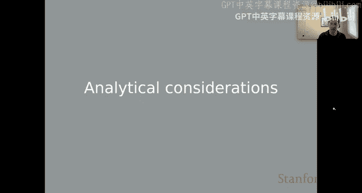
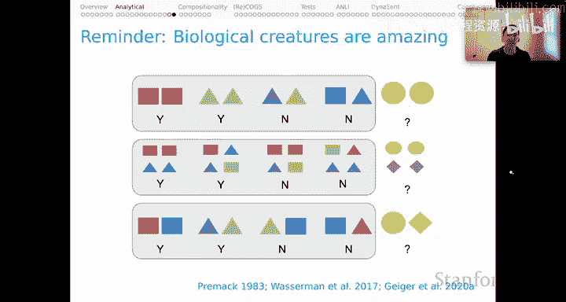
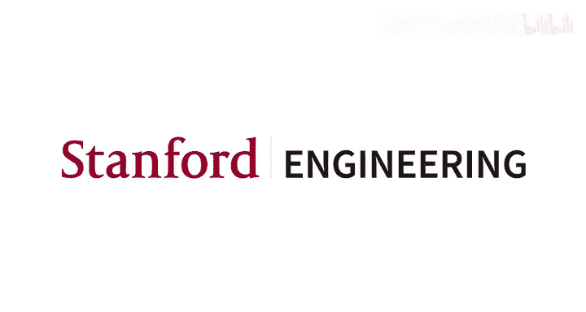

# 斯坦福大学《自然语言理解｜Stanford XCS224U Natural Language Understanding I Sp 2023》中英字幕（豆包翻译 - P26：-26-Stanford XCS224U I Behavioral Eval of NLU Models, Pt 2： Analytical Considera - GPT中英字幕课程资源 - BV1sx4y1s7oW

Welcome back， everyone。 This is part 2 in our series on Adv behavioral methods for NLU。

 We're going to talk about some analytic considerations that surround this kind of assessment and analysis。

 The key questions for us are what can behavioral testing tell us and just as crucially。

 what can't it tell us about the nature of our systems。

I said this in the first part of these screencasts。 It bears repeating。

 We talk about adversarial testing as a kind of shorthand。

 but there is no intrinsic need to be adversarial in all cases。

 We could just be trying to explore what our systems are capable of。

 So here are some example questions that you might be thinking of in this mode。

 They start off purely exploratory and they end up being quite adversarial。 For example。

 has my system learned anything about numerical terms。

 You could ask this in an openend way and construct a test data set that would help you address this question。

 Does my system understand how negation works， Same thing。

 Maybe you did an audit of the training data， and you found that negation was sparsely represented and you want to ask。

 given what it did see， Was it able to induce a reasonable theory of how negation works。

 Beal testing could help you address that question。Does my system work with a new style or genre？

That's an important kind of subtle domain shift， maybe it was trained on text from newspapers and you would just want to find out whether its behavior is accurate on Twitter data。

This system is supposed to know about numerical terms。

 but here are some test cases that are outside of its training experiences for such terms。

 What will happen？ We are now moving into a mode of being more thoroughly adversarial。

 and we might have discovered about the system that it's not good at numerical terms。

 And now we're trying to expose that gap in its abilities。

When applied to invented genres that is very unfamiliar kinds of inputs。

 does the system produce socially problematic， say stereotyped outputs。 At this point。

 youre actively trying to construct examples that， you know will be outside of standard experiences for the model in an effort to discover what its behaviors are like in those unusual tail situations。

 That is probably more thoroughly adversarial。And maybe the most adversarial of all would be kind of exploring random inputs that lead the system to produce problematic outputs。

 This is the mode where you take normal examples and append a certain sequence of Uniicode characters on the end and see something very surprising happen as a result as a way of kind of auditing the system。

4 gaps in its security in some general sense， All these things are on the table for us。

 These are all interesting behavioral tests to run。But behavioral testing has its limits。

 I think we all know this in our hearts， but it's worth dwelling on it。

 No amount of behavioral testing can truly offer you a guarantee about what our systems will be like。

You are at the mercy of the set of examples that you decided to construct。

 I think this is pretty clear。 This often goes under the heading of the limits of scientific induction。

 But let's linger over an example to see just how this can become pressing for an illustration。

 I've got an even odd model in the middle here。 And I've drawn it as a big opaque rectangle。

 We don't know how this model works。But the promise of this model is that it takes in strings like 4 and predicts whether those strings refer to even or odd numbers。

 So here，4 has come in， and it has predicted even so far so good，21 comes in， and it predicted odd。

 also good。32 prediction of even。36， prediction of even 63 prediction of odd。

This behavioral testing is going great and suggests that we have a very solid model of even odd detection。

But suppose I now expose for you how this model works。 I show you the insides。

 And what that reveals for you is that this model is just a simple look up。

 And we got lucky on those five inputs because those are exactly the five inputs that the model is prepared for。

 It has this else clause that says odd。 And now now you know exactly how to expose a weakness of the system。

 When you input 22， that is not in the list and it defaults to its elsewhere case and says odd and that is an incorrect prediction。

Notice that it was not the behavioral test that gave us this insight。

 but rather being able to peek under the hood。Now we move to even odd Model 2。 It gets 22 right。

 It says even。 And let's assume it gets all those green cases correct， as well。5 comes in。

 and it says odd 89 comes in， and it says odd 56 comes in， and it says even。

 And you think now we really have an excellent model of even odd detection。 But once again， Now。

 I let you look inside。 And what's revealed when you look inside is that this is a more sophisticated version of the same kind of look up。

 Now， what this model does is look at the final token by splitting on white space and use that as the basis for classification decisions。

 And if that final word is not in its look up table， it defaults to predicting odd。Having seen that。

 we can now be adversarial。 We feed in 16。 It predicts odd by following that elsewhere case。

 and we have shown that the model has a flaw。But again， we saw the flaw not from our behavioral test。

 but rather from looking inside the model。 Now， we move to Model 3， it gets 16 right。

 Is this the one true model of even odd， Well， we can keep our behavioral testing up。

 but we will always have doubts in the back of our minds that we have missed some important cases in our test that are hiding significant problems for the system。

That is a simple illustration of the actual situation that you are in。

 If you deploy a model out into the world， you have done limited testing。

 and now you have to see what happens for the unfamiliar cases。

Another more incidental limitation to keep in mind of behavioral testing。

 as we're going to discuss it， is that by and large， we set aside the question of metrics。

 When you look through the literature on challenge and adversarial tests。

 you find that mostly people are adopting the metrics that are familiar from the underlying tasks and simply probing the models within those guardrails。

 I think that's fine， but in the fullness of adversarial testing。

 we should feel free to break out of the cones of these tasks and assess models in new ways to expose new limitations and so forth。

 So I'm going to play by the rules by and large in this lecture。

 but have in mind that one way to be adversarial， would be to put models in entirely unfamiliar situations and ask new things of them。

Here's another really crucial analytical point that we need to think about when we do behavioral testing when we see a failure。

Is this a failure of the model or is it a failure of the underlying data set。

A lovely paper that provides a framework for thinking about this is Liu etal 2019。

 which has the heading inoculation by fine tuning。 We're going to talk about that idea in a second。

 But kind of the guiding idea behind the paper is embodied in this quote。

 What should we conclude when a system fails on a challenge dataset set。😊，In some cases。

 a challenge might exploit blind spots in the design of the original data set。

 Call that a data set weakness。 In others， the challenge might expose an inherent inability of a particular model family to handle certain kinds of natural language phenomena。

 That's the model weakness。 And these are， of course， not mutually exclusive。

 So data set weakness and model weakness。 And the thing to watch out for is that people want to claim they have found model weaknesses。

 That's where the action is， if you can show that the transformer architecture is fundamentally incapable of capturing some phenomena。

Then you have a real headline result that is important。

 it might mean that the transformer is a non starter when it comes to modeling language。But frankly。

 it's more likely that you have found a data set weakness。

 There is something about the available training data that means the model has not hit your learning targets。

 That is a much less interesting result because it often means that we just need to supplement with more data。

 We need to be careful about this because we don't want to mistake data set weaknesses for model weaknesses。

We made a similar point in a paper that we did about posing fair but challenging evaluation tasks。

We write， however， for any evaluation method， we should ask whether it is fair。

And fair in the following sense， has the model been shown data sufficient to support the kind of generalization we are asking of it？

Unless we can say yes， with complete certainty， we can't be sure whether a failed evaluation traces to a model limitation or a data limitation that no model could overcome。

This is an important point。When we say fair to our models。

 we don't mean that we're particularly worried about them that they might be mistreated or something。

 Rather， we are worried about an analytic mistake where we blame a model for a failing when， in fact。

 the failing is on us because something about the specification that we gave didn't fully disambiguate the learning targets that we had in mind。

 This can easily happen。 and it can lead to misdiagnosis of problems。

 Here's an example that's just at a very human level that can show that any agent could feel stumped by a misspecified problems。

 Suppose I begin the numerical sequence 3，5，7。 And I ask you to guess what the next number is。 well。

Even within kind of human expectations here， it seems reasonable to assume that I was listing out odd numbers in which case you should say 9 or prime numbers。

 in which case you should say 11。 And it is absolutely unfair if I was imagining the prime case for me to scold you for saying 9 in this context。

 But that is exactly the kind of mistake that we are at risk of making when we pose challenged problems to our systems。

Here's another case in which this could happen that's kind of more oriented toward natural language understanding。

 Suppose I want a probe systems to see whether they can learn basic aspects of kind of boolean logic。

 And so what I do is show the system cases of combinations of P and Q where they're both true and where P is false and Q is true。

And now I ask the system whether it can generalize by filling out this entire truth table。Well。

 even within the bounds of the hypothesis space for normal boolean logic。

 there are two reasonable hypotheses here。 I might have in mind the conditional。

 the material conditional symbol symbolized by the arrow here or disjunction， inclusive conjunction。

 as symbolized by this V symbol down here。My training data。

 as depicted on the left ear simply did not disambiguate what my learning target was， and so again。

 it is no fair to scold systems if they arrive at the conclusion that I meant the conditional when secretly I meant this junction。

The paper that I mentioned before， Liuit Al 2019 is a lovely framework for thinking about how to get over this analytic hurdle and distinguish between data set weaknesses and model weaknesses。

 This is the framework that they call inoculation by fine tuning。

 And this is a diagram from their paper。 Let's walk through it。

 Suppose we train our system on our original data。 And then we test it on the original test set and some challenge set that we're interested in。

😊，And we observe that the system does well on that original test and very poorly on the challenge dataset set。

And the question is， why is that happening， and I've already presented to you the major choice point here。

 is this a data set weakness or a model weakness that we are seeing？

So the proposed method for resolving that question works as follows。

 we're going to fine tune on a few challenge examples。

 so we're going to update the model and then retest on both the original and the challenge data sets。

We have three possible general outcomes here。 The data set weakness case is the case where now。

 having done this fine tuning， we see good performance on both the original and our challenge dataset set。

 In particular， the challenge performance has gone way up。

 That is an indication to us that there were simply some gaps in the available training experiences of our model that were quickly overcome by our fine tuning。

 So that's a data weakness。Conversely， a model weakness would be a situation where even after doing this fine tuning。

 we still see poor performance on our challenge data set。

 even though we have maintained performance on the original。

 that might mean that there is something about our new examples from our challenge set that are fundamentally difficult for this model。

 Call that a model weakness。And then the third outcome， also important， annotation artifacts。

 This is where having done this fine tuning， we have now hurt the model in the sense that performance on the original test set has plummeted。

And that's a case where we might discover that our challenge data set is doing something unusual and problematic to the model。

 and that might cause us to reflect again on the nature of the challenge we've posed。

Here's a diagram from the paper using an adversarial test that they study in detail。

 and that was released in relation to NI models。 and they're kind of organized by the three outcomes that they see。

 outcome1 is the data set weakness case。 And this is the characteristic process for this。

 Let's focus on these green lines here。 the dots here indicate performance on the original set and the crosses here。

 our performance on the new challenge set。 This is a data set weakness。

 in that you see that as we fine tune across this X axis on more and more challenge examples。

 we see performance on that challenge set go up。 And we maintain performance throughout that fine tuning process on the original data set。

 So that as a characteristic picture of something we could call data weakness。

The model weakness case is also pretty clear to see here again we have the original data set with these dots。

 we maintain performance on that across all of the different levels of fine tuning。

But well below that is the corresponding line for the challenge dataset set， also pretty flat。

 no matter how many examples we find tuneon， we never really budge on performance on those examples。

 suggesting that there's a real problem with the underlying model。

And then outcome 3 is the dataset set artifacts。 And this is the case where our fine tuning actually introduces something kind of chaotic into the mix by disturbing the model。

 And the net effect there is that for the original data set pick this one here。

 we see variable performance。 We see some gains on the challenge dataset set。

 but really at a cost to the overall performance of the system。

 And that would suggest to us that the data in the challenge set are somehow problematic。

Those are kind of general lessons here， I have one more story that I thought I would tell you that comes from work that we did in my group。

 and this relates to having negation as a learning target and again this is in the spirit of helping you avoid what could be a serious analytic mistake for behavioral testing。

We have this intuitive learning target related to negation。 If A entails B， then not B entails not A。

 That is the classic entailment reversing property of negation。

 It applies at all levels in language and is responsible for why， for example。

 where we have pizza entails food， then not food entails not pizza。

Simple intuitive learning target with lots of consequences for language。

 and then we have this observation through many papers in the literature。

That our top performing natural language inference models fail to hit that learning target。And。

 of course， the tempting conclusion there is that our top performing models are incapable of learning negation。

 We want to make that conclusion because it's a headline result that will mean we have a really fundamental limitation that we have discovered。

But we have to pair that with the observation that negation is severely underrepresented。

In the NLI benchmarks that are driving these models。

And so that should introduce doubt in our minds that we've really found a model weakness we might be confronting a data set weakness instead。

To address that question， we kind of followed the inoculation by fine tuning template and constructed a slightly synthetic data set that we call Mo N LI from monotononicity N I。

 It has two parts in positive Mo N L I。 There are about 1500 examples。

 We took actual hypotheses from the S N LI benchmark。Like food was served。

 And we used a word net to find a special case of food like pizza， an entailment case。

 And then we created a new example， pizza was served。 And having constructed that new example。

 we now have two new positive mo and ali cases。 A is neutral with respect to B， and B entails A。😊。

We also have negative Moenli， which has a similar number of examples and follows the same protocol。

 except now we begin from negated examples like the children are not holding plants。 Again。

 use word net for a look up。 We have flowers entails plants。 And that creates a new example。

 the children are not holding flowers。 And because of the entailment reversing property of negation。

 We get our two examples again。 But now the labels are reversed。

 A entails B and B is neutral with respect to A。 The converse of the pattern we saw up here。

We did our level best to pose this as a very hard generalization task in the sense that we held out entire words for testing。

 to be sure that we were getting a look at whether or not systems had truly acquired a theory of lexical relations in addition to acquiring a theory of negation。

 So we're making this as hard as we can， but we're also trying to be sure that we have good coverage over the relevant phenomena for negation。

So one thing we did with this data set is use Mo andLI as a challenge data set。

And the initial results are quite worrisome。 Let's look at the Bt row of this table here。

 It was trained on SnLI。 It does great on SnLli， and it does extremely well on the positive part of the Moenli split。

 but it has essentially zero accuracy on the negative part of Moenli。😊。

The strategy seems clear here the model is simply nigo ignoring negations and therefore getting every single one of these examples wrong because they look like positive cases to the model。

And you might think， aha， we have found a fundamental limitation of Bert。

 but I think that's incorrect。 If we do a little bit of inoculation by fine tuning on negative Mo andli cases。

 performance on that split immediately goes up。 Now， we have maintained performance on S N L I。

 and we have excellent performance on the negative split for Mo and Lli。

 And this strongly suggests that we had found not a model weakness， but rather a data set weakness。😊。

Final thing I want to say here by way of wrapping up is that I have emphasized fairness for our systems。

And I think that is important to have in mind so that we don't confuse ourselves。

 But I couldn't resist pointing out that biological creatures are amazing。

 And we now know that they often solve tasks that are unfair In the sense that I just described it。

 Here is a classic case。 This is this is called relational match to sample。

 And this is the observation that even very， very young humans， and some animals。

 including crows and nonpriate humans， are able to solve tasks like this。 I show you two red squares。

 And then ask you to pick from these two options here。 and people go for the two same ones。

 kind of matching with the original prompt。 You don't need training instances for this。

 People naturally gravitate to it。😊，Whereas if I show you two different shapes and ask you to make a similar choice。

 now， what people do is go for the two different ones。

 This is same different reasoning that we do consistently with essentially no training data。

 As posed here， I maintain that these tasks are unfair。 And yet， none the less。

 humans and many biological entities are able to systematically solve these tasks。

 That is a puzzle about human and other biological creature cognition。

And it's something that we should keep in mind。 People solve unfair tasks。 And the question is。

 how would we get our machine learning models to solve such tasks， if indeed。

 that's what we want them to do， And these are just the simpler cases， for example。

 we can do kind of hierarchical versions of equality。 And here with some training。

 even crows can do problems like this one。 And people solve them out of the box。 So to speak。

 with essentially， no training instances or not enough training instances to fully disambiguate the task。

 Again， pointing out that biological creatures are amazing。 so。😊。

We should pose fair tasks to our systems while keeping in mind that there are scenarios in which we might have an expectation for a solution that is not supported by the data。

 but nonetheless the less， the one that all of us arrive at was seemingly no effort。

