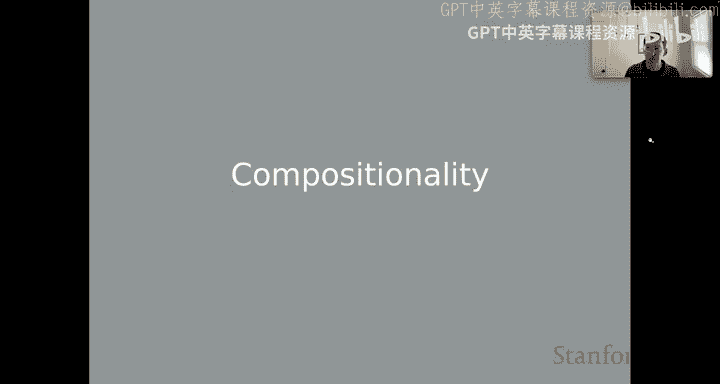
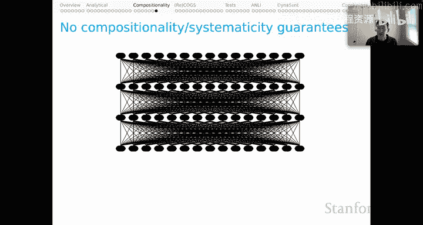
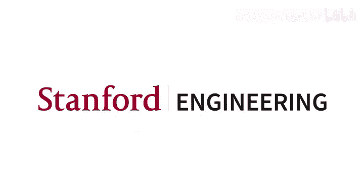

# 斯坦福大学《自然语言理解｜Stanford XCS224U Natural Language Understanding I Sp 2023》中英字幕（豆包翻译 - P27：-27-Behavioral Evaluation of NLU Models, Part 3： Compositionality .zh_en - GPT中英字幕课程资源 - BV1sx4y1s7oW

Welcome back everyone， this is part three in our series on Advance behavioral Test for NLU。

 our focus is the principle of compositionality， this is a principle that is important to me as a linguistic semanticist and it's also arguably a prerequisite for understanding the goals of cogs and recogs which are compositional generalization benchmarks。

Let's start with an informal statement of the compositionality principle。

 it says the meaning of a phrase is a function of the meanings of its immediate syntactic constituents and the way they are combined。

That's the principle， let's unpack it by way of an example， I have a simple syntactic structure here。

 a full sentence， every student admired the idea。And the compositionality principle says that the meaning of this S node for sentence here is fully determined by the meaning of its two constituent parts。

 NP and VP。And you can see that this implies a recursive process。

 so what is the meaning for the NP while that is fully determined by the meanings of this debt for determine node and this for noun node。

And the meanings of those are easy to see， those are fully determined by their parts。

 which there's just one part for each， and those are lexical items and that's where this recursive process grounds out the intuition is。

That you just have to learn all the lexical items of the languages that you speak。

 Having done that and having figured out how they combine with each other。

 you have a recursive process that allows you to combine things in new ways and understand novel combinations of these elements。

 A compositionality is saying that you have guaranteed there。

 because the meaning of the whole will be a function of the meaning of the parts and how they are combined。

We could also think about this in a kind of bottom up fashion。 We start with those lexical items。

 their meanings are stipulated or learned and memorized。

 and then those meanings in turn determine the meanings of these parent nodes here。Which in turn。

 determine the meanings of the complex nodes above them and so forth until we have derived bottom up a meaning for the entire sentence。

Why do linguists tend to adhere to the compositionality principle， Well。

 this can be a little bit hard to reconstruct， But I would say that the usual motivations are as follows。

 First， we might just hope that as semanticists trying to study language。

 we would model all the meaningful units of the language。

 and that would imply that we have gone all the way down to even the most incidental looking lexical items and given them meanings in isolation。

 like good lexicographers might feel they should do。In practice。

 I should point out that that means there's a lot of abstraction around linguistic semantics。

 because it is just hard， perhaps impossible to give a meaning for a word like every in isolation from the things that it combines with。

 And so what happens in practice actually is that the meanings assigned are functions。

 So what we're saying here is that every is a functional meaning that when combined with the meaning for student delivers another function。

 that when combined with the meaning of this verb phrase。

 finally gives us a meaning for this S note up here。

 And it's something like universal quantification where in this case， if something is a student。

 then it has the property of admiring the idea that would be the fundamental claim of the sentence。

 And you can see there that that claim was kind of driven by every down there in this determiner position inside the subject。

So a great deal of abstraction， but that is a technique for giving meanings to all the meaningful units。

 which would be a consequence of adhering to compositionality。

You often hear linguists talk about the supposed infinite capacity that humans have for dealing with language。

 I grant that there is some sense in which this is true。

 because there seems to be no principle bound on the complexity or length of the sentences that we can understand in a kind of abstract way。

But this needs to be heavily qualified。 I am sad to report that we are all finite beings。

 and therefore， there is only a finite capacity in all of us to make and understand language。

 And so this is a little bit overblown。 But I see what this is getting。

 And I think the fundamental intuition to something more like creativity。

 We have an impressive ability to be creative with language By and large。

 the sentences that you produce to day and the sentences that you interpreted today day had never been encountered before in all of human history。

 Most sentences are like that。 And yet， none the less。

 we are able to instantly and effortlessly produce these sentences and understand what they mean。

 And that does imply that there is some kind of capacity in us for making use of a finite resource。

 say the lexical items combining them in new ways in order to be creative with language。

 and compositionality could be seen as an explanation for that。😔。

There's also a related idea from cognitive science called systematicity。

 which I think is a slightly more general notion than compositionality and may be a more correct characterization。

 let's dive into that a little bit under the heading of compositionality or systematicity。

The systematicatistity idea traces as far as I know to photor and pillin， they say。

 what we mean when we say that linguistic capacities are systematic is that the ability to produce or understand some sentences is intrinsically connected to the ability to produce or understand certain other ones。

So the idea is that if you understand the sentence， Sandy loves the puppy。

Then just by that very fact， you also understand the puppy loves Sandy。

And if you recognize that there is a certain distributional affinity between the turtle and the puppy。

 you can also instantly and effortlessly understand the turtle loves the puppy。

 The puppy loves the turtle。 The turtle of Sandy and so forth and so on。

 you get this instant explosion in the number of things that you know。

 in some sense as a consequence of your own understanding of language being so systematic。

 And I do think that compositionality could be a particular way of explaining what we observe about the systematicity of the human capacity for language But I think systematicity is arguably more general。

 You can see that it's given a kind of distributional characterization here。

 that might allow for things that are not strictly compositional， but nonetheless the less。

 importantly systematic。Systematicity is a powerful idea for thinking about the intuition behind many of the behavioral tests that we run。

 especially the hypothesis driven challenge tests that we run。

 because very often when we express concerns about systems。

 they are concerns that are grounded and a certain lack of systemity。

 And here's a brief example to illustrate this。 This is from a real sentiment classification model that I developed that I thought was pretty good。

 And I started posing little challenge problems to it。

 And I was initially very encouraged by these examples。

The bakery sells a mean apple pie is generally a positive claim about this bakery's pies。

 and it involves this very unusual sense of mean， which essentially means good。

 a meanapp pie is typically a good one。And I was encouraged that the gold label and the predicted label aligned here。

Similarly， for they sell a meanapp pie， I was happy to see this alignment。

 and I started to think that my model truly understand this very specialized sense of the adjective mean。

😊，But that kind of fell apart with the next two examples， she sells a mean apple pie。

 he sells a mean apple pie， both of those were predicted negative。

 whereas the gold label is of course still positive。The errors are worrisome。

 but the deeper thing that I was worried about is the lack of systematicity， because as a human。

 I have no expectation that changing the subject from a plural pronoun to a singular one or using a pronoun as opposed to a full noun phrase like the bakery would have any effect on the interpretation of the adjective mean in these cases。

 And yet， none the less， the model's predictions changed and that manifest for me as a lack of systematicity。

And that's a kind of guiding intuition behind many of the adversarial or challenged dataset sets that people have posed。

 They have a hypothesis grounded in the systematicity of language。

 and they observe departures from that in their models。 and they begin to worry about those models。

It's interesting to reflect on the compositionality principle in the context of the history of AI models。

In the earliest eras of AI， like the Shidlo system or the Cha 80 system that we saw on the first day。

 we got kind of compositionality by design because those were implemented grammars。

 symbolic grammars that themselves adhered to the compositionality principles。

 So we didn't wonder about whether these N LU models were compositional because we kind of presuppupposed that they would be。

And parts of that actually did carry forward into the more modern machine learning era。 For example。

 many semantic parsing systems， like this one depicted from Percy Leong's work。

 were also compositional in the sense that underlyingly there was a compositional grammar。

 and the task was to learn weights on the rules of that grammar。

 And so arguably the resulting artifacts were compositional with some stochasticity associated with them being probabilistic models。

And even in the more modern， deep learning era， we again saw systems that were arguably compositional。

 This is from the paper that launched the Stanford Seniment T Bank。

 It's a recursive tree structured neural network。And it abides by the compositionality principle in the sense that all the nodes depicted in these structures denote vectors。

 And there was a complicated， deep learning function that combined those vectors to derive the meaning for their parent nodes。

 And it did that recursively until we got a meaning for the entire sentence。

So it's not symbolic in the way of these older systems and in the way of much work in linguistic semantics。

 but it is arguably a compositional system， an intriguing property of those deep learning artifacts。

 in fact。But we have。 It seems kind of moved away from that perspective。 Now。

 we're confronted all the time with these huge， typically transformer based models where everything is connected to everything else。

 And it is certainly clear that we have no guarantees of compositionality or systematicity built into these networks。

 And， in fact， in the earliest days， people often worried that even though they were performing well。

 they were learning nonsstematic solutions and that motivated a lot of challenge testing for them。

The question now is， can we pose behavioral tests that will truly assess whether models like this。

 which are hard to understand analytically have found systematic solutions to the language problems that we pose。

 If the answer is no， we should worry。 And if the answer is yes。

 it's an amazing discovery about why these models perform so well。

 and also often an amazing discovery about the power of data driven learning alone。

 to deliver systematic solutions to language problems。 So it's kind of an open question。

 but a tremendously exciting set of questions to be exploring now as our models are getting so good。

 even at the hard behavioral tasks that we pose for them。😊。

