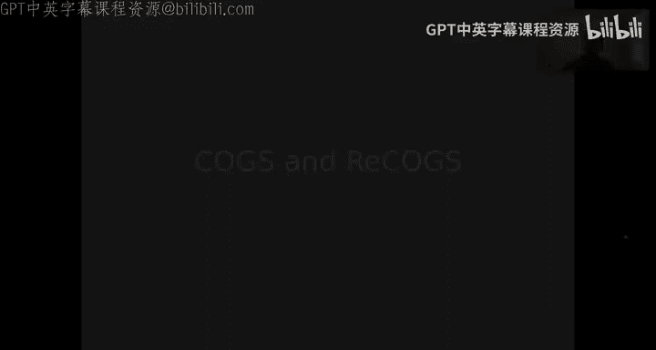
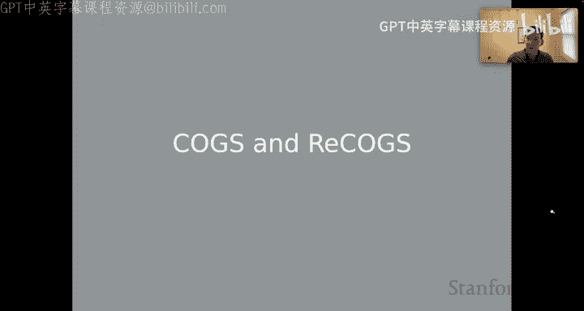
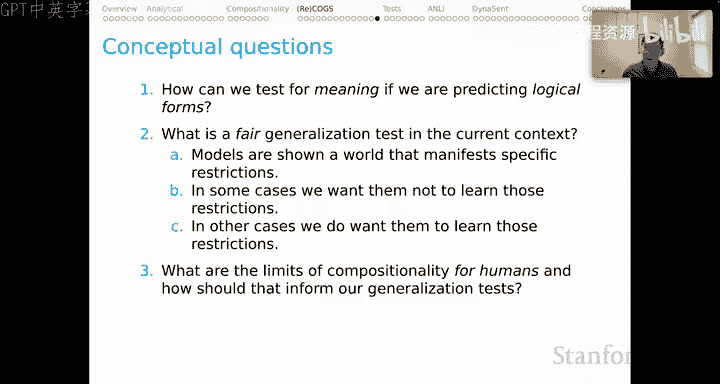

# 斯坦福大学《自然语言理解｜Stanford XCS224U Natural Language Understanding I Sp 2023》中英字幕（豆包翻译 - P28：-28-Behavioral Evaluation of NLU Models, Part 4： COGS and ReCOGS .zh_en - GPT中英字幕课程资源 - BV1sx4y1s7oW

Welcome back， everyone。 This is Sccast 4 in our series on Adv behavioral testing for NLU。

 In the previous screencast， we talked about the principle of compositionality。

 We come now to our point of intersection with the homework and the associated Baoff。

 We're going to talk about the benchmarks cogs and recogs。

 which are both designed to test compositional generalization for our models。

Cogs set the agenda here， and then recogs is our extension of it。

 What we were trying to do with recogs is first understand why some of the generalization splits in cogs have proved so challenging for present day models。

 And in addition， reformulate cogs somewhat so that it comes closer to testing purely semantic phenomena and kind of abstracting away from incidental features of some of the logical forms that are in cogs。

Let's start with a task description。 We'll look at cogs First。

 The inputs are simple English sentences like a rose was helped by a dog。

 and the outputs are logical forms。 That is descriptions of the meanings of the sentences。

 And for cogs and recogs， these are a kind of event semantic style descriptions Here。

 we've got rows and indefinite corresponding to the grammatical subject here with variable one。

The next conjunct is help theme， so this is describing the theme argument of the helping event and X3 is the event variable for this helping event and x1 links back to rows identifying this rows as the theme。

The event description also has an agent that is identified by variable x6 and again binds into that helping event description x3。

 and x6 is identified as being a dog。Here's a similar example。

 This one involves the definite description， The sailor that corresponds to this star operator in the logical form。

 and otherwise， the semantics is very similar。Recogs is very similar in many respects here。

 I've got that same first example。 a rose was helped by a dog。

 You can see that Recog's logical forms tend to be shorter。

 We've removed a lot of the symbols that are associated with variables。

 We've reorganized the conjunc somewhat， and the event descriptions are somewhat more transparent。

 For example， we have a separate predication identifying the help event and binding it to variable X 7。

 which is then used to identify both the theme and the agent。Here's that second example。

 The sailor dusted a boy。 We have the star operator for definite descriptions as well。

 and the other simplifications are， as in the first example。

What are the motivations for both cogs and recogs while they really tie into the compositionality principle。

 we have an observation that humans easily interpret novel combinations of familiar elements in ways that are systematic。

This is so effortless， in fact， that the Cog's generalization splits are even sometimes hard to appreciate as compositional generalization tasks。

 because the relevant leaps that we need to make seem very small indeed。

 to us as speakers of a language like English。The explanation for why this is so easy and effortless for us is compositionality。

 That is one way of explaining why we're able to make so much use of novel combinations of familiar elements。

 Compositionality tells us that in some sense， the meanings of those novel combinations were fully determined by the meanings of their parts。

The core question we're trying to address is， can our best models do compositional generalization。

 and relatedly， have they， too found compositional solutions。

 That would be a more internal question about their underlying causal mechanisms。

 I think the vision of cogs and recogs is that we have behavioral tasks that can help us resolve question 3 about generalization。

 And the hope is that if they succeed at question 3 will have an informed answer to the deeper question posed in about the nature of their solutions。

 One way to think about this is that if a model manages to succeed at a task like cogs or recogs that can only be that is the best explanation for that is that they have found a compositional solution。

We should pause to more deeply understand the Cog's logical forms。

 because they have some interesting features about them that actually help explain the pattern of results that we see in the literature。

To start， I kind of alluded to this before， verbs specify primitive events that have their own core conceptual structure and can involve one or more obligatory or optional roles。

 Here's a quick example。 Our sentence is Emma broke a vase。This is at its heart a breaking event。

 and the logical form here is saying that it has two participants， the agent， Emma。And the theme。

 which is the vase， which is an indefinite identified by this predication up here。

Here's a related English sentence。 The vase broke。 This one is lacking its agent argument。

 and the theme argument has been promoted to grammatical subject position in the English sentence。

 But otherwise， this is very similar。In cogs， variable numbering is determined by linear position in the input sentence。

 That is， for example， the reason that we're using the variable X2 here for the event description。

 is because the verb break， which anchors that event is in position2 in the input sentence。

That turns out， actually， to be a really important feature of these logical forms that seriously impacts the performance of modern models。

 especially ones with positional encoding。All the variables in cogs and Ricog's logical forms are bound。

Right because it looks like we have free variables。

 but they're all existentially bound with widest scope， so for example。

 whereas you have a logical form like this where it looks like variables one and  two are free variables。

 in fact， were meant to interpret this as though there were a prefix of existentially quantified variables at the start of the logical form。

Definite descriptions are also bound。 They're bound more locally by that star operator。 For example。

 the sailor ran translates as star sailor X1， because sailor is in the first position。

 and that's a complete definite description。 And then that continues the the sailor being the agent of the running event bound to variable 2 in second position there。

The cog splits have the following structure。 We have a pretty large train set。

 We also have a dev set and a test set， And both of those are I I D。

 That is their standard evaluations in the terms that we're using in this unit。

 The interesting part is this group of 21000。Generalization examples corresponding to 21 different splits。

 each one trying to probe models for different sort of compositional generalization phenomena。

This is a table from the paper that enumerates all of the generalization splits。

 at least in some fashion。 They're broken up into different categories。

 We've talked a bit about these before。 But let me just highlight a few for this first block here。

 we're talking about putting familiar phrases into new positions。 For example。

 subject to object for common noun means that in training。

 we see examples like hedgehog ate the cake where hedgehog is a grammatical subject。

 And in the generalization split in this category， we first encounter hedgehog in a position that is not the subject。

 and the others are similar。 for the primitive grammatical roll splits。

 we see these primitives like shark and Paulula as isolated elements in training。

 and then in generalization， we encounter them in full sential context。

 And we have to figure out what to do with them。There are also novel combinations of modified phrases。

 for example， object modification to subject modification means that modifiers like on the plate occur in object position during the train examples。

 and then in subject position in the generalization split。

 that turns out to be very difficult indeed。For deeper recursion for both sential complements and PP complements。

 we see some number of recursive depth at training。

 and then in generalization we see even more depth for those kinds of recursion。

Then there are some other things that involve alternation of syntactic role like active to passive and passive to active。

Some cases like Emily baked and the giraffe baked a cake。

 or we have shifting of the argument structures and so forth。 And then at the bottom。

 we have some splits that involve verb classes。That's a high level overview of the splits。

 What we did for the Recogs paper is assemble what I've here called a synthetic leader board。

 This is just us pulling together results from a bunch of prominent papers in the literature that tackled the cogs problem。

Let's first look all the way to the right here at the overall column。If you look there。

 which is a standard move for N L peerers to make， just look at overall。

 you see what looks like a pretty rosy picture。 Four cogs models are getting up into the 80s on these generalization splits。

 And that looks like they've really gotten traction。

And then if you look just to the left of that at that lex column。

 that's grouping together the generalization splits that involve lexical generalization。

 you find some impressively high numbers indeed。 So it looks like models are really good at those lexical tasks。

But then travel with me further to the left from there to the three columns that we've called structural generalization tasks。

 Ob P P to subject P P column of all zeroes。C， P recursion， pretty much all zeros。 P P recursion。

 a similarly dismal story。This looks to me， like models are simply failing to get any traction at all。

 Something is systematically wrong。 These are not just low numbers。

 This is an indication of something fundamentally being amiss about how these models are grappling with these cog splits。

And this was really the puzzle that we posed when we started thinking about the reCOs work。

 what is behind these columns of zero or near zero numbers。

 it's a very worrisome situation we want to get to the bottom of it。

The first thing we did is just observe that there are a lot of redundant tokens in the cogs logical forms。

 For example， every single variable begins with X， space， underscore space， and then the numeral。

 The numeral is the only distinguishing feature of that variable。

 And so what we decided to do is simply remove it and replace it with just a one there。

This has a profound effect on the performance of models。

 even though it's an obviously semantics preserving change to the logical forms。

 And I think we can think in terms of basic conditional probabilities to come to an understanding of why this matters so much。

 Think just at the level of bygram frequency for cogs overwhelmingly。

 the commonest bigram in the data set is comma X。 And that's because so many of these expressions involve variables inside those parenthetical expressions with commas。

 And then way down with much smaller frequency are commas with names next to them。😊。

When we make these adjustments to the logical forms， everything evens out much more。

 Those variables are still prominent 1，4，6， and 3， but notice that a proper name Emma。

 the most frequent proper name in the Cogs dataset set， is now on par with those variables。

 And overall， we're seeing a much evener picture， which is a much happier state for language models to be in。

 because they are so dependent on these kind of local conditional probabilities。😊。

And since this makes for a happier data set and is obviously semantics preserving。

 we decided to go ahead and remove those tokens。 That's a simple one。

 That helps mainly with lexical generalization splits。

 but it is not especially impactful for those really persistently hard， structural splits。😊。

Let's turn to them now， first question， what is behind the zeros for CP and PP recursion that was one of the hardest structural generalization splits？

Here， we should think first about length。The fundamental observation here is that models are exposed to one kind of example length during training and a very different distribution of lengths during the generalization splits。

 In particular， the longest examples occur in the generalization splits。 Here。

 we're showing the distribution for input sentences。 The generalization split lengths are in green。

 and they have this very long tail out to very long examples。 Here are the output L F's。 same thing。

 Look at the green examples。 You can see that the generalization ones are much， much longer。 We have。

 again， this very long tail of very long examples。Now， I should be clear。

 I think it's perfectly reasonable to be pushing models to generalize to ever greater lengths at test time。

 This is persistently hard for many models， and we should compel the field to find ways to address that limitation。

But remember， our goal was to test for C P and P P recursion。

 and we can now see that that recursion question has been totally entwined with this question about length generalization。

And we wanted to separate them apart。 So to decouple length from depth。

 we concatenate existing examples and reinex the variable names using the cogs protocol to cover all of the variable names that we end up seeing at test time。

 because remember， one feature of this length issue is that not only positions that we remain untrained during training and then end up appearing relevant during testing。

 but also the names of the variables， right， If the longest sequence you had in Cogs training LED you to have variable name 45。

 and you encounter 46 at test time that not only are the associated positions corresponding to random embeddings。

 but also that token itself has a random vector associated with it in virtue of the fact that it never appeared during training。

 Again， it's fine to push models to overcome that problem， but here you can see its couple。

Together with this recursion question， and we decoupled them by simply augmenting examples by concatenating them together and adjusting the variable names accordingly。

And what we find is that that essentially completely overcomes the problem for both LSTms and for transformers。

 The performance that we reach is well above the previous state of the art on this recursion problem。

 What this suggests to us is that the hard aspect of this split is not recursion。

 which we are trying to test for， but rather this persistent issue about length generalization。

 An important lesson about that column of zeroes there。Second hard question。

 what is behind the zeros for P P modifiers。 Remember that was literally a column of zeros in our synthetic leader board。

 Here's our hypothesis about what's happening For cogs。

 The trained data actually teach the model that P Ps occur only with a specific set of variables and positions。

When models learn this lesson， they then struggle with examples that contradict it。

Every experience that these models have with these P P modifiers suggests that they have a very limited distribution。

 And then at generalization time， we confront them with the fact that that distribution was misleading。

 I think that poses some pretty deep questions about what's fair in terms of posing a compositional generalization task。

 But at the same time， we have diagnosed， I think， why we have all those zeroes。

To further that argument， what we did is take original cog sentences and manipulate them in various ways so that P Ps would associate with a wider range of linear positions and correspondingly a wider range of variable names。

 We have various tricks for doing that。 For example。

 We can prepo object noun phrases to get sentences like the box in the tent。 Emma was lent。

Topalization is a pretty routine operation on English objects。

 And here we have simply implemented that。 It has no effect on the underlying semantic representation。

 but for cogs， it has the effect of shifting around the variable names。

 In addition to get a fuller coverage of variable names and positions and so forth。

 we also have interjections。 So we simply stick inums in various random points in the input sentences。

 It's a meaning preserving operation。 It's just a filled pause， but again。

 it has the effect of shifting around the variable names and associated positions。

 And to further cover the space， we also do this thing with participles。

 So instead of having just standard prepositional modifiers。

 we also do things like a leaf painting the spaceship。 again。

 to fill in the gaps in these variable names and positions。

The result is a very large performance increase for both LSTms and transformers on these splits。

 again， suggesting that our hypothesis was on the right track and kind of functionally the blocker here was that models had been taught that P Ps associate with certain variable names and certain positions。

 which is not precisely what we were hoping to test for。On the basis of these insights。

 we perform some modifications to cogs to get recogs。

 This is a kind of high level summary of what we did。 Imagine an input sentence， Mia a a cake。

 The cogs L F looks like this。 we did that redundant token removal that I described before。

 mostly focused on the variable names。 We did some meaning preserving data augmentation of the sort I described for the C P and P P recursion cases。

 And then we introduce this notion of arbitrary variable naming。

 So recogs examples do not have variable names that are tied to the position in the input string。

 Rather， they're kind of randomly aside in a semantically consistent way。

 and we have many more examples as a result in an effort to teach models to abstract away from the precise names of variables。

So for our given example here， we end up with a recogs logical form that looks like the one at the bottom of this slide。

And the overall effect of performance is kind of summarized in the diagram on the right here。

 For Cogsil lefts， we have this really challenging aspect that structural generalization tasks have dismal performance。

The redundant token removal doesn't really affect that。 As you can see in these two low red bars。

But meaning preserving data augmentation and arbitrary variable renaming do dramatically improve performance on those structural generalization splits with the net effect of kind of evenening out performance across these two aspects of the cogs slash recogs problem。

Here's a summary of the results。 We have LSTMs on the top Transformers on the bottom。

 My high level takeaway here is that reccogs is not necessarily an easier task。 In fact。

 some aspects of it are actually harder looking， according to our experiments than cogs。

 But what we have done is even outperformance and show that it's possible to get traction on those totally recalcitrant structural generalization splits that LED to that really strange situation for the literature before with those columns of all zeros。

So overall we think that this is a healthier benchmark to hill climb on and。That seems good as well。

 because ReCOx is just getting us closer to testing the semantic phenomena that we care about。

To wrap up the screencast， I thought it would pose some conceptual questions that still linger for me。

 having done this deep dive on cogs and recogs。First。

 how can we test for meaning if we're predicting logical forms。

 Lo forms are just more syntactic expressions。 We want to get at the true meaning。

 We have to do that through logical forms， and the logical forms always have some arbitrariness about them。

 That's always going to get it in the way of us really purely seeing whether models understand the meanings of these input sentences。

What is a fair generalization test in the current context， you know。

 a lot of our insights about compositionality start to border on things that might look like they are unfair in the sense of my earlier screencast in this unit。

 because we are deliberately holding out from the training experiences。

 some examples that we expect the model to grapple with at test time。For example。

 models are shown in a world that manifests a specific restriction like Ppss appear only in object position and then asked to grapple with a world in which they also appear in subject positions。

 and the hard part about this is that in some of these cases where we restrict the training experiences。

 we want models to learn but not not to learn those restrictions as in the cog splits。

 whereas in other cases， we do want them to learn those restrictions。

 and actually just conceptually figuring out for different phenomena， which category they fall into。

 seems extremely difficult to me。What are the limits of compositionality for humans and how should that inform our generalization test。

 Maybe that's the ultimate ground truth here。 You know。

 we have an assumption that natural languages are compositional， but that's a very strong assumption。

 it surely has some limitations。 And so maybe the thing to do is figure out where and how humans generalize and where they don't and then just set up a general expectation that our models will be able to follow suit。

 But that poses many conceptual questions。 For example。

 if we have goals that are not supported by our data sets。

 But that seem like good goals for models to reach。

 How should we express that in our tasks and in our models。

 We expect these issues to be embodied in the data in the examples。

 But here we have goals that seem to reach beyond what we can encode in examples。

 especially given the variation that we see in2 B and 2 C。

I don't have answers to these questions， but I find it exciting that we can pose them and that we have models that might plausibly be on their way to achieving something like the compositional generalization that we are actually seeking。

