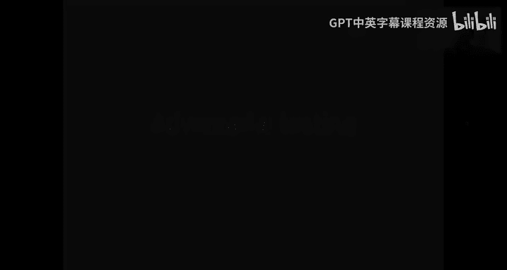
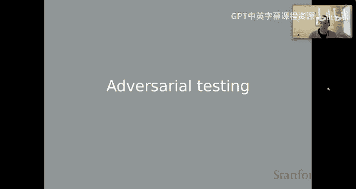
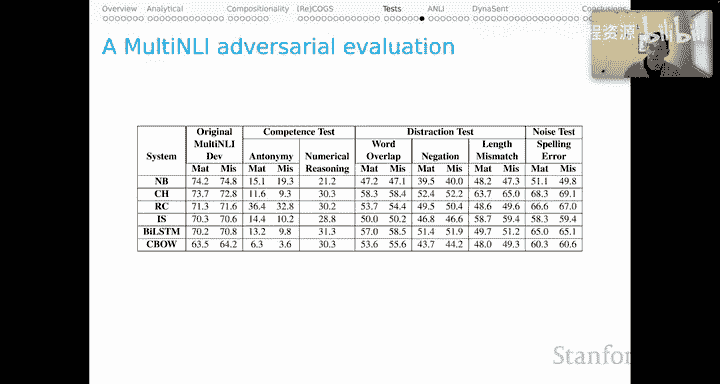
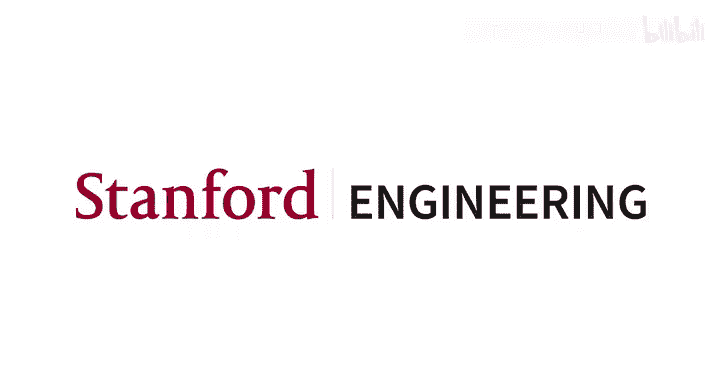

# 斯坦福大学《自然语言理解｜Stanford XCS224U Natural Language Understanding I Sp 2023》中英字幕（豆包翻译 - P29：-29-Behavioral Evaluation of NLU Models, Pt 5： Adversarial Testing .zh_en - GPT中英字幕课程资源 - BV1sx4y1s7oW

Hello， everyone。 Welcome back。 This is the fifth screencast in our series on advanced behavioral testing for N LU。

 What we've done so far in the unit is reflect on the nature of behavioral testing and think about its motivations。

 And we've tried to come to grips with its strengths and its weaknesses。

With that context in place， I thought it would be good to look at some recent prominent cases of adversarial tests to see what lessons they can teach us。

 especially taking a kind of historical perspective because we've learned a bunch of things about the nature of these challenges。

Let's begin with Squa。 On this slide here， I have some screenshot from the Squa leader board that I took recently。

 The Squa leader board is nice and friendly to humans because it gives us this privileged place at the top of the leader board。

 You can see that humans are getting around 87% exact match。 So 87% accuracy on squad。😊。

But be careful here。 you actually have to travel all the way down to position 31 on the leader board to find a system that is worse than humans。

 according to this metric。 and many of the systems that are above humans are well above humans。

 according to this metric on squad。 So you can essentially picture the headlines。

 Comps have gotten better at humans than answering questions and the underlying evidence is squad。

 And I think that's the kind of headline that motivated this first and very prominent adversarial test from Jia and Liang 2017。

 This is an important initial entry into this modern era of adversarial testing in N L U。To start。

 let me just remind you of what the squad task is like We're given context passages for evidence。

A question is posed， and the task is to find an answer to that question。

 And we have essentially a guarantee that that answer will be a sub string of the context passage。

Gia Un Leang had the intuition that models might be overfit to the particular data that was in squad。

 And so they set up some adversaries to try to diagnose that problem。

 And the way their adversaries worked is that they would append misleading sentences to the ends of these passages。

 So in this case， I've appended Qua Leland Stanford had Jersey number 37 in Champo 34。

And what Jangliang find is that with these appended sentences in place。

 Model switch and start to answer Leland Stanford。 They're distracted by this new and false evidence。

So that's worrisome。 But you might have an intuition that we can surely overcome this adversary。

 What we should do is take this augmented train set with these appended sentences on it and retrain our models。

 And then surely the models will overcome this adversary。 And indeed。

 we find that they do overcome this particular adversary。

 and they will stop being misled by the appended sentence。But Ge and Leang are ahead of you。

 What about an adversary where we simply prepend these misleading sentences to the evidence passages。

 They find again that models are distracted and start to answer Leland Stanford using that first new sentence。

And you could think， well， we can now train on the augmented train set that has the prepending and the upending。

 and maybe now we'll have overcome the adversary。 But you can see what kind of dynamic we've set up。

 Now we could put the misleading sentences in the middle of the passage。 And again。

 we'd probably see models start to fall down。And fall down， They did。

 Here is a kind of leader board showing original system performance for what at the time were top performing systems for squad。

 as well as their performance on this adversary that Jian Liang had set up。Obviously。

 there's an enormous drop in overall system performance for this adversary。

 and that is worrisome enough。 But I think we should look even more closely。

 It's noteworthy that the original ranking has gotten essentially totally shuffled on this adversarial leader board。

 The original number one system has fallen into position 5。

 The original two position when all the way to 10，3 to 12。

 I think the original 7 place position is now in the number one slot on the adversary。😊。

But the point is that there's essentially no relationship between original and adversary。

 This is a plot that kind of substantiates that I have original system performance along the X axis。

 adversarial along the Y axis。 And it's just a cloud of dots showing no evident correlation between the two。

So this probably suggests that systems were kind of overfit to the original squad problem。

 and they're dealing with this adversary in pretty chaotic ways。And that itself is worrisome。

I should say that I'm not sure for this particular adversary of the current state of things。

 I would love to have evidence for you about more modern transformer systems and how they behave with these adversaries。

 But as far as I know， no one has done that systematic testing。

 I think it would be valuable to have those data points。Let's move to a second example。

 This is natural language inference。 What I've got on the slide here is a picture of performance on S N L I。

 one of the major benchmarks for this task over time。 So along the X axis。

 I have time along the Y axis， I have the F1 score and the red line marks our estimate of human performance。

 and the blue line is tracking different systems that are from the published literature。

 And it's important to emphasize that these are essentially all published papers。😊。

What you see is a very rapid progress over time， eventually surpassing our evidence of human performance。

 and the line is kind of almost monotonically increasing。

 which strongly suggests to me that published papers are learning implicit lessons from earlier papers about how to do well on the S N LI task。

But the point is， we do now have systems that are superhuman。 Those are published papers。

 The multianaI leader board is a little bit different。 This is hosted on Kagel。 Anyone can enter。

 And as a result， you get many more systems competing on this leaderboard and you get much less of that kind of community wide hill climbing on the task because people who aren't communicating with each other are simply entering systems to see how they did。

 So the blue line oscillates all over the place。 but it's still a story of progress toward that estimate of human performance。

And if you took these numbers at face value， you might conclude that we are developing systems that are really。

 really good at doing inference in natural language， at doing what is， in effect。

 common sense reasoning。But again， the intuition behind adversaries is that we might worry about that。

 And one of the first and most influential entries into the adversarial space for N LI was Glockner etal 2018。

 This is the breaking NI paper。 And what they did is conceptually very simple and draws really nicely on intuitions around systematicity and compositionality。

I've got two examples on the table here。 The first one is going to play on synonyms。

 So the original premise from S N LI is a little girl kneeling in the dirt， crying。

And that entails a little girl is very sad。 What they did for their adversary is simply change sad to unhappy。

😔，Those are synonyms， essentially。 and so we have an expectation that systems will continue to say entails in this case。

But what Glockchner at all observed is that even the best systems are apt to start switching to calling this a contradiction case。

 and they do that because they are kind of overfit to assuming that the presence of negation is an indicator for contradiction。

And again， I love this test because it's clearly drawing on intuition around systematicity。

 We assume that substitution of synonyms should preserve the S N LI label。

 and systems are just not obeying that kind of underlying principle。

The second example is sort of similar。 The premise is an elderly couple are sitting outside a restaurant enjoying wine。

 The original S N L I case is a couple drinking wine。 and that had the entailment label。

 for breaking an Ly。 They switched wine to champagne。 Now。

 we have two terms that are kind of siblings in the conceptual hierarchy。

 Theyre disjoint from each other， but they're very semantically related。

 The human intuition is that these examples are now neutral because wine and champagne are disjoint But systems have only a very fuzzy understanding of that kind of lexical nuance。

 and so they are very prone to saying entails for this case as well。 Again。

 an intuition about the systematicity of the lexicon and how it will play into our judgments about natural language inference。

😊，And we're just not seeing human like behavior from these systems。

Here is the results table from the Glockner etal paper。 We should exempt the final lines， I think。

 on the grounds that those systems consumed Wordnet。

 which was the resource that was used to create the adversary。

 And look at the systems that are in the top three rows。

 What you find is that they do really well on SnLized test set。 right， They're in the mid80s。

 and they do abysmally on the new test set。 are huge deltas in performance there。

So that's interesting and worrisome。But we should pause here。

 Let's look more carefully at this table， in particular， at the model column。

All of these models are from the pre transformer era。In fact。

 they're just on the cusp of the transformer era。 And these are all instances of kind of recurrent neural networks with tons of attention mechanisms added on to them。

 almost reaching the insight about how we should go forward with attention being the primary mechanism。

 And you see their kind of historical period reflected also in the S NI test results which are lower than systems we routinely train to day built on the transformer architecture。

So we should ask ourselves what will happen if we test some of these newer transformer models。

 So I decided to do that。 I simply downloaded a Roberta model that was fine tuned on the multinli dataset set。

 So different from SnI， which was used by Glockner etal to create their data set。

 This is the code for doing it。 It's a little bit fiddly。 So I decided to reproduce it。

 And the headline here。Is that this model off the shelf essentially solves the Glockchner at all adversary。

 We should look just at contradiction and entailment because neutral is too small a category in this little challenge set。

 And you see impressively high F1 scores。Dramatically different from the results that Gchner et all reported from the pre transformer era。

 And remember， this is even under domain shift because this Roberta model was trained on multianai where testing it on examples derived from S N L I。

 So that looks like a real success story， an adversary that has essentially been overcome。

 And I think even the most cynical among us would regard that as an instance of progress。

Let's look at a second N LI case。 This one will play out somewhat differently。 But again。

 there are some important lessons learned。 This is from Nike at all 2018。

 It's a larger adversarial test benchmark。 It's got a bunch of different categories， antonyms。

 numerical word overlap negation， and I think a few others。For some of them。

 were doing something very similar to Glockchner， which is drawing on underlying intuitions about compositionality or systematicity for doing things like love。

 hate or this reasoning around numerical terms。But the data set also includes some things that look more directly adversarial to me as when we append some sort of redundant or confusing elements on to the end of the examples to see whether that affects system performance。

 That's more of a kind of squad adversary intuition， I would say。So that's the benchmark。

 It's pretty substantial。 There are lots of examples in it。 And the results tell a similar story。

 We have systems that are pretty good at multi NI， but really。

 really bad at essentially all of the splits from this adversarial benchmark。

But we've seen this dataset set before。 We talked about it when we talked about inoculation by fine tuning from the inoculation by fine tuning paper。

5 of the six panels in this central figure are actually from this Nik at all benchmark。

 and they tell very different stories。 We saw that word overlap and negation were diagnosed as a data set。

 weakness instance， where models had no problem solving those tasks。

 If given enough relevant evidence。 Splling errors and length mismatch。

 by contrast where model weaknesses。 models really couldn't get traction on those。

 So those might still worry us。

And numerical reasoning is an example of a dataset set artifact where there's something about the examples that really disrupts the performance of otherwise pretty solid models。

So three very different lessons coming from the same challenge or adversarial benchmark。

 and I think that's also a sign of progress because we now have the tooling to help us go one layer deeper in terms of understanding why models might be failing on different of these challenge test sets。

 which is， after all， the kind of analytic insight that we set out to achieve with this new mode of behavioral testing。

