# 斯坦福大学《自然语言理解｜Stanford XCS224U Natural Language Understanding I Sp 2023》中英字幕（豆包翻译 - P2：-02-Course Overview, Part 2 .zh_en - GPT中英字幕课程资源 - BV1sx4y1s7oW

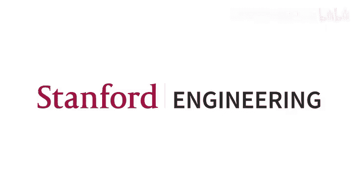

All right， welcome back everyone。Day two。Got a lot we want to accomplish today。

 What I have on the screen right now is the home base for the course。 This is our public website。

 and you could think of it as kind of a hub for everything that you'll need in the course。

 You can see along the top here， we've got some policy pages。 There's a whole page on projects。

There's a page that provides an index of background materials。YouTube screencasts， slides。

 handson materials in case you need to fill in some background stuff notice also I do a podcast that actually began in this course last year and I found it so rewarding that I just continue doing it all year and so new episodes continue to appear if you have ideas for guests for this podcast feel free to suggest them I'm always looking for exciting people to interview and I think the back episodes are also really illuminating。

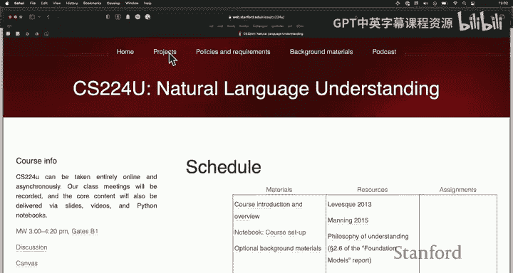

That's along the top then over here on the left you've got ones stop shopping for the various systems that we have to deal with you've got our Ed forum for discussion if you're not in there let us know we can get you signed up Canvas is your home for the screencasts and also the quizzes and I guess there's some other stuff there gradecope is where you'll submit the main assignments including your project work and also enter the bakeoffs。

And then we have our course GitHub and that is the course code that we'll be depending on for the assignments and that I hope you can build on for the original work that you do。

If you need to reach us， you can use the discussion forum。

 but we also have this staff email address that is vastly preferred to writing to us individually。

 it really helps us manage the workload and know what's happening if you either ping us on the discussion forum。

 private post， public post， whatever， or use that staff address。In the middle of this page here。

 we've got links to all the materials， the first column is slides and stuff like that and also notebooks。

 the middle column it's core readings mostly， I'm not presupposing that you will manage to do all of this reading because there is a lot of it but these are important and rewarding papers and so at some point in your life you might want to immerse yourselves in them。

 but I'm hoping that I can be your trusted guide through that literature。And then on the right。

 you have the assignments。That's the website， questions， comments， anything I could clear up。

 I have a time budgeted later to review the policies and required work in a bit more detail。

 but if there are questions now I'm happy to take them。Yes， for the quizzes。

 are the quizzes doable in the day that they become available or do we need？😊。

Like course material all the way up through。That is a good question。

 it's going to depend on your background， but in the worst case， if this is all brand new to you。

 you might not feel like you can confidently finish the quiz until that final lecture in the unit like this one is all about transformers。

 all of the answers are embedded in this handout here。But if you want to hear it from me。

 you might not hear that until next Thursday， but that gives you another five days。M，Yes。

Tt projects are available。 There can be guidelines。Right， that must be here。

 I think I've got an index of past projects behind a protected link which will depend on you being enrolled if you're not enrolled。

 we can get you past that little hurdle， but I did get permission to release some of them so somewhere on this page is a link to there it is exemplary projects there's another list at the Gitthub projects。

 MDd page which is also linked somewhere in here of published work and that stuff you could download the private link gives you the actual course submission that could be an interesting exercise to compare the paper they did in here with the thing they actually published and I'll emphasize again that that will be interesting because of how much work it typically takes to go from a class project to something that makes it onto the ACL anthology。

But that's of course， an exciting journey。Oh yeah， and if you haven't already do this course setup。

 it's very lightweight， you get your computing environment set up to use our code and actually this is a sign of the changing times。

 I also exhort you to sign up for a bunch of services。

 coabab and maybe consider getting a pro account for $30 over the course of the entire quarter you could get a lot more compute on coLab including GPUs。

 also the Amazon versions， Sage makers studio。And in addition。

 open AI account and cohere account both of those have free tiers for cohe you get really rate limited and for Open AI and they give you $5 you could consider spending a little bit more I do think you could do all our coursework for under those amounts and I think that for Open AI you could still have lots of accounts if you wanted to each one getting 5 it used to be 18 and now it's  five so we know what's coming but embrace it while you can also I'll say pretty well confident that we'll get a bunch of credits from AWSed for you to use EC2 machines so more details about that in a little bit。

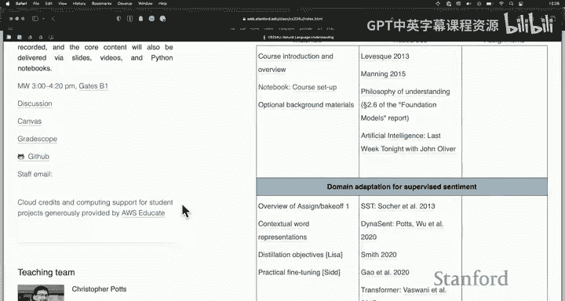

Okay， so if you want to follow along， let's head to this one。 This is our slideshow from last time。

 and I do just want to review some things。 What we did last time is I tried to immerse us in this weird and wonderful moment for AI。

And give you a sense for how we got here。And then we talked about the first two units， transformers。

 and retrieval augmented in context learning。I think that is all wonderful stuff。

 I expect you all to do lots of creative and cool things in that space。

 but it's important for me to continue this slideshow because there is more to our field than just those big language models and prompting and there are lots of important ways to contribute beyond that。

 So let me take a moment and just give you an indication of what I have in mind there。😊。

Our third main course unit， I've called compositional generalization。 This is brand new。

 We're going to focus on the Cogs benchmark， which is a relatively recent synthetic data set that is designed to stress test whether models have really learned systematic solutions to language problems。

 so the way Cogs works is we have essentially a semantic parsing task。

 The input is a sentence like Lena gave the bottle to John。

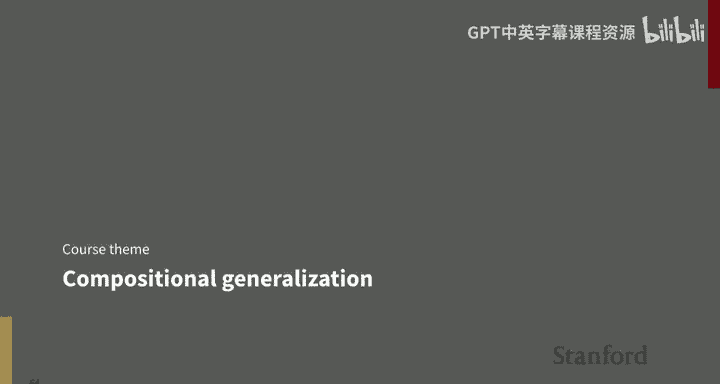

And the task is to learn how to map those sentences to their logical form。

 which are these logical representations down here。

The interesting thing about cogs is that they've posed hard generalization tasks， for example。

 in training you might get to see examples where Lina here is in subject position。

 and then at test time you see Lina in object position。Or at train time。

 you might see Paula as a name but in isolation， and the task is to have the system learn how to deal with Paula。

As a subject of a sentence， like Paula painted a cake。Or object PP to subject PP。 So at train time。

 you see M8， the cake on the table where on the table is inside the direct object of the sentence。

 and then at test time you see the cake on the table burned where on the table is now a subject。

These seem like dead， simple generalization tasks， right， and the sentences are very simple。

 but here's the punchline。This is a kind of accumulated leaderboard of a lot of entries for cogs。

 and if you look all the way on the right， you can see systems are doing pretty well。

 It is impressive that they can go from these free form sentences into those very ornate logical forms。

 okay， but look at this column。This is a column of zeros， objectject PP to subject PP。

 it looked really simple right， that's just the task of learning from Emma ate the cake on the table and predicting the cake on the table burned。

 why are these all these brand new systems getting zero on this split？That shows， first of all。

 that this is a hard problem。 Now， we are going to work with a variant that we created of cogs called Recogs。

 This was done with my student Zenmu and Chris Manning。 It's brand new work。😊。

We think that in part all those zeros derive from there being some artifacts in cogs。

 so it was made kind of artificially hard and also artificially easy in some ways。

 so in this class we're going to work with recogs， which has done some systematic meaning preserving transformations to the original to create a new data set that we think is fairer。

 but it still remains incredibly hard， systems can get traction where before they were getting zero so we know their signal and we have more confidence that this is testing something about semantics and then the punchline remains the same this is incredibly hard for our systems。

 even our best systems。There needs to be some kind of breakthrough here for us to get our systems to do well。

 even on these incredibly simple sentences。So I am eager to see what you all do with this problem。

 you're seeing a picture here of the kind of best we could do。

 which is a little bit better than what was in the literature previously。

 but certainly not a solve task。Right so that will culminate in this homework and bake off our third one。

From there， the course work opens up into your projects。

 we're done with the regular assignments and we go through the rhythm of lit review experiment protocol。

 which is a special document that kind of lays down the nuts and bolts of what you're going to do for your paper and then the final paper itself。

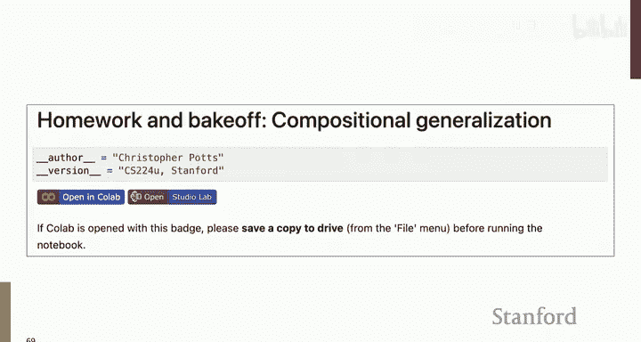

In the spirit of that， what we do in our course together is think about topics that will supercharge your own final project papers and the first topic that comes to mind for me there is better and more diverse benchmarks。

We need measurement instruments to get reliable estimates of how well our systems are doing。

 and that implies having good benchmarks in this context。

 I really like to invoke this famous quotation from the explorer Jacques Koususteau。

 He said a water and air， the two essential fluids on which all life depends。

 that's data sets for our field。 And you can see here that Kusteau did continue have become global garbage cans。

 that might concern us about what's happening with our datas。 I don't think it's that bad。

 but still you could have that in the back of your mind that we need these data sets we create to be reliable high quality instruments。

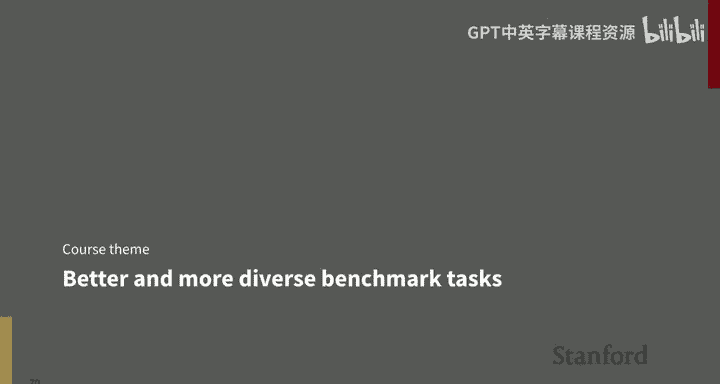

And the reason for that is that we ask so much of our data sets。

 we use them to optimize models when we train on them。

We use them crucially and this is increasingly important to evaluate our models。

 our biggest language models that are getting all the headlines， how well are they actually doing。

 We need datas for that， We use it to compare models to enable new capabilities via training and testing to measure progress as a field it's kind of our fundamental barometer for this and of course for basic scientific inquiry into language and the world。

 This is a long and important list and it shows you that data sets are really central to what we're doing。

And so I'm sort of exhorting you， as you can tell， to think about datasets。

 especially ones that would be powerful as evaluation tools in the context of this course。

 I am genuinely worried about the new dynamic where we are evaluating these big language models essentially on Twitter where people have screenshots of some fun cases that they saw and we all know that we're not seeing a full representative sample of the inputs we're seeing the worst and the best and it's impossible to piece together a scientific picture from that my student Omar Katd recently observed。

 I think this is very wise， that we have moved into this era in which designing systems might be really easy。

 it might be a matter of writing a prompt but figuring out whether it was a good system is going to get harder and harder and for that we need lots of evaluation datasets。

RightYou could think about this slide that I showed you from before we have this benchmark saturation with all of these systems now increasingly quickly getting above our estimate of human performance。

 but I asked you to be cynical about that as a measure of human performance right。

 another perspective on this slide could be that our benchmarks are simply too easy because it is not like if you interacted with one of these systems。

 even the most recent ones， it would feel superhuman to you。呵。

Partly what we're seeing here is a remnant of the fact that until very recently。

 our evaluations had to be essentially machine tasks， not human tasks。

 and we had humans do machine tasks to get a measure of human performance。

 maybe we're moving into a new and more exciting era。We're going to talk about adversarial testing。

 I've been involved with the dataabbech effort， this is a kind of open source effort to develop data sets that are going to be really hard for the best of our models and I think that's a wonderful dynamic as well。

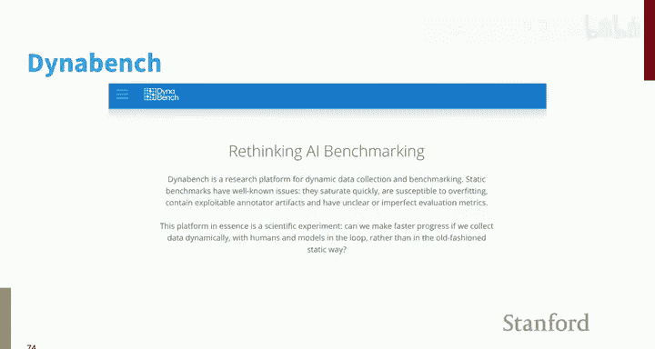

Right and that kind of leads into this related topic of us having more meaningful evaluations。

 Here's a fundamental thing that you might worry about throughout artificial intelligence。

 All we care about is performance for these systems。

 some notion of accuracy I've put this under the heading of Straththn's law when a measure becomes a target it ceases to be a good measure if we have this consensus that all we care about is accuracy。

 we know what will happen everyone in the field will he' climb on accuracy and we know from Strathn's law that that will distort the actual rate of progress by diminishing everything else that could be important to thinking about these AI systems。

Relatedly， like this is a wonderful study from Bjani at all。

 I've selected a few of the values encoded in ML research。

 which they did via a very extensive literature survey and kind of impressionistically here's the list at the top。

Dominating everything else， you have an obsession with performance， As I said。

 then way down on the list， though， in second place。

 you have efficiency and things like explainability， applicability in the real world robustness。

 as I go farther down on the list here， the ones that are colored there。

 they actually should be in the tiniest of type。 because if you think about the fieldss actual values as reflected in the literature。

 you find that these things are getting almost no play。 I think things are looking up。

But it's still the case that it's wildly skewed toward performance。

 but those things that I have down there in purple and orange， bene beneicence， privacy。

 fairness and justice， those are incredibly important things and more and more important as these systems are being deployed more widely and so we have to V our practices and what we hold to be valuable。

 elevate these other principles and you all could start to do that by thinking about proposing evaluations that would elevate them that could be tremendously exciting and the final point here is that we could also have kind of a move toward leader boards that embrace more aspects of this again to help us move away from the obsession on performance we should have leader boards that kind of score us along many dimensions in this context that really been inspired by work that Cohen did on what he calls dino scoring which is a proposal for how to synthesize across a lot of different。

sTo give you a quick illustration here， I have a table where the rows are question answering systems。

And the columns are different things we could measure， just a sample of them， performance。

 throughput， memory， fairness， robustness， and we could add other dimensions。

With the current dinos scoringring that you're seeing here where most of the weight is put on performance。

 that Derta system is the winner in this leaderboard competition。Okay， but that's standard。

 But what if we decided that we cared much more about fairness for these systems。

 So we adjusted the dino scoring here to put five on fairness。 Keep a lot on performance。

 but diminish the kind of other measures there。 Well。

 now the electro largege system is in first place。 Which one was the true winner。

 I think the answer is that there is no true winner here。

 what this shows is that all of our leader boards are reflecting some ordering of our preferences。

 And when we pick one， we are instilling a particular set of values on the whole enterprise。

But this is also creating space for us， this is I think part of Cohen's vision for dino scoring that we could design leader boards that were attuned to the things that we want to do in the world via the waitinging and the columns that we chose and evaluate systems on that basis。

Yeah what is fairness to you in this field mean how do you measure something like that What is fairness Yeah。

 well that's a whole nother aspect to this so if we're going to start to measure these dimensions like we're going to have a column for fairness we better be sure that we know what's behind that and I can tell you there needs to be a lot more work on our measurement devices our benchmarks for assessing fairness because all of those things are incredibly nuanced multi-dimensional concepts and so the idea would be to bring that in as well yeah throughput memory maybe those are straightforward but fairness is going to be a challenging one but that's not to say that it's not incredibly important。

And then finally， to really inspire you， I do feel like this is the first time I could say this in this course。

 I think we're moving into an era in which our evaluations can be much more meaningful than they ever were before。

 assessment today or yesterday is really one dimensional， that's the performance thing I mentioned。

 it's largely insensitive to the context we always pick F1 or something is the only thing regardless of what we're trying to accomplish in the world。

The terms are largely set by us researchers， right we say it's F1 and everyone kind of follows suit because we're supposed to be the experts on this and it's often very opaque。

And tailored to machine tasks， I've already complained about that。

 are estimates of human performance being very different from what you would think that phrase means。

In this new future that we could start right now， our assessments could certainly be high dimensional in fluid。

 I showed you a glimpse of that with the dinos scoringing。 I think that's incredible。

 They could also in turn be highly sensitive to the context that we're in if we care about fairness and we care about efficiency and we put those above performance we're going to get a very different prioritization of the systems and so forth and so on。

And then in turn， the terms of these evaluations could be set not by us researchers who are doing our very abstract thing。

 but rather the people who are trying to get value out of these systems。

 the people who have to interact with them。

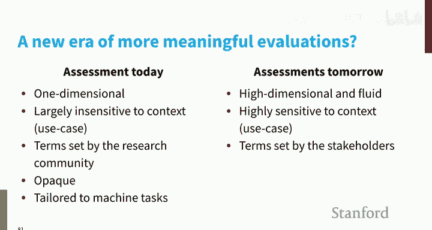

And then the judgments could ultimately be made by the users， right。

 they could decide which system they want to choose based on their own expressed preferences。

And then in turn， maybe we could have our evaluations be much more at the level of human tasks as opposed so right now。

 for example， we might insist that some human labelers choose a particular label for an ambiguous example。

 and then we assess how well how much agreement they have。

 whereas the human thing is to discuss and debate right to have a dialogue about what the right label is in the face of ambiguity and context dependence Well。

 now we could have that kind of evaluation right， maybe we evaluate systems on their ability to adjudicate in a human-like way on what the label should be。

Hard to imagine before， but now probably something that you could toy around with a little bit with one of these large language model APIs right now if you wanted。

And I think we could really embrace that。I have a couple more topics， but let me pause there。

 do people have thoughts， questions， insights about benchmarks and evaluation？

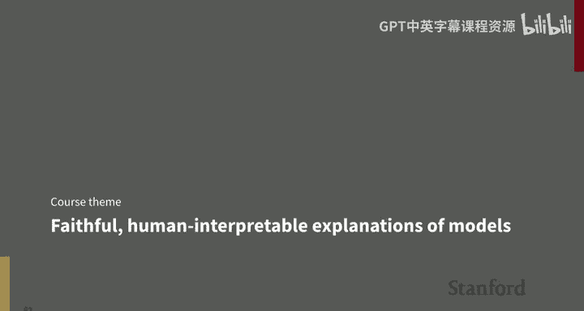

I hope you're seeing that it's a wide open area for final projects Yeah I there more of a move to like get like specialists in other fields like like for example。

 like linguistics or like related things to like help。Bypart。

What a wonderful question you asked is there a move to have more experts participate in evaluation。

 I hope the answer is yes， but let's make the answer。 yes， that would be the point right。

 because what we want is to provide the world with tools and concepts that would allow domain experts。

 people who actually know what's going on in the domain we're trying to use this AI technology to make these decisions and make adjustments and so forth based based on what's working and what isn't。

 Yeah， that should be。Our goal， and then what we as researchers can do is provide things like what Colin provided with dinos scoringing。

 which is the intellectual infrastructure to allow them to do that。

And then you all probably have lots of domain expertise that kind of intersects with what we're doing。

 but maybe comes from other fields， and so you could participate as an NLU researcher and as domain expert to do a paper that embrace both aspects of this and maybe you propose a kind of metric that you think really works well for your field of economics or sociology or whatever you're studying right yeah。

 health medicine， all these things incredibly important。So another hand go up。Yeah。

I think one of the challenges we're going to face is just really expensive to collect human or more sophisticated labels as an example there's a paper that came out recently in Me Hall where they trained or actually really just tuned an LLM to respond to medical student or medical questions from USME and other medicine related exams。

 they also had a section for long- form answers， the short form answers it's a multiple choice they could figure it out the long- form answers they actually had doctors evaluating them and that's really expensive they could only collect so many labels。

 even you know the large staff of doctors so I think the balance between I mean calculating click through to breathe is just counting but evaluating how valuable search result is that requires a human that's a little more expensive than I'm curious how we can balance the cost。

Yeah， the issue of costs is going to be unavoidable for us。

 I think we should confront it as a group this research has just gotten more expensive and that's obviously distorting who can participate in what we value。

 it's another thing I could discuss under this rubric for your particular question though I remain optimistic because I think we are in an era now in which you could do a meaningful evaluation of a system with no training data。

And rather just a few dozen， let's say10 examples for assessment。

 if you're careful about how you use it， that is if you don't develop your system on it and so forth。

 but even if you say okay I'm going to have 100 for development Im 100 that I keep for a final evaluation to really get a sense for how my system performs on new data。

 that's only 200 examples， and I feel like that's manageable，Even if we need experts。

 and the point would be that that might be money well spent。

 it might be that if we can get some experts to provide the 200 cases。

 we have a really reliable measurement tool。I could never have said this 10 years ago because 10 years ago the norm was to have 50。

000 training instances and 5，000 test instances， and now your cost concern really kicks in。

But for the present moment， I feel like a few meaningful cases could be worth a lot and you all could construct those data sets again before I used to give the advice。

 don't create your own data in this class， you'll run out of time， but now I can give the advice， no。

 if you have some domain expertise in the life sciences or something and you want a data。

Create one to use for assessment。It'll shape your system design， but that could be healthy as well。

Another big theme， explainability。Okay， and this also relates to our increased impact if we're going to deploy these models out in the world。

 it is really important that we understand them right now we do a lot of behavioral testing that is we come up with these these test cases and we see how well the model does。

 but the problem which is a deep problem of kind of scientific induction is that you can never come up with enough cases and the world is a diverse and complex place and no matter how many things you dreamed up when you were doing the research if you deploy your system it will encounter things that you never anticipate。

And if all you've done is behavioral testing， you might feel very nervous about this because you might have essentially no idea what it's going to do on new cases。

 The mission of explainability research should be to go one layer deeper and understand what is happening inside these models so that we have a sense for how they'll generalize to new cases。

 It's a very challenging thing because we're thinking about these enormous and incredibly opaque models and there is you can even find people saying in the literature that they're skeptical that we can ever understand what's happening with these systems。

 but I am optimistic they are closed deterministic systems they may be complex but we're smart。

 we can figure out what they have learned I really have confidence in this and the importance of this is really that we have these broader societal goals we want to systems that are reliable and safe and trustworthy and we want to know where we can use them and we want them to be free from bias and it seems to me。

That all of these questions depend us on us having some true analytic guarantees about model behaviors。

 It seems very hard for me to say trust me， my model is not biased along some dimension if I don't even have any idea how it works the best I could say is that it wasn't biased in some evaluations that I ran。

 but I just emphasize for you that that's very different from。

Being evaluated by the world where a lot of things could happen that you didn't anticipate。

We'll talk about a lot of different explanation methods。

 I think that these methods should be human interpretable。

 that as we don't want low levell mathematical explanations of how the models work。

 we want this expressed in human level concepts so that we can reason about these systems。

And we also want them to be faithful to the underlying model。

 we don't want to fabricate human interpretable but inaccurate explanations of the model we want them to be true to the underlying systems these are two very difficult standards to meet together。

 I can make them human interpretable if if I offer you no guarantees of faithfulness right but then I'm just tricking myself and you I can make them faithful by making them very technical and low level we could just talk about all the matrix multiplications we want。

 but that's not going to provide a human level insight into how the models are working so together though we need to get methods that are good for both of these right concept level understanding of the causal dynamics of these systems。

We'll talk about a lot of different explanation methods， I'll just do this quickly。

 train tests that is the behavioral thing remains very important for the field。

We'll talk about probing， which was an early and very influential and very ambitious attempt to understand the hidden representations of our models。

We'll talk about attribution methods， these are kind of ways to assign importance to different parts of the representations of these models。

 both input and output and also their internal representations。

 and then we're going to talk about methods that depend on active manipulations of model internal states and you'll be able to tell that I strongly favor the active manipulation approach because I think that that's the kind of approach that can give us causal insights and also richly characterize what the models are doing and that's more or less the two de Zerada that I just mentioned for these methods。

But there's value to all of these things and we'll talk about all of them and you'll get hands on with all of them。

 and all of them can be wonderful for your analysis sections of your final papers。

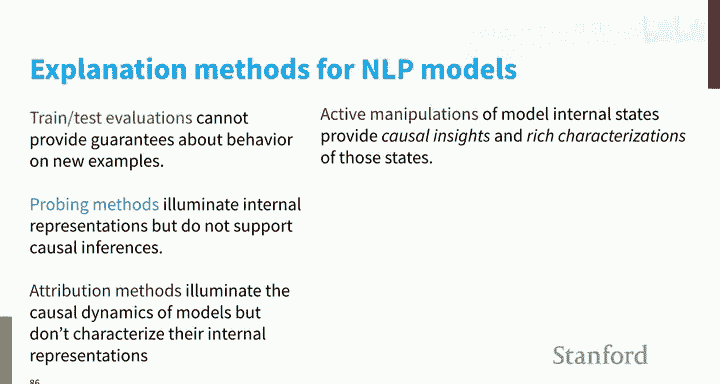

We might even talk about interchange intervention training。

 which is when you use explainability methods to actually push the models to become better。

 more systematic， more reliable， maybe less biased along dimensions that you care about。

That's my review of the core things， questions or comments。

 I have a few more kind of more low level things about the course to do now， yeah。

I know we're going to get into all of the explanation methods in a lot of detail later on。

 but can you give a quick example just so that we have any imagination of what they are？

Probing is training supervised classifiers on internal representations。

 and this was just the cool thing to say， hey， I'll just look at layer three column four of my BtRT representation。

 does it encode information about animacy or part of speech？And the answer seems to be yes。

And I think that was really eye opening that you， even if your task was sentiment analysis。

 you might have learned latent structure about animacy。😊。

That's getting closer to the human level concept stuff problem with probing is that you have no guarantee that that information about animacy here has any causal impact on the model behavior it could be just kind of something that the model learned by the by。

Attribution methods have the kind of reverse problem。

 they can give you some causal guarantees that you know this neuron plays this particular role in the input output behavior。

 but it's usually just a kind of scalar value it's like 0。3 and you say well what does the 0。

3 mean and you say it means that it's that much important but nothing like oh is it anary none of those human level things and then I think the active manipulation thing which is like doing lots of brain surgeries on your model？

can provide the benefits of both probing and attribution， causal insights。

 but also a deep understanding of what the representations are。

And there's a whole family of those it's a very exciting part of the literature Yeah I have a question going back to Cogs so I guess why would we want to use the Cog data set if for're testing for generalization。

 like why can't we just prompt the language model of a word that we've never seen before and kind of like try and do some form of if you see it in the subject position。

 get into position in the object and see how well it does that。Oh， yeah， no。

 so for cogs for your original system， it could be that you try to prompt a language model。

Zen did a bunch of that as part of the research， it was only okay。

But maybe there's a version of that where you prompt in the right way with the right kind of instructions and then it does solve cogs。

 that would be wonderful because that would suggest to me that those models。

 whatever model you prompted has internal representations that are systematic enough to have kind of a notion of subject and a notion of object and verb and all of that linguistic stuff。

 and that would be very exciting。Yeah， the cool thing about cogx is that I think it's a pretty reliable measurement device for making such claims。

Yeah。How transferable is this discussion to languages other than English like I wonder if？

We should be concerned about the very tight coupling between the properties of English as a language and all our advancement in。

Well， I mean I hope that a lot of you do projects on multilingual NLP。

 low resourcesource settings and so forth and I think in a way we live in a golden age for that research as well。

 there's more research on more languages than there were 10 years ago and that's certainly a positive development the downside is that it's all done with multilingual representations。

 multilingual Bt and so forth and they tend to do much better on English tasks than every other task。

 so that obviously feels like suboptimal but again that's the same story of like sudden progress with a lot of mixed feelings that I have about a lot of these topics。

In the interest of time， let's press on a little bit。

 I think I just wanted to skip to the course mechanics， this is at the website。

 but there it is that's the breakdown of required pieces and you can see that it has a kind of strong emphasis toward the three parts that are related to the final project。

But the homeworks are also really important and the quizz is less so。

But I think they're important enough that you'll take them seriously。It's fully asynchronous。

 it's wonderful to see so many of you here and I am eager to interact with you here if possible but also on Zoom for office hours and stuff。

 please attend office hours if you just want to chat one of my favorite games to play in office hours is a group comes with three project ideas and I rank them from least to most or most to least viable for the course it's a fun game for me and I think it always illuminates some things about the problems。

All right and then we have continuous evaluations that you have the three assignments。

 the quizzes and then the project work， and there's no final exam just the we want you to be focused on the final project at that point。

I think I'll leave this aside， we can talk about the grading of the original systems a bit later。

 and then you have the project work。Some links here， exceptional final projects and some guidance。

 these are the two documents I mentioned before。I'll just say again that this is the most important part of the course to me and the thing that's special。

 and I'll say again also we have this incredibly accomplished teaching team this year。

 diverse interests and they all have done incredible research on their own。

 I've learned a ton from them and from their work and I encourage you to do the same。

 so seek them out in office hours and you know take advantage of their mentorship for the work you do。

And then here are some crucial course links kind of covered that before。

 the quizzes I think I've covered as well。

And these policies are all at the website。嗯。Right， and so the setup。

 do that if you haven't already make sure you're in the discussion forum。

 we want you to be connected with the kind of ongoing discourse for the class。

 do quiz zero as soon as you can so that you know your rights and responsibilities and then I think right now we should check out the homework。

 the sentiment homework。To make sure you're oriented around that before we dive into transformers。

Questions about that stuff。It's all at the website。

 but I've kind of evoked it for you in case it raised any issues。All right。

 let's look briefly at the first homework， I feel like we should kick it off somehow and it is maybe an unusual mode for homeworks so feel free to ask questions this is kind of cool so this link will take you to the GitHub。

Which I think you're probably all set up with on your home computers。

But you might want to work with this in the cloud。 so this works well。

 so you could just click like open coab。

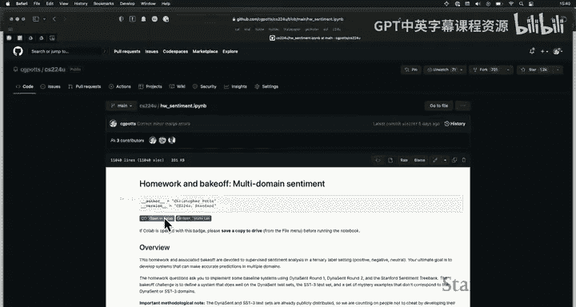

And。I think I've done a pretty good job of getting you so that it will set itself up。

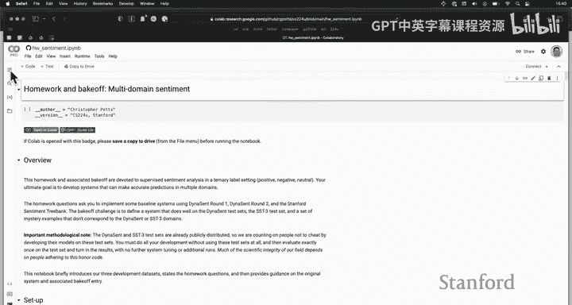

With the installs that you need and the course repo and so forth。

 I would actually be curious to know that there are bumps along the road to getting this to just work out of the B and Coab。

 I do encourage this because if you're ambitious you'll probably want GPUs and this is a good inexpensive way to get them。

It's also a pretty nice environment to do the work in。Zoom in here。

Along the left you can see the outline and that's actually kind of a good place to start。

 so we're doing multi domainomain sentiment and what I mean by that is you're encouraged to work with three data sets。

 dinoscent round one， dinoscent round two and the Stanford sentiment tree bank these are all sentiment tasks。

 and they all have turnernary labels positive negative and neutral。

 but I am not guaranteeing you that those labels are aligned in the semantic sense。 In fact。

 I think that the SST labels are a bit different from the Dnoscent ones。

But certainly the underlying data are different because Dnocent is like product reviews and Stanford Ciment Tary Bank is movie reviews。

But there are further things， so dinoscent round one is hard examples that we harvested from the world。

 from the Yelp academic data set。Whereas dinoscent round two is actually。

Annotators working on the Dynna benchch platform， which I mentioned just a minute ago。

 trying to fool a really good sentiment model。So the dinoscent round two examples are hard。

 they involve like non literal language use and sarcasm and other things that we know challenge current day models。

So you have these three data sets and then for the there are really two main questions for the first question。

 I'm just pushing you to develop a simple linear model with sparse feature representations This is a kind of more traditional mode background if you need a refresher on this。

 this is a chance to get it if you feel stuck on this question I think we should talk about how to get you up to speed for the course。

But for a lot of you， especially if you've been immersed in NLP。

 this should be a pretty straightforward question。It leads to a pretty good system。

 so you do a feature function， you write a function for training models and a function for assessing models。

For each one of these questions， what you do is complete a function that I started。

There is not a lot of coding this is mainly about starting to build your own original system。

And for every single one of these questions， there's a test that you can run。I like unit tests a lot。

 I think we should all write more unit tests。 The advantage of the test for me is that if there was any unclarity about my own instructions。

 the test probably clears them up。And you also get a guarantee that if your code passes the test。

 you're in good shape。More or less the same tests run on grade scope。

 so when you upload the notebook， if you got a clean bill of health at home youll。

Probably do fine on gradecope and if you don't， it might be because the grade scopecope Autograder has a bug。

Let me know about that， those things always feel like they're just barely functioning。

But the idea is that you know this is really not about me evaluating you。

 this is about you exercising the relevant muscles and building up concepts that will let you develop your own systems。

 and I'm just trying to be a trusted guide for you on that。

So you do some coding and you have these three questions here and the result of doing those three questions is that you have something that could be the basis for your original system it be pretty cool by the way。

 if some people competed using just sparse linear models to show the transformers that there's still competition out there。

Oh。So that's the first question， and then the second one is the same way。

 except now we're focused on transformer fine tuning， which is our main focus for this unit。

I have a question here that pushes you to understand how these models tokenize data。

It's really different from the old mode， you'll learn some hugging face code。

 and you'll also learn some concepts。And then I have a question that pushes you to understand what the representations are like。

 we're going to talk about them abstractly， here you'll be hands on with them。And then finally。

 you're going to finish up writing a pie torch module where you find Tomb Bt。

And that is step one to a really incredible system， I'm sure。

And I've actually written the interface for you so that given the course code and everything else。

 the interfaces for these things are pretty straightforward to write。

 all you have to do is write the module and for completing the homework questions。

 you don't actually need heavy duty computing at all because you don't do anything heavy duty。

But when you get to the original system， that might be where you want to train a big monster model and figure out how to work with the computational resources that you have to get that done。

This notebook is using tiny Bt， which is small， but you still need a GPU to do the work。

 so you'll still want to be on coab or something like that。

And then I don't know how ambitious you're going to get for your original system。

You can tell that I'm trying to lead you toward using question one and question two for your original system。

 but it's not required and if you want to do something where you just prompt GBT4， maybe a win。

 I don't know。I'm up for anything， it does need to be in original system。

 you can't just download somebody else's code and if all you did was a very boring prompt structure。

 you wouldn't get a high grade on your original system or trying to encourage you to think creatively and explore。

And then the final thing is you just enter this in a bakeoff。

 and really that just means grabbing an unlabeled data set from the web and adding a column with predictions in it。

And then you upload that when you submit your work to Grade scopecope。

And then when everyone's submissions are in， we'll reveal the scores and there'll be some winners。

And we'll give out prizes I'm optimistic that we're going to have EC2 codes as prizes that's always been fun because if you win a bakeoff you get a little bit more compute resources for your next big thing。

Yeah， they become， they don't want to hand out these codes anymore like they used to because cloud compute is so important now。

 but I think I have an arrangement in place to get some and by the way。

 we give out prizes for the best systems and the most creative systems and we have even given out prizes for the lowest scoring systems because if that was a cool thing that should have worked and didn't。

 I feel like you did a service to all of us by going down that route and that deserves a prize。

As trying to have a multidimensional leaderboard here， right。

 even as we rank all of you according to the performance of your systems。That's my overview。

 questions or comments or anything。All right。I propose then。That we go to transformers。

So download the handout。 And by the way， these should be really good。 So these slides。

 you'll get a version with fewer overlays to make it more browsable。

 All of these things up here are links。So。Oops。So if you click on these bubbles。

 you can go to directly to that part and you can see that this is a kind of outline of this unit。

And then there's also a good table of contents with good labels。

 so if you need to find things in what I admit is a very large deck that should make it easier to do that and you can also track our progress as we move through these things。

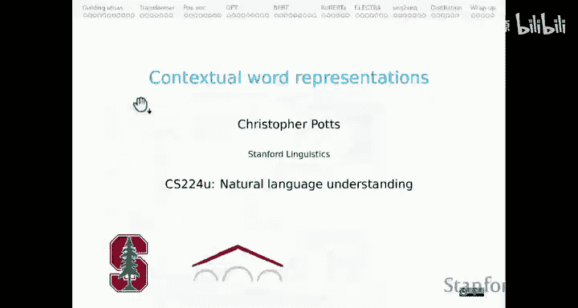

So we dive in？Guiding ideas。

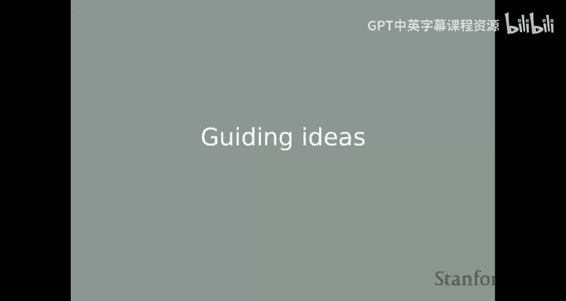

What is happening with these contextual representations？Okay。

 this one slide here used to take two weeks for this course and I've been trying to convey this。

 we have stopped doing that， the background materials are still at the website。

 it was also the first two weeks of CS224N we did them before they did them and CS224N back before natural language understanding was all the rage but they get there first now and it is a more basic course I'm saying they do G word to Vec and we're going to dive right into transformers。

Here is my one slide summary of this。Back in the old old days。

 the dawning of the statistical revolution in NLP。The way we represented examples。

 let's say words for this case， was with featurebased sparse representations and what I mean by that is that if you wanted to represent a word of a language。

 you might write a feature function that says okay。

 yes or no on it being referring to an animate thing， yes or no on it ending in the characters ING。

 yes or no on it mostly being used as a verb and so forth and so on。

 and so all these little feature functions would end up giving you really long vectors of essentially ones and zeros。

That were kind of hand designed and that would give you a perspective on a bunch of the dimensions of the word you were trying to represent。

That lasted for a while， and then it kind of started to get replaced。

Pre word to V end G with methods like pointwise mutual information or TF IDF。

These methods had long been recognized as fundamental in the field of information retrieval。

 especially TFIDF as a main representation technique for finding relevant documents for queries。

ItTook a while for NLP people to realize that they would be valuable。

 but what you start to see here is that instead of writing all those feature functions。

 I'll just keep track of co-occurrence patterns in large collections of text。

And PMI and T IDF do this essentially just by counting and then reweighting some of the counts。

 but really it is the raw form of distributional representation。

That get kind of got replaced or this is sort of simultaneous in an interesting way。

 but you have paired with PMI and TFIDF methods like principal components analysis， SVD。

 which is sometimes called latent semantic analysis， LDA。

 which is latent Deishly allocation a topic modeling technique。

 it's a whole family of these things that are essentially taking count data。

 and giving you reduced dimensional versions of that count data。

And the power of doing that is really that you can capture higher order notions of co-occurrence。

 not just what I as a word co-occurred with， but also the sense in which I might co-occur with words that co-occur with the things I co-oc with your kind of second order neighbors。

 and you can imagine traveling out into this representational neighborhood here。

And that turns out to be very powerful because a lot of semantic affinities come not from just being neighbors with something。

 but rather from that whole network of things co-occurring with each other。

 and what these methods do is take all that count data and compress it in a way that loses some information but also captures those notions of similarity。

And then the final step， which might actually be the kind of final step in this literature were learned dimensionality reduction things。

 autoenrs， word tovec and glove。And this is where you might start with some count data。

 but you have some machine learning algorithm that learns how to compute dense learned representations from that count data。

So kind of like step three infused with more of what we know of as machine learning now。

And I say it might be the end because I think now for anything that you would do with this mode。

 you would probably just use contextual representations， so this is the full story， perhaps。

And then here's the review if you want， right， and I think it is important to understand this。

 both the history， but also the technical details to really deeply understand what I'm about to dive into so you might want to circle back if that was too fast。

Yeah。Is there any option to just like one hot encode your entire vocabulary。

 I think this is my understanding of what modern and transformer based models do。

To one hot encode the whole vocabulary。So well just say a bit more like what are you doing？

My understanding of how large language models encode individuals。

And they have a list of all of their possible tokens。

 they break it down into tokens and then if you're token3 to 37 you just like。

You have a vector of length， the number of tokens you have， like a vocabulary of length 50，000。

And then you just want on end code which token that is。Well， we're about to do this。

 so don if I'll show you how they represent things and let's see if it connects with your question。

Because it is different。 Yeah， it is going to be very different and the notion of token and the notion of type is about to get sort of complicated。

Right。Before we do the technical part， just a little bit of context here about why I think this is so exciting。

 I'm a linguist right， and I was excited by these static vector representations of words。

 but it was also very annoying to me because they give you one vector per word。

Whereas my experience of language is that words have multiple senses。

 and it is hard to delimit where the senses begin an end。 Consider a verb like break。

 which I've worked on with my Ph D student， Erica Peterson。 The vase broke。 That's one sense。

 maybe dawn broke。 That's the same form broke。 but that means something different。

 entirely different。 The news broke。 again broke as the form there。

 but this being something more like was published or appeared。

 Sandy broke the world record is very unlike send the vase broke， right， Now。

 it's like surpassing the limit。Sandy broke the law as a different sense yet again。

 that's some kind of transgression。The burglar broke into the house。 That's break again。

 But now with a particle。 And that means something different。 Still。

 the newscaster broke into the movie broadcast。 That means it was interrupted。Very different again。

 we broke even means， I don't know， we ended up back at the same amount we started with。

So how many senses of break are here if I was in the old mode of static representation would I survive with one break vector for all of these examples or would I have one per example type type。

 but then what about all the ones that I didn't list here。

 the number of senses for break starts to feel impossible to enumerate if you just think about all the ways in which you encounter this verb。

 and there is some metaphorical core that seems to run through them。

 but in the details these senses are all very different？

And this tells me that the sense of a word like break is being modulated by the context it is appearing in。

And the idea that we would have one fixed representation for it。

 even if it's learned from data is just kind of wrong from the outset。Here's another example。

 we have a flat tire， but what about flat beer， flat note， flat surface？

Maybe they have some metaphorical core， but those feel like at least two to four different senses for flat。

Throw a party， throw a fight。 throw a ball， throw a fit。 all very different senses。

 It's tragic to think we would have one throw that was meant to cover all of these examples。 right。

 A crane caught a fish。A crane picked up the steel beam。

That might feel like a standard sort of lexical ambiguity。

 and so maybe you can imagine that we have one vector for crane as a bird and one for crane as a machine。

But is that going to work for the entire vocabulary。

 I suspect not I saw a crane we wouldn't even know what vector we were dealing with there right。

 which one would we pick and then we have another problem on our hands which is selecting the static vector based on context right how are we going to do that and this is a really deep thing It's not just about the local kind of morphphoyntactic context here。

 what about are there typos I didn't see any。So the sense of any there is like any typos right。

 versus are there bookstores downtown， I didn't see any。

 now the sense of any and the kind of elliptical stuff that comes after it is any bookstores。

And now I hope you can see that the sense that words can have is modulated by context in the most extended sense。

And having fixed static representations was never going to work in the face of all of this diversity。

We were never going to figure out how to cut up the senses in just the right way to get all of this data。

Handled correctly。And the vision of contextual representation models is that you're not even going to try to do all that hard and boring stuff instead you are just going to embrace the fact that every word could take on a different sense that is have a different representation depending on everything that is happening around it。

And we won't have to decide then which sense is in1 A and whether it's different from1 B in 1 C and so forth。

 we will just have。All of these token level representations。

 it will be entirely a theory that is based in words as they appear in context。For me as a linguist。

 it is not surprising at all that this turns out to lead to lots of engineering successes because it feels so deeply right to me about how language works。

Brief history here， I just want to be dutiful about this， make sure people get credit where it's due。

November 2015， die and lay， that's a foundational paper where they really did what is probably the first example of language model pretraining。

It's a cool paper to look at， it's complicated in some ways that are surprising to us now。

 and it is certainly a visionary paper。And then McCann et all。

 this is a paper from Salesforce Research that's at the time was read by Richard Socher。

 who was a distinguished alum of this class。Proud of that。

 they developed the Cove model where what they did is train machine translation models。

 and then the inspired idea was that the translation representations might be useful for other tasks。

 and again， that feels like the dawn of the notion of pre-training contextual representations。

And then ElLmo came， I mentioned ElLmo last time， huge breakthrough， massive bidirectional LSTMs。

 and they really showed that that could lead to rich multipurpose representations and that's where you really feel everyone reorienting their research toward these kind of models。

That's not a transformer based one， though that's by LSTMs。

 and then we get GPT in June 2018 and Bt in October 2018。

The Bt paper was published a long time after that， but as I said before it had already achieved massive impact by the time it was published in 2019 or whatever。

 so that's why I've been giving the months here because you can see it's really there was this sudden uptake in the amount of interest in these things that happened around this time and that led to where we are now。

Another kind of interesting thing to think about if you step back for the context here is that we as a field have been traveling from high bias models where we decide a lot about how the data should look and be processed toward models that impose essentially nothing on the world So if you go up into the upper left here。

 I'm just imagining a model that's kind of in the old mode where you have like your glove representations of these three words and to get a representation for the sentence you just add up those representations。

In doing that， you have decided ahead of time a lot of stuff about how those pieces are going to come together。

 I mean， you just said it was going to be addition。

Which is almost certainly not correct about how the world works。

 so that's a prototypical case of a high bias decision。If you move over to the right here。

 that's a kind of recurrent neural network。And here I've kind of decided that my data will be processed left to right。

I could learn a lot of different functions in that space so it's much more expressive。

 much less biased in this machine learning sense than this solution here。

 but I have still decided ahead of time that I'm going to go left to right。

And this is another example， these are tree structured networks Richard Socher。

 who I just mentioned was truly a pioneer in tree structured recursive neural networks here I make a lot of decisions about how the pieces can possibly come together the rock is a unit constituent separate from rules which comes in later and I'm just saying I know ahead of time that the data will work that way if I'm right it's going to give me a huge boost because I don't have to learn those details if I'm wrong though I might be wrong forever。

And I think that's actually that feeling that you're wrong forever is what led to this kind of thing happening。

 so here I've got kind of a bidirectional recurrent model。

 so now you can go left to right and right to left and all these attention mechanisms that are going to like jump around in the linear string。

And this is a true progression with what happened withcurrentcurs sorry recurrent neural networks。

 go both directions and add a bunch of attention connections。

 and that is kind of the thing that caused everyone to realize oh。

 we should just connect everything to everything else and go to the maximally low biased version of this and just assume that the data will teach us about what's important to connect to what we won't decide anything ahead of time so a triumph。

Of saying， I have no idea what the world is going to be like。

 I just trust in my data and my optimization。The attention piece is really interesting to me。

 You know， we used to talk a lot about this in the course。 Here I have a sequence really not so good。

And a common mode still common today is that I might fit a classifier on this final representation here to make a sentiment decision。

But people went on that journey I just described where you think， wait a second。

 if I'm just going to use this。Won't I lose a lot of information about the earlier words？

I should have some way of like connecting back and so what they did is dot products。

 essentially between the thing that you're using for your classifier and the previous states。

 that's what I've depicted here， just as a kind of way of scoring this final thing with respect to the previous thing you might normalize them a little bit and then form what was called the context vector。

 this is like the attention representation and what I've done here is build these links back to all these previous states。

 and that turned out to be incredibly powerful And when you read the title of the paper。

 attention is all you need。What they are doing is saying you don't need LSTM connections and recurrent connections and stuff。

 the sense in which attention is all you need is the sense in which they're saying all you needed was these connections that you were adding onto the top of your earlier models。

And maybe they were right， but certainly it has taken over the field。

Another important idea here that might often be overlooked is just this notion that we should model the subparts of words。

And again， I can't resist a historical note here。 if you look back at the Elmo paper。

 what they did to embrace this insight is incredible。 They had character level representations。

And then they fit all these convolutions on top of all those character level representations which essentially like ways of pooling together subparts of the word。

 and then they form a representation at the top that's like the average plus the concatenation of all of these different convolutional layers。

And the result of this is a vocabulary that does latently have information about characters and subparts of words as well as words in it。

 and I feel that that's deeply right， right and this is like a space in which you could capture lots of things like how talk is similar to talking and is similar to talk and you know all that stuff that a simple unigram parsing would miss is latently represented in this space。

But。The vocabulary for Elmo is like 100，000 words。So that's a 100000 embedding space that I need to have。

 It's actually gargantuan and。It's still the case that if you process real data。

 you have to unc out that is Mark as unknown， most of the words you encounter because the language is incredibly complicated and 100。

000 doesn't even come close to covering all the tokens that you encounter in the world。And so again。

 we have this kind of galaxy brain moment where I guess the field says， forgetge all that。

And what you do instead is tokenize your data so that you just split apart words。

Into their subward tokens， if you need to。So here I've got an example with the Bt tokenizer。

 this isn't too surprising， that comes out looking kind of normal。But if you do encode me。

Notice that the word and code has been split into two tokens。And if you do snuffleepagus。You get one。

2， three， four， five， six， seven tokens， six or seven from that。

 because it doesn't know what the word is， and so what it does is not unk it out。

 but rather split it apart into a bunch of different pieces and the result is the really startling thing that Btlike models have only 30。

000 words in their vocabulary。But they're words in the sense that they' are these sub word tokens。

Now this was going to be tragically bad。In the realm where we were doing static word representations because I'm going to have a vector for N。

And have no sense in which it was participating in the larger part of snuffphiagus。

But we're talking about contextual models。 So even if these are the tokens。

 the model is going to see the full sequence。And we can hope that it reconstructs something like the word from all the pieces that it encountered。

 certainly we could hope that for something like encode。And we take this for granted now。

 but it's deeply insightful to me and incredibly freeing in terms of the engineering resources that you need。

 but it does depend on rich contextual representations。And then another notion， positional encoding。

So we have all these tokens or maybe sub partss of words。In addition to representing things。

 using a traditional static embedding space like a glove one。

 that's what I put with these light gray boxes here。

We'll also represent sequences with positional encodings。

 which will just keep track of where the token appeared in the sequence I'm processing。

And what that means is that the word rock here。Occurring in position two。

We'll have a different representation if rock appears in position 47 in the string。

It'll be kind of the same word， but also partly a different word。

And that's another way in which you're embracing the fact that all of these representations are going to be contextual。

This is an interesting story for me because I've been slow to realize what maybe be the whole field already knew。

 that this is incredibly important， how you do this positional encoding really matters for how models perform and that's why in fact it's like one of these early topics here that we'll talk about next time。

And then， of course。Another guiding idea here is that we are going to do massive scale pretraining I mentioned this before we're going to have these contextual models with all these tiny little parts of words in them all in sequences with positional encodings and we are going to train at an incredible scale that's that same story of word to vet glove through GPT and then on up to GPT3 I mentioned this before and some magic happens as you do this on more and more data with larger and larger models。

And then finally， this is related。This insight that instead of starting from scratch for my machine learning models。

I should start with a pretrained one and fine tune it for particular tasks。

We saw this a little bit in the pre transformformer era。

 the standard mode was to take glove or word to V representations and have them be the inputs to something like an RN。

And then the R&N would learn and instead of having to learn the embedding space from scratch。

 it would start in this really interesting space and that is actually a kind of learning of contextual representations because what happens if the glove representations are updated is that they all shift around and the network kind of pushes them around so that you get different senses for them in context。

And then again， the transformer thing just takes that to the limit。

And that is the mode that you'll operate in for the first homework， I've put this from 2018 onwards。

 we have this thing where I hope you can make it out at the bottom。

 you load in Bt and you just put a classifier on top of it。

And you learn that classifier for your sentiment task， say。

 and that actually updates the burnRT parameters and the burnRT parameters help you do better at your task。

And in particular， they might help you generalize to things that are sparsely represented in your task specific training data because they've learned so much about the world in their pretraining phase。

I put that for 2018 onwards， I'm a little worried that we're moving into a future in which fine tuning is just again using an open AI API。

 but you all will definitely learn how to do much more than this even if you fall back on doing this at some point where now what you're doing is some lightweight version of fine tuning。

 a massive model like GPT3 same mental model there。

 it's just that the starting point knows so much about language in the world compared even to the Burt model up here。

嗯。Those are the guiding ideas， a pause。Questions， comments， that's on your minds， yeah。

Going back to the subward spliting of the longer words。

 is there an intuition we are imposing on interpret that a particular way or is that also part of determined by the problems？

Oh yes， so what gets imposed as a modeling bias in that sense when you do the tokenization is that the question yeah。

 potentially a lot， I left this out for reasons of time。

 but there are a bunch of different schemes that you can run for doing that subward tokenization you'll see this as you read papers and as I talk wordpiece。

 there's byte pairing codingd， there's a unigram language model。

 all of them are attempts to learn kind of optimal way to tokenize the data based on things that tend to co-occur a lot together。

But it's definitely a meaningful step。Yeah and so like for example。

 as someone who's interested in the morphology of languages word forms and you all might。

 this could be a cool multilingual angle if you think about language or so very rich morphology。

 you might have an intuition that you want a tokenization scheme that reproduces the morphology of that language that splits a big word with all its suffixes say down into things that look like the actual pieces as you recognize them。

 and then you could think， well the best of these schemes should come close to that right。

 and that could be an important and useful bias that you impose。Yeah。

 can you elaborate on what happens？When we do find tu to the original model， like does it？Change or。

Just， it adds additional layers to it or like what actually happens with fine engineering？

What happens when you fine tune as usual with these questions there's like an easy answer and a hard answer so the easy answer is that you are simply back propagating whatever error signal you got from your output comparison with the true label back through all the parameters of the model and in principle that could mean that as you fine tune on your sentiment task you are updating all of the parameters even the pre-trained burnt ones and then of course there are variance of that where you update just some of the Bt parameters while leaving others frozen and so forth but the idea is you have a smart initialization that's the burnt initialization and then you kind of adjust the whole thing to be really good at your task。

What really happens there？That's a deep question right that could actually connect with the explainability stuff like what adjustments are happening to the network and which ones are useful。

 which ones could even be detrimental， which ones are causing you to overfit are there lightweight versions of the fine tuning that would be better and more robust and get a better balance from the pretraining and the task specific thing。

And that just shows you fine tuning is an art and a science all at once。Sure。So。

Do we also control like。The influence of the。Find tuning data set over the original model。

Can we control it in a way that oh just change the model a little bit or change the original model completely？

Let's see what's the right metaphor， you could control it。

The same way that you could control a kind of outof control car and you have a steering wheel and you have an accelerator and a break。

 but if they're all kind of you're not sure how they work， yeah。

 you can try and as you get better at the task as you get better at driving the vehicle you have more fine control。

 but it said art and the science at the same time I'm actually hoping you know that Siid。

 he's going to do a hands-on session with us next week and that he imparts some of his own hard one lessons to you about how to drive these things because he's really been in the trenches doing this with large models。

But you know， you have your learning rate and your optimizer and other things you can fiddle with and hope that it steers in the direction you want。

Yeah， if we use tree structures right now to represent like syntax。

 I guess my question is why don't they work super well for language models then like I guess the sentiment that you had was like oh kind of just like put attention towards anything and see what works I guess why is that the sentiment in linguistics then as well。

Great question my personal perspective is that probably all the trees that we have come up with are kind of wrong。

And as a result， we were actually making it harder for our models because we were putting them in this bad initial state。

 and so the mode I've moved into is to think let's use the transform or something that's much more like this。

 totally free form， and then use explainability methods to see if we can see what tree structures they've induced。

Because those might be closer to the true tree structures of language and another aspect of this is that I feel like there's not even for a given sentence。

 one structure， there could be one for semantics， one for syntax， one for other things。

 and so we want those all simultaneously represented and again。

These powerful models we're talking about could do that。

 and so then they become devices for helping us learn what the right structures are as opposed to us imposing them。

Yeah。Numbers are important part of language， how toization the words for numbers。

 because it's digits， itss words， the same meaning， different meaning。

 is it in the same domain or it's。Oh， I love this。 This is a great example of something that sounds small。

 but could be a wonderful final paper and turns out to be hard and deep。

 How do you represent numbers if you've got a wordpiece tokenizer Do you get it down to all the digits。

 Do you leave them as big chunks。 Do you do it based on the strong bias that you have about like this is the tens place。

 this is the hundreds place， what do you do， Yeah， wonderful question to ask and I am absolutely positive that that lowlevel tokenization choice will influence whether or not your model can learn to do basic arithmetics say。

😊，Yeah。And so a paper that evaluated a bunch of schemes in a way that was insightful and important you know on real mathematical abilities could really help us understand which models will be intrinsically limited and in turn how to develop better ones。

 I love it。Yeah， on the slide have the thats titled attention you've shown your reports as do products with the final word against all the other previous ones。

Well I picked the final might not the first one I there。Or all of them。 attentionten is all you need。

 This is a perfect transition。 So yeah， you should do all of them。

 That's like the what they mean by the title of the paper。 Yes， do it all。

 Se-atten means attending everything to everything else。 So this is a perfect transition。

 We're out of time420 next time we will dive into the transformer。

 we' resolve the questions that we got back there。 You'll see much more of these attention connections。

 Yeah， we're really queued up now to dive into the technical parts。😊。

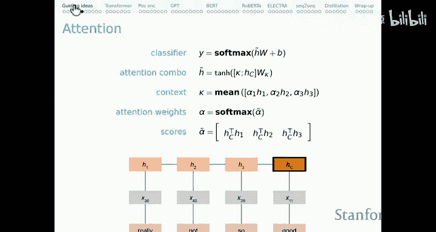

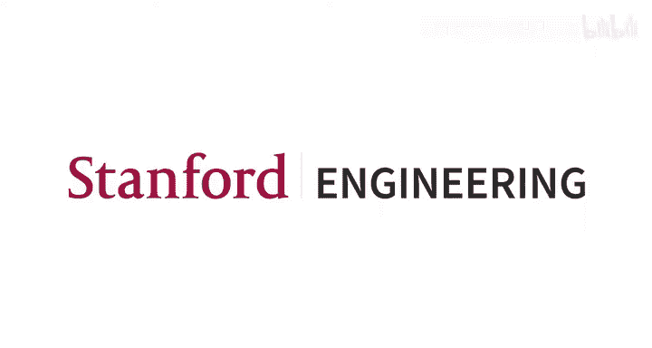