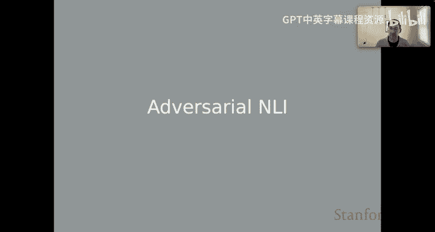
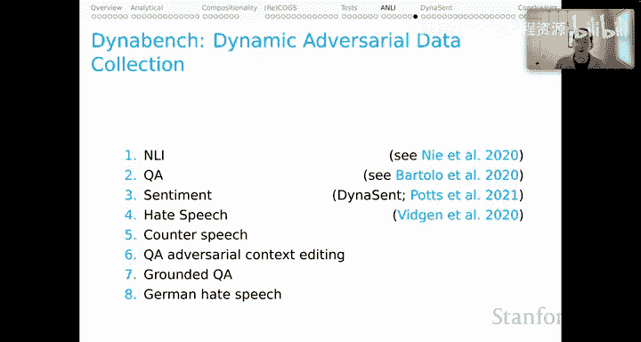
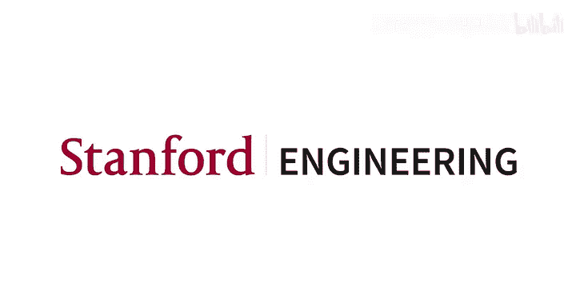

# 斯坦福大学《自然语言理解｜Stanford XCS224U Natural Language Understanding I Sp 2023》中英字幕（豆包翻译 - P30：-30-Behavioral Evaluation of NLU Models, Part 6： Adversarial NLI .zh_en - GPT中英字幕课程资源 - BV1sx4y1s7oW

Welcome back， everyone。 This is part 6 in our series on advanced behavioral testing for N L U。

 To this point， we've been focused on adversarial testing。

 We're now going to take a more expansive view and think about the potential benefits of training on adversarial cases。

 The foundational entry in this literature is the A N L I paper and the associated benchmark。

 As far as I know， A N LI is the first attempt to create a really large train set that is filled with adversarial examples。

 that is with examples that fooled a top performing model， but were intuitive for humans。

I think it's fair to say that A andI is a direct response to the kinds of adversarial test results that we reviewed in the previous screencast。

 where we saw NI models that were surpassing our estimates for human performance。

 but nonetheless the falling down on very simple phenomena。

 turning on systematicity or compositionality in language。

So the vision for ALI is that by introducing an adversarial dynamic into the train set creation。

 we can get models that are more robust。 Here's how data set creation worked。

The annotator is presented with a premise sentence and a condition that is entailment。

 contradiction or neutral， one of the NI labels。The annotator writes a hypothesis。

And then a state of the art model makes a prediction about the resulting premise hypothesis pair。

If the model's prediction matches the condition， that is if the model was correct， in some sense。

 the annotator returns to step 2 to try again。Whereas if the model was fooled。

 the premise hypothesis pairs independently validated by other human annotators。

The result of this dynamic of this interaction with this top performing model is a train set that is full of really hard cases。

 cases that fooled this top performing model， in addition to cases that didn't fool that model。

The examples are kind of interesting。 The premises and AI tend to be long。 The hypotheses are。

 of course， challenging。Interestingly， the data set also contains these reason text。

 This is the annotator's best attempt to explain why the model might have struggled with that particular example。

 As far as I know， the reason text haven't been used very much in the literature。

 but they strike me as an interesting source of indirect supervision about the task。

 So you might check those out。This is the core results table for the ALI paper。

 There's a lot of information here， but I think the story is pretty straightforward。

 Let's focus on the Bt model。 The Bt model is doing really well on S N LI and multi NI across all of these different variants of the training regimes。

When the model is trained only on SNLI and multinLI， it does really poorly on ANLI。

 you can see ALI had three rounds when we pool them together， this model gets around 20% accuracy。

As we take that model and augment its training data with ANLI data from previous rounds。

 we do see improvements overall in the ANLI column which is encouraging。

 it looks like the models are getting better at the task as they get more of these adversarial examples as part of training。

But the fundamental insight here is that performance on ANLI is well below performance for the other benchmarks because this is a substantial challenge。

 and I believe that this substantial challenge still stands。

 models do not excel at ANLI even into this day as far as I know。

One thing I love about A and L I is that it projects this kind of really interesting vision for the future development of train and test assets for the field。

 It's actually all credit due to zeals at all， they also describe this vision in their papers on swag and hella swag。

 They write a path for N LP progress going forward towards benchmarks that adversarally coevolve with evolving state of the art models。

 I didn't have time to tell this full story in details。 Butzeals at all is an interesting story。

 There are two papers。 The first one introduced swag。

 which is a kind of synthetically created train and test environment for adversarial testing。😊。

And they found that it was very difficult， but when the Bert paper came out。

 Bert essentially solved the swag problem。In response to that。

 Zeals at all made some adjustments to the swag dataset set that produced Heasg。

 Heaswag was substantially harder for Bert， And I believe that Heaswag remains a challenging benchmark to this day。

 And I think that started us on the path of seeing how productive it could be to create data sets。

 Use them to develop models and then respond when models seemed to succeed with even harder challenges。

And in the A N L I paper， they project this vision very directly。

 This process yields a moving post dynamic target for N L U systems rather than a static benchmark that will eventually saturate。

 This sounds so productive to me， you know， throughout the field。

 large teams of very talented people spend lots of time and money getting epsilon more performance out of our established benchmarks。

 Wouldn't it be wonderful if instead， when we saw the benchmark saturating。

 we simply created new benchmarks and posed new challenges for ourselves。

 I think it's a very safe bet that models would improve more rapidly and become more capable if we did this kind of moving post thing。

😊，And that really is the vision for Dinabech， Dyninabech is an open source software effort。

 an open source platform for doing among other things， dynamic adversarial data collection。

And Dinabech has produced a number of dataset sets to this point。 A and LI is the first one。

 That's the precursor。 We also have Dyninabech derived dataset sets for Q A for sentiment。

 and a number of data sets for hate speech， including counter speech to hate speech。

 We have a few on Q A and one on German hate speech。 And I think this list will continue to grow。

 and offer us these incredible new resources。So let me stop there for the next screencast。

 I'm going to do a deep dive on a Dynammentch derived data set that we created called Dnocent。

