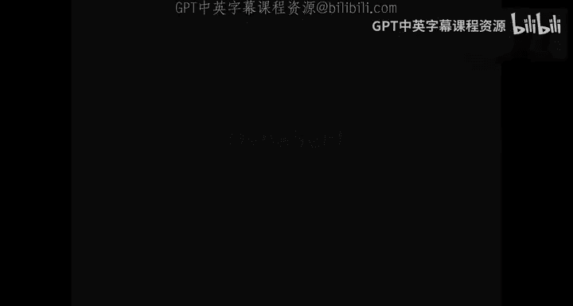
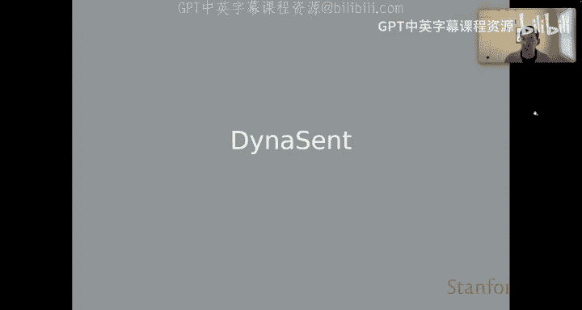
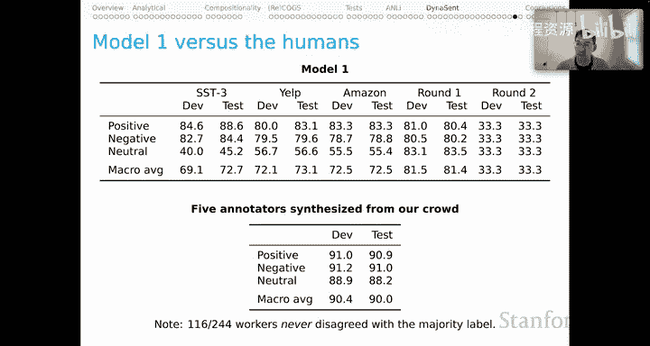
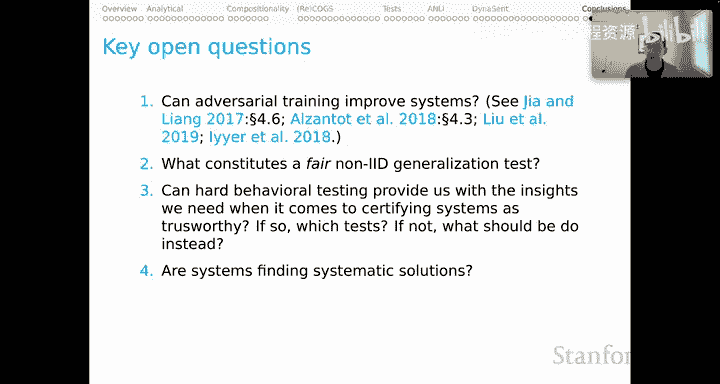

# 斯坦福大学《自然语言理解｜Stanford XCS224U Natural Language Understanding I Sp 2023》中英字幕（豆包翻译 - P31：-31-Behavioral Eval of NLU Models, Pt 7： DynaSent and Conclusion .zh_en - GPT中英字幕课程资源 - BV1sx4y1s7oW

Hello， everyone。 Welcome back。 This is the seventh and final screencast in our series on advanced behavioral evaluation for N LU。

 In the previous screencast， I introduced the idea of having adversarial train sets in the mix。

 and I did that in the context of adversarial NI。 And I talked briefly about the Dinabech platform。😊。

For this greencast， we're going to build on those ideas。

 This is going to be a deep dive on the dinoscent data set， which I was involved in creating。

 You've actually worked already with Dnoscent in the context of assignment 1 and the As bakeoff。

 I'm describing it now because I think it introduces some new concepts and also because it might be a useful resource for you as you think about projects。

 All our data code and models are available on Github。

Dinoscent is a substantial resource with over 120000 sentences across two rounds。

 and each one of those examples has five gold labels from crowd workers。

There's the associated paper and as I said， round two for this was created on Dynina benchch with an interesting adversarial dynamic that I'll talk about。

This is a complete project overview。 We're going to walk through this diagram in some detail at a high level。

 though I think you can see there are two rounds， and there are also two models in the mix。

 Those are the red boxes。 And at each round， we're going to do extensive human validation。

Let's dive into round 1。 The starting point for this is model 0。

 which we use as a device for finding interesting cases naturally occurring on the web。

 Those are human validated， and that gives us our round one data set。In a bit more detail。

 Model 0 is a Roberta based model that was fine tuned on a whole lot of sentiment examples。

 These are the five benchmarks that we use to develop this model。

 All of these data sets for us are cast as ternary sentiment problems。 That is positive。

 negative and neutral。 And you can see from this slide that we are training on a really substantial number of sentiment examples。

We're going to benchmark these models against three external data sets， SST3， Yelp and Amazon。

 and the table here is showing that the model does well on all three of those benchmarks。

 The results are not stellar。 I think this is a pretty hard sort of multi domain problem for sentiment。

But in general， this looks like a solid device for finding interesting cases。

 And that's the role that this will play。 We are primarily thinking of using Model 0 as a device for harvesting examples from the wild。

The space we explore is the Yelp open data set， and we use the following heuristic。

 We favor sentences where the review is one star and model 0 predicted positive。And conversely。

 where the review is 5 star and model 0 predicted negative， This is a heuristic that we think。

 On average， will lead us to examples that model 0 is getting incorrect。But it is just a heuristic。

 The only labels we use are ones that are derived from a human validation phase。

 This slide is showing you the interface that we used。

 The code is actually available in the project repository。

 And you can see at a high level that reviewers were making a choice about whether a sentiment had positive。

 negative， No sentiment or mixed sentiment labels。Each example was validated by five workers。

The resulting data set is quite substantial。 This is a kind of summary of the numbers。 First。

 I would point out that 47% of the examples are adversarial， which seems to me a high rate。

 but the data set includes both adversarial and non adversarial cases。

 I think that's important to making a high quality benchmark。

There are two ways that you can think about training on this resource。

 The standard one would be what we call majority label training。

 And this is the case where you infer that the label for an example is the label that was chosen by at least three of the five people who labeled it。

 And if there is no such majority label， you put that in that separate elsewhere category。

 That leads to a substantial resource。However， we find that it is more powerful to do what we call distributional training In distributional training。

 you repeat each example five times with each of the labels that it got from the crowdworkers and train on that entire set。

 The result is that you don't have to worry about the no majority category anymore more。

 So you keep all your examples。 And you also intuitively get a much more nuanced perspective on the sentiment judgments that people offered。

 Some are clear cases with five out of five， and some actually have pretty mixed distributions across the labels and your training models on all of that information。

And we find in practice that that leads to more robust models。For the Devon test。

 we restrict attention to positive， negative and neutral to have a clean three class ternary sentiment problem。

 and we balanced across those three labels for both Devon test。So how do we do， Well。

 let's think first about model 0 in its performance on this benchmark， This is a kind of summary。

 We set things up so that model 0 performs a chance on round 1。

 No information coming from model 0 about the labels。

 And then you have the summary numbers here before from before on how it does on all of those external benchmarks。

Humans， by contrast， do extremely well on round1。 We estimate that the kind of F1 for humans is around 88 per cent。

 and that's a high number， and it also arguably understates the level of agreement。

 So we note that 614 of our 1200 workers never disagreed with the majority label。

 So this looks to us like a very high rate of agreement and consistency for humans on this resource。

And here， just to round out， the discussion of round1 are some randomly sampled short examples showing you every combination of model prediction and distribution across the labels focused on the majority label in this case。

 And you see a lot of interesting， nuanced linguistic things。

 And I think a lot of use of non literal language。Let's move now to round 2。

 This is substantially different。 We begin from Model 1。

 and this is a Roberta model that was fine tuned on those external sentiment benchmarks。

 as well as all of our round one data。 The intuition here coming from the A LI project is that we should train models on previous rounds of our own dynamic data set collection。

Instead of harvesting examples from the wild in this phase。

 we're going to use Dynina bench to crowd source sentences that fool Model 1 will human validate those。

 and that will lead us to our round two data set。Let's think a little bit about Model 1。 Again。

 this is a Roberta based classifier， and it is trained on those same external benchmarks。

 but now down sampled somewhat so that we can give a lot of weight to round one。

 which is now in the mix。These models are still trained on a substantial amount of data。

 and we're trying to do to offer some evidence that round one is the important thing to actually focus on for this model。

How do we do， This is a summary of performance on the external data sets， as well as round1。

 And you can see down here that this model is getting around 80% on our round1 data with essentially no loss in performance on those external benchmarks。

 There is a bit of a drop， I think we are performing some kind of domain shift by emphasizing round1。

 as I described。 but overall， we're maintaining pretty good performance while doing quite well on the round one data set。

😊，I want to do a deep dive a little bit on how the examples were crowdsource。

 Because I think this is an interesting nuance around how to get people to write productively in a crowdsourcing context。

 In the original interface， we simply did more or less what was done for A and LI， which we。

 which is that we asked people to write a sentence from scratch that would fool the model in a particular way。

We found， though， that that's a very difficult creative writing task。

 and it leads people to do similar things over multiple examples。

 which we intuited would lead to artifacts in the resulting data set。

And so we switch to emphasizing what we call the prompt condition in the prompt condition。

 we actually offer crowd workers a naturally occurring sentence that comes from the Yelp open data set。

 and their task is to edit that sentence in order to achieve this task of fooling the model。

The result is a data set that's much more high quality and has much more naturalistic examples in it。

For validation， we did the same thing as round one。

 and that leads to a data set that looks like this。

 There are only 19% cent adversarial examples in this。 I think this shows that by now in the process。

 we have a very strong sentiment model that is very difficult to fool。

 But 19 per cent is still a substantial number numerically。 And so we feel like we're in good shape。

Overall， it's a somewhat smaller benchmark， but it has similar structure。

 We can do majority label training as well as distributional training。

 and we have balanced dev and tests。 They just happen to be a little smaller than round one。

How does Model 1 do versus humans？ Well， again， we set things up so that Model 1 would performed at chance on our round 2 data。

 And you saw that Model 1 does pretty well on the round 1 data for humans， though。

 this round is extremely intuitive。 Our estimate of F1 for humans is actually higher than for round 1。

 We're now at around 90 per cent。And here， a hundred and 16 of our 244 workers never disagreed with the majority label。

 again， a substantial level of agreement on what are clearly very difficult sentiment problems。

 And just to round this out， I thought I'd show another sample of examples from this round， again。

 showing Model one predictions and every way that the majority label could have played out。

 And I think even more than in round one， what we start to see are examples that make extensive use of intricate syntactic structures and also intricate use of non literal language like metaphor and sarcasm and irony。

 as techniques for coming up with examples that are intuitive for us as humans。

 but are routinely very challenging for even our best models。

So that is Dnoscent， let me use this opportunity to just wrap things up with a few conclusions。

 these are all meant to be open questions designed to have us looking ahead to the future of adversarial training and testing。

Core question here。 can adversarial training improve systems， I think overall。

 we're seeing evidence that the answer is yes， but there is some nuance there。

 And I think it's going to take some calibration to get this exactly right。

What constitutes a fair non Iid D generalization test。

 I introduced this notion of fairness when we discuss the analytic considerations around all these behavioral evaluations。

 and then this became very pressing when we talked about why some of the cogs and recog splits are so difficult。

 The question arises。 whether it's even fair to be asking our machine learning systems to generalize in particular ways that might nonetheless the seem pretty intuitive for us as humans。

Can hard behavioral testing provide us with the insights we need when it comes to certifying systems as trustworthy。

 If so， which tests， And if not， what should we do instead， I think this is a crucial question。

 I think in a way， we know that the answer is no， No amount of behavioral testing can offer us the kind of guarantees that we're seeking。

 But it is it is a powerful component in getting closer to deeply understanding what these systems are like。

 And certainly we can use behavioral testing to find cases where they definitely fall down。

 But for actual certification of safety and trustworthiness。 I believe we will need to go deeper。

 And that is the topic of the next unit of the course。Fundamentally。

 are our best systems finding systematic solutions。 If the answer is yes。

 we will feel as humans that we can trust them。 And if the answer is no。

 even if they seem to behave well in some scenarios。

 we might always worry that they're going to do things that are totally baffling to us。

And then finally， the big， juicy， kind of cognitive and philosophical question。

 where humans generalize in ways that are unsupported by direct experience。

 How should AI respond in terms of system design， What should we do in order to achieve these very unusual quasi cognitivetive quasi behavioral learning targets。

 I don't have a way to resolve this question， But I think it's really pressing when we think about really challenging our systems to do complex things with language。

