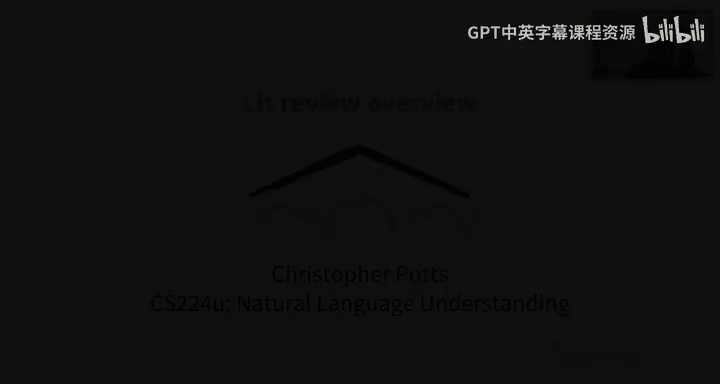
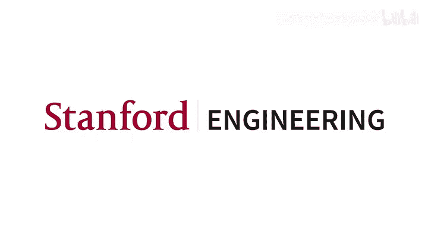

# 斯坦福大学《自然语言理解｜Stanford XCS224U Natural Language Understanding I Sp 2023》中英字幕（豆包翻译 - P32：-32-Lit Review Overview .zh_en - GPT中英字幕课程资源 - BV1sx4y1s7oW

Welcome， everyone。 This short screencast is an overview of the lit review。

 We've reached the project phase of this course， and I think the lit review is a really crucial element there。

 It's where you begin to build an intellectual foundation for your project。

Fundamentally， for me， the rationale behind the lit review is about productive dialogue。

 We want you to enter into dialogue with your teammates and with yourself and with your mentor from the teaching team about what you're going to try to accomplish in the final project。

 So you should pose questions。 You should identify obstacles and propose initial workarounds。

 You should find data sets and models and architectures and everything else。

 And you should think carefully about your resources。

 The idea here is to gather Intel from the literature。

About what people are doing in your space and use that information to begin to carve out an original vision for your own final projects。

The specific requirements are listed at the course website。

 You can follow the link at the top of the slide here。 Let me just offer you a brief rundown。 First。

 it's a roughly six page document， and we say 8 pages is the max so you don't go overboard。

 and that does not include the obligatory references section。We have a template that you can use。

 it's a LoX template based in the ACL format， you're not required to use it but you might as well and you'll begin to get used to dealing with that ACL format。

 which is required for the final paper。Groups of one should review five papers。

 Groups of two should review 7， and groups of three should review 9。

 I think you can hear in there a small incentive for doing group work。

 which we think is productive in general。The ideal is to have the same topic for your lit review and final project。

 obviously that's the most efficient， but we do grant that sometimes people finish their lit review and that leads them to the realization that they don't want to work in that area anymore that is perfectly fine。

 but then you should negotiate that with your mentor and with the members of your team to make sure you can have your actual project converge in the time available。

 which is always too short。And then we come to the major things to include and you might as well use these phrases as section headings in the document to help your mentor understand what you're trying to do。

So general problem task definition， this is absolutely crucial。

 we want to know what kind of questions you're going to be asking and you might begin to guide us toward things that will be crucial for your project。

Then we want concise summaries of the articles， and I will say we're not really looking for you to just summarize the content rather the ideal summary is going to raise questions and identify issues that will be useful to you in thinking about the project work itself and relatedly you should compare and contrast these articles。

 How do they differ in terms of models and data and fundamental results because that too could help point the way toward space for an original contribution。

And then really importantly， let's think about future work， what are you going to do next。

 how might this all come together into a project， it's never too early to begin that creative process and the more you can do under this heading。

 the more productive your dialogue with your mentor will be and then I think you'll be able to go farther。

And then finally。So that you get in the habit of this and so that we can identify what literature items you're reviewing。

 we want an obligatory references section。In terms of actually conducting lit review searches。

 I do have some tips that I have found really productive over the years。

 so here's the kind of cycle that I still use regularly。

Search with some keywords in the ACL Anthology， Google Scholar or semantic Scholar。Because it's NLP。

 I recommend starting with the ACL anthology， a wonderful aspect of the NLP community is that it is very well organized when it comes to its literature。

Essentially， all of the work that's published by the L A L is accumulated into this anthology。

 which has good Google search， good bib entries， abstracts， links to the papers。 You name it。

 So that's a good first stop， especially if you' are working on a core topic in N LP。😊。

But don't limit yourself to that， you should branch out also in Cze Google Scholar and semantic Scholar in this course we really value interdisciplinary work and so you want to connect with other literatures besides NLP in many cases。

Next step， download relevant and or highly cited results and check out their abstracts and related work sections。

These are heuristics relevant will be delivered by the search engine， According to your keywords。

 and then highly cited is just a good heuristic for finding things that have been influential。

 You shouldn't depend on it， but there's no doubt that it's a useful piece of information。

When you do this， you're seeking out key questions and techniques and also other highly cited papers。

 You should not read entire papers at this point that is tremendously inefficient。

 There are too many papers out there。 So you need to use your time wisely。

 So the idea here is to get a feel for these papers and also get a sense for what else they are citing。

Download the papers that you see prominently in the related work section and kind of add those to the set that you downloaded as part of your core search。

And then return to step 1 with some new keywords that you gathered as part of the searching that you did。

And you should keep going on that loop and break out of it when you have a sense for what you're doing and what others have done in the area。

 you'll start to iterate out around in a few papers that you think are clearly important。

 Maybe some new directions will be suggested by the other papers that are in your set。 Now。

 you've got the basis for thinking about a selection for the lit review。

At that stage you select some core papers from that downloaded set。

 and finally you read those deeply and you cover those in the lit review notice you do that only at the final stage so that you can learn as much as you can by kind of surveying widely in a lightweight way。

 and then you go deep once you have a sense for where to invest。This is sort of amusing。

 a plagiarism policy。 It's especially meta feeling for us because after all。

 we study large language models， and there's a growing concern in academia that these language models will make it harder for us to assess student writing。

 Let's try to embrace this a little bit。 So I did do a search based on how the elect paper relates to the transformers's paper。

 This is with G 4。 And I will confess to you that what came back looks awfully useful to me。

 this does look like kind of raw information that you could use to inform a lit review。

 So that's all to the good。😊，Make sure you know the course policy though it's linked here and what it essentially says is there's no rule against using an AI assistant like GPT4 to help you with your lit review。

But all output from the model needs to be quoted。 That's per the policy。

 You treat it like any other resource。 And， of course。

 assignments that are just quotations from any resource are not going to do well in terms of evaluation。

Assignments with substantial overlap in prose will be scrutinized for plagiarism。

 What that means is that if two groups used a similar prompt and got back similar results and and included them in the lit review unquoted。

 they'd probably get an had for plagiarism， not because they used a model。

 but because the two assignments look too much alike。 And at that point。

 it's not the language model that we're implicating here。

 But rather the standard sort of thing that we see when we worry about plagiarism。

So I would suggest using these assistants not to produce raw prose for you。

 but rather to help you figure out what's in the literature and you'll want to be skeptical consumers because while I think this is a pretty good description of E and transformers。

 I haven't thoroughly audited it， and I wouldn't included anywhere。

 even paraphrased by me until I had given it a thorough audit to make sure that it was all factually correct because that's the ultimate thing that we're looking for and nevermin where all this prose came from But the idea here is that there is obviously value to these things they could supercharge certain aspects of research So we don't want to ban them After all。

 we think they're really interesting artifacts。 That's why we're in this course but we want to use them with caution and we want to make sure that they don't end up kind of producing really bad scholarship that is the fundamental thing that we're watching out for。

That's it for the lit review。 It's worth thinking ahead to the next document。

 which is a bit more unusual in the context of these course。 That's the experiment protocol。

 This is a short structured report designed to help you establish your core experimental framework。

 And the required sections are listed here。 Hypotheses， data， metrics， models， General reasoning。

 summary of progress and references。 you can see that that's kind of the raw materials for a project in this space。

 and we're trying to look to see whether anything is missing。

 and whether there are any other obstacles that would prevent your project from converging in the time available。

 The idea is clarity around project goals， I of obstacles and project risks。

 So you should be airing on the side of disclosing too much in the interest of making sure we overcome all the obstacles and fill in all the gaps so that the project succeeds in the end。

 That's for the protocol。 But you might as well be thinking along these lines for the lit review。

 It is。Never too early to begin brainstorming about exactly what the final project is going to look like。

 even at the lit review stage， you can start to get a feel for what hypotheses are interesting。

 what techniques you want to try， and so forth and so on。 So the earlier the better。

 that's what all of these preliminary project assignments are about。

