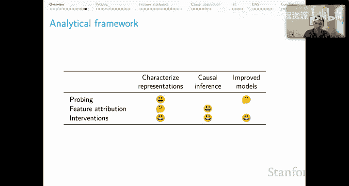

# 斯坦福大学《自然语言理解｜Stanford XCS224U Natural Language Understanding I Sp 2023》中英字幕（豆包翻译 - P33：-33-Analysis Methods for NLU, Part 1： Overview .zh_en - GPT中英字幕课程资源 - BV1sx4y1s7oW

Welcome， everyone。 This greencast kicks off our unit on analysis methods in NLP。

In the previous unit for the course， we were very focused on behavioral testing。

 and we looked in particular at hypothesis driven challenge and as adversarial tests as a vehicle for deeply understanding how our models will behave in especially unfamiliar scenarios。

 What we're going to try to do in this unit is go one layer deeper and talk about what I've called structural methods。

 including probing feature attribution and a class of intervention based methods。

 And the idea is that we're going to go beyond simple behavioral testing to understand we hope the causal mechanisms that are guiding the input output behavior of our models。

In the previous unit， I tried to make you very aware of the limits of behavioral testing。 Of course。

 it plays an important role in the field， and it will complement the methods that we discuss。

 but it is intrinsically limited in ways that should worry us when it comes to offering guarantees about how models will behave to make that very vivid for you。

 I use this example of an even odd detector。 Let me walk through that from now taking a slightly different perspective。

 which is the kind of illuminated feeling that we get when we finally get to see how the model actually works。

 But recall this even odd model takes in strings like 4。

 and predicts whether they refer to even or odd numbers。 So4 comes in and it predicts even 21。

 and it rightly predicts odd 32， even 36， even。63 odd。

 And this is all making you feel that the model is a good model of even odd detection。

But you need to be careful。 You've only done five tests。 Now。

 I show you how the model actually works， and it is immediately revealed to you that this is a very poor model。

 We got lucky with our first five inputs。 It is a simple look up on those inputs。

 And when it gets an unfamiliar input， it defaults to predicting odd。 Once we see that。

 we know exactly how the model is broken and exactly how to foil it behaviorally， we input 22。

 and it thinks that that is odd。😊，But then we get a second even oddD model。

It passes the first five tests。 It makes a good prediction about 22。

 good prediction about 5 and 89 and 56。 And again， your confidence is building。

 But you should be aware of the fact that you might have missed some crucial examples。And again。

 when I show you the inner workings of this model， you get immediately illuminated about where it works and where it doesn't。

 This model is more sophisticated。 It tokenizes its input and uses the final token as the basis for predicting even odd。

 That is a pretty good theory。 but it has this else clause where it predicts odd。

 And now we know exactly how to foil the model。 We input 16， and it thinks that that is odd。

So it was really the point at which we got to see the internal causal mechanisms that we knew exactly how the model would work and exactly where it would fail。

 Now， we move at last to Model 3。 Let's suppose that it gets all of those previous inputs correct。

 Is it the one true model of even odd detection。 Well， we can keep up our behavioral testing。

 But you should see by now that no matter how many inputs we offer this model。

 we will never get a guarantee for every integer string that it will behave as intended for that kind of guarantee we need to look inside this black box。

But， of course， in the modern era of N LP models， they're hardly ever as easy to understand as the symbolic programs that I was just showing you。

 Instead， our models look like this huge array of birds nests。 Lots of internal states。

 all connected to all the other states， completely opaque。

 They consist mainly of weights and multiplications of weights。 They have no symbols in them。

 Therefore， they are very difficult for us to understand as humans in a way that will illuminate how they'll behave in unfamiliar settings。

Of course， the dream of these models is that somehow we'll see patterns of activation or something that look like this and begin to reveal what is clearly a tree structure。

 And so you might think aha， the model actually does implicitly represent constituents or named entities or other kinds of meaningful unit in language。

 and then you would feel like you truly understood it。But， of course， that never happens。 Instead。

 what we get when we look at these models is apparently just a mass of activations。

 You get the feeling that either there's nothing systematic happening here or we're just looking at it incorrectly。

I'm going to offer offer a hopeful message On this point。

 The mess is only apparent when we use the right techniques and take the right perspective on these models。

 the best of them actually have found really systematic and interesting solutions。

There's another angle we could take on this， which connects back to the stuff about behavioral testing。

 I've showed this slide a few times in the course。 It's progress on benchmarks along the X axis。

 we have time and the Y axis is a normalized measure of distance from our estimate of human performance in the red line。

And one perspective on this slide is that progress is incredible。

 benchmarkchmarks used to take us decades get to saturate。

 and now saturation happens in a matter of years。The other perspective on this plot， of course。

 is that the benchmarks are too weak。 We have a suspicion that even the models that are performing well on these tasks are very far from the human capability that we are trying to diagnose。

 We feel that they have brittle solutions， concerning solutions that are going to reveal themselves in problematic ways。

To really get past that concern， we need to go beyond this behavioral testing。

There's another underlying motivation for this， which is systematicity。

 We talked about this in detail in the previous unit。 It's an idea from Froder and Piian。

 They say what we mean when we say that linguistic capacities are systematic I that the ability to produce or understand some sentences is intrinsically connected to the ability to produce understand certain others。

 This is the idea that if you know what Sandy loves the puppy means。

 then you just know what the puppy loves Sandy means。

 And if you recognize the distributional affinity between the turtle and the puppy。

 You also understand the turtle loves the puppy。 Sandy loves the turtle and so forth and so on for suddenly an enormous number of sentences。

 And the kind of human capacity for language makes it feels like these aren't new facts that youre learning。

 but rather， things that follow directly from an underlying capability that you have。

 And we offered compositionality as one possible explanation for why in the language realm our understanding and use of language is so。

Systematic。The related point here is that you get the feeling that we won't fully trust our models until we can validate that the solutions that they have found are also systematic or maybe even compositional in this way。

 Otherwise will have concerns that at crucial moments， their behaviours will be arbitrary。

 seeming to us。There's another angle that you can take on this project of explaining model behaviors。

 You know， the field has a lot of really crucial high level goals that relate to safety and trustworthiness and so forth。

 right， We want to be able to certify where models can be used and where they should not be used。

 We want to be be able to certify that our models are free from pernicious social biases。

 and we want to offer guarantees that our models are safe in certain contexts。😊。

Given what I have said about behavioral testing， you can anticipate what I'll say now。

 behavioral testing alone will not suffice to achieve these goals。

 It could possibly tell us that a model does have a pernicious social bias or is unsafe in a certain context or has a certain area where it should be disapproved for use。

But the positive guarantees， free from social bias， safe in a context or approve for a given use。

 Those will not be achieved until we get beyond behavioral testing for those。

 we need to understand at a deep level what our models are structured by and how。

 what mechanisms guide their behavior。 We need analytic guarantees about how they will behave。

 And that means beyond behavioral testing to really understand the causal mechanisms。

In service of moving toward that goal， we're going to discuss， as I said， three main methods。

 The first one is probing。 There are some precedents before Tenny at all 2019 in the literature。

 But I think Tenny at all give real credit for showing that probing was viable and interesting in the Bert era。

 because what they did is essentially fit small supervised models to different layers in the Bt architecture and what they discovered is that there is a lot of systematic information encoded in those layers。

 This was really eye opening， I think that most people believed that even though Bert was performant。

 It was performant in ways that depended on entirely unsystematic solutions。

 and what probing began to suggest is that Bert had induced some really interesting causal structure about language as part of its training regime。

The way this plot works is that we have the layers of Bt along the X axises。

 and we have different phenomena in these different panels。 And what you can see in the blue。

 especially is that different kinds of information are emerging pretty systematically at different points in the Bt layer structure。

 For example， part of speech seems to emerge around the middle。 Dependency pars emerge a bit later。

 Na entities are kind of fainter and later in the structure。

 semantic rolls pretty strong near the middle。 Co referenceference information emerging later in the network and so forth and so on。

 This was really eye opening because I think people didn't anticipate that all of this would be so accessible in the hidden representations of these models。

What we'll see is that probing is very rich in terms of characterizing these internal representations。

 but it cannot offer causal guarantees that this information is shaping model performance。

 So we can complement that with a class of methods that are called feature attribution methods。

 The idea here is that we will essentially in the deep learning context study the gradients of our model and use those to understand which neurons and which collections of neurons are most guiding its input output behavior。

 And for these methods， we're going to get kind of only faint characterizations of what the representations are doing。

 but we will get some causal guarantees。 What I've got here to kind of illustrate is a simple sentiment challenge set。

 there are a bunch of hard cases involving attitude taking with verbs like。

 say and kind of shifts in sentiment。 And what you see here in the highlighting is that the model seems to be making use of very intuitive information to shape what are very good predictions for these cases。

And again， that might be reassuring to us that the model is doing something human。

 interpretable and systematic under the hood。And then finally。

 we're going to study intervention based methods。 This is a large class of methods。

 I think I'll save the details for a later screencast。

 but the essence of this is that we're going to kind of perform brain surgery on our models。

 We are going to manipulate their internal states and study the effects that that has on their input output behavior。

 and in that way， we can piece together an understanding of the causal mechanisms that shape the models's behavior。

Pushing us toward exactly the kind of guarantees that we need。So let me。

 by way of wrapping up this opening Sccast， offer you a kind of analytical framework for thinking about the methods that we're going to discuss。

 Let's say we have three goals。 First， we want to characterize representations。

 input representations， output representations， but maybe most crucially internal representations for our models。

We also want to make causal claims about the role of those representations。

 and once we have started to learn about how the models behave。

 we would like to have an easy path to actually improving models based on those insights so that we don't simply passively study them。

 but rather actively make them better。So that's a kind of scorecard， let's think about these methods。

 what we'll see is that probing is great， as I said， at characterizing representations。

 but it cannot offer causal inferences and it's unclear whether there's a path from probing to actually improving models。

For future attributions， we get only faint characterizations of the model internal states。

 we pretty much just get weights that tell us how much individual neurons contribute to the input output behavior。

But we can get causal guarantees from some of these methods。

 we'll talk about integrated gradients as an example of that。

And then these intervention based methods， I've got smilemiies across the board。

 This is the class of methods that I've been most deeply involved with。

 It's the class of methods that I favor， and that is in large part because of how well they do on this scorecard with these methods。

 we can characterize representations。 we can offer college guarantees。 And as you'll see。

 there's an easy path to using the insights we gained to actually improve our models。

 And that's kind of the name of the game for me。So we will now begin systematically working through these three classes of methods。

 trying to more deeply understand how they work and why my scorecard looks the way it does。

