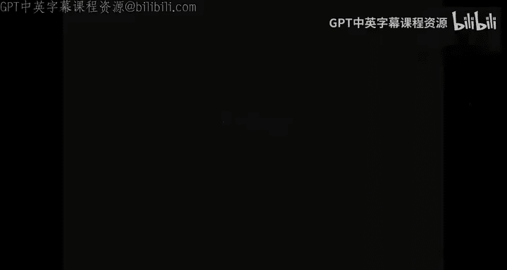
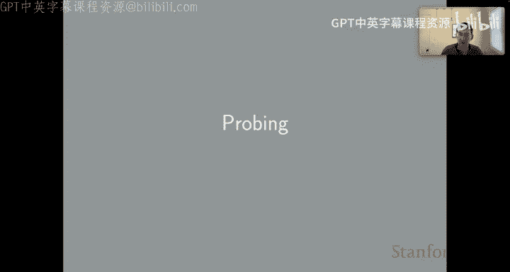
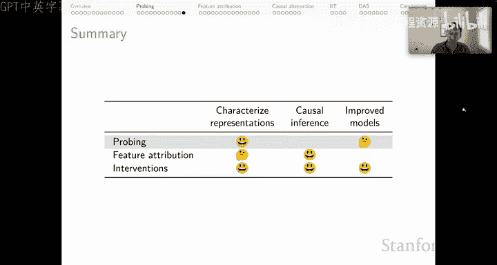

# 斯坦福大学《自然语言理解｜Stanford XCS224U Natural Language Understanding I Sp 2023》中英字幕（豆包翻译 - P34：-34-Analysis Methods for NLU, Part 2： Probing .zh_en - GPT中英字幕课程资源 - BV1sx4y1s7oW

Welcome back， everyone。 This is part 2 in our series on analysis methods for N LP。

 We've come to our first method， and that is probing。 Here' is an overview of how probing works。

 The core idea is that we're going to use supervised models。

 Those are our probe models to determine what is latently encoded in the hidden representations of our target models。

 the ones that we actually care about。😊。

Probing is often applied in the context of so called bertology。

 and I think Tenny at all 2019 is a really foundational contribution in this space。

 As I mentioned before， I think this was really eye opening about the extent to which Bert is inducing interesting structure about language from its training regimes。

Probing can be a source of valuable insights， I believe， but we do need to proceed with caution。

 And there are really two cautionary notes here。 First。

 a very powerful probe might lead you to see things that aren't in your target model。

 but rather just stored in your probe model。 It is， after all。

 a supervised model that you trained in some way。Second， and maybe more importantly。

 for the current unit， probes cannot tell us about whether the information that we identify has any causal relationship with the target model's input output behavior。

 This is really concerning for me， because what we're looking for from analysis methods is insights about the causal mechanisms that guide model behaviors。

 So if probing falls short on offering us those causal insights。

 It's really intrinsically limited as an analysis method。

I'm going to focus for this screencast on supervised probes to keep things simple。

 but I will mention unsupervised probes near the end。

 They don't suffer from the concern that they're overly powerful， but they do， I think。

 still fall short when it comes to offering causal insights。

Let's start with a kind of recipe for probing to be careful about this。

 The first step is that you state a hypothesis about an aspect of the target model's internal structure。

 You could hypothesize that it stores information about part of speech or named entities or dependency parss。

 You name it。 The hypothesis space is open。You then need to choose a supervised task that is a proxy for the internal structure of interest if you're going to look for part of speech。

 you need a part of speech data set and you're going to be dependent on that dataset set when it comes to actually defining the probe itself。

Then you identify a place in the model， a set of hidden representations where you believe the structure will be encoded。

And you train a supervised probe on the chosen site。

 And then the extent to which your probe is successful is your estimate of the degree to which you are right about the underlying hypothesis。

 But there are some caveats there。Let's first walk through the core method。

 What I have on the slide now is a kind of very cartoonish look at a burnt like model with three layers。

 And you can see these inputs have come in， and we're going to target the hidden representation H to start。

 Let's suppose that's the site that we chose to probe。

What we're going to do is fit a small linear model on that internal representation using some task labels。

 The way that actually plays out in practice is instructive， right。

 We're going to run the burnt model on the current input。

 and we're going to grab the vector representation there。

 and use it to start building a little supervised learning data set where this is some vector。

 and this is a task label for our input example。 Then we run the burnt model again on a different sequence。

 We get a different vector representation at our target site。

 and that also contributes to our supervised learning dataset set with a new task label。

 We do it again for a different input。 We get a different vector and another task label and so forth and so on。

 And we continue this process firm。 maybe tens of thousands of examples。

 whatever we've got available to us in our probe data set。

 And then we fit a small linear model on this X Y pair。😊。

Notice that we have used the BRT model simply as a kind of engine for grabbing these vector representations that we use for our probe model。

And， of course， I chose a single representation， but more commonly with Bert were doing this layer wise。

 You could decide that the entire layer here encodes part of speech。

 and then you would build up a data set consisting of lists of these vectors with their associated lists of labels and train a part of speech tagging model on that basis。

 And that would be your probe。The first question that arises for probing is really pressing。

 Are we probing the target model， Are we simply learning a new model that is the probe model， probes。

 in the current sense， are supervised models whose inputs are frozen parameters of the model we're probing。

 right， We use the Bt model as a kind of engine for creating these feature representations that were the input to a separate modelling process。

This is very hard to distinguish from simply fitting a supervised model， as usual。

 with some particular choice of feturization， right。

 the site that we chose based on how Bert did its calculations。So based on one and two。

 we know that at least some of the information that we're identifying is likely stored in the probe model。

 not in the target model。And of course， more powerful probes might find more information in the target model。

 but that's only because they're storing more information in the probe parameters。

 they have a greater capacity to do that。To help address this。

 Hewett and Leang introduced a notion of probe selectivity。

 and this is just going to help us calibrate to some extent how much information was actually in the target model。

The first step here is to define a control task。 This would be a random task with the same input output structure as your target task。

 For example， for word sense classification， you could just assign words random fixed senses。

 for part of speech tagging， you could assign words to random fixed tags。

 may be keeping the same tag distribution as your underlying part of speech data set。 or for parsing。

 you could assign edges randomly using some simple strategies to give you tree structures that are very different。

 presumably from the ones in your gold data set。And then selectivity as a metric for probes is just the difference between probe performance on the task and probe performance on the control task。

 So you've baked in how well your model can do on a kind of random task。 That's the idea。

And Hetton and Leang offer this kind of summary picture。

 which essentially shows that the most reliable probes in terms of giving you insights will be very small ones here。

 This is a model with just two hidden units that gives you very high selectivity。

 there is likely to be a very large difference between performance on your task and the performance of this control model when the model is very simple。

 On the other hand， if you have a very powerful probe model with many parameters。

 you'll have low selectivity because that model has such a great capacity to simply memorize aspects of the dataset set。

😊，Let's move now to the second concern I have， which is about causal inference。

 And to build this argument， let's use a simple example。

We imagine that we have a small neural network that takes in three numbers as inputs and perfectly computes their sum。

 So when 1，3，5 comes in， it does its internal magic and it outputs 9。

 and we'll presume that it does that calculation perfectly for all triples of integers coming in。

The question is， how does it manage this feat， How does this model work。

 You might have a hypothesis that it does it in a kind of compositional way where the first two inputs。

 X and Y come together to form an intermediate variable S1。

 The third one is kind of copied into an internal state W。

 And then S1 and W are modular representations that are added together to form the output representation。

 That's a hypothesis about how this model might work。 And now the question is。

 can we use probing to reliably assess that hypothesis。

So let's suppose we have this neural network and what we decide is that L1。

Probably computes the input Z。And let's suppose we fit a probe model。

 It could be a simple identity probe， and the probe says yes。

 L1 always perfectly encodes the identity of the third input。

Suppose we continue that we probe L2 and we find that it always perfectly computes x plus y。

 according to our very simple probe model。That might look like evidence for the hypothesis that we started with。

 You say， aha， it's a bit counterintuitive because L 1 encode Z and L 2 X， Y。

 So it's kind of out of order。 But nonetheless， the model is obeying my hypothesis。

But the probes have misled you。 Here is a look at the full internal structure of this model。

 This is all the weight parameters。 Again， this model performs our task perfectly。

 But the point is that L 2 has no impact at all on the output behavior。

 And one way to see that is to look at the output vector of weights。

 L 2 is just zeroed out as part of this computation。 No causal impact。

 The probe said it stored X plus Y。 And it might be doing that。 In fact， it is doing that。

 but not in a way that tells us about the input output behavior。So the probe in that deep way。

 in that causal way， misled us。The final goalpost that I set up was。

 do we have a path to improving models from the analysis method that we've chosen here。

 I have a kind of mixed answer。 There does seem to be a path from probing to what you might call multi taskask training。

 where I'm training this model to do addition。 and in addition。

 I train it so that this representation here in code Z。 And this one encodes X plus Y。

 We can certainly have such objectives。 I think it's an open question whether or not it actually induces the kind of modularity that we're interested in。

😊，But the really deep concern for me is just that still here we don't get causal guarantees。

 We can do the multitask training， but that does not guarantee that the structure we induced whatever it's like is actually shaping performance on the core task in this case of adding numbers。

 So we have to proceed with caution。Finally， a quick note， I mentioned unsupervised probes。

 There's wonderful work in this space using a variety of different methods。

 Here are some references to kind of really formative entries into that literature。 Again。

 I think these techniques do not suffer from the concerns about probe power because they don't have their own parameters typically。

 but they do， I think， suffer that limitation about causal inference。

So let's wrap up with our scorecard。 Remember， probing can characterize representations really well。

 We use the supervised probe for that。 So that's a smiley face。

 but probes cannot offer causal inferences。 And I put a kind of thinking emoji under improved models because it's unclear to me whether multitask training is really a viable。

 general way of moving from probes to better models。

