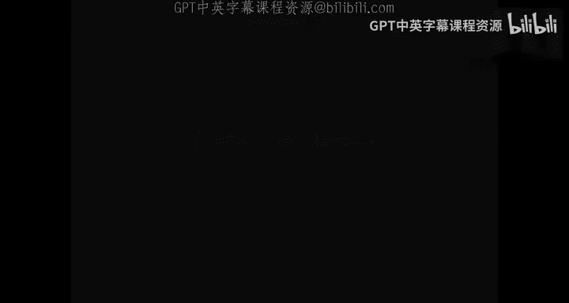
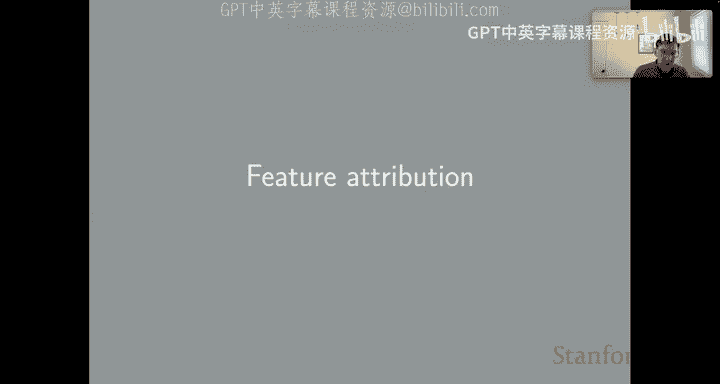
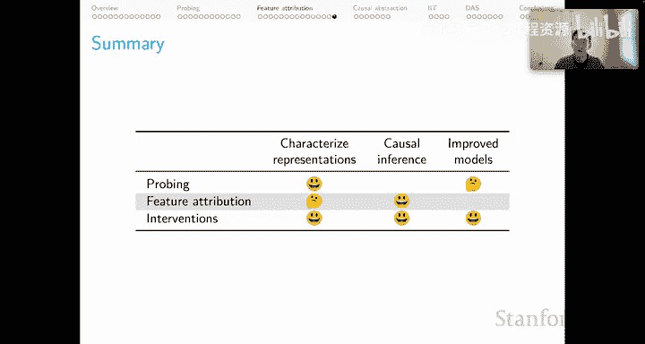

# 斯坦福大学《自然语言理解｜Stanford XCS224U Natural Language Understanding I Sp 2023》中英字幕（豆包翻译 - P35：-35-Analysis Methods for NLU, Part 3： Feature Attribution .zh_en - GPT中英字幕课程资源 - BV1sx4y1s7oW

Welcome back everyone， this is part three in our series on analysis methods for NLP。

 we're going to be focused on feature attribution methods。

I should say at the start that to keep things manageable。

 we're going to mainly focus on integrated gradients from Sunnda Ra Rajan etal 2017。

 This is a shining， powerful， inspiring example of an attribution method for reasons I will discuss。

 But it's by no means the only method in this space。 for one stop shopping on these methods。

 I recommend the Cap do AI library。 It will give you access to lots of gradient based methods like I G。

 as well as many others， including more traditional methods like feature ablation and feature permutation。

😊，So check out Capam AI In addition， if you would like a deeper dive on the calculations and examples that I use in the Sccast。

 I recommend the notebook feature attribution， which is part of the course code repository。Now。

 I love the integrated gradients paper， Sunara Rajan et all 2017， because of its method。

 but also because it offers a really nice framework for thinking about attribution in general。

 And they do that in the form of three axioms。 I'm going to talk about two of them。 And of the two。

 the most important one is sensitivity。 This is very intuitive。😊。

The axiom of sensitivity for attribution methods says if two inputs x and x prime differ only at dimension I and lead to different predictions。

 then the feature associated with dimension I has non zero attribution。So here's a quick example。

 Our model is M。And it takes inputs that are three dimensional， and for input 101。

 this model outputs positive。And for 111， it outputs negative。That's a difference in the predictions。

 and that means that the feature in position2 here must have non zero attribution seems very intuitive because obviously this feature is important to the behavior of this model。

Just quickly， I'll mention a second axiom implementation invari if two models M& M prime have identical input output behavior。

 then the attributions for M& M prime are identical。

 That's very intuitive if the models can't be distinguished behaviorally。

 then we should give them identical attributions， we should not be sensitive to kind of incidental details of how they were structured or how they were implemented。

Let's begin with a kind of baseline method， gradients by inputs。

 This is very intuitive and makes some kind of sense from the perspective of doing feature attribution in deep networks。

 What we're going to do is calculate the gradients for our model with respect to the chosen feature that we want to target and multiply that value by the actual value of the feature。

 So gradients by inputs。 It's called gradients by inputs。 But obviously。

 we could do this kind of gradient taking with respect to any neuron in one of these deep learning models and multiply it by the actual value of that neuron。

 for some example， And so actually， this method generalizes really nicely to any state in a deep learning model。

It's really straightforward to implement that， I've depicted that on the slide here the first implementation uses raw Pitorrch。

 and the second one is just a lightweight wrapper around the cap implementation of input by gradient。

So shows you how straightforward this can be。One issue that I want to linger over here that I find conceptually difficult is this question of how we should do the attributions For classifier models。

 we have a choice。 We can take attributions with respect to the predicted labels or with respect to the actual labels。

 which are two different dimensions in the output vector for these models。Now。

 if the model you're studying is very high performing。

 then the predicted and actual labels will be almost identical and this is unlikely to matter。

 but you might be trying to study a really poor performing model to try to understand where its deficiencies lie。

 and that's precisely the case where these two will come apart as an illustration on this slide here I've defined a simple make classification synthetic problem using PsK learn it has four features。

And then I set up a shallow neural classifier and I deliberately undertrained it。

 it has just one training iteration。This is a very bad model。

If I do attributions with respect to the true labels， I get one vector of attribution scores。

If I do attributions with respect to the predicted labels。

 I get a totally different set of attribution scores。And that confronts you with the difficult。

 conceptual question of which ones you want to use to guide your analysis They are giving us different pictures of this model。

 And I think that there is no a priori reason to favor one over the other。

 I think it really comes down to what you're trying to accomplish with the analysis that you are constructing。

 And so the best answer I can give is to be explicit about your assumptions and about the methods that you used。

This issue， by the way， will carry forward through all of these gradient based methods。

 not just inputs by gradients。Heres the fundamental sticking point for gradients by inputs。

 It fails that sensitivity axiom。 This is an example。

 a counter example to sensitivity that comes directly from Sunnda Ra Rajan at all 2017。

 We have a very simple model here。 M。 It takes one dimensional inputs。

 And what it does is one minus the re activation applied to one minus the input， very simple model。

When we use the model with input zero， we get zero as the output。When we use the model with input2。

 we get one as the output， so we have a difference in output predictions。

 these are one dimensional inputs so we are now required by sensitivity to give nonzero attribution to this feature。

But sadly， we do not when you run input by gradients on this input。

 you get zero and when you run input by gradients on input 2， you also get zero。

 and that is just a direct failure to meet the sensitivity requirement。

 So that's a worrisome thing about this baseline method。

 It cues us up nicely to think about how integrated gradients will do better。

The intuition behind integrated gradients is that we are going to explore counterfactual versions of our input。

 And I think that is an important insight as we try to get causal insights into model behavior。

 It becomes ever more essential to think about counterfactuals。 Here's the way I G does this。

 We have two features in our space X1 and X 2。 And this blue dot represents the example that we would like to do attributions for。

With integrated gradients， the first thing we do is set up a baseline and a standard baseline for this would be the zero vector。

And then we are going to create synthetic examples interpolated between the baseline and our actual example。

 and we are going to study the gradients with respect to every single one of these interpolated examples。

 aggregate them together and use all of that information to do our attributions。

Here's a look at the IG calculation in some detail as you might implement it for an actual piece of software。

 let's break this down into some pieces step1， we have this vector。

 alpha and this is going to determine the number of steps that we use to get different synthetic inputs between baseline and the actual example。

We're going to interpolate these inputs between the baseline and the actual example。

 that's what happens in purple here。According to these alpha steps。

 and then we compute the gradients for each interpolated input。 And that part of the calculation。

 the individual ones looks exactly like inputs by gradients， of course。Next step。

 we do an integral approximation through the averaging。

 that's the summation that you see so we're going to sum over all of these examples that we've taken and created the gradients for。

And then finally we do some scaling to remain in the space region of the original example。

 and that is the complete IG calculation。Let's return to sensitivity。

 We have our model M with these one dimensional inputs，1 minus value applied to 1 minus x。

 This is the example from Sundnda Rajan et all。 I showed you before that inputs by gradients fail sensitivity for this example in this model。

Integrated gradients does better。 And the reason it does better。 You can see this here。

 we are summing over all of those gradient calculations and kind of averaging through them。

 And the result of all of that summing and averaging is an attribution of approximately one。

 depending on exactly which steps that you decide to look at for the I G calculation。

So this example is no longer an counterexle to sensitivity。

 and in fact it's provable that IG satisfies the sensitivity axiom。

Let's think in practical terms now， we're likely to be thinking about Bt style models。

 This is a kind of cartoon version of Bert where I have some output labels up here at the top。

 I have a lot of hidden states， and I have a lot of things happening all the way down to maybe multiple in fixed embedding layers。

 and the fundamental thing about IG that makes it so freeing is that we can do attributions with respect to any neuron in any state in this entire model。

 and so we have some of the flexibility of probing。

 but now we will get causal guarantees that our attributions relate to the causal efficacy of neurons on input output behavior。

Here's a complete worked example that you might want to work with yourselves， modify。

 study and so forth。 Let me walk through it at a high level For now。

 The first thing I do is load in a Twitter based sentiment classifier based in Roberta。

 that I got from Huging face for the sake of Cap。 you'd need to define your own probabilistic prediction function。

 and you need to define a function that will create for you representations for your base。

 as well as for your actual example。 Those are the things that will interpolate between with I G。

You need to do one more function to find the forward part of your model here I just needed to grab the logits and then IG forward and whatever layer I pick are the core arguments to layer integrated gradients for capum。

Here's my example， this is illuminating， it has true class positive。

 I'll take attributions with respect to the positive class， the true class。

Here are my base and actual inputs。And here is the actual attribution step， inputs， base I Ds。

 The target is the true class。 and this is some other keyword argument。

 The result of that is some scores， which I use。 And then I kind of Z score normalize them across individual representations in the Bt model。

 That's an additional assumption that I'm bringing in that will do kind of averaging of attributions across these hidden representations。

Little more calculating。 And then cap provides a nice function for visualizing these things。

 And so what you get out are little snippets of HTML that summarize the attributions and associated metadata。

 I've got the true label。 the predicted label， those align。There' are some scores。

 and I'm not sure actually what attribution label is supposed to do。

 But the nice thing is that we have color coding here with color proportional to the attribution score。

 You have to be a little bit careful here。 green means evidence toward the positive label。

 which in sentiment might be negative。 This is meant to be the true label。

 and negative is evidence away from the true label。 and the white there is neutral。

So here's a fuller example。 And for this one to avoid confusing myself。

 I did relabel the legend away from the true label neutral with respect to the true label and toward the true label。

 So this is kind of very intuitive where the true label is positive。

 We get strong attributions for great， where the true label is negative。

 We get strong attributions for words like wrong and less activation for things like great。

 This is kind of intuitive here that we're getting more activation for said than for great。

 suggesting the model has learned that the reporting verb there kind of modulates the positive sentiment that is in its scope。

And then down at the bottom here， we have one of these kind of tricky situations。

 The true label is 0。 The predicted label is one。 These are attributions with respect to the true label。

 So we're seeing， for example， that incorrect is biased toward negative。

 My guess about these attributions is that the model is actually doing pretty well with this example and may be missed for some incidental reason。

But overall， I would say qualitatively， this slide is a kind of reassuring picture that the model is doing something systematic with its features in making these sentiment predictions。

So to summarize， feature attribution can give O characterizations of the representations。

 you really just get a scalar value about the degree of importance。

 and you have to make further guesses about why examples are sorry， representations are important。

 but it's still useful guidance。We can get causal guarantees when we use models like I IG。

 but I'm afraid that there's no clear direct path to using methods like IG to directly improve models。

 It's kind of like you've just got some ambient information that might guide you in a subsequent and separate modeling step that would improve your model。

So that's a summary of feature attribution， a powerful， pretty flexible。

 heuristic method that can offer useful insights about how models are solving tasks。

