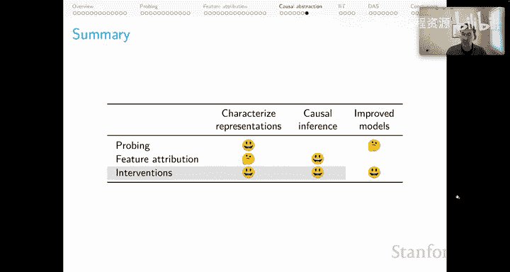
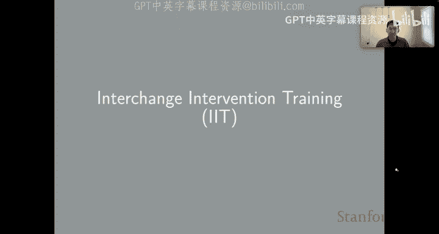
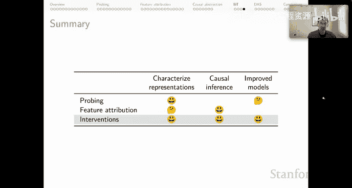

# 斯坦福大学《自然语言理解｜Stanford XCS224U Natural Language Understanding I Sp 2023》中英字幕（豆包翻译 - P36：-36-Stanford XCS224U I Analysis NLU, Pt 4： Casual Abstraction & Interchange Inte - GPT中英字幕课程资源 - BV1sx4y1s7oW

Welcome back， everyone。 This is part 4 in our series on analysis methods for NLP。

 We've come to our third set of methods， causal abstraction。

 I've been heavily involved with developing these methods。

 I think they're tremendously exciting because they offer a real opportunity for causal concept level explanations of how our NLP models are behaving。

😊。

Let's begin with a kind of recipe for this causal abstraction analysis， step one。

 you state a hypothesis about some aspect of your target model's causal structure and you could express this as kind of a small computer program。

In step 2， we're going to search for an alignment between variables in this causal model we've defined and sets of neurons in the target model。

This is a hypothesis about how the role for those variables and sets of neurons align with each other。

To do this kind of analysis to assess these alignments。

 we perform the fundamental operation of causal abstraction analysis。 The interchange intervention。

 and much of this greencast is going to be devoted to giving you for a feel for how interchange interventions work。

For a running example， let's return to our simple neural network that takes in three numbers and adds them together。

 We assume that this network is successful at its task。 And the question is。

 in human interpretable terms， how does the network perform this function。

As before we can hypothesize a causal model that's given in green here。

 and the idea behind this causal model is that the network is adding together the first two inputs to form an intermediate variable S1。

And then the third input is copied over into an intermediate variable W。

 And S1 and W are the elements that directly contribute to the output of the model。

 That's a hypothesis about what might be happening with our otherwise opaque neural model。

 And the question is， is the hypothesis correct。We're going to use interchange interventions to help us assess that hypothesis。

 We'll break this down into a few pieces。 First， we hypothesize that the neural representation L3 plays the same role as S1。

Let's assess that idea。 The first intervention happens on the causal model。

 So we take our causal model and we process example 1，3，5， and we get 9。

 We use that same causal model to process 4，5，6， and we get 15。And now the intervention comes。

 we're going to target the S1 variable for the right hand example that has value 9。

 literally take that value and place it in the corresponding place in the left hand example。

The causal model is completely understood by us。 And so we know exactly what will happen。 Now。

 the output will change to 14。 The child nodes below the variable that we intervened on don't matter。

 In this case。 The intervention fully wipes them out。 And we're just adding 9 and 5 together。

That's the causal model。 We assume that we understand it before we begin the analysis。

 The interesting part comes when we think about the neural model。

 We don't know how this neural model works。 And we're going to try to use these interventions to uncover that。

So we process 135 with our neural model and we get nine。We process  four， five，6， and we get 15。

And now we're going to intervene on the L 3 state。 We target that in the right hand example。

 and we literally take those values and place them in the corresponding spot in the left hand example。

 And we study the output。 And if the output after that intervention is 14。

 then we have one piece of evidence that L 3 plays the same causal role as S1。

And if we repeat this intervention for every conceivable input to these models。

 and we always see this alignment between causal model and neural model。

 we have proven that L3 plays the same causal role as S1。 We can continue this for other variables。

 Let's target now L1。 Suppose we hypothese that it plays the same role as W in the causal model。

Again， let's first intervene on the causal model。 We target that W variable on the right hand。

 and we take that value， and we place it in the corresponding place in the left hand model。

 We study the output。 that has changed the output to 10。And then we return to our neural models。

 parallel operation， target L1 on the right。 Take that value and literally place it into the corresponding spot in the left。

 And we study the output。 And again， if the output is 10。

 we have a single piece of evidence that L 1 and W are causally aligned in this way。

And if we repeat this intervention for every possible input and always see this correspondence。

 we have proven that L1 and W play the same causal roles。And we could go one step further。

 Suppose we think about L 2。 Supp we intervene on L2 in every way we can think of。

 And we never see an impact on the output behavior of the model。 In that way。

 we have proven that L 2 plays no causal role in the input output behavior of this network。

And since we can assume that the input variables are aligned across causal and neural models。

 and we can assume that the output variables are aligned。

 we have now fully proven the all these intervention experiments that that causal model in green is an abstraction of the otherwise more complex neural model。

 and that is exciting if we have actually establish this。

 and we are licensed to allow the neural model to fall away。

 and we can reason entirely in terms of the causal model secure that the two models are causally aligned。

 They have the same underlying mechanisms。😊，Now， that is a kind of ideal of causal abstraction analysis。

 There are a few things from the real world that are going to intervene。

 The first is that we can never perform the full set of interventions for all realistic cases。

 there are too many inputs。 Even for the case of my tiny addition network。

 there is an infinitude of possible inputs。 We can't check them all。

 So we have to pick a small subset of examples。 And then otherwise， for real models。

 we're never going see perfect causal abstraction relationships because of the messy nature of naturally trained models that we use。

 So we need some graded notion of success。 And I think interchange intervention accuracy is a good initial baseline metric for that。

The IIA is the percentage of interchange interventions that you performed that lead to outputs that match those of the causal model under the chosen alignment。

 So you can think of it as an accuracy measure for your hypothesized alignment。

IiaA is scaled in 01 as with a normal accuracy metric。It can actually be above task performance。

 This is kind of striking， and it has happened to us in practice if the interchange interventions put the model into a better state than it was in originally then you might actually see a boost in performance from these Frankenstein examples that you have created。

This is really fundamental here。 IIA is extremely sensitive to the set of interchange interventions that you decided to perform。

 If you can't perform all of them， you have to pick a subset and that will be a factor in shaping your accuracy results。

 In particular， Pay particular attention to how many interchange interventions should change the output label。

 Those are the ones that are really providing causal insights。

 because you see exactly what should happen in terms of changes once you have performed the intervention。

So having an abundance of these causally insightful interventions is the most powerful thing you can do in terms of building an argument。

Let me briefly summarize some findings from causal abstraction， these are mostly from our work。

Fine tune Bt models succeed at hard out of domain examples involving lexical entailment and neigation because they are abstracted by simple monotonicity programs。

 And I emphasize because， and I wrote it in blue there。

 because I am not being casual with that causal language。 I really intend a causal claim。

 that is the kind of thing that causal abstraction licenses you to be able to say。Relatedly。

 finet Bt models succeed at the MQNLI task because they find compositional solutions。

 MQNLI is the multiply quantified NLI benchmark。 It's a synthetic benchmark full of very intricate compositional analyses between quantifiers and modifiers and so forth。

 a challenging benchmark， and we show with causal abstraction that models succeed to the extent that they actually find compositional solutions to the task。

Models succeed at the MIS pointer value Retrieval task because they are abstracted by simple programs like if the digit is 6。

 then the label is in the lower left。A brief digression there， I love these kinds of explanations。

That simple program that I described is more or less a description of the task。

 And so it's wonderfully reassuring to see that our explanations actually align with the task structure for these very successful models。

 And another nice point here is that we're starting to see a blurring of the distinction between neural models and symbolic models。

 After all， if you can show that the two are aligned via causal abstraction。

 Then there really is no meaningful difference between the two。

 which leads you to wonder whether there's truly a meaningful difference between symbolic AI and neural AI。

 They can certainly come together and you see them coming together in these analyses。😊，Finally。

 Bart and T 5 use coherent entity and situation representations that evolve as the discourse unfolds。

 Leadal 2021 use causal abstraction in order to substantiate that claim。 Very exciting to see。😊。

If you would like to get hands on with these ideas， I would encourage you to check out our notebook。

 it's called IIT Equality， it walks through causal abstraction analysis using simple toy examples and then also shows you how to apply IIT。

 which is the next topic we'll discuss。There isn't time to cover this in detail。

 but I did want to call out that causal abstraction is a tool kit corresponding to a large family of intervention based methods for understanding our models。

 I've listed a few other exciting entries in this literature here。

 And if you would like even more connections to the literature。

 I recommend this blog post that we did， which kind of relates a lot of these methods to causal abstraction itself。

So let's return to our summary scorecard。 We're talking about intervention based methods。

 I claim that they can characterize representations richly。 After all。

 we show how those representations correspond to interpretable high level variables。

I've also tried to argue that this is a causal inference method。

And I still have a smiley under improved models。 I have not substantiated that for you next。

 but that is the next task under the heading of interchange intervention training。

So let's turn to that now， IIT。

The method is quite simple and builds directly on causal abstraction with interchange interventions。

 Here's a kind of summary diagram of interchange intervention using our addition example with the one twist that you'll notice that my intervention now for L 3 has LED to an incorrect result。

 We wanted 14。 and we got 4。So we have， in some sense。

 shown that our hypothesized alignment between these variables is not correct。

But I think you can also see in here an opportunity to do better。

 We can correct this misalignment if we want to。 After all， we know what the label should have been。

 and we know what it was。And that gives us a gradient signal that we can use to update the parameters of this model and make it more conform to our underlying causal model under this alignment。

 Let's see how that would play out， right。 We get our error signal。

 and that flows back as usual to the hidden states， L 1， L 2 and L 3。😊，And for L1。

 the gradients flow back as usual to the input states。 and the same thing is true for L 2。

 But for L 3， we have a more complicated update。 We have literally copied over the full computation graph in the pytorch sense。

 including all the gradient information。 And so what we get for L 3 is a kind of double update coming from our current example。

 as well as the source example， which also processed that representation So we get a double update。

 The result of repeatedly performing these I updates on these models using the causal model for the labels。

 as we've done here， is that we push the model to modularize information about S1 in this case in the L3 variable。

 So the importance of alignments kind of falls away and the emphasis here is on actually pushing models improving them by making them have the causal structure that we have hypothesized in the hopes that they will then。

😊，Form in more systematic ways and be better at the tasks we've set for them。Findings from i I。

We showed that IIT achieve state of the art results on that MIS pointer value retrieval task that I mentioned before。

 as well as rescan， which is a grounded language understanding benchmark。

We also showed that IIT can be used as a distillation objective。Where essentially。

 what we do is distill teacher models into student models。

 forcing them not only to conform in their input output behavior。

 but also conform at the level of their internal representations under the counterfactuals that we create for II。

 This is exciting to me because I think it's a powerful distillation method。

 And it also shows you that the causal model that we use for II can be quite abstract。 In this case。

 it's just a kind of high level constraint on what we want the teacher and student models to look like。

😊，We also showed that II can be used to induce internal representations of characters in language models that are based in subward tokenization。

 and we show that this helps with a variety of character level games and tasks。

 This is II being used to strike a balance。 Subward models seem to be our best language models。

 But we have tasks that require knowledge of characters。

 and what we do with II is imbue these models with knowledge of characters in their internal states。

And finally， we recently used IIT to create concept level methods for explaining model behavior。

 that's a technique that we call causal proxy models。

 and it essentially leverages the core insight of IIT。Again， we have this course notebook。

 IIT Equality， it covers abstraction analyses， and then also shows you how to train models in this IIT mode。

So we can return to our scorecard now I have smilemiies across the board and I claim that I have justified all of those smilemiies。

 and I feel that this does point to intervention based methods as the best bet we have for deeply understanding how NLP models work。

