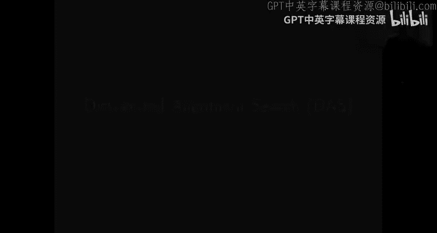
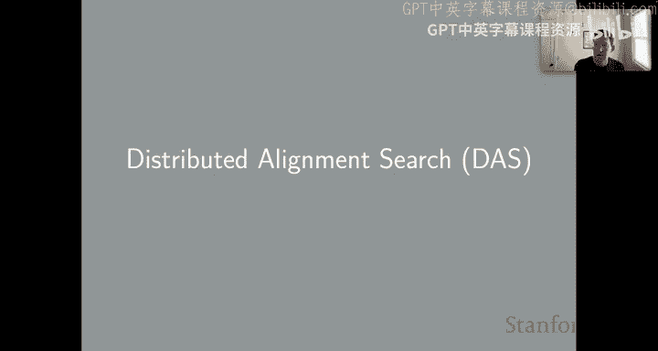
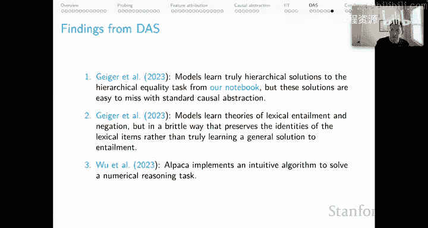
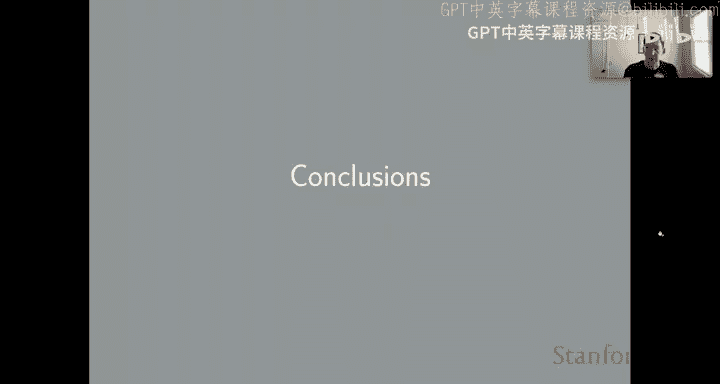
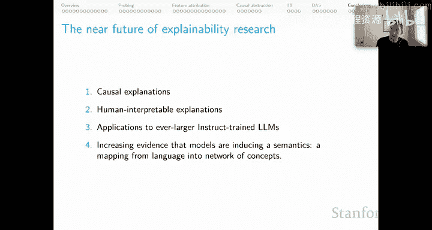
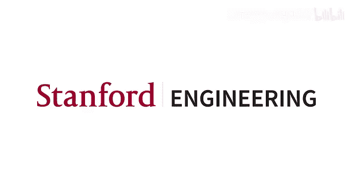

# 斯坦福大学《自然语言理解｜Stanford XCS224U Natural Language Understanding I Sp 2023》中英字幕（豆包翻译 - P37：-37-Stanford XCS224U： Analysis NLU, Part 5： Distributed Alignment Search (DAS) & - GPT中英字幕课程资源 - BV1sx4y1s7oW

Welcome back， everyone。 This is the fifth and final screencast in our series on analysis methods for NLP。

 I'm going to seize this moment to tell you about a brand new method we've been developing。

 distributed alignment search。 I think this overcomes crucial limitations with causal abstraction as I presented it to you before。

 So I'm going to give you a high level overview of D AS。

 And then use that as a starting point to think even further into the future about analysis methods in the field。

😊。

To start， let's return to our scorecard。 I've been using this throughout the unit。

 I feel I have justified the three smileies along the interventions row。

 but there remain really pressing issues for this class of methods。 Let me identify two of them。

 First， alignmentign search is expensive。 You know。

 the name of the game here is to define a high level causal model。

 and then align variables in that model with sets of neurons in the target neural model。

For a complex causal model and a modern， large language model。

 the number of possible alignments in that mode is enormous。 I mean。

 to call it astronomical would be to fail to do justice to just how large this space is。As a result。

 we introduced lots of approximations and we could easily miss a really good alignment。

The second issue is even deeper。 causal abstraction could fail to find genuine causal structure because we presume that we're doing it in a standard basis。

 and the central insight behind D A S is that there might be interpretable structure that we would find if we simply rotated some of these representations in various ways。

 And， in fact， the target of D A S is a rotation matrix that we learn。

 and that helps us find optimal alignments。I'm going to keep this high level and intuitive。

 And for that， I'll have a running example， a very simple one。 This is Boolean conjunction。

 I have the causal model on the left here。 It takes in Boolean variables。

 It has intermediate variables for those inputs， and then it outputs true。

 If both of the inputs were true， otherwise false。On the right， I have a very simple neural model。

 and the neural model perfectly solves our Boolean conjunction task with this set of parameters。

So that's the starting point。 Now， in the classical causal abstraction mode。

 I could define an alignment like this with these red arrows， and it looks good。 I align the inputs。

 as you would expect。 I align the outputs， as you would expect。

 and I'll add in the decision procedure that if the neural network outputs a negative value。

 that's false for the causal model。 And if it outputs a positive value。

 that's true for the causal model。 So that's intuitive。

 And then I did the intuitive thing of aligning V1 with H1 and V2 with H2。😊，Now。

 this model is perfect behaviorally， as I said， but it does not abstract the neural model under our chosen alignment。

 and that chosen alignment bit is crucial。 And I'll just give you the spoiler here。

What I did inadvertently is reverse the order of those internal variables。

 I should have mapped V1 to H2 and V2 to H1。What we're doing with this simple example is simulating the situation in which I just made a mistake about what set of alignments I decided to look at。

 and I picked one that is subop in terms of finding structure that is actually there。

And the promise of D A S is that even if I start with this incorrect alignment。

 a rotation will help me find it。First， I'll just substantiate for you that we do indeed have a failure of causal abstraction。

 I'll show you a failed interchange intervention On the top， As usual。

 we do an intervention with our causal model。 We take V1 from the right example and put it into the corresponding place in the left example The original output for the left example was false。

 but because of the intervention， We should get the output value true。

When we do the corresponding aligned intervention on the neural model。

 we end up with an output state that is negative。 That means predicting false。

 but the causal model said we should predict true。 And that's exactly the kind of thing that leads us to say that this is not in the abstraction relationship。

 This causal model and this neural one。The two models have unequal counterfactual predictions。

 That is the heart of it。 But remember， we already know why they do。

 It's because I chose the wrong alignment due to bad luck or research shortages or whatever。

Here's the crucial insight behind D A S。 The alignment relationship does hold in a nonstandard basis。

 If I take the current network and the current alignment。

 and I simply rotate H1 and H2 using this rotation matrix。

 Then I have a network that is behaviorally perfect and satisfies the causal abstraction relationship。

 causal abstraction Class mode missed this because of the standard basis we chose。

 And the essence of that is that there was no reason to choose the standard basis。

 It's intuitive for us as humans， but there's no reason to presume that our neural models prefer to operate in that basis。

 and this example reveals that we might find interpretable structure by dropping that assumption about the basis。

So the essence of DAS to keep an eye on the ball here is really learning this rotation matrix。

 that is the target of learning in DAS， and then the rotation matrix becomes the asset that you can use for actually finding and displaying and assessing internal causal structure。

Here's a more high level abstract overview of how this might happen using a pair of aligned interventions。

 So I have my target model in red here。I have two source models on the left and right。

 They process their various examples， and we're going to target the variables x1。

 x 2 and x 3 across these different uses of the model。

The first thing we do is rotate that representation that we targeted to create some new variables。

 Y1， Y 2 and Y 3。 And remember， R here is the essence of DA S。

 And that is the matrix that we're going to learn using essentially interchange intervention training。

Having done this rotation， I then create a new matrix that comes from me deciding to do an intervention with y 1 with y 2。

 and then copying y 3 over from this core base example。 that gives me this new vector here。

 And then we unroate。And we do the intervention。And remember。

 the essence of DAS is that we're going to freeze the model parameters。 This is an analysis method。

 not a method where we change the core underlying target model。

 But the thing that we do is learn a rotation matrix that essentially maximizes the interchange intervention accuracy that we get from doing this rotation and then on rotation to create these new models。

 So this is a blend of I I like techniques， as well as classical causal abstraction。

 We keep the model frozen because we want to interpret it， but we learn that rotation matrix。

 That's the essence of DS。Findings of D A S so far。 these are pretty nuanced in our DA S paper。

 we show that models learn truly hierarchical solutions to a hierarchical equality task。 This is。

 in fact， the one that's reviewed in our notebook book for this course。

 But those solutions are easy to miss with standard causal abstraction because of this non standard basis issue。

Here's a more nuanced finding。In earlier causal abstraction work。

 we found that models learn theories of lexical entailment and negation that kind of align with a high level intuitive causal model。

 But with DA S， we can uncover that they do that in a kind of brittle way that actually preserves the identities of the lexical items rather than truly learning a general solution to the entailment issue。

And the third finding is from a separate paper， and this is tremendously exciting because it shows that we can scale to levels that were impossible before due to our lack of a need for searching for alignments。

 because now we essentially learn the alignment。 So we scaled DAS to Alpaca。

 and we discovered that Alpaca， a 7 billion parameter model implements an intuitive algorithm to solve a numerical reasoning task。

And I think this is just the start of the potential that we see for using DIS to understand our biggest and most performant and most interesting large language models。

All right。 let me turn now to wrapping up just some high level conclusions here。 First。

 I wanted to return to this diagram that I use to motivate analysis methods in general。

 We have these incredibly important goals for the field， identifying approved and disapproved uses。

 identifyingdentifying and correcting pernicious social biases and guaranteeing models as safe in certain contexts。

 I feel that we cannot offer guarantees about these issues unless we have analytic guarantees about the underlying models。

 and for me that implies a truly deep causal understanding of the mechanisms that shape their input output behavior。

 And for that reason， I think the analysis project in NLP is one of the most pressing projects for the field。

And in that spirit， let's look ahead a little bit to the near future of explainability research for the field。

 First， as I said， we should be seeking causal explanations。

 but we also need human interpretable ones。 If causality were the only requirement。

 We could just give low level mechanistic mathematical explanations of how the transformer worked and call that explainability research。

 But that's at the wrong level for humans trying to offer guarantees about safety and trustworthiness。

 we need human interpretable explanations。We need to apply these methods to ever larger instruct trained L L Ms。

 Those are the most relevant artifacts for the current moment。

 And I think we're starting to approach this goal with D A S。

 I just mentioned how we can apply it to Alpaca。 I think we could scale even further。

 but we really want to be unconstrained in terms of what we can explore。

 And that requires a lot more innovation in the space。And then finally。

 to kind of return to the previous unit and our discussion of cogs and recogs and compositionality。

I think we're seeing increasing evidence that models are inducing a semantics that is a mapping from language into a network of concepts。

 If they are doing that， and if we can find strong evidence for that。

 its tremendously eye opening about what kinds of data driven learning processes could lead a language technology to actually have induced the semantics from its experiences。

 which would， in turn， lead us down the road of having many more guarantees that their behavior would be systematic。

 which could be a basis for them being， again， trustworthy。

 safe and secure and all of those important goals for the field and for society。

