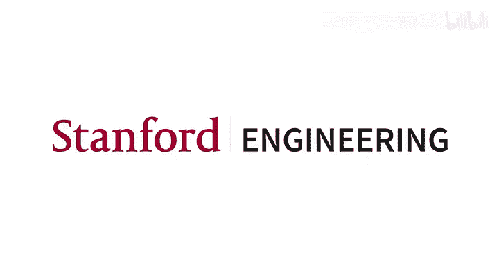
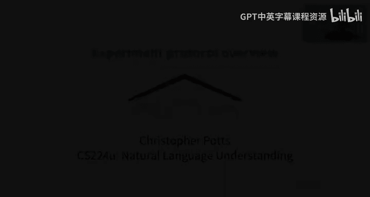
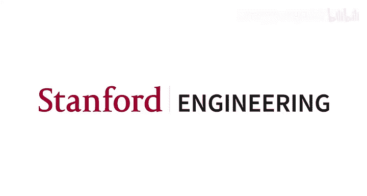

# 斯坦福大学《自然语言理解｜Stanford XCS224U Natural Language Understanding I Sp 2023》中英字幕（豆包翻译 - P38：-38-Experiment Protocol Overview .zh_en - GPT中英字幕课程资源 - BV1sx4y1s7oW

Welcome， everyone。 This short Sccast is an overview of the experiment protocol document。

 This is the second document on your way to the final paper。 It's a somewhat unusual document。

 but I think it's really important in terms of helping you and your teammates and your mentor get complete clarity on what you're going to achieve for the final paper。

The rationale at high level is the same as the one for the lit review。

 It's about productive dialogue。 We want you in productive dialogue with your teammates and with yourself and with your mentor about the scope of the project and its overall goals。

We want you to identify the core questions you'll be addressing at this stage。

 We want you to identify your core methods。 That is data， models。

 metrics and everything that goes along with that。 And maybe most importantly， for this phase。

 we want you to identify obstacles and propose some workarounds。

 The more the merrier in terms of uncovering these things that are threatening the convergence of the project。

 if we can identify these things at this stage， we can probably find really productive workarounds。

 But as it gets closer and closer to the final paper deadline。

 it becomes harder and harder to get these things to converge in a happy way。

The requirements are linked from the course website， you can see the link at the top here。

 let me just offer a quick rundown。This is a short。

 structured report that is establishing your core experimental framework and kind of talking about it。

 I emphasize short， they can get long if you have a lot of obstacles or points of uncertainty。

 but by and large， if things are going well， We expect this to be a short document。

 We do specify that the max is 8 pages。 But I'll say that the norm is for them to be shorter than that。

We have， as before an optional overleaf template， this is just derived from the ACL templates。

 we encourage you to use it， but it is not required at this stage。

And then we come to the required pieces I mentioned these in the lit review overview。

 we want you to now to state your core hypothesis or hypothesistheses as clearly as possible。

We want you to talk about what data resources that you're going to use and any limitations。

 access limitations， producing data is a big limitation。

 anything that might threaten the need that you have for data。Metrics， this is important。

 If it's a standard sort of classification problem， it might be a very short thing that you report。

 like you say， macro F1。 But if you're working on a specialized problem or inventing your own metrics。

 this might be a more detailed discussion。Models， of course， or architectures。

 We want to know about the baseline that you plan， the comparison points， the abls。

 all of that stuff。 And we would like to see how it keys into the core hypotheses you listed in4 a。

And then the general reasoning， how does the project come together。

 how do the data and the models and the metrics connect with the hypothesis。

 I think that's the most important thing， most powerful thing to convey at that point。

And then a summary of progress so far。I emphasize you are not required to have any results at this stage。

 It could be purely a planning document， but if you do have results， it's great to report them。

 That's kind of evidence that you've got a minimal viable project。

 And it we can start to build on whatever insights those results have offered， but it's not required。

 but we would like to know what you've done so far。 Even if it's just assembling the raw ingredients。

 Let us know。 if you've run some experiments and youve got stuck。

 That's an obstacle that we want to identify。 That is the spirit of this progress report。 It's not。

Evaluative in terms of us giving you a grade based on how far along you are， quitete the contrary。

 this is entirely evaluated based on the extent to which you can give us a clear insight into how you're doing for this project。

And then finally， as always， required references section。In terms of tips， I would say， first。

 there's no particular length we have in mind。 A short or a long rubric could be bad or good。

 depending on the state of your project and what you're trying to achieve。

 So completely open minded about that。As I said before， please try to call out concerns you have。

 even if they are distant ones， this is meant to be a last chance to make sure the project will converge in the time allotted so you might as well err on the side of more disclosures。

Yes， you need to be able to state a hypothesis。 It is common for engineers to come to me and say。

 but I don't have a hypothesis。 All I want to do is see whether this model is a good model for my problem。

 And I say to them， that is a hypothesis。 Just state that as a claim about what you think will work。

 And that will actually guide us intellectually and also guide us in terms of choosing baseline and ablation studies and other things that will give us insight into whether you're right about this thing that you feel about this model that you are evaluating。

No， you do not need to report results， as I said before。

 but they are very welcome because they're a sign that you've kind of got all the working pieces in place and the project machine is functioning。

We want you to have a full working pipeline as soon as possible。 It is。

 I confess tempting to insist on initial results so that that pipeline would be in place。

 I think that's premature。 But the spirit of this is that we want you basically to be at a state where any day。

 you could submit a project。 It would be a working project。

 It might not be the one that you envisioned， but you could submit it。 Once you get to that point。

 It's a really happy state in which you're mainly just adding new experimental results。

 I the reporting， adding analyses and other things that allow you to build a really fleshed out project。

 So get that minimal viable project in the bag soon。😊。

So that you can do creative exploration without feeling like you're under a lot of undue pressure。

For other tips and resources， I have a very large markdown document that covers lots of things。

 FAQs that I've seen in the past。Discussions of each one of the documents that's associated with the final project work。

 examples of past final papers that have gone on after some work to be publications and a whole lot else besides。

 So if you start， if you feel like you just need some guidance on crucial points about how to develop a project in the space。

 I highly recommend this document， I think it's got lots of good stuff in it and。

If your paper goes on to be a publication， I would love to hear about it。 Drop me a note， and I will。

 with your permission， add that to the list of published papers stemming from work for this course。

 I'm very proud of how long and diverse that list is。😊。

