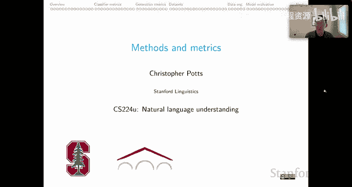
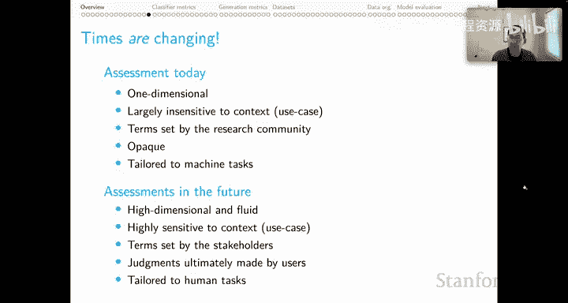

# 斯坦福大学《自然语言理解｜Stanford XCS224U Natural Language Understanding I Sp 2023》中英字幕（豆包翻译 - P39：-39-NLP Methods and Metrics, Part 1： Overview .zh_en - GPT中英字幕课程资源 - BV1sx4y1s7oW

Welcome， everyone。 This Sccast kicks off our series on methods and metrics。

 The overarching goal of this series is to help you work your way through your project and make smart choices around experiments and data and metrics and everything else。

 and also be a kind of trusted companion and sounding board for you as you confront really hard decisions around doing this kind of research。

😊。

Let's start with an overview of the goals and the current issues。

Fundamentally， we're trying to help you with your projects。

 This comes down to things like managing data， establishing baseline systems， comparing models。

 optimizing models， and maybe most importantly， navigating tricky situations。

 we can provide some high level guidance here， and then you should look to your mentor from the teaching team to really help you optimize these things and get through the really hard parts。

For associated materials， we have a big notebook on evaluation metrics that allow you to get hands on with some of the detailed technical things that I give an overview of in these screencasts。

 There's also a really wonderful set of pages embedded in the psit site about how to think about model evaluation in AI more generally。

And then we also have an extensive notebook that allows you to get hands on with the more methodological stuff that we're going to talk about and the notebook substantiates with experiments。

 some of the things that I'll just offer you as general lessons here。

And then there are a few things that you could check out in terms of reading， although honestly。

 there is much less reading than you would expect， this might be a sign that the field is still maturing four fields in the hard sciences and the behavioral sciences。

 there would be entire textbooks about methods and metrics， whereas for us。

 we seem to have an assumption that people will just pick it up as they go。

 I'm not sure that's to the credit of the field。 But that is the current situation。

 And I guess the thinking behind this unit is that we can help somewhat provide some more systematic guidance on all these really crucial things that serve the foundations of our field。

I wanted to start by saying one really important thing about how we think about your projects。

 The fundamental thing here is that we will never evaluate your project based on how good the results are。

 where we all know what good means it means being at the top of the leader board or something similar。

I recognize that publication venues in the field do this。

 and the rationale there is that they have additional constraints on space and that leads them to favor positive results for new developments over negative results。

As an aside， I think we can all see that this is a distorting effect on the scientific literature。

 and it absolutely is ultimately hindering progress because negative results can be so powerful and useful in terms of instructing people about where to invest their energy and in particular。

 where not to invest their energy。 So this is a kind of sad commentary。

 but I'm just observing that it's true。 and then fundamentally for our course。

 we are not subject to any constraints， real or imagined on what we can publish。

 So we can do the right and good thing of valuing positive results and negative results and everything in between。

What this means is you could be at the top of the leader board。

 according to your own experimentation。 But if your report is shallow and doesn't really explain how that number got there or what the thinking behind it was。

 you won't do well。 more importantly， conversely， you could try something really creative and ambitious。

 it might fail。 but that could be an outstanding contribution because of how careful you were about the things we actually care about。

 which are the appropriateness of the metrics， the strength of the methods。

 and the extent to which the paper is open and clear sighted about the limitations of its findings。

 This is a wonderful movement in the field that we increasingly emphasize finding the outer limits of our ideas and describing those limitations in our papers。

 I would exhort you to do similar things， And I think overall， on average。

 this kind of work is going to lead you to more fruitful systems more rewarding results and higher quality papers。

So I feel really good about this。 And we can talk in the next unit about how to navigate tricky things related to this publication bias。

 I think fundamentally， we can do right there as well。

 And the shift in perspective that you need to take is to move away from papers that are a competition favoring your chosen system and toward papers that are simply openly evaluating scientific hypotheses and mustering as much evidence as possible to inform those hypotheses。

 And once you move into those modes， you're not any more thinking about how to pick a winner。

 but rather just thinking about strength of evidence and the importance of the hypotheses。

 So we can get there and everyone will be happier as a result But it does require a shift in perspective from the norms that we often hear about。

 which are competition oriented。😊，4 methods。 I've put this under the heading。 How times have changed。

 And unfortunately， I don't have very many happy lessons to teach here。

 Let's rewind the clock to around 2010。 in that era。

 you could develop your complete system on tiny samples of your train data Once you had it working。

 you would do regular cross validation using only the train data。 Nice pristine experimental setting。

 You would evaluate only very occasionally on your held out dev set。

In an effort to avoid hill climbing on that dev set and ultimately overfitting to it。

 And that's why you would be cautious there。 And then in the final stages of your project。

 you would do a complete round of hyperparameter tuning using your dev data。

 You would select the best model， and you would run your final test evaluation and report that number more or less as is。

That was 2010， there is something deeply right about this as a scientific picture for our field。

 but unfortunately times have changed in 2323， you could develop your system on tiny samples of your data as before good。

However， for step 2， either there's no training data for your task or cross validation on it would cost $20000 and take six months。

 So already， we are off course here in terms of our ideal scientific picture。 relatedly。

 the dev set is frequently and crucially important to optimization。

 So you have to keep fingers crossed that it really is a superb proxy for test， because， after all。

 you're going to orient all of your optimization processes toward this dev set。And then finally。

 for the final stage， either hyperparameter tuning would cost $100，000 and take 10 years。

 or there are no hyperparameters， but test runs cost $4000 because you're calling an open AI model or something like that。

Boy， this looks untenable， right， What do we do， The core tenets of the previous era remain sound。

 As I said， I like them。 There's something really good about them， but we cannot enforce them。

 Enforcing them has become impossible。 If we did only the richest organizations could follow them。

 and that would restrict participation in the field in a way that would be terrible。

 If you're creating a ranked list。 you have to put broad participation way above all of those very pristine and idealized methods that we used to be able to get away with back when every model trained very quickly on a consumer laptop。

So what you have to do is articulate your methods and the rationale behind them。

 including practical details like resource constraints and heuristics that you had to invoke。However。

 two rules should， remain absolutely fixed here。 I'm adamant about this。 First。

 you never do any model selection even informally based on test set evaluations。

 I know there are people violating this rule out there in the field， but don't follow that path。

 It's really important for us。 especially when we think about the high stake scenarios that we could be deploying our systems in to have pristine test evaluations that give us an honest look about how our systems will behave on unseen examples。

 and you compromise that entirely。 the moments you choose a model based on test set numbers。

Relatedly， as you think about constructing baseline and ablations and comparisons with the literature。

 you have to strive to give all systems you evaluate the best chance of success。 You should never。

 ever stack the deck in favor of a system that you are advocating for。 We all know it can be done。

 All these models have hyperparameter， and you could pick really bad settings for models you disfavor。

 and you could work really hard to find optimal settings for models that you like about in that way。

 you would appear to have won some kind of competition。

 but you would have compromised the very foundations of your project。

What you need to do instead is give every system its best chance。

 work really hard to make all of them competitive。 The result will be better。

 science results you can trust。 And ultimately， you will go farther in the field if you are rigorous about this rule as well。

That is it for methods， for metrics， I can be more hopeful。

 I have put this under the heading how time should change。

 and I do feel like they are changing very rapidly in a happy way。

The overarching idea that we could have in mind here is Strathern's law。

 When a measure becomes a target， it ceases to be a good measure。 We have to beware staorn's law。

 We have to be vigilant and make sure we don't fall into this trap。In this setting。

 with this in mind， I'm always reminded of leader boards。 You know。

 leader boards are central to the way the field works。

 We all think about them and use them as markers of progress。 They do have their good aspects， right。

 leaderboards can be an objective basis for comparison。

 and that creates opportunities for even wild seeming ideas to get a hearing in fields without leader boards very often。

 these wild ideas are rejected out of hand by the community with no evaluation。

 whereasas at least leader boards give people in our field。 a chance to participate。

 That's the good The bad， though， this can get really bad with leader boards。

 we have a constant conflation of benchmark improvements with actual progress when we know， in fact。

 that the benchmarks might be fallible relatedly， we have this conflation of benchmarks with empirical domains。

 people say things like。😊，O C， R is solved。 Question answering is solved。

 What they really mean is that certain benchmarks have been solved。

 and we are all aware by now that those two claims about the benchmark and the capability are radically different。

 but none the less， people conflate them。 And even in the way we talk。

 I find we're often guilty of this third thing here。

 which is conflating benchmark performance with a capability。

 we see that a system does well at question answering for squad。

 and we assume it's a good question answer。 even though we know in our hearts。

 that these two things are very different。So that's the bad of leader boards。

 I think what we should do moving forward is think about how to bring in more of the good。

 more dimensions of good， and remove the dependence on these bad assumptions that we often make。

The fundamental issue here， I would say， is that the metrics that you choose。

 including the ones that get embedded in leader boards。

 are actually tied up with the thing that you're trying to solve。 And too often in the field。

 we don't actually make that connection。 So let me offer you some scenarios。

 and they should get you thinking about how you would approach this differently with different metrics in mind。

 Suppose you're in a scenario where missing a safety signal costs lives and human review is feasible。

 What kind of metric which you favor for a system。Conversely。

 suppose exemplars need to be found in a massive data set。 Again。

 what kind of metrics would you use to evaluate systems in this kind of context。

 I think the metrics would be very different from the first one in the second scenario with the exemplars。

 we can afford to miss a lot of cases， we just need a few really good ones。

 whereas in the first scenario， every missed case cost lives。

 And we have the opportunity to do human review。 So obviously， our values are oriented differently。

Suppose specific mistakes are deal breakers。 Others hardly matter。 Now。

 you want a metric that will give credit and give demerits to different kinds of mistakes and good predictions in different ways to capture these underlying ideals。

 Suppose cases need to be prioritized。 You're not talking about classification any more。

 You're talking about ranking。 Again， You should have good metrics for ranking。

Suppose the solution needs to work over an aging cell network。

 Well now your obsession with accuracy should kind of go out the window in favor of systems that can run on very constrained hardware。

 low energy， low power， very fast， all of that stuff。

Suppose the solution cannot provide worse service to specific groups。 Well。

 standard machine learning models will often favour majority groups。 We know this。

 And if your ultimate allegiance is to making sure that the system is equitable across groups。

 you will have to change your metrics from the norm and maybe even your underlying practices around optimization。

Suppose specific predictions need to be absolutely blocked while now you're in a totally different territory where some kinds of error cost you infinitely。

 whereas others matter hardly at all。 Again， a very different scenario from the norm。In the field。

 tragically， the scientific literature seems to offer one answer to essentially every scenario。

 which is that you use F1 and related accuracy metrics as your measure of system performance。

You can see if you review this list that F1 is not appropriate for any of these scenarios。

 F1 is just what we as researchers choose when we have no information about the application area。

 When we have information， we should be tailoring our metrics to those specific scenarios。

 it's just hardly ever done。 and I worry that the lesson we project out to the world is that you needn't bother。

 we don't do it and we are purported to be experts。 So why would anyone else do it。

 Even though as experts， we can see these different scenarios call for very different metrics。

Relatedly， if you do do a survey of the scientific literature。

 you find a kind of overarching obsession on performance， accuracy F1， all of those things。

 This is really nicely supported by this lovely and creative paper the values encoded in machine learning research。

 This is Birhani at all 2021， What I've done here is distill their evidence down into a kind of cartoonish picture that does。

 I think， capture the essence of this。 I've used font size to convey the values that they find encoded in our literature。

 and in the largest fontier。 unsurprisingly， is performance dominating every other value that we might want reflected in our research。

😊，Kind of close behind in second place， but actually pretty distant is efficiency。

Then you get interpretability， but notice that's interpretability for researchers。

 We're probably guilty of that in this class， the interpretability work that we talked about in the previous unit is very focused on technical consumers。

Applicability， robustness scalability。 These are pretty well represented。

 And then I used a different and lighter font to reflect things that are very distant in this ranking interpretability。

 but for users now， beneficence， privacy， fairness justice。

 we all recognize that these are crucial aspects of successful N， L P systems。

 But they are hardly ever reflected in our practices around hypotheses and system evaluation， right。

 really， if someone was just consuming our literature， what they would get out of it is， again。

 justice obsession with accuracy and related notions of performance。So we should push back。

 We should elevate some of those other values in the form of metrics that we use。 Luckily。

 there are efforts to do this。 I've put this under the heading of multidimensional leader boards。

 I have been involved with one effort Dnaboard Also Don Bench and explain aboard。

 These are all efforts to provide many more dimensions of evaluation for our systems and get much richer pictures of what's actually happening。

 In this context， I would like to mention dinos scoring。

 I think this is a really powerful way to bring in multiple metrics and even allow the person behind the system to decide which metrics to favor to what degree。

😊，It's such a powerful metric that I've， in fact， offered you a notebook that implements dinos scoringing and offers you some tips on how to use it so that you too could explore using dinos scoringing to synthesize across multiple things that you measure。

Let me give you a sense for why this could be so powerful。

 I have here a real leader board for question answering systems。

And the deera model is in first place， according to my dinoscour。

 That dinoscour was created by giving a lot of weight to performance and then equal weight to throughput。

 memory， fairness and robustness。😊，However， with dinos scoringing， I can adjust those weights。

 And so suppose I decide that I really want a system that is highly performed， but also fair。

 according to my fairness metric。 So I adjust that dinos scoringing to put five weight on fairness。

 and I reduce throughput memory and robustness accordingly。 Well。

 now the previously first place system is in second place。

 and electro largege has become the first place system。And， of course。

 different weightings of the different metrics that I have here will adjust the ranking in other ways。

 And that shows you that there is no one true ranking。

 but rather rankings only with respect to different priorities and values and measurements that I take。

 And that is the essence of dinosaune to be transparent about those values and also to reflect them in good old fashioned leader boards。

 as we're doing here。In this context， when we talk about evaluation and we talk about different metrics。

 people often say， wait a second。 This is all too technical， too customized， to intricate。

 What we should do is something more like the Tring test。 After all， that was the ultimate test。

 in some sense， the idea here is that a human and a computer are interacting。

 Then the human is trying to figure out that it's a computer and the computer is doing its level best to fool that human。

 And in that way， we're supposed to have a good diagnosis for general system quality and intelligence and all those other things。

I just want to issue a cautionary note here。Right， the first touring test was she is reported in Sheber 1994。

 and in that test， Shakespeare expert Cynthia Clay was thrice misclassified as a computer on the grounds that no human could know that much about Shakespeare。

 That's an instance of people not really knowing what the human experience is like in its full range and generality。

Conversely， this is another comical story In 2014， an AI。

 a very simple one called Eugene Gustmann passed the the Tring test。 How did it do it， Well。

 it did it by adopting the personality of a 13 year old boy when it was rude or appeared distracted because it was confused about what the human was trying to do People just chalked that up to the fact that 13 year old boys are often kind of rude and distracted。

 And in that way， it got a huge pass。Google Duplex is a real AI system， a sophisticated one。

 and that is an AI that routinely runs and wins Turing tests with service workers。

 it makes phone calls， and even though it announces itself because it does this by law。

 as an AI right from the start of the conversation。

 people often lose track of that information and believe that they are talking with a computer。

And relatedly， now that we've moved into this mode of doing a lot of natural language generation。

 We're all discovering that people are not good at distinguishing human written texts from texts that come from our best large language models。

 So in this way， especially with the stories of duplex and the L L Ms。

We should reflect on the fact that all of us are probably constantly failing Turing tests in some cases。

 with sophisticated As， but in some cases， with ones that are actually pretty simple。

 there are some cognitive biases about social interaction that make this not such a reliable test。

There's another dimension to this that we should think about in the context of evaluation。

 And that is how we estimate human performance。 And my summary here is that we estimate human performance by forcing humans to do machine tasks。

 And then saying that that's how humans actually perform。

 Let me give you an example in the context of natural language inference。

 Let's imagine that you're a crowd worker。 And you've been asked to label premise hypothesis pairs for whether or not they're neutral entailment or contradiction。

 And you get a little training。 And after the training， you see， okay。

 a dog jumping and a dog wearing a sweater。 Those are neutral with respect to each other。

 because we don't know from the jumping， whether it's wearing a sweater。 There's no relationship。

Then you're given the example turtle and linguist。 And you think， well。

 I can imagine turtle linguists somewhere in some possible world。

 but I was told this was a common sense reasoning situation。

 And so I'll say contradiction because no actual turtles are linguists seems like a safe assumption。

But then you come to a photo of a racehorse and a photo of an athlete and you're asked to assign a label and you think。

 huh。I havenn't really thought about this before。 Can a race horse be an athlete。In general。

 can animals be athletes。And you might decide that you have a fixed view on this。 Maybe you say。

 of course， a racehorse could be an athlete。 or， of course， not。

 But the really fundamental thing is that you might be unsure of what other people think about this。

 And in turnuring， you might feel unsure about what label you're supposed to assign。

 The human thing is to discuss and debate to figure out why the question is being asked and what people are thinking about related to the issues。

 But what we do instead is block all of that interaction and simply force crowdworkers to choose a label。

 and then we penalize them， in effect， to the extent to which they don't choose the label that everyone else chose。

 Even though all of us feel uncertainty。 Here's another example。

 a chef using a barbecue a person using a machine， is a barbecue a machine。

 I think it probably depends on the situation， the goals， the assumptions， all of that stuff。

 The human thing is to discuss those points of uncertainty。 and then assign a label。

 But we simply block that。 when we do crowdsourcing。So now， when you hear。

An estimate of human performance。 You should remember that the humans were probably not allowed to do most human things。

 like， say， let's discuss this。 And so human performance in these contexts really means average performance of harried crowd workers doing a machine task repeatedly。

We can all do that mental shorthand。 but， of course， out in the world， people hear human performance。

 and they think human performance in the most significant sense。

 We should be aware that that's not true。 And we should be pushing back against the assumption that this is actually what we mean when。

 in fact， this is what we did。So what are we looking for with metrics。

 I would say that we're looking for things that are kind of between standard old evaluations。

Can a system perform more accurately on a friendly test than human performing that same machine task。

 That is my kind of cynical paraphrase of standard evaluations。

But we also don't want to swing to Canem system perform like a human in open ended adversarial communication。

 That's the Tring test。 It's very particular thing， and it's very thorny In the middle there。

 there's lots of fruitful stuff。In the spirit of our previous units， we could ask。

 can a system behave systematically， even if it's not accurate。

 that might be a system that is on its way to being one we can trust。

 even if it's currently kind of not doing so well？Can a system assess its own confidence。

 know when not to make a prediction。 Our systems in AI used to fail on every unanticipated input。

 Now， they give an answer， seemingly with confidence， no matter what you throw at them。

 We need to change that。 We need systems to withhold information when they're just not sure it's good information as an example。

 and maybe fundamentally。We should ask， can a system make people happier and more productive。

 This would move us far away from automatic evaluation and toward things that were more like human computer interaction evaluations。

 But ultimately， I feel like this is our goal， and we might as well just design evaluations that are oriented to it。

😊，As I said， I' am hopeful about all of this。 I think that time should change and they are changing。

 Assessment to day or maybe yesterday is one dimensional accuracy。

 largely insensitive to context or use case。 Again， F1。

 maybe the terms are set by the research community， whether we know it or not。

The metrics are often opaque， and the assessments are often kind of hard to understand deeply and they are tailored to machine tasks right from the very get go in the way that they are structured。

I think assessment to morrow or maybe to day， depending on the work that you all do。

 could be high dimensional and fluid。 It could be highly sensitive to context in use case。

 and the terms could be set by the stakeholders， the system designers out in the world or better the people who are using the system。

Ultimately， the judgment should be made by users and the tasks that we're talking about should be fundamentally human tasks。

We have entered into an era in which I think we could start to implement all of these visionary items about how assessment should work。

 And so I would encourage you all to think about how you could push forward in these directions with the research that you do for this course。

