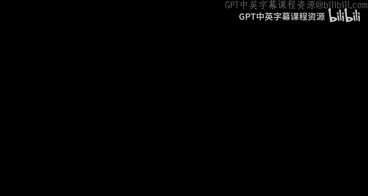
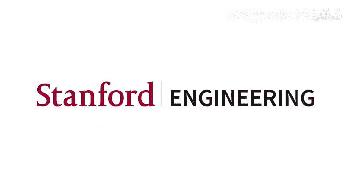

# 斯坦福大学《自然语言理解｜Stanford XCS224U Natural Language Understanding I Sp 2023》中英字幕（豆包翻译 - P3：-03-Homework 1 I Overview： Bake Off.zh_en - GPT中英字幕课程资源 - BV1sx4y1s7oW

Welcome， everyone。 This Sccast is an overview of assignment 1 and the associated bakeoff。

 The goal here is to give you a sense for the nature of the work。

 that is the nature of the questions that you'll be answering， as well as the thinking behind them。

 And I think that will help you both with the current work and also with subsequent assignments。

 because they all follow similar rhythms and have a kind of similar philosophy behind them。

For this assignment bakeoff pairing， we're going to be doing multi domain sentiment analysis for the work we're going to be in Jupiter notebooks。

 we're going to be fitting classifiers with psyit learn as well as fine tuning parameters that we load in with hugging face code。

If that's new to you or if you need a refresher， I would encourage you to check out the materials that are linked from this page of the course site。

 We have a lot of stuff there for you， including basic tools。

 kind of deep background stuff on scientific computing and Python and Pytorrch。

 working in Jupiter notebooks and this final notebook here will really help you work productively in the context of our course code base。

 which offers lots of starter code that can help you fit powerful models with relatively little coding yourself。

And then specifically for supervised learning we have a lot of materials， again。

 some deep background stuff on supervised learning in general。

 and then a lot of materials that are actually oriented toward sentiment analysis。

 we've got videos and slideshow as well as notebooks that will help you get hands on with the material So again。

 if this is new to you or if you need a refresher I would encourage you to check out these materials and they will get you to the point where you can work productively on this first assignment and bake off。

The task setting， as I said， is multi domainoma sentiment analysis。

 we're going to pose this as a ternary problem， so we'll have labels positive， negative and neutral。

For training and development， we're going to offer you three major resources。

 Dnoscent round1 is a large data set of naturally occurring sentences that were labeled with Ternary sentiment by crowd workersers。

Dyninoscent round 2 is a somewhat smaller dataset set that consists of examples that were written from scratch by crowdworkers in an effort to fool a top performing sentiment model。

 And again， they were validated separately by crowdworkers。

 and then the Stanford Sentiment T Bank is a classic sentiment data set。

 It's released in a five label format， and we have reformatted it slightly to conform to the Ternary sentiment specification。

So those are resources that you have available to you for training and development。

 All of this is oriented around entering our bakeoff and for the bakeoff test set。

 you're going to have examples drawn from the test sets from those above resources。

 as well as a set of mystery examples whose origins is are unknown to you。

 And the idea here is that we're going to pose a hard。

Sentiment task to give you a real sense for how your system generalizes even to examples that are unlike the ones that you could anticipate when you were doing training and other kinds of development。

In that spirit， I want to make an important methodological note。

The Dnoscent and SSD test sets are public。 that means you have the labels for all of those examples。

 We are counting on people not to cheat in the bakeoff by developing their models on those test sets。

Evaluate exactly once on the test set and turn in the results with no further system tuning or additional runs。

 It is a sin in our field to do any kind of model selection based on performance on the test set。

 The idea is that you run your system once on the test set and submit the results。

 much of the scientific integrity of our field depends on people adhering to this honor code。

 The function of a test set is to give us a true glimpse of how your system performs on examples that were unseen during system developments。

 So you have to keep that test set under lock and key until the very end。

 We can guarantee that for our mystery examples， but not for the examples that are drawn from these public test sets。

 We need to rely on this honor code。All right。 That's the background stuff。

 What we're going to start doing now is kind of walking through the notebook itself。

 We're going to start with data loading。 We're going to use load data set from hugging face to load in the dinoscent rounds。

 as well as the SST。 And as I said before， the SST gets loaded in a5 label format。

 And the notebook does the work of reformmantting it into the turnernary problem。

We also have a little function called print label distribution。

 and it will show you the distribution of labels for one of these splits。

 Here's the distribution for Dnoscent round 1。 That's a large resource。

 Dnoscent round 2 is somewhat smaller， and the SST is the smallest of these resources。

Now we come to the assignment work itself， beginning with question1， linear classifiers。

 what we're going to be doing here is developing relatively lightweight models that depend on typically very sparse feature representations。

 You could think of these as kind of being bag of words models that you might augment to make them more interesting。

Here's how the outline looks。We've got four background sections and then three subtasks。

 I urge you to work through the background sections first before you begin the tasks。

 whether you need a refresher or whether this is really what you do every day。

 I think the background sections will pay off in terms of helping you get hands on with the code and also just for a refresher on the core concepts。

 So work through them and then dive into the tasks。Question 1。

 task one is about writing feature functions。 And for the background section， we wrote one for you。

 This is unigrams phi。 It takes in a string， splits that string on white space。

 and essentially just counts the resulting unigrams。

 It returns a dictionary mapping unigrams to their counts in the input string。

 That is the basis for featureturization in the context of pst learn， as we'll be using it。

 So that's our example。 And then the task here is simply to write a better version of that。

 We've called that tweet gras phi。 And the core of this is just using this really nice tokenizer from N LT K。

 which does a good job with things like emoticons and other kinds of punctuation and so forth。

 It will be a superior basis for feature functions。 This is a very simple coding task。

 The idea here is to get your creative juices flowing Having written this feature function you might think about new ways of tokenizing or new things you could do in terms of feature。

😊，To build ever more powerful models。So this is just the start。

I want to say something about unit tests， you will notice in this homework that every single one of the questions has an associated unit test。

 and that is true for every question on all the assignments for the course。

So make sure that you use those unit tests。 I'm not going to blaor this throughout the screencast and the subsequent ones。

 but those unit tests are always there。 They perform a crucial role。

 It is very hard for us to fully disambiguate what we're looking for in terms of coding in English。

 So instead， we rely on these unit tests。 If you pass the unit test。

 Then you have completed the task as we defined it。

 you will also get a clean bill of health from the autograder when you submit and everything should go swimmingly。

So make use of these unit tests， they also help you with core concepts and other aspects of the problem they'll give you feedback if the unit tests fail and in general help you iterate toward a successful outcome。

So use those unit tests。For question 1 task2， this is model training。

 What you should do first is work through the two associated background sections on feature space vectorization and ons kit learn models。

 and then you're well set up to tackle this particular task。The task is relatively straightforward。

 You need to complete a function called train linear model。

 You can see here we've given you a detailed dock string。 And then in comments。

 we've walked you through the steps that you need to take to complete the function。

 This is not meant to be difficult conceptually or in terms of coding。

 If you did that background reading。 and you're up to speed on the core concepts。

 This will be very straightforward。 The idea here is to give you an asset。

 a function that you can use for very efficiently training new linear models in case you decide to train a lot of these models as part of developing an original system。

So straightforward coding， you complete that， and then you have this new asset to work with。

Question 1， task 3 is very similar。 This is model assessment。 Work through the background section。

 and then you should be well set up for the question itself。 Again。

 the core task is to complete a simple function。 This one is called assess linear model。

 We've provided documentation。 and we've walked you through the steps that you need to take。

 It should be straightforward because， again， the idea here is to give you another tool that you can use for very efficiently assessing models that you've trained so that you can iterate toward really interesting models if you decide to。

That's it for question one， we now come to question two， we're going to switch gears a little bit。

 we're going to start working with Huging face code。

 and we're going to be fine tuning pretrain models in this case a Bt mini model。

Here's the outline again， you have some background sections， work through them first。

 and then you'll be set up to do the three subtasks associated with this question。

Let's look at question 2， task1。 This is another tokenization question。 batch tokenization。

 you'll be using hugging face code。 So work through the background material and then dive into the question。

 You just need to complete a function， get batch token Is。

 The spirit of this is to get you thinking about how hugging face tokens work。

 Make you aware of the various keyword arguments that they have。 and in general。

 get you thinking about how to use these functions effectively in the context of fine tuning models。

So again， not a hard coding task， you should just follow the instructions and kind of look around at the hugging face documentation in order to do this work。

Question 2， task2 is about representation。 Again， this is about getting used to the way hugging face code works and about the way models like Bert represent examples。

 So you work through the background section and then you can tackle the associated task。

 which involves completing a function get reps。 And again。

 we've walked you through the steps because the idea here it is to give you a sense very quickly for what the representations are like and how you might use them。

And then the final question is similar， this is the most involved， though。

 because this is where the pieces kind of come together。 Question two。

 task3 is writing a fine tuning module。So there's one more background section on masking that you should check out。

 and then you'll be well set up to do this。 You're going to be completing an NN module that we call Bt classifier module。

 There are two parts to that。 You complete the init method。

 And that helps you set up the core computation graph。

 And you can see here we've provided a lot of guidance in terms of documentation and other description。

 And then you also complete the forward method， which is core for how we do inference in this model and makes use of the graph that you set up in the init method。

And then you're all set。 It's just a few lines of code。 It is not meant to be complicated。 Again。

 the idea is that once you have a functioning Bt classifier module。

 you have something that you could easily modify to do more powerful and creative things for the original system。

One more note， we have a section calledClifier interface marked as optional use。

You don't have to train any models as part of the core questions for this assignment。

 but you might want to train some original models as part of evaluating original systems。

 Our classifier interface can help out of the box， it will allow you to work with the Nn module that you just wrote to actually train on data and do assessments。

 So it's there for you as a kind of wrapper and it's straightforward also as you iterate on your Nn module to continue to make use of this classifier interface。

 And if you'd like a deeper dive on those concepts。 check out this this tutorial notebook。

 which I mentioned at the start of the screencast。And now we come to the heart of it。 In my view。

 the most exciting part， Question 3， original systems， you can do pretty much whatever you want。

 The task is to develop an original turnernary sentiment classifier model。

 There are many options for this。 We have really only one rule。

 You cannot make any use of the test sets for Dnoscent round 1。

 Dnoscent round 2 or the SST at any time。 during the course of developing your original system。

 It is under locking key。😊，Another note this needs to be an original system。

 so it doesn't suffice to just download code from the web， retrain it and submit。

 you can build on people's code， but you have to figure out how to do something new and meaningful with it。

We will be evaluating your work based on the extent to which you try original creative things not on the underlying performance of the systems。

 this is not so much about being at the top of the leaderboard。

 although I grant that that's exciting， it is more about creative exploration with code and with data and with modeling techniques。

If you feel uncertain about this question of originality。

 I would encourage you to interact with the course team。

 they'll give you guidance about whether something is original enough and maybe suggest new avenues if they feel that you should be doing more。

One technical note about this， you'll notice that in this notebook and in all the assignment notebooks。

 there's the original system cell。 Please follow these instructions。

 This really amounts to adding a description of your system and the code for the system between the start comment and stop comment lines here and do not disrupt those two lines。

 They are crucial。We want you to do this for a few reasons。 First， technically。

 your code has to be between these two comments。 so the autograder knows to ignore it。

 If you put your original code elsewhere in the notebook。

 it might really cause the grade scopepe autograder to fail because it doesn't know how to execute your code。

 It doesn't have libraries you need and so forth。In addition。

 we really value these textual descriptions， and the descriptions are especially important if you tried a bunch of different things and decided to reject those options in favor of maybe a simple looking original system。

 You want to get credit for all that exploratory work that you did and you can get that only if you describe the work to us。

 So take advantage of the textual description of the system to kind of get full credit for all of your efforts。

Having developed the original system， you're going to enter it into the bake off。

 And this really amounts to grabbing some new unlabeled examples and running your system on those examples。

 In a bit more detail， you can see here that you load in the unlabeled examples。

 And then the task is to add a new column called prediction。 Make sure it's called prediction。

 and make sure it consists of strings， positive， negative or neutral。 Those are your predictions。

Once you've done that， you write that to disk as a file with this name and you upload it to GradeScope and we'll have a leaderboard that kind of shows you how people did。

Make sure when you submit to Grcope that you submit files with these two names。

 it's really important that you keep those names。 The autograder is looking for files with these names。

 And if it fails to find them， it will report that you didn't get any credit。

 So make sure you use those file names， and then you should be all set。This is really exciting stuff。

 You've developed an original system。 You run it on these unlabeled examples When everyone has submitted all of their systems。

 we'll reveal everyone's scores， and then the teaching team will do a report reflecting back to all of you。

 What people did。 What worked and what didn't。 And that is often the most exciting part of this intellectually。

 because you get this wonderful look at all the creative and original things people tried。

 Some of them were blazing successes。 Some of them failed miserably。

 All of that is incredibly instructive about how to do problems like this one even better。

 And so that's the most exciting and informative part of this whole experience for me。 So go forth。

 try creative ambitious things。 and we will all learn from the results。😊。

