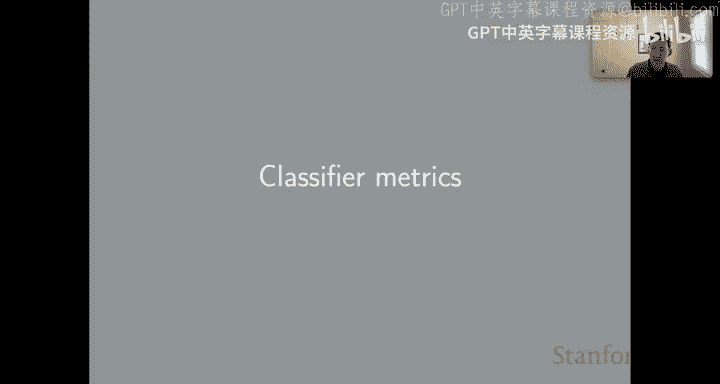
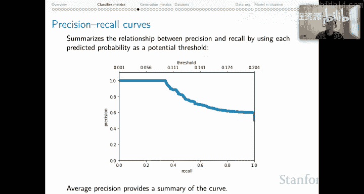

# 斯坦福大学《自然语言理解｜Stanford XCS224U Natural Language Understanding I Sp 2023》中英字幕（豆包翻译 - P40：-40-NLP Methods and Metrics, Part 2： Classifier Metrics .zh_en - GPT中英字幕课程资源 - BV1sx4y1s7oW

Welcome back， everyone。 This is part 2 in our series on methods and metrics。 In Part 1。

 I introduce some really high level overarching themes around methods and metrics。

 We're now going to do a deep technical dive on classifier metrics。

 because I imagine many of you will be dealing with classifiers for your final project。😊。

Even though this is a deep technical dive， I'd like to keep our eyes on those high level themes。

In fact， let's start there with an overview of thinking about this。

Carrying over a lesson from the first screencast， I would emphasize that different evaluation metrics encode different values。

 and that means that choosing a metric is a crucial aspect of your experimental work。

 You need to think about your hypotheses and your data and your models and how all of those come together to inform good choices around metrics。

 Even if you are fitting something as seemingly simple as a classifier。

You should feel free to motivate new metrics and specific uses of existing metrics。

 depending on what your goals are。 that's something that I emphasized in part one of this series that we should really be thinking about how our metrics align with the things that we're actually trying to do。

For established tasks， I grant that there will usually be pressure to use specific metrics。

 The ones that are in the leader boards or in the prior literature。

 but you should feel empowered to push back if you feel that's the right thing to do。 After all。

 areas of research can stagnate due to poor metric。

 So we all have to be vigilant and push back if we think that a metric is just leading us astray。

In that spirit， let's start with confusion matrices， the basis for many calculations in this area。

 As a running example， I'm going to use a turnernary sentiment problem。

 I'll have the gold labels across the rows and predictions going down the columns。

 And so this confusion matrix is saying， for example。

 that there were 15 cases that were gold positive and that the system predicted as positive。

 Where there are 100 cases that were gold positive and the system predicted neutral。😊。

In the spirit of taking nothing for granted， let me emphasize for you that a threshold was likely imposed for these categorical predictions coming from the model。

 especially if you have a probabilistic classifier。

 what you got out was a probability distribution over the three classes in this case。

 And you applied some decision rule to figure out which one would count as the actual prediction。

So obviously， different decision rules will give you very different tables of results。

 And so in the background， you should have in mind that that is an ingredient here。 And in fact。

 at the end of the slideshow， I'll suggest a metric that allows you to pull back from that assumption。

Another thing that's worth keeping track of is the support that is the number of cases that for the gold data fall into each one of the categories。

 Here you can see that it is highly imbalanced， and you should have in mind that that will be an important factor in choosing a good metric。

Let's begin with accuracy。Accuracy is the correct predictions divided by the total number of examples。

 Given a confusion table like this， that means that we sum up all the diagonal elements and divide that by the sum of all the elements in the table。

 That's accuracy。 The bounds for accuracy are 0 and  one with 0 the worst and one the best。

The value encoded in accuracy is just in the simplest terms， how often is the system correct。

That actually relates to two weaknesses。 First， there is no per class metric。

 We have to do this over the entire table。 Second， we have a complete failure to control for class size。

 Think about that value encoded。 How often is the system correct。

 That is insensitive to the different classes that you have in your system and the way it makes predictions for those classes。

 It is just looking at the raw number of times that you made the right guess。And actually。

 our table is a good illustration of how this can be problematic。Essentially。

 all of the true cases are neutral， and essentially， all of the predictions are neutral。

 And as a result， it hardly matters what you do for this system in terms of positive and negative。

 because accuracy will be totally dominated by performance on that neutral category。

 That could be good。 It's giving us a picture of how your system performs on the most frequent case。

 and it will reflect the value that I've suggested here。

 but it might be directly at odds with our goals of really doing well on even the smallest categories。

Suppose that you do have a goal of doing well， even on the small categories。

 I'm going to offer you some metrics for that。 But one thing you should keep in mind again is that if you are using a cross entropy loss。

 You are implicitly optimizing your model for accuracy。

 because accuracy is inversely proportional to the negative log loss。 That is the cross entropy loss。

 So you might set goals for yourself that are like good macro F1。 That'ssymmetric。

 I'll introduce in a second。 But keep in mind that your system is actually oriented toward accuracy。

 and that will have consequences， for example， optimization processes tend to favor the largest classes。

 and this is a picture of why that happens for classifiers。

One other technical note that I wanted to make， the cross entropy loss is actually a special case of the kale divergence loss。

 and that's kind of accuracy for soft labels where you have a full probability distribution over the classes。

The reason we often simplify this away is that typically for classifiers， we have a one hot vector。

 There's exactly one label dimension that is true。 And that means that for all other classes。

 the false ones， this ends up being a total of 0。 And that means we can simplify it down to the negative log of the true class。

 And that's how you get back to these standard formulations。 But this is the general formulation。

 and you can， in principle， learn from distributions over the labels that you have。

 and that will be fundamentally the same kind of operation with the same inbut biases。

But we do want to move away from raw accuracy， and the first step to doing that is precision。

The precision for a class K is the correct predictions for K divided by the sum of all guesses for K。

 So we're going to kind of operate column wise here。

 And here I've shown you the calculation for precision for the positive class。

 and we could do similar calculations for the negative and neutral classes。

The bounds of precision are 0 and  one with 0， the worst and one the best with a small caveat that precision is undefined for cases where you would need to divide by 0。

 So we just map those to 0 typically。 And sometimes if you're using psych。

 you see lots of warnings about metrics when you encounter this case。

The value encoded is penalizing incorrect guesses， and that leads directly to the weakness you can achieve high precision for a class K simply by rarely guessing k。

If you just make sure you're very cautious about this class。

 you will get high precision in all likelihood， But that's not necessarily the full set of values we want to encode。

So typically， we balance that with recall。 The recall for class K is the correct predictions for K divided by the sum of all true members of K。

 So here we're going to operate row wise。 and I've given you the sample calculation for the positive class。

The bounds are 0 and 1， must0 the worst and won the best。

The value encoded is that we're going to penalize missed true cases。

 So it is a kind of duel of precision。And that encodes its weakness as well。

 We can achieve high recall for K simply by O is guessing K。

 If I want to be sure I don't miss any examples， I'll just guess constantly and increase my chances of not having any misses。

 And now you can see very directly that we should balance this against precision。

 which is imposing the opposite value。 And that's the usual motivation for F scores。

 Usually F1 scores， but we can， in principle， have this weight beta。

 which will control the degree to which we favor precision and recall。 And again。

 no need to go on autopilot。 There are scenarios where precision is important and scenarios where recall is important。

 And you could use beta to align your metrics with those high level values that you have。

 But by default， it's one， which is an even balance。

 And what we're doing is simply the harmonic mean of precision and recall。

This can be a per class notion， so I've given the F1 scores along the rows for each one of those classes。

The bounds are 0 and  one with0， the worst and one the best。

 And this is always going to be between precision and recall as the harmonic mean of those two。

The value encoded is something like this。 How much do the predictions for class K align with true instances of K with beta controlling the weight placed on precision and recall。

 So it's kind of like both precision and recall have been baked into this notion of aligning with the truth。

The weaknesses。There's no normalization for the size of the dataset。

And it ignores all the values off the row and column for K。 I'm doing the F1 for the positive class。

 I don't pay attention to any of these other values。

 no matter how many examples there are in those off elements。

 And so that's a kind of structural bias that gets built in here。

 kind of a place that these metrics miss when you think per class。

We can average F scores in multiple ways， I'm going to talk about three macro averaging。

 weighted averaging and micro averaging。Let's start with macro。

 This is the most dominant choice in the field。 And the reason is that we， as N L peers。

 tend to care about categories， no matter how large or small they are。 And if anything。

 we often care more about the small classes than the large ones， because they're interesting or hard。

The macro average is simply an average across them numerically。

 So I simply do the average of these three numbers。

 So it gives equal weight to all three Bos are 0 and 1，0， the worst and one。 the best。

 The value encoded is， as I said， same as F scores plus the assumption that all classes are equal。

 regardless of size or support。The weaknesses， a classifier that does well only on small classes might not do well in the real world。

 That's the kind of duel of caring a lot about small classes。

 Suppose you do obsess over positive and negative in the scenario。 and you do really well on them。

 but at the cost of neutral。 Well， in the real world。

 your system is encountering most mostly neutral cases。 And if it's failing on them。

 it might look like a really bad system。A classifier that does well only on large classes might do poorly on small but vital smaller classes。

 right so this is the case where you might really care about those small classes even more than you care about the large one。

 and that's not reflected in the macro average because it simply takes them all as equal weight。

Weighted average F scores is a straightforward way to average where you've simply take into account the total support。

 and so it's a straight up weighted numerical average of the three F1 scores。The bounds are 0 and 1。

0， the worst one。 The best。 the value encoded is the same as the F scores。 plus。

 the assumption that class size does， in fact matter in this case。

 So this will be more like accuracy。The weakness， of course。

 is that large classes will heavily dominate， so we're back to that same weakness that we had for accuracy。

The final way of averaging F scores is called micro averaging。

 what you do here is take each one of the classes and form its own binary confusion matrix for that class and then you add them together and you get a single binary table。

The properties for this are， again， balance 0 and 1，0， the worst and one。 The best。

 The value encoded is exactly the same as accuracy。

 If you focus on the yes category in that final table that you constructed。

 It is exactly the same as accuracy。 So the weakness are same as F scores plus a score for yes and a score for no。

 which is kind of annoying because what do you do with the no category， you have to focus on yes。

 So there's no single number， but the yes， one was just accuracy after all。

 And that as far as I can tell is the only one that everyone pays attention to。 So overall。

 I feel like at this point， you could just ignore microav F scores。

 you still see them in the literature and in results tables froms kit， I believe， But overall。

 it's basically macro average to abstract away from class size or weighted average to bring in the overall class size。

 as an element in the metric。 Those are the two that I would suggest going forward and only for fully balanced problems。

 should you。Back to accuracy where class size won't be an interfering factor。Finally。

 I wanted to return to that observation I made at the start that it's kind of irksome that we need to always impose a decision boundary。

 We have to do the same thing with precision and recall。 We could think very differently about this。

 We could have， for example， precision and recall curves that would allow us to explore the full range of possible ways that our system could make predictions given a decision boundary。

 This offers much more information about trade offs between these two pressures and could be make it much easier for people to align system choices with the underlying values that they have for their system。

😊，So I know it's impractical to ask this because the field is fairly focused on single summary numbers。

 but I think it could be interesting to think about precision recall curves to get much more information。

 And then if we do need to choose a single number， average precision is a summary of this curve that。

 again， avoids the decision about how we wait precision and recall and brings in much more information。

 you'll recognize this as analogous to the average precision calculation that we did in the context of information retrieval where。

 again， it offered a very nuanced lesson about how systems were're doing。

