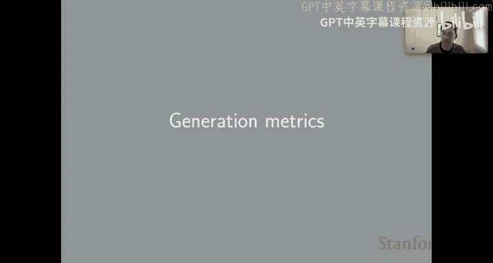
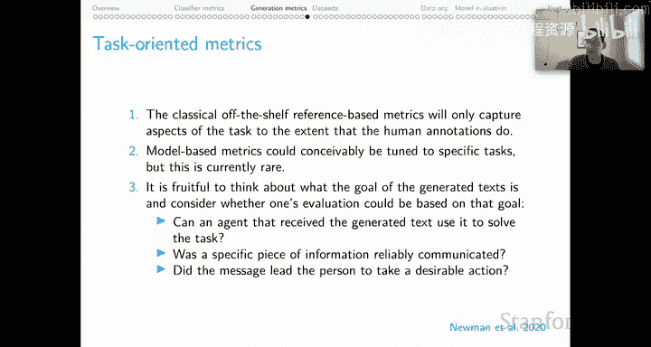

# 斯坦福大学《自然语言理解｜Stanford XCS224U Natural Language Understanding I Sp 2023》中英字幕（豆包翻译 - P41：-41-NLP Methods and Metrics, Part 3： Generation Metrics .zh_en - GPT中英字幕课程资源 - BV1sx4y1s7oW

Welcome back， everyone。 This is part 3 in our series on methods and metrics。

 We're going to talk about generation metrics。 You know， in the previous screencast。

 we talked about classifier metrics。 Those seem conceptually straightforward at first。

 but turn out to harbor lots of intricacies。 That goes double。

 at least for generation generation is incredibly conceptually challenging。

 I would say the fundamental issue here， I that there is more than one effective way to say most things。

 And so that immediately raises the question of what we are even trying to measure。 Is it fluency。

 Is it truthfulness， Comunicative effectiveness， maybe something else。

 These are all interestingly different questions。 After all。

 you could have a system that was highly fluent but spewing falsehoods or even a system that was highly disfluent but achieving its goals and communication。

 those kind of examples show that you really need to have clarity on the high level goals before you can even think about which metrics to choose。

😊。

For generation。Let's begin the discussion with perplexity。 That's a natural starting point。

 It's a kind of analog of accuracy， but in the generation space。 So for some sequence。

 X and some probability distribution or model that can assign probability distributions。

 The perplexity for that sequence， according to that model is really just the geometric mean of the probabilities assigned to the individual time steps。

 And then when we average over an entire corpus for the mean perplexity。

 we just do the geometric mean of the individual perplexity scores per sequence。

Properties of perplexity， while its bounds are one and infinity with one the best。

 So we are seeking to minimize this quantity。It is equivalent to the exponentiation of the cross entropy loss。

 This is really important。 Most modern day language models use a cross entropy loss。

 And what that means is that whether you wanted to or not。

 you are effectively optimizing that model for perplexity。What's the value encoded。

 it's something like does the model assign high probability to the input sequence？

So when we think about assessment， what that means is that we have some assessment set of sequences。

 we run our model on those examples， we get the average perplexity across the examples。

 and we report that number as an estimate of system quality。Relatedly。

 there are a number of weaknesses that we really need to think about。 First。

 Perplexity is heavily dependent on the underlying vocabulary。

 One easy way to see this is just to imagine that we take every token in these sequences and map them to a single unc character。

 In that case， we will have perfect perplexity。 but we will have a terrible generation system。

Perplexity also really does not allow comparisons between data sets。

 The issue here is that we don't have any ground truth on what's a good or bad perplexity separate from the data。

 And what that means is that comparing across two data sets with perplexity numbers is just comparing incomparables。

Relatedly， even comparisons between models is tricky。

 You can see this emerging here because we really need a lot of things to be held constant to do a model comparison。

 Certainly， the tokenization needs to be the same。 Certainly， the data sets need to be the same。

 Ideally， many other aspects of the systems are held constant when we do a perplexity comparison。

 Otherwise， again， we are in danger of comparing incomparables。Word error rate might be better。

 and this is more tightly aligned with actually human created reference text。

 which could be a step up from perplexity in terms of how we think about assessment。

This is really a family of measures。 You need to pick a distance measure between strings。

 and then your word error rate is parameterized by that distance metric。

 Here's the full calculation for a gold text X。And a predicted text pre。

 We do the distance between X and pre， according to whatever distance measure we chose。

 and we divide that by the length of the reference or gold text。

And then when we average over a whole corpus， what we do is for the numerator。

 sum up all of the distances between gold and predicted texts。

 and we divide that by the total length of all of the reference texts。Properties of word error rate。

 its bounds are zero and infinity with zero the best。

 it's an error rate so we're trying to minimize it。

The value encoded is something like how aligned is the predicted sequence with the actual sequence。

 so in that way it's similar to F scores once you have thought about your distance metric。Weaknesses。

 Well， it can accommodate just one reference text。 Our fundamental challenge here is that there's more than one good way to say most things。

 Whereas here we can accommodate only a single way。

 presumablysably a good one of saying the thing that we care about。

It's also a very syntactic notion by default。 Most distance metrics are string edit metrics。

 and they're very sensitive to the actual structure of the string。 And so as a result， by and large。

 these metrics will treat。 It was good。 It was not good。

 and it was great as all similarly distant from each other。 when， of course， semantically。

 it was good， and it was great are kind of alike and different from it was not good。😊。

Blue scores build on intuitions around word error rate。

 and they're trying to be more sensitive to the fact that there's more than one way to say most things。

 Here's how blue scores work。 It's， again， going to be a balance of precision and recall。

 but now tailored to the generation space。 The notion of precision is modified N gra precision。

 Let's walk through this simple example here。 We have a candidate， which is kind of unusual。

 It's just7 occurrences of the word the。 So obviously not a good candidate。

 We have two reference text。 These are presumed to be human created texts。

The modified ngram precision for the is2 over 7。 There are  seven occurrences of the in the candidate。

 and the two comes from the reference text that contains the maximum number of the。

 And that's reference text 1， it has two tokens of the。

 whereas reference text 2 has just one token of the。 So we get two points for that。

 And then the modified ngram precision for the is two over 7。That's a notion of precision。

 We need to balance that with a notion of recall。 Otherwise we might end up with systems that do very short generations in order to be very precise。

And so for recall， Blue introduces what they call a brreevity penalty， and in essence。

 what this is doing is saying， if the generated text is shorter than the text I expect for my corpus。

 I pay a little penalty。 Once I get to the expected length。

 you stop paying a recall a brevity penalty and you start to rely on the modified engram precision。

And the blue score itself is just a product of the brevity penalty score and the sum of the weighted modified ngram precision values for each an。

 What I mean by that is we could do this for unigrams， bigrams， trigrams。

 We could assign different weight to those different notions of Ngram。

 and all of those are incorporated if we want into the blue score。Properties of the blue score。

 its bounds are zero and one with one the best that we have no expectation for naturalistic data that any system will achieve one because there's no way we could have all the relevant reference texts conceptually。

The value encoded is something like an appropriate， we hope， balance of precision and recall。

 as implemented in that brevity penalty。It's similar to the word error rate。

 but it seeks to accommodate the fact that there are typically multiple suitable outputs for a given input are kind of fundamental challenge for generation。

Weaknesses， well， there's a long literature on this。

Some of it arguing that blue fails to correlate with human scoring for translation。

 which is an important application domain for blue， so that's worrisome。

It's very sensitive to the engram order of things。 so in that way。

 it is kind of very attuned to syntactic elements of these comparisons。

It's insensitive to engram type。 again， that's a notion of string dependence。 So that dog。

 the dog and that toaster might be treated identically with your blue scoring。

 even though that dog and the dog are obviously closer to each other than that toaster。And finally。

 for you have to be really thoughtful about the domain that you're operating in。

 because blue might be just mismatched to the goals of generation in that space。 For example。

 Leo etal 2016 in the process of developing and evaluating neural conversational agents just argue against blue as a metric for dialogue。

So think carefully about what your generations mean。

 what kind of reference text you actually have and whether or not everything is aligned。

 given your high level goals。 Again， a common refrain for this unit of the course。

I mentioned two reference based metrics and I call them reference based word error rate in blue are both like this because they depend on these reference texts。

 these human created texts。Others in that family include Rouge and meteor。

 And what you can see happening here， especially with meteor。

 is that we're trying to be oriented toward a task。

 maybe a semantic task like summarization and also less sensitive to fine grain details of the reference text and the generated text to key into more semantic notions。

 Meteor does that with things like stemming and synonyms。

And with scoring procedures like cider and Bt score。

 we actually move into vector space models that we might hope capture many deep aspects of semantics。

 cider does this with TF IF vectors。 It's a powerful idea。

 though it does make it heavily dependent on the nature of the dataset set。

And then Bert score uses weighted maxim at the token level to define scores between two texts。

 That's a very semantic notion。 In fact， the scoring procedure looks a lot like the one that we use for the Colbert retrieval model。

What you can see happening， especially with Bt score。

 is that we're trying to get away from all the details of these strings and really key into deeper aspects of meaning。

I thought I'd mention image based NLG metrics， some of you might be developing systems that take images as input。

 produce text， and then we want to ask the question of whether or not that's a good text for the image。

For this task， reference based metrics like blue and word error rate will be fine。

 assuming that the human annotations exist and are kind of aligned with the actual goal that you have for the text that you're generating conditional on these images。

But that could be a large burden for many domains and many tasks。

 We won't have annotations in the right way for these reference based metrics。

 So you might think about referenceless metrics。 metricss in this space seek to score text image pairs with no need for human created references。

At this moment， the most popular of these is certainly clip score。

 but there are others like Uic and spurts， and the vision here is to drop the need for human annotation。

 which is a major not bottleneck for evaluation and instead just score these image taxpayers in isolation。

I think this is really promising。 We do have a paper Chry et all 2022。

 where we criticize these referenceless metrics on the grounds that they are insensitive to the purpose of the text and the context in which the image appeared。

 Those are crucial aspects when you think about our goals for generation in this context。

 And it's a shame that these referenceless metrics are just missing that information。 However。

 we are optimistic that we can design variance of clip score and related metrics that can actually bring in these notions of quality。

 So I think referenceless metrics may be a fruitful path forward for evaluation for image based N L G。

And then finally， to round this out， I thought I'd offer a more high level comment under the heading of task oriented metrics。

 We've been very focused so far on comparisons with reference texts and other notions of intrinsic quality。

 But we should reflect on the fact that， by and large， when we do generation。

 we're trying to achieve some goal of communication or to help an agent take some action。 Right。

 The classical off the shelf reference based metrics will capture aspects of the task only to the extent that the human annotations did。

 So if your reference texts aren't sensitive to what the goal of generation was。

 then that won't be reflected in your evaluation。You can imagine model based metrics that are tuned to specific tasks and therefore task oriented in their nature。

 but that's actually currently a very rare model。I think it's fruitful， though。

 to think about what the goal of the text was and consider whether your evaluation could be based in that goal。

 This would be a new mode of thinking。You would ask yourself。

 can an agent that receive the gen detect text use it to solve the task。

 and then your metric would be task success。Or was a specific piece of information reliably communicated Again。

 we could just ask directly whether the agent receiving the message reliably extracted the information we care about。

 or did the message lead the person to take a desirable action。

 which should be a more indirect measure of communicative success。

 And that could be the fundamental thing that we use for our metric for generation。

 that will capture some aspects and leave out some others， For example， fluency， But I think overall。

 you can imagine that this is much more tightly aligned with the goals that we actually have for our generation systems。

