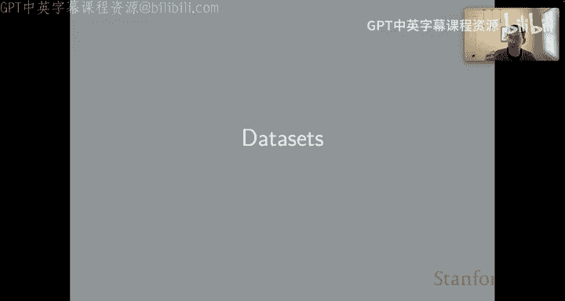
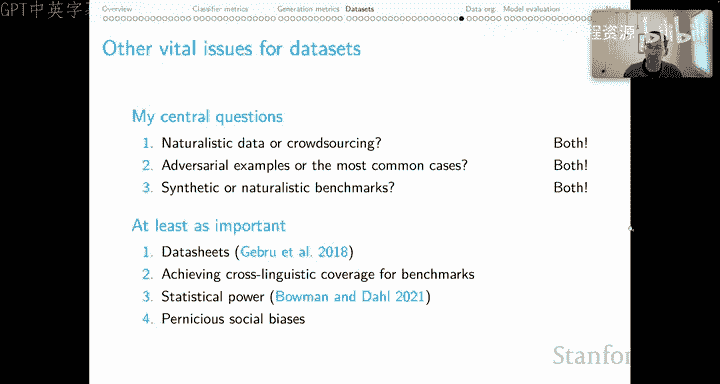

# 斯坦福大学《自然语言理解｜Stanford XCS224U Natural Language Understanding I Sp 2023》中英字幕（豆包翻译 - P42：-42-NLP Methods and Metrics, Part 4： Datasets .zh_en - GPT中英字幕课程资源 - BV1sx4y1s7oW

Welcome back， everyone。 This is part 4 in our series on methods and metrics。

 We're going to talk about data sets In the previous two screencasts。

 we really got in the weeds around classifier and generation metrics。

 I want to pop up a level now and talk conceptually about the role that data sets play in our field and how we construct them。

😊。

This is really a central topic In this context， I like to mention this quotation from the famous oceanographer and explorer Jacques Cuoussteau。

 Ksteau said water and air the two essential fluids on which all life depends。

My analogy here is that data sets are the resource on which all progress in the field of NLP depends。

Now， Ksteau's quotation actually continues， have become global garbage cans。

 which is worrisome for data sets。 I think there are some in the field who would make the analogy extend to this worrisome aspect。

 but I feel optimistic。 I feel we've learned a lot about how to develop data sets effectively。

 and we have more data sets than ever。 And so I think things are on a good trajectory as long as we're thoughtful。

But it really is important that we get this right， because we ask so much of our data sets。

 We use them to optimize models to evaluate models。

 to compare models to enable new capabilities in models via training to measure field wide progress and for fundamental aspects of scientific inquiry。

 This list is pretty much everything that we do in the field of NLP。 All of it depends on data sets。

 And you can see it's important that we get these data sets right。 After all， if we don't。

 then we've got a very shaky foundation and we might be tricking ourselves when we think we're making a lot of progress。

😊，Because data sets really are in a way the fundamental instrument。

 I like this quotation from Arabn Joshi。 The late great Arab and Joshi had the analogy that data sets are like the telescopes of our field。

 When he said this， this was back in around 2007。 He was actually expressing a concern。 He。

 He said that N L peerers were like astronomers who want to see the stars。

 but refused to build any telescopes。 And that Arabn indeed indeed did try to lead the way toward creating more data sets and valuing data set contributions。

 And I think he would be pleased with the current state of the field when we have more data sets than ever。

😊，In that context， though， it's worth mentioning this plot that I've used a few times in this course under the heading of benchmark saturating faster than ever。

 Remember along this chart along the X axis， I have time going back to the 90s and the Y axis is a normalized measure of distance from our so called human performance。

 although we've talked about what human performance actually means here。

When some people look at this chart， they see a story of progress where the benchmarks are indeed saturating faster than ever before。

 I think we can't deny that that is evident here。 But the other aspect of this is just the worrisome fact that none of the systems that are represented in this chart are superhuman in any meaningful sense and the fundamental problem there might be that our data sets are simply not up to the task of measuring what we want them to measure。

So for a kind of alternative perspective on this， let's talk about the limitations that we find in these data sets and we do indeed find them more quickly。

Again， for this slide along the X axis， I have time stretching back into the 90s。

 and so far I have one data set represented the Penn tree Bank。

 which is a collection of syntactic pars for sentences。

 It drove progress on syntactic parsing for decades for maybe too long。The dots here。

 the red dots are papers that are finding errors in the Pennre bank。

 Most of these papers trace to work by De Mar Moyers and colleagues and， you know。

 hat tip to them for really thinking carefully about the quality of the data and trying to improve it。

But one thing that's noteworthy for me is that despite the very long timeline。

 there are relatively few papers and they're all just about errors in the parsse trees。

Let's fast forward to S N LI， the Stanford Natural Lanage inferencefer benchmarkchmark。

 This was launched in 2015。 And right away， you get an outpouring of papers that are finding limitations in the data set。

It's actually rare to find papers pointing out errors in the era of natural language understanding and error is kind of harder to define。

 but we can identify things like artifacts， those are the orange dots and biases。

 those are the blue dots， as well as gaps in the data set， as I've given in that maroon color。

There are lots of dots here compared with the Pentry bank。 A similar story holds for S。

 It was launched soon after S NI。 And again， you get a bunch of papers。 in this case。

 pointing out artifacts in the data set。And then finally for another illustration。

 ImageNet is an interesting case， it was launched in 2009。

 which feels like a previous era of data set generation。

 and for a while it got to lead a quiet life as a trusted benchmark， just like the PTB did。

But then you get an outpouring of papers， identifying things like biases and errors and artifacts and gaps。

 And so we've entered into this era in which if you are successful with your benchmark and you get a lot of users。

 people will also find limitations quickly。 I think that is a healthy dynamic that we should embrace。

 It's a little bit hard to take as the creator of a data set。 But ultimately。

 I think we can see that this is a marker of progress。

 This kind of sical inquiry about these fundamental devices。😊，So to keep things succinct here。

 I'm going to identify three central questions that I'll address for data sets。

 and then I'll list out some more at the end of the screencast。 First question。

 should we rely on naturalistic data like data that you scrape from a website or extract from an existing database or should we turn to crowdsourcing as a commonly debated question。

 my answer will be use both。Second question， should we use adversarial examples or benchmarks that consist only of the most common cases。

 another thing that's hotly debated， and my answer is both。Third question。

 should we use synthetic benchmarks or naturalistic benchmarks。

 A lot of people in the field think synthetic benchmarks are fundamentally problematic and that we should use only naturalistic ones。

 But you can probably anticipate my answer at this point。 I think both of them have a role to play。

 I'll substantiate all three of these boths as we move through the screencast。

Let's start with that question of naturalistic data versus crowdsourcing。

 The reason I answer both is that this is basically about trade offs for me for naturalistic data sets。

 which you could call found or curated， like you scrape a website or do some work to harvest examples from a website。

 You have abundance。It's probably inexpensive to gather these examples。

 and they will be genuine in some sense， because they were presumably not created for the sake of your experiment。

 but rather for some naturalistic purpose， some genuine communicative purpose。 On the other hand。

 these are also weaknesses。 The data set will be uncontrolled。

 You're at the mercy of what you observe in the world。

 It will be limited in terms of the kind of information that you can gather。

 And it will be maybe be intrusive， right， It's probably not the case that you got opt in from every single person who contribute a data point for this data set that you've created。

 And so in some sense， you might have a deep concern about the rights of the people who contributed。

Let's contrast this with crowdsourcing， I've called this lab grown。

 this is a more artificial thing that you do。This could be highly controlled because youve set up the task。

It could be privacy preserving in the sense that you could just make sure everyone who contributes knows that they're contributing to the dataset set。

 and you could even offer offer them the opportunity to remove themselves at a later date if they decide that that's important。

 And this will be genuinely expressive because you can have crowdworkers in principle do even very complicated things to get data that you wouldn't observe in the wild。

But then you have the corresponding weaknesses。 This will be scarce。

 You'll never have enough crowdsource data， and it will be expensive。 And in addition。

 it can get very contrived， right， You're having people do things that are very unnatural。

 not things that they would do as a matter， of course， with communication。

 but rather things that you set them up to do。 And the results of this might feel contrived also in the sense that。

 you know， the crowd workersers are trying to please you， the person who launch the task。

 And that might be a goal that's very different from the one that you actually have in mind。

So for me， looking at these trade offs， the question is， how could we balance all these things。

 And I do think that we can find hybrid models that allow us to be both genuine and expressive and to preserve in general。

 a lot of the strengths across these two and minimize the weaknesses。

 I've shown you an example of this already for dinocent round 2。 we had two conditions。 One。

 where workers just wrote a text from scratch to try to fool a top performing model for sentiment and another condition where we gave them existing sentences that they could edit in order to achieve that goal。

 And fundamentally， I think the editing condition offers much more naturalism while still giving us the results that we wanted for that prompt condition I would first observe that they did edit the text。

 we see a wide range of different edit distances between the original and the thing they produced。

 So that seems healthy。 And then this is more important， for example in terms of length。 We find。

That the no prompt examples were very short compared to the prompt ones and the prompt ones have lengths that are more like just naturally occurring sentences that we would harvest in domain from a site like Yelp。

 here's a similar thing for vocabulary size， the no prompt condition is very limited in terms of its vocabulary。

 whereas we get much more diversity for the prompt condition approaching the diversity of vocabulary for naturally occurring cases。

So this looks like a clear win for prompting which mixes naturalism with things we do in the lab。

 and the result was really wonderful examples that would be hard to observe。

 that do all sorts of interesting things linguistically and also play with non literal language use and so forth。

So I think the hybrid model gave us the best of both worlds in some sense。

Let's move to our second question。 Should we use adversarial examples or just benchmarks that contain the most common cases。

 And remember， my answer is both， Just as a reminder， this。

 we talked about this in a previous unit for standard evaluations。

 you create a data set from a single model independent process and divide it into trained dev test。

 whereasas for adversarial assessment， We have a separate test set created in a way that you suspect or no will be challenging given your system and the way it was developed initially。

And then for adversarial data sets in general， this would be Tra dev test。

 where all of those elements were guided by attempts by people usually to fool a top performing model or set of models。

So these are the comparisons that we're thinking about here。

I mentioned for you before that there are a bunch of these fully adversarial data sets covering a wide range of domains。

I think that's been fruitful。 And I think it's a lesson of that literature that we're seeing lots of good results。

 especially from adversarial training and testing。 But there is an alternative perspective out there。

 And I think the most vocal of that perspective is Bowman and Doll 2021。 I'll offer you some quotes。

 And you should definitely check out the paper。They write under the heading of adversarial examples。

 not being a panacea that adversarial filtering can systematically eliminate coverage of linguistic phenomena or skills that are necessary for the task。

 but already well solved by the adversary model。This mode seeking。

 as opposed to mass covering behavior by adversarial filtering， if left unchecked。

 tends to reduce data set diversity and thus make validity harder to achieve。I actually。

 frankly think that this is a totally reasonable perspective。

 and the disconnect here is the notion of adversarial filtering。

 That is certainly not something I would advocate for。 if you think about Dnocent。

 our train and devon test sets all contain a mixture of cases that were adversarial。

 and cases that the model actually got right， more like the mode seeking behavior that they're talking about here。

 I do think you could damage a model by doing adversarial filtering， especially for training。

 because I think it could put the model in a very unusual state。But again。

 that's not something I was arguing for。 I was arguing for the both perspective。

 have benchmarks that contain both the adversarial cases and the truly kind of normal mode seeking cases that they're mentioning here。

 So I would not leave this pressure unchecked。They also write this position paper argues that concerns about standard benchmarks that motivate methods like adversarial filtering are justified。

 but that they can and should be addressed directly。

 and that it is possible and reasonable to do so in the context of static I I D evaluation。 again。

 let's set aside the distracting thing about filtering and focus on what they claim here。

 which is that you， if you have a massive benchmark， will simply。

 by virtue of having that massive benchmark， cover all of the relevant phenomena。

I actually just think that that's factually incorrect。 I think it is very difficult。

 given the complexity of language to develop a benchmark that is so large that just as a matter of course。

 you've covered all the hard cases and the role of adversarial training examples could be to help us fill in those gaps in a much more efficient way。

Because remember the job to be done is a complicated one， let's focus on the domain of sentiment。

 yes， we need our models to get normal cases like the food was good， correct。

But we also need them to deal with these complicated shifts in perspective。

 as in my sister hated the food， but she's massively wrong， or the cookies seemed dry to my boss。

 but I couldn't disagree more。 And we also need them to get things like non literal language use like breakfast is really good If you're trying to feed it to dogs。

 That some sarcasm or irony。 As well as really creative things that people do with language like worthy of gasps of foodgasms。

 where we get a new use of a suffix here。 We can all immediately intuitive what this intotu it what this means。

 It's a positive statement。 but we know models will struggle with this kind of innovative use of language。

 And we need to push them to overcome that hurdle。 If you just do standard data collection。

 You might not see any of these examples or certainly not in the density that you need to see them to improve our systems。

 And so that's why I would just introduce a measure of adversarialness into train， dev and test。

 But I would not do any of the filtering that bowowman and。All are worried about。

So for adversarial testing in general， here's what I would say are the major lessons we've learned so far。

 Often， our top performing systems， like the one from that benchmark saturating slide。

 have found unsystematic solutions that should worry us。

I also noted in earlier units of this course that progress on challenge sets does seem to correlate with meaningful progress in general。

 That's an important insight。Present day systems get traction on adversarial cases without degradation on the general cases。

 You know， it would be worrisome if training on adversarial examples。

 even a little bit of them caused our systems to perform worse in the general case。

 but I think we do not see that happening。And then the final thing I would say is that whatever your view is on the role of adversarials in system development。

 If you deploy a system out into the world， the adversarial examples that people cook up and throw at your system will define public perception for your system。

 And so in the interest of selfpreservation， I would encourage you to think about adversarial dynamics for evaluation before you do any kind of deployment。

 and that's why I exhorted you all in an earlier unit for this course to really think deeply about evaluation and have diverse teams of people with multiple perspectives on your system participate in that internal evaluation to really find the cases where your system performs in a problematic way。

 you should be your own adversary to the extent that you can to avoid having really adversarial problems emerge when your system is used in the world。

Final question， synthetic benchmarks or naturalistic benchmarks。 And as I said。

 there is a prominent perspective in the field that naturalistic benchmarks are the only ones we should be using。

 to me， at a scientific level， This is deeply worrisome。

 because what it does is introduce two unknowns into almost all the experiments that we run。

 The data set is an unknown in the sense that we don't fully command what its structure is like。

 And the model is almost by definition in these context， An unknown。

 We're trying to explore its properties。 And so the situation is kind of like。

 you have this massive data set that you cannot audit comprehensively。

 you might not even fully understand the process that created it， even if you did crowdsourcing。

 And then you have that as the input to a model， which is also a major unknown。

 And then you get some output。 And the question is， what are the causal factors in this output。

Causal assignment in this case is very difficult because of the fact that we have two unknowns。

 If we could fix the data set and call it a known quantity。

 then we could trace aspects of the output to properties of the model that we have manipulated。

 but with two unknowns in play， this will always be uncertain。I gave you a story about this before。

 Let me briefly rehearse it。 This is under the heading of negation as a learning target。 Remember。

 we have this idea that we should have systems that know that if A entails B。

 then not B entails not A， the entailment reversing property of negation。

And we have an observation across a lot of different papers that top performing NLI models fail to hit that learning target。

It's very tempting to conclude here that the model is the problem， right？

 top performing models seem incapable of learning negation。

 but we have an observation that our data sets， the naturalistic benchmarks these models were trained on severely under represent negation。

So now we don't know whether the issue is with the models or with the data set because we have two unknowns。

In response to that， we created what I've called here a slightly synthetic benchmark that is monotonnicity N L I or Mon Lli。

 recall it has two parts， a positive part where we take existing S N LI hypotheses and use word net to create new examples that fire off these systematic cases where we get a neutral B and B entailment A。

 That's the positive part， we did the same thing for negated examples。 And now after the replacement。

 we get the reverse of those patterns。 What this leads us to is is a data set that has naturally occurring cases as its basis。

 But a systematic manipulation that leaves us with complete guarantees that we have a certain kind of representation for lexical entailment and negation。

😊，That's why it's slightly synthetic。 And then when we use this as a challenge dataset set。

 we get a blast of insight。 I claim let's look at the Bt row here。

 Bert is performing extremely well on S N L I， extremely well on the positive part of our synthetic benchmark。

 but essentially hitting 0 for the negative part of our benchmark。

 It's obviously just ignoring the negations。😊，What is the issue here， Is it data or is it the model。

 Well， when we do a modest amount of fine tuning on negative moennai examples。

 we immediately boost performance for the model on that split。

 And that shows us definitively that when we show a model like Bert relevant negation cases。

 it can handle the task。And so now， as a result of having a known data set。

 we have learned something directly about our model。When we turn to naturalistic data。

 and I emphasize when there， because I do think that that's an important component in NLP。

 When we move from then synthetic to naturalistic， we do so knowing that Bert can。

 in principle learn negation and that data coverage will be a major factor in its performance there。

 Those are crisp analytic lessons that we learned only because we allowed some synthetic evaluations。

So that's it， those are three major questions for data sets in the field there are many more though right so I address these but we can also think about issues like data sheets that is disclosures for data sets that help us understand how they can be used responsibly and where their limits lie。

We should also be thinking much more about how we're going to achieve cross linguistic coverage for our benchmarks right now we have still to this day too much focus on English when in fact。

 we want systems and models that are performant the world over。

We could worry about statistical power， and of course。

 we should also worry deeply about the pernicious social biases that are embedded in our data sets and how we will get rid of those in order to create technologies that are more equitable。

