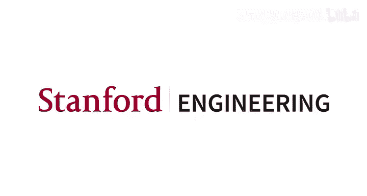
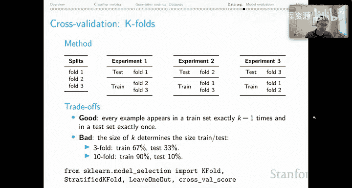
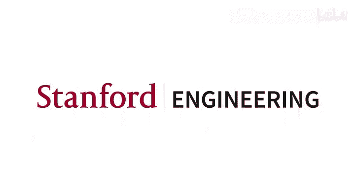

# 斯坦福大学《自然语言理解｜Stanford XCS224U Natural Language Understanding I Sp 2023》中英字幕（豆包翻译 - P43：-43-NLP Methods and Metrics, Part 5： Data Organization .zh_en - GPT中英字幕课程资源 - BV1sx4y1s7oW

Welcome back everyone， this is part5 in our series on methods and metrics。

 this will be a short focused technical screencast about data organization。

Within the field of NLP and indeed all of AI， we're all accustomed to having data sets that have train。

 dev and test portions。This is common in our largest publicly available data sets。

It does presuppose a fairly large data set， And that's in virtue of the fact that we hardly ever get to use the test set。

 As I have said repeatedly in the field where all on the honor system to do test set runs only when all of system development is complete。

 So that test set is under lock and key most of the time。

 and that does mean that it goes hardly ever used during the course of scientific inquiry。

Having these fixed test sets is good because it ensures consistent evaluations。

 it's much easier to compare two models if they were evaluated according to exactly the same protocol。

 but it does have a downside that because we always use the same test set。

 we get up kind of community wide hill climbing on that test set as later papers learn indirect lessons about the test set from earlier papers in the literature and that ends up inflating performance。

 but on balance， I think train dev test has been good for the field of NLP。However。

 if you're doing work outside of NLP， you might encounter data sets that don't have predefined splits。

 that could be because they're small or because they're from a different field， for example。

 in psychology， you hardly ever get this trained dev test methodology。

 and so data sets from that field which you might want to make use of。

 are unlikely to have the predefined splits。This poses a challenge for assessment， right。

 because as I said， for robust comparisons， we really want to have all our models run using the same assessment regime。

 and that means using the same splits for all of your experimental runs。Now， for large dataset sets。

 you could just impose the splits yourself and then use them for the entire project right and that will simplify your experimental design。

 and it will also reduce the amount of hyperperameter optimization that you need to do。

 So if you can get away with it， just impose the splits and maybe bake that into how people think about the data in NLP now。

But for small data sets， imposing these splits might simply leave you with too little data。

 and that could lead to very highly variable system assessments， right。

 either yourre training on too few examples to have a lot of examples for assessment and that causes some noise。

 or you're leaving too few examples to assess on。 and then the resulting assessments are very noisy and highly variable。

 So it's hard to get that right in these situations。

 I think what you should do is think about cross validation。In cross validation。

 we take a set of examples and partition them into two or more trained test splits。

 We run a bunch of system evaluations， and then we aggregate over those scores in some way。

 usually by taking an average， and we report that as a measure of system performance。

There are two broad methods that you can use for this kind of cross validation the first is very simple。

 I've called it random splits here， and the idea is for k splits that is k times you shuffle your data set。

And then you split it into 1% train and usually one minus1% test to use all the data。

 and then you conduct an evaluation。 So you repeat that K times and you get a vector of scores。

 and then you aggregate those scores in some way， usually you would take an average。

 but you could also think about an average plus a confidence interval or some kind of stats test that would tell you about how two systems differ according to this regime。

Usually， but not always， you want these splits to be stratified in the sense that the train and test splits have approximately the same distribution over the classes or output values to give you consistent evaluations。

Trade offs。 Well， the good part of this is that you can create as many experiments as you want without having this impact the ratio of training to testing examples。

 The value of K here is separate from the value of T and 1 minus T。

And what that means is that you can run lots of experiments and independently set the number of train examples or the number of assessment examples。

 so that's certainly to the good。The bad here is that you don't get a guarantee that every example will be used the same number of times for training and testing because of the shuffle stuff that you do here introducing a lot of randomness。

Frankly， for reasonably sized data sets， this bad here is very minimal indeed。

 And so I really like random splits。 And I would worry about the bad only in situations in which you have a very small data set。

Finally，syCt Learn has lots of utilities for doing this kind of random split stuff。

 I would encourage you to use them。 They've worked them out。

 nice reliable code that will help you with these protocols。Now， in some situations。

 you might instead want to do what's called K fold cross validation。 and this is somewhat different。

 Let's imagine we have a data set， and we have divided it ahead of time into three folds。

 That is three disjoint parts。Then we have experiment one where we have our test fold is fold one。

 and we train on folds two and three together。Experiment 2， we train on fold2 and test on， sorry。

 we test on fold 2 and train on  one and 3。 And for experiment 3。

 we test on fold 3 and train on one and 2。 So we've covered all of the combinations。

 Our three folds give us three separate experiments。

And then we kind of aggregate results across all three of the experiments。

Let's think about our trade offs again， the good part is that every example appears in a train set exactly k minus1 times and in a test set exactly once。

 so we get a nice pristine experimental setting in that regard。The bad though。

 is really bad to my mind， the size of K determines the size of the train set right。

 If I do three folds cross validation， I get to train on 67% of the data and test on 33。

But if I want to do 10 folds cross validation， now I have to train on 90% and test on 10。

 So it feels like the number of experiments has gotten problematically entwined with the percentage of train and tests that I want to have。

 And that's really problematic。 You might want to have a lot of folds。 That is a lot of experiments。

 but nonetheless the train on only 80% of the data in each case。

That leads me to prefer the random splits approach in almost all settings。

 because the bad there was relatively small relative to the confound that this kind of introduces for cafolds cross validation。

Finally， I'll just note thatsyit， again， has you covered。

 They have lots of great utilities for doing this kind of k folds cross validation in various ways。

 So do make use of them to make sure that your protocols are the ones that you wanted。

