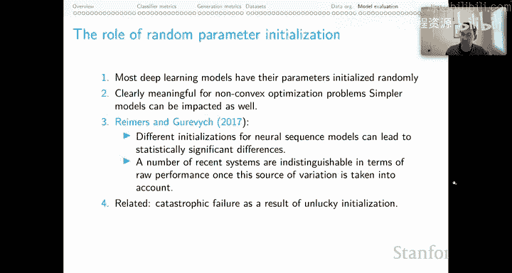
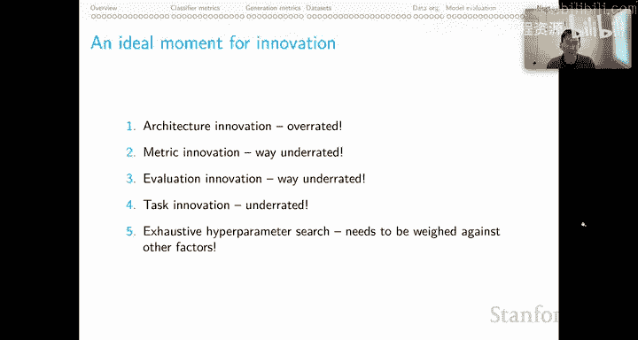

# 斯坦福大学《自然语言理解｜Stanford XCS224U Natural Language Understanding I Sp 2023》中英字幕（豆包翻译 - P44：-44-NLP Methods and Metrics, Part 6： Model Evaluation & Conclusion .zh_en - GPT中英字幕课程资源 - BV1sx4y1s7oW

Welcome back everyone， this is the sixth and final screencast in our series on methods and metrics we're going to talk about model evaluation。

 This is a high level discussion that is directly oriented toward helping you with your final project work。

Here's an overview we're going to talk about baselines， what are they， why are they important？

We'll talk about the trials and tribulations of hyperparameter optimization and why it's important。

 We'll think about classifier comparison， a common mode to be in as you're evaluating systems and hypotheses。

 And then we'll talk about two things that are really particular to the deep learning era。

 How to assess models that don't converge in any strict sense and also the role of random parameter initialization in the performance of our biggest models。

Let's start with base lines。 We take this for granted。

 but this is actually pretty important conceptually。 Here's a fundamental observation about baseline。

 Evaluation numbers in our field can never be understood properly in isolation。

 Suppose your system gets 095 F1。 You feel overjoyed。

 But the first question reviewers will ask you is。 I the task too easy。

 How do simple baseline do on the problem。Conversely。

 suppose your system gets 06 and you feel in despair。

Because you feel like you haven't had a success here。

 but the next question should be how do humans do they're presumably a kind of upper bound。

 and if it's a hard task or a noisy task， human performance might be close to 0。

61 and you might really have achieve something meaningful there。

 So it's baseline models and in that case， oracle models that are helping us to understand。

Baselines are also crucial for strong experimental design， right。

 so defining your baseline should not be some afterthought。

 but rather central to how you define your overall hypotheses， Think about simple systems。

 Think about ablations of your target system and incorporate those into your thinking about the comparisons that you'll make and baselines are really just one aspect of the comparisons we want to offer。

Baselines are essential for building a persuasive case。

 we saw that in my two examples there to really understand and calibrate on what you achieved。

 we need some baselines to kind of calibrate all of that stuff。

They can also be used to illuminate specific aspects of the problem and specific virtues of your proposed system that often falls under the heading of ablations of your system。

 Those are baseline that remove crucial features or components and test the model with the same protocol。

 and then the distance between your chosen model and the alateated model is a kind of estimate of the importance of the alateated components to the overall system performance。

 Cru aspect of arguing and supporting hypotheses in everything else。

Random baseline are really useful for many purposes。 First， they can provide a really true。

 lower bound on how systems can do on your problem。 Sometimes they are surprisingly robust。

 And so it's worth running these early。 And I think also they can help you kind of fully debug your system。

 These are probably lightweight models that do relatively little processing。

 and can make sure that everything is kind of functioning and make sense and all that other stuff。

 Psyit learn again， has you covered。 They have dummy classifier and dummy regressor。

 They have different ways of acting as random models。

 And I think this is really useful to set up early in your process。

You could also think about task specific baseline。 This might require real thought and real study in the literature。

 Does your problem suggest a baseline that will reveal something about the problem or the way it's modeled。

 If so， you should have one of these task specific baseline。 Here are two recent examples from N L U。

 The first one is natural language inference， People discovered that so called hypothesis only baseline can be very strong。

The reason this happens is that in the underlying crowdsourcing effort。

 crowdworkers were given premise sentences and asked to construct three hypotheses， one for neutral。

 one for contradiction and one for entailment。 in that process of construction。

 they did some systematic things that kind of convey information about the label inadvertently through the hypothesis。

 For example， many contradictions involve negation。

 and many entailment pairs involve very general terms as part of the hypothesis。

 What that means is that the hypothesis actually carries information about the label。

 and a hypothesis only baseline quantifies that。 you simply fit a model without any premise information and see how you do And the finding of the literatures that very often for our benchmarks。

 the hypothesis only baseline is way above chance。 And what that shows you is that the random baseline is not so informative anymore more。

There's a similar story for the story closed task。 This is to distinguish between a coherent and incoherent ending for a story。

 And again， systems that look only at the ending often do really well。 I think for the same reason。

 the coherent versus incoherent thing is often actually inferable， just from the ending。

 neglecting the story。 So it's not that the task is broken here necessarily， but rather， again。

 that you should think about this as a baseline to compare against and progress is really progress from this very specialized baseline。

Next topic， hyperparameter optimization。 This is discussed extensively in one of our background units on sentiment analysis。

 You might go there for a refresher here。 I'll just briefly review the rationale。

 You want maybe to obtain the best version of your model。

 And that might mean exploring over different hyperparameters to find a kind of optimal setting for it。

Another motivation is about comparison between models。

 Suppose you do have a results table full of different systems you're comparing。

 It makes no sense to compare them against randomly chosen parameter settings。

 because you really want to give every model the best chance to shine。 Otherwise。

 there's an arbitrariness to be evaluation that might not translate into robust results。

 So what you really do is give every system a chance by exploring a wide range of hyperparameters and reporting the optimal results。

 according to that exploration。 That's a fair comparison。

 and it implies a lot of search over hyperparameters。

You might want to understand the stability of your architecture。 This is interestingly different。

 This is where you're not interested in the best parameters。

 but rather how stable system performance is under various choices people might make in order to get a sense for how robustly it will perform if people are saying not attentive to these hyperparameters or set them inly in a kind of inadvertent accident or an adversarial setting。

Cruciial to all of this， no matter what your goals。

 Hyparameter tuning must be done only on train and development data。

 you never do model selection of any kind based on the test data。

 This is a special case of the rule that I've been repeating throughout the course。

 This is really fundamental to how we think about testing and generalization。

 and it applies with real force in the context of the kind of model selection we're doing here。Now。

 hyper parametermeter optimization has gotten really challenging in the era of long running。

 expensive training regimes。 And let me give you a sense for what the problem is by way of an example。

For each hyperparmeter， you identify a large set of values for it in some range。

Then you create a list of all the combinations of all the hyperparameter。

 This is the cross product of all the values for all the features you identified in step 1。

 What you can hear in that description is an exponential growth in the number of settings for each setting。

 you cross validate it on the available training data， which might imply 5 or 10 or 20 experiments。😊。

Then you choose the settings that did best in step3 and you train on all the train data using that setting and then you evaluate that model on the test set that is a kind of pristine version of the protocol that we might be implementing。

But here's the problem。 Suppose parameter H1 has five values， and parameter 2 has 10。

Then the total number of settings is now 50。Suppose we add three， then it goes to 100。

Now suppose we're going to do five fold cross validation to select optimal parameters and how we are at 500 runs。

Very quickly， the number of experiments exploded。 And if each one of these runs takes a day。

 you're pretty much out of contention in terms of actually implementing this protocol completely。

 Something has to change。Right， the above is untenable as a set of laws for the scientific community。

 We cannot insist on this level of hyperparameter optimization。 If we adopted it。

 complex model strained on large data sets would end up disfaavvoreed。

 And only the very wealthy would be able to participate。 And to give you a glimpse of this。

 here is a quote from a paper from a team at Google doing kind of NLP for healthcare care。

 The performance of all above neural networks were tuned automatically using Google Vizier with a total of over 200000 GP hours。

 That is a lot of money spent on a lot of compute。 Obviously。

 we cannot insist on a similar level of investment for experiments， say for this course， but frankly。

 for any contribution in the field。 We have to have compromises。

So here are some reasonable compromises。 These are pragmatic steps you can take to alleviate this resource problem。

 I've given them in descending order of attractiveness， and I find that as the days go by。

 we need to go lower and lower on this list。You could do random sampling and guided sampling to explore a large space on a fixed budget。

 This is kind of nice because you have the cross product of all of the settings。 That's too large。

 You simply randomly sample in the space， maybe with some guidance from a model。

 and you can then on a fixed budget of， say， 5 or 10 or 100 runs。

 do a version of the phone grade search。😊，You could also search based on a few epochs of training。

 the expense comes from multiple epochs， maybe you do one or two。

 and then you pick the hyperparameters that were best at that point。

 and if the learning curves are kind of familiar and consistent。

 then this will be a pretty strong approach here。You could also search based on subsets of the data。

 this is fine， but it could be risky because we know some parameters are very dependent on data set size。

 and so you're selecting based on small data and applying it to large data。

 even though you know that's probably a risky assumption。

You could do heuristic search and define which hyperparameters matter less and then set them by hand and justify that in the paper。

 That's increasingly common。 People describe things like we determined in our initial experiments that these hyperparameters had this optimal value or didn't matter that much。

 And so we chose these reasonable values。 And then the actual search happens only over the ones that you kind of can tell are important。

 We have to take your word for it that you've done the heuristic search responsibly。

 but this is obviously a really good way to balance exploration with constrained resources。

You could find the optimal hyperparameters via a single split and use them for all subsequent splits and then justify that based on the fact that the splits are similar。

 that would automatically cut down substantially on the number of runs you need to do because you don't need to do so much cross validation in this mode。

And then finally， you could adopt others choices right and the skeptics will complain that these findings don't translate to new data sets。

 but it could be the only option， and as I say a few years ago， this was kind of frowned upon。

 but now in the modern arrow with these massive models， it's basically the only option。

 and so I think increasingly people are simply carrying forward other hyperparameters。

 it means less exploration， we might not be seeing the best versions of these models。

 but it might then again be the only option。In terms of tools for hyperparameter search as alwayssyCit is really rich with these things。

 they've got a lot of these toolings and in addition PsyICI optimizes kind of one level up in terms of sophistication。

 that's where you could do model guided search through a hyperparameter grid in order to intelligently select good settings to lead to a good model on a fixed budget。

Next topic， classifier comparison， this is a short one， but this can be important。

 Suppose you've assessed two classifier models。Their performance is probably different in some way。

 What can you do to establish whether these models are different in any meaningful sense。

 I think there are a few options。 The first would be practical differences if they obviously make a large number of different predictions。

 you might be able to quantify that difference in terms of some actual external outcome。

 That's a really good scenario to be in。You could also think about confidence intervals to further bolster the argument that you're making。

 This will give us a picture of how consistently different the two systems are。

 And if they are consistently different， then you have a very clear argument in favor of one over the other。

The Wilcoxen sign rank test is a kind of accepted method in the field for assessing classifiers。

 using methodologies that are similar to standard T tests。

 And I guess the consensus is just that the assumptions behind the Wililcoxen test are somewhat more aligned with classifier comparison to do that。

 as well as confidence intervals。 you will have had to run your model on lots of different settings to get a long vector of 10 to 20 scores to use as the basis for the stats testing。

If that is too expensive， you could opt for Mcnemars test。

 This is a comparison that you do over two single trained classifiers based on their confusion matrices。

 So you only need one run。 It will be kind of unstable if the models are unstable。

 but it is a way of doing a stats test in the kind of mode of the chi squared test to give you some information about how two fixed artifacts compare to each other。

 Not as strong as the previous methods， but none the less useful and arguably better than nothing。

Okay， a special topic for deep learning， how do you assess models without convergence this never used to arise back in the days of all linear models all these models would converge more or less instantly to epsilon loss and then you could feel like that was how you'd move forward with assessing them。

Right， but now with neural networks， convergence has really taken center stage。

 and it's in a complicated way that it takes center stage。 First。

 these models rarely converge to epsilon loss。 and therefore。

 it's kind of nonisue whether or not that would be your stopping criterion。 In addition。

 they might converge at different rates between runs。 and their performance on the test set。

 might not even be especially related to how small the loss got。

 So you need to be kind of thoughtful about exactly what your stopping criteria will be。 Yes。

 sometimes a model with low final error turns out to be great。

 And sometimes it's worse than the one that finished with a higher error。

 This might have something to do with overfitting and regularization， but the bottom line here is。

 We don't know a priori what's going on。 This is very experiment driven。

So one thing to think about for stopping criteria in general is what we call incremental dev set testing to address the kind of uncertainty that I just reviewed。

 you regularly collect information about Dev set performance as part of the training that you're doing。

 For example， at every hundredth iteration。 you could make predictions on the dev set and store the resulting vector of predictions。

All the pytorrch models for this course have an early stopping parameter and a bunch of related parameters that will help you set this up in a way that will allow you to do this incremental testing and with luck。

 get the best model。And if you need a little bit of motivation for this here are some plots from an actual model。

 you can see the loss going down very steadily across different iterations of training。

 but the performance on the dev set tells a very different story。

 you can see based on this performance that at a certain very early point in this process around iteration 10。

 our performance was actually getting worse。 even though the loss was going down。

 And that just shows you that sometimes the steady loss curve is a picture of overfitting。

 and not of your model actually getting better at the thing that you care about。

So think carefully about your stopping criteria。 And in general， though。

 I think we might want to take a more expansive view of how we do evaluation in this mode。 Here。

 what I' am pitching is that we look at the entire performance curve。

 maybe with confidence intervals so we can make some confident distinctions。

 all these plots for different conditions across models we were comparing have epochs along the X axis and F1 along the Y axis。

 And if you step back， what I think you see is that our mittens model。

 the one that we were kind of advocating for is the best model on average。

 but largely in early parts of training。 If you train for long enough a lot of the distinctions disappear。

😊，So if you have a fixed budget of epochs， mittens is a good choice。

 if you don't care about the resources， it might not be so clear which one you should choose。

 maybe it doesn't matter。 that's a nuanced lesson that I think is really powerful to teach and we can't really teach it if all we do is offer point estimates of model performance。

 we really need to see the full curve to see that level of nuance and so。

I know that N L peers love their results tables。 You should have results tables。

 but maybe you could supplement them with some figures that would give us a fuller picture of what was going on。

Final topic， the role of random parameter initialization。

 Most deep learning models have parameters that are random at the start， even if they're pretrained。

 There are usually some random parameters in the mix there。

 This is clearly meaningful for the kind of non convex problems that we're posing。

 Simr models can be impacted as well。 but it's especially pressing in the deep learning era。

 And here is a relatively recent paper showing actually。

 that different initializations for neural sequence models LED to statistically significant differences in performance。

 And so a number of recent systems were actually indistinguishable in terms of their raw performance。

 Once we took this source of variation into account。😊。

There's a related issue here of catastrophic failure from unlucky initializations。

 sometimes that happens， sometimes you see it， sometimes it's hard to notice。

There's a question of how to report that as part of overall system performance。

 We need to be reflective about this。 And maybe the bottom line here is just for the associated note book for this unit evaluation methods。

 I just showed you with the classic X or problem， which has always been used to motivate the powerful models that we work with now。

 that you don't actually get success for a simple feed forward network for that problem。

8 out of 10 times it succeeds。 and two out of the 10 times it's a colossal failure。

 That is a glimpse of just how important initialization can be。

 And since we don't analytically understand why we're seeing this variation。 the best response。

 If you can afford it is a bunch more experiments。

Alright， let's wrap up。 A lot of this in the back of my mind is oriented toward helping you with the protocols。

 which is a document associated with your final project where you give us the nuts and bolts of the project and try to identify any obstacles to success。

 So all the lessons we've been teaching throughout this series are oriented toward helping you think critically about this protocol and ultimately set up a firm foundation for your project。

With that out of the way， I thought I would look ahead to this moment and the future。

 I think this is an ideal moment for innovation in surprising new places。

 Architecture innovation way overrated at this point。 I mean， it's still important。

 but it is overrated relative to the amount of things people do。 metric innovation。

 way underrated It's been a theme of these lectures that we need to think very carefully about our metrics。

 because they are our guidepost toward whether we're succeeding or not。

 relatedly evaluations in general。 We need innovation there。

 This is way underrated by the community at this point。 task innovation underrated。

 We are seeing something。 So it's not as bad as two and3， but still。

 we should all be participating in this area。 And then finally， exhaustive hyperparameter search。

 You need to weigh this against other factors。 There is more at play here than just that pristine scientific paradigm。

 We need to think about costs in every sense。😊，And how it relates to the kind of innovations that we're likely to see。

 So I'm pitching a pragmatic approach， but I'm also exhorting you to think expansively about how you might participate in pushing the field forward。

