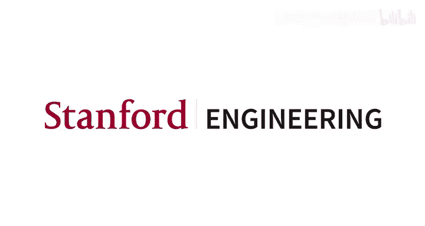
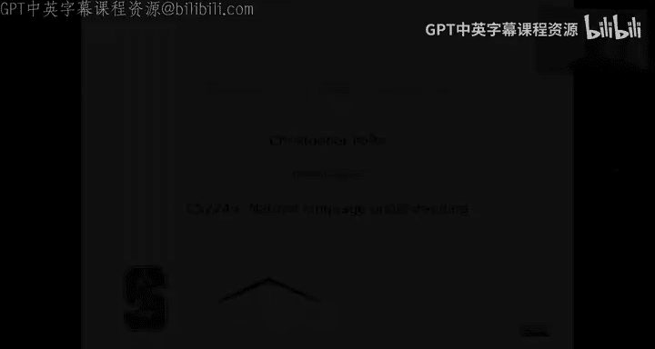
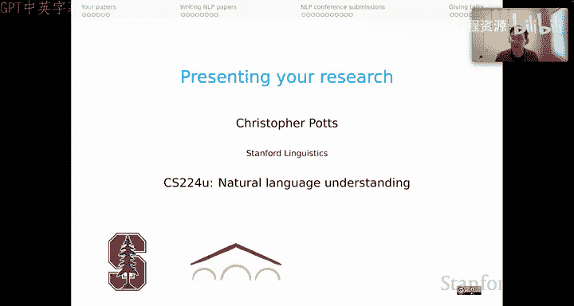
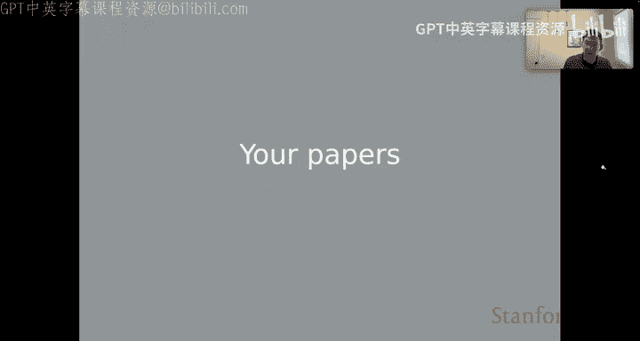
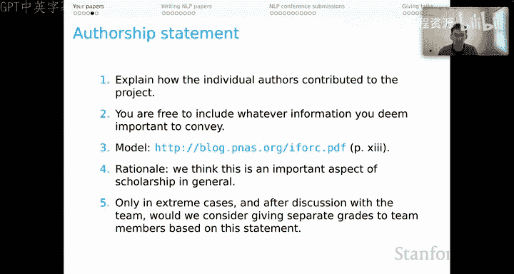
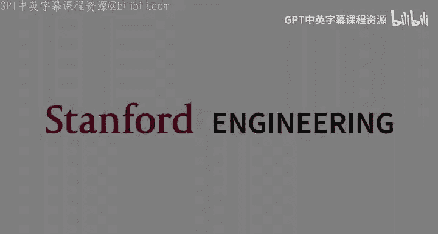

# 斯坦福大学《自然语言理解｜Stanford XCS224U Natural Language Understanding I Sp 2023》中英字幕（豆包翻译 - P45：-45-Presenting Your Research, Part 1： Your Papers .zh_en - GPT中英字幕课程资源 - BV1sx4y1s7oW

Welcome， everyone。 This Sccast kicks off our series on presenting your research。

 We're going to try to cover the full life cycle of a project in the field from work you do for a course like this on up to the day when you might be on stage at a top workshop or conference giving a talk about your research。

Let's dive in， I just wanted to start with some practical notes about your papers for this course。

Here are some links you might find useful， the links go to the website as well as to the projects page in the course code repository。

 I think I would single out that projects page as potentially especially useful。

 It's got FAQs about projects。 It's got advice about the individual project components as well as advice about publishing in the field in general。

 and also I'm proud to say it now has an extensive list of published papers that began their lives as work for this course。

 I'm really proud of that list and I hope you find it inspiring to check that work out。

This is a reminder about our overall perspective on project work for this course。

 I talked about this at length in our methods and metrics Sccast。

 but I think it bears repeating because it is so fundamental。

 We will never evaluate a project for this course based on how good the results are。

 We recognize that there is a bias towards so called positive results in the scientific literature in general and a bias away from so called negative results。

I think that's unfortunate that bias， I feel like we're making progress as a scientific community in terms of getting people to value negative results。

 but it will be a long journey。For this course， though， we're freed from all of those biases。

 We're not subject to any of the constraints that would motivate that。

 And so we can do the right and good thing of valuing positive results。

 negative results and everything in between。Fundamentally。

 we're going to evaluate your work based on the appropriateness of your metrics。

 the strength of your methods and the extent to which the paper is open and clear sighted about the limitations of its findings。

 That really reflects our values。 This does mean that if your paper reports top results on some leader board。

 but has chosen strange metrics and feels unmotivated。

 You will not necessarily do well on the final paper。And conversely， and this is more important。

 if you tried something really creative and ambitious and it didn't pan out in terms of results on some leader board that matters hardly at all。

 You might have a really informative， negative result on your hand。

 and the whole scientific community would benefit from seeing it。

 So there we're going to look to the strength of your methods and the evidence that you've got。

 and that will carry the day。Papers for this course have a few special sections that come at the end。

 I thought I would just review those and talk in particular about the motivations。

 Let's start with the known project limitations section。 The promptier。

 Imagine that your reader is a well intentioned N LP practitioner who is seeking to make use of your data。

 models or findings as part of a separate scholarly project deployed system or some other kind of real world intervention。

 Have that person in mind and ask， what should such a person know about your work。

Things you might think about benefits and risks of the work cost to your participants， to society。

 to the planet and so forth。Responsible use of your data， models and findings。

You might be able to think of other things that should fall under this heading。

I want to emphasize that I have asked you to have in mind a well intentioned N LP practitioner。

 I think it's very hard to think through how to reach someone who is going to be a bad actor and try to apply your ideas for evil purposes or use them in some problematic way。

 Set that kind of thing aside and just focus on the person who is trying to build productively on your ideas to do something good in the world。

 That person might have the best intentions， but not really appreciate where the limitations of your ideas lie。

 This is an opportunity to communicate directly with that person。 about the limitations。

 And in doing that， I think you could save them a lot of grief。

 you could save their users a lot of grief。 And ultimately。

 this seems like a really important thing for us to be doing in this era when our research can have such wide ranging impacts。

In the spirit， if you get really into this， you could think about doing things like data sheets。

 Model cards and impact statements。 These are more extensive structured documents that， again。

 help you with disclosures， mainly to well intentioned users。

 I didn't insist on them for this coursework， because it is a lot of work。

 But if you think about releasing data and models out into the wider world。

 I think it would be great to confront all the issues that these kind of structured documents ask you to confront。

😊，We also require an authorship statement， and again， this is about our scientific perspective。

 It is not about evaluation。Fundamentally， this statement should explain how the individual authors contributed to the project。

You can include whatever information you deem important to convey。If you would like some examples。

 I recommend this document here， which is publication guideliness for PNAS。

 it includes some tips on good authorship statements。The rationale again， is scientific。

 we think this is an important aspect of scholarship in general。

 especially in this era when we have large team papers。This is not about evaluation。

 and it is not meant to be punitive only in extreme cases。 And after discussion with the entire team。

 would we consider giving separate grades to team members based on this statement。

 It's not about grading。 This is about how we publish and how we take credit for our ideas and how we explain the contributions of individual scientists。

