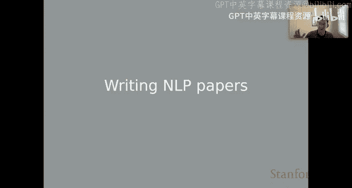
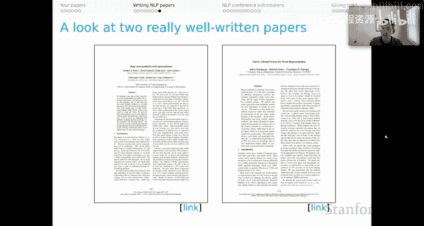

# 斯坦福大学《自然语言理解｜Stanford XCS224U Natural Language Understanding I Sp 2023》中英字幕（豆包翻译 - P46：-46-Presenting Your Research, Part 2： Writing NLP Papers .zh_en - GPT中英字幕课程资源 - BV1sx4y1s7oW

Welcome back everyone， this is part two in our series on presenting your research。

 we're going to be talking about writing NLP papers and this will hold both for this course and for papers that you might write in general。

Here's the outline of a typical NLP paper， this is not required in terms of its structure but it is kind of freeing to know that if you follow roughly the structure。

 you'll be in line with the norms of the field and your readers and especially your conference reviewers might have an easier time navigating the ideas。

We're almost always talking about a four or eight page two column paper where references are not counted toward this page total。

And we're thinking about papers that typically have these components for an eight page or you'd have your opening page with the title and abstract and then the intro。

 the intro might dribble on page2， and then you're probably going to have your related work section。

 After that， you're going to be starting in on the heart of the paper。

 you might introduce your task and the associated data。 Then your models。

Then your methods and results， which can be a kind of no nonsense reporting of the results。

 close with some analysis and then a very short conclusion。 these aren't very long papers。

 so a short conclusion is fine。For a four pager， which is another common format。

 you just kind of compress all of this and you might hope that you can devote much less space to related work for the sake of just explaining your own ideas。

 but fundamentally it's the same structure。In a bit more detail， here some notes on this。

 the intro in the conventions of NLP papers， the intro is expected to tell the full story of the paper at a high level。

 and indeed the abstract tells an even higher level complete story。

 the intro is one layer down and by the time the reader is done with the intro they essentially know exactly what the paper is going to do and it's all over but the details。

So the intro is a kind of microcosm related work。 This is meant to contextualize your work and provide insights into major relevant themes of the literature as a whole。

 Use each paper or theme as a chance to articulate what is special about your paper So I find it helpful to think about this in a kind of tempemplationatic format where each subsection or paragraph of my related work section is going to raise some kind of topical issue or question。

 Once I've done that as the first sentence of the paragraph。

 then I just more or less list out maybe with some color。

 the individual papers that fall under that topical heading。

 and then I close the paragraph with an explanation of how those ideas relate to the ideas for the current paper。

 how the ideas from my paper complement what's in the literature or conflict with it or extend it or whatever else it is。

 I try to articulate that so that the whole effect is to raise some crucial topics for your area help the reader understand what those topics are and then。

Al explain how the current ideas relate to that whole messy context。

So the related work is a chance to of course cite everyone so that no one feels upset about being excluded。

 but also to contextualize your ideas in this very useful way。

Data this will likely be a very detailed section if the data sets are new or your task is new or the data is unfamiliar or you're casting things in an unfamiliar way。

 This could be a much shorter section if it's a familiar data set and familiar task structure。

Then your model， by which I really mean the essence of your ideas， you might not have a model per se。

 but presumably you have some core ideas that you are pursuing and evaluating。

This is your chance to flesh out exactly what those ideas are like。

 you can use your prior work section to kind of contextualize and amplify and with luck the related work really helped us understand why you're doing the modeling or analysis work that you're doing。

Then the methods， this would be like your experimental approach， including metrics。

 baseline models and other things like that。 You're probably going to be short on space and so you can start using appendices for things like hyperparameter optimization choices。

 other small details about compute and so forth so that you can keep the main paper devoted to the real essence of the narrative。

Then results， and I think it's best if this is a kind of no nonsense description of what is in the results tables or in the results figures and how that kind of basically relates to the previous sections。

Then you can open things up a little bit when you do analysis。

 this can be discussion of what the results mean， what they don't mean， how they can be approved。

 what the limitations are and so forth right and so the nature of this section will depend a lot on the nature of your modeling effort and the nature of your results。

For papers that have multiple experiments with multiple data sets， maybe even multiple models。

 it can help to repeat that methods results analysis thing。

 or even data methods results analysis in separate subsections so that we get kind of self-contained units of experimental reporting。

 and then you might have final analysis or discussion section that weaaves them all together and reconnects with the ideas from your intro and related work。

And then finally， conclusion。You again want to quickly summarize what was in the paper in a way that's not unlike what you did in the abstract I'm guessing there is one nice opportunity here though which is to chart out possible future directions and I questions that you left open and so forth。

 things that people might pursue as next step so you at least get to have a kind of forward looking。

 more expansive， final few sentences of the paper。I thought I would just offer a scattering of interesting advice about scientific writing things that you could mull over。

 Let's start with this nice kind of deconstruction from the NLP Stuart Cheber。

 And he's fundamentally arguing for the rational reconstruction approach。

 He contrasts that first with the continental style in which one states the solution with his little introduction or motivation is possible。

 sometimes not even saying what the problem was。 I think here he means to be criticizing continental philosophers like Darrida。

 But that's just my guess。Readers of papers like this will have no clue as to whether you are right or not without incredible efforts in close reading of the paper。

 but at least they'll think you're a genius。I think he means that somewhat ironically we should strive not to write papers in this mode。

Kind of at the other extreme is what he calls the historical style。

 This is a whole history in the paper of false starts。

 wrong attempts near misses re definitionfins of the problem。

This is better than the continental style， because a careful reader can probably follow the line of reasoning that the author went through and then use this as motivation。

 But the reader will probably think you're a bit addddle headed。 And in general。

 these papers are also very difficult to read because it's hard to discern what was important and what wasn't。

So ultimately， what Cheber offers as a better mode is the rational reconstruction approach。

 You don't present the actual history that you went through。

 but rather an idealized history that perfectly motivates each step in the solution。

 The goal in pursuing the rational reconstruction style is not to convince the reader that your're brilliant or ale headed for that matter。

 but that your solution is trivial。 It takes a certain strength of character to take that as one's goal。

 The better written your paper is the more readers will come away thinking。

 that was very clear and obvious。 Even I could have had those ideas。 It feels paradoxical。

 but it is the best mode to operate in。Sometimes few people feel a tension here between the rational reconstruction approach and my call elsewhere in these lectures to really disclose as much as you can。

 to be open and honest about what you did。 If you start to feel that tension。

 I would encourage you to use the appendices to really enumerate every false start possibly as a list so that someone who is really trying to figure out what happened has all the information they need。

 That will allow you to， in the paper， tell a story that will reach the maximum number of people and feel informative。

 feel like progress and so forth。I also like this hint on mathematical style from David Goss。

 This is a document that's full of advice a lot of it about how to format math equations in Lotech。

 but fundamentally his advice is have mercy on the reader。

 and one part of that is to just have your reader in mind to write your own paper as though you were someone consuming the ideas for the first time and think what information would you need。

 what can be left out and in general， what would help most in terms of conveying the ideas to that hypothetical reader。

Cormick McCarthy， the novelist， also has an outstanding piece linked at the bottom here。

 full of advice for scientific writers。 I think Cormick McCarthy actually hangs out with lots of scientists at the Sc Fe Institute。

 and he's probably learned a lot about how they work。

 Here's one piece of advice that I'd like to highlight。

 Decide on your paperss theme and two or three points you want every reader to remember。

 This would be stuff that you would put in the intro and maybe be structure the intro around these ideas。

 This theme and these points form the single thread that runs through your piece。 The words。

 sentences， paragraphs and sections are the needlework that holds it together。

 If something isn't needed to help the reader to understand the main theme， omit it。

 I find this wonderfully clarifying。 Once I have figured out what my two or three main points are。

 And I have sketched them， at least in the intro。 Then as I'm writing。

 And as I'm deciding on experiments to run or to neglect。

 I'm always thinking about whether or not they serve those。😊。

insAnd that helps me a lot with decision making， and it helps me a lot with actually just writing these papers in a way that I hope is relatively clear。

This strategy will not only result in a better paper， but it will be an easier paper to write。

 as I said， since the themes you choose will determine what to include and exclude and resolve a lot of low level questions about the narrative。

And then the final piece of advice I wanted to offer here in general is advice from Patrick Blackburn this is actually about giving talks and I'll mention it later。

 but I think it applies to any kind of scientific communication， the fundamental insight。

 where do good talks or papers come from， it is honesty。

A good talk or a good paper should never stray far from simple， honest communication。

 I have that phrase in mind all the time as I do my research。

 and I find it wonderfully clarifying and exciting to see。😊，To round this out。

 I thought I would just mention two papers that I find to be exceptionally well written。

 I can think of lots of papers like this。 I， in fact。

 have a longer list at that papers do Md document in the course code repository。

 but I thought it would be fun to highlight too。 And I've given the links here。

 The first is the Elmo paper。 deep contextual word representation。

 I like pretty much every aspect of this paper。 The intro does a great job of contextualizing the results and beginning to motivate the core idea behind contextual representation and pretrain。

😊，The actual model is presented with real clarity。 You get all the notation that you need about how it's structured。

 It's a bit dense， but I think that's a consequence of a very complicated model。

 So I think I'm fine with that。 And then you get a really exhaustive exploration experimentally and then with follow up questions and hypotheses that really give you an amazingly full picture of Elmo and its strengths and weaknesses。

 It's a short paper， but man， it feels jam packed with ideas and you can learn so much just by reading it。

😊，I also thought I would single out the glove paper。 This is another really interesting example。 Now。

 I think the whole paper is well written， but the part that I would like to single out is the presentation of the model itself。

 because rarely in N LP。 do you get a kind of analytic starting point that the authors build gradually into a model。

 They talk about the practical challenges of implementing that model and why that leads them to certain kind of implementation choices for it。

 And then ultimately， you get a description of the various hyperparameters that are involved in the final implementation。

 By the end of that， you feel like you've really learned something conceptual。

 In addition to kind of now understanding the details of the glove model itself。

 It doesn't hurt that the paper is well written elsewhere and has incredible results， of course。

 But I really single out the model reporting as an exceptional piece of writing that we could all kind of think about as we think about the motivations for our own modeling ideas。

😊。

