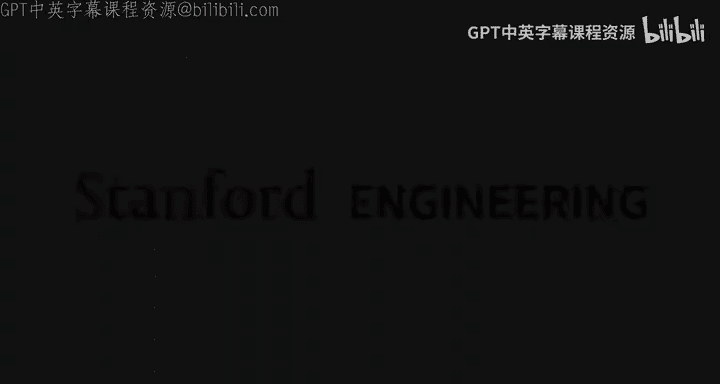
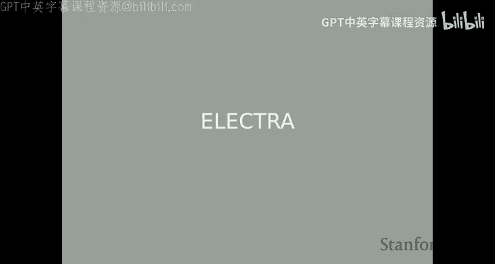
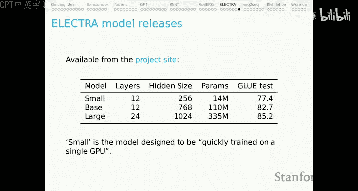
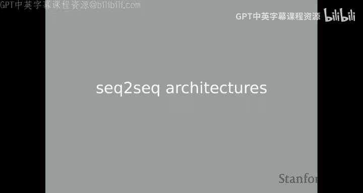
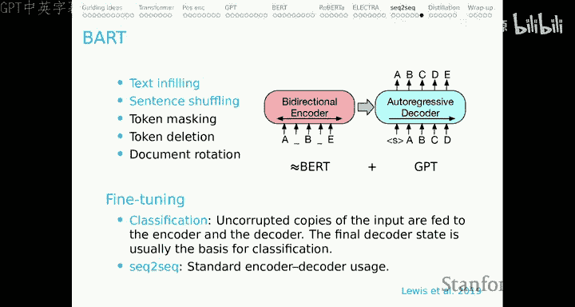
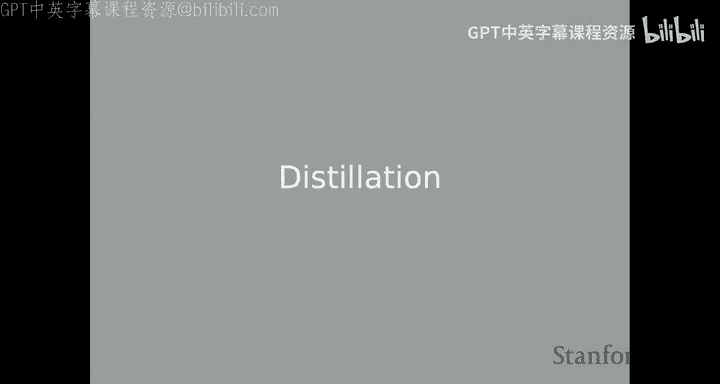
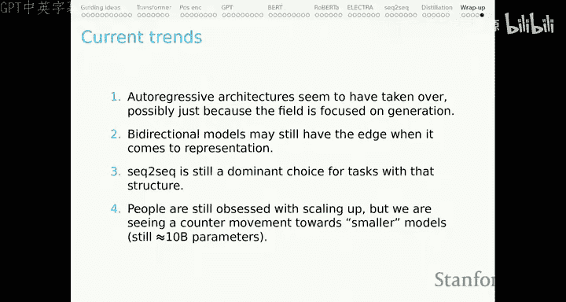
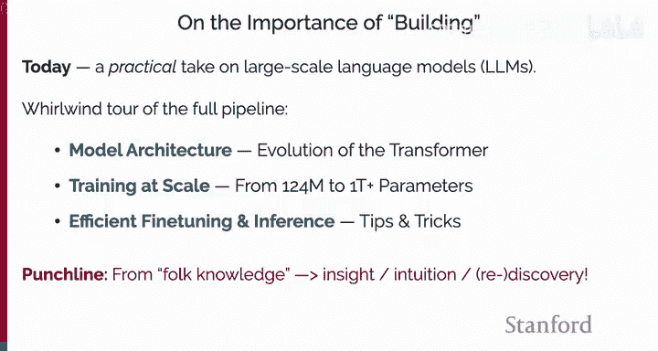
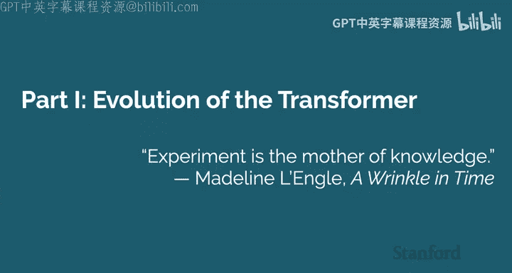
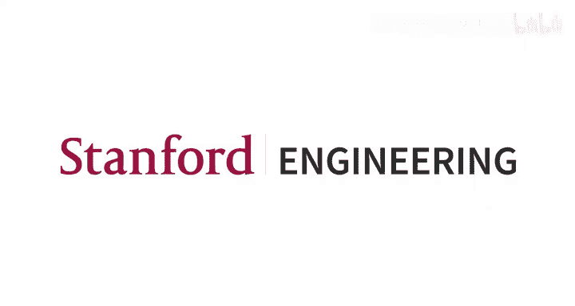

# 斯坦福大学《自然语言理解｜Stanford XCS224U Natural Language Understanding I Sp 2023》中英字幕（豆包翻译 - P49：-49-Fantastic Language Models and How to Build Them, Part 1 .zh_en - GPT中英字幕课程资源 - BV1sx4y1s7oW

All right， welcome everyone， welcome back。Let's get started。

 we have another action packed day for you， time a wasting。To start here。

 I'm going to finish up our big slide deck on contextual word representations。

 there are just a few more small things to cover， and then Siid is going to help us get hands on with training really big models。

So there's the link as usual from the website， if you want to follow along。

 and we're going to skip right to this section calledElectra。

Electctor is a model that came from Stanford from Kevin Clark and collaborators。

 and I think it's really exciting， it shows you the kind of design space we're in。

 a really creative example of doing something that was different from what had come before in the space of transformers。

Last time we talked about some known limitations of the Bert model。

 most of them identified in the Bt paper itself。 I covered that first one。

 You we just wanted more ablation studies， more exploration of the Burt architecture。

 The Roberta team kicked that off。 I think they did a great job with electoral。

 we're going to address known limitations 2 and three。

 The first is that we have a mismatch between the trained vocabulary and the fine tune vocabulary。

 because of the role of the mask token in training Bt models。And the second one。

 which might feel more pressing to you is that Bert is pretty inefficient when it comes to learning from data。

 because we mask out or replace about 15 per cent of the tokens。

 And as you recall from the Bt learning objective。 Those are the only tokens that contribute to the learning objective itself。

 All of the other work is kind of redundant。 And so we might hope that we could make more efficient use of all these sequences that we're processing。

 Eor is going to make some progress on that， too。So let's focus on the core model structure and then we'll look at all the other things they did in the paper。

We'll start with our input sequence X， this is the chef cooked the meal。

And the first thing we do is mask out some of those tokens。

 and that could be a random sample of 15% of the tokens， just like in most work with BEt。

Then we have what could be literally a burnt model。 we're going to call it the generator。

 typically a small one that has a mass language modeling objective。

 and that can produce output sequences as usual。 However。

 the twist here is that we're going to replace some of the tokens that came from the input with kind of randomly sampled ones from the MMs。

 You can see here that we've copied over the and copied over Che but now8 has been replaced by cook。

 That might not have been the most probable output for the model。

 but we're going to do that replacement step there。

 So what we've it created here is a sequence that we can call x corrupt a corrupted version of the input。

 And that is the primary job of this generator model。At this point， the heart of E takes over。

 This is called the discriminator， but we can also talk about it as the electromod itself。

 In essence。 The job of the discriminator is to figure out which of those tokens were originals and which ones were replacements。

 So that's a kind of contrastive learning objective。

 You can see here that the actual label it's going to learn from from 8 is that it was replaced and for the that it was an original。

 even though it was a sampled token。And the actual loss for the model is the generator that is the st typicalpical Bt ML LM loss。

Together with this electroor loss， with await weighting。That's how the model is trained。

 But there is， as I said， in asymmetry here in the sense that once we've done the pretraining phase。

 we can let the generator fall away entirely and focus just on the discriminator。

 as the model that we're going to use for downstream fine tuning tasks。

 And so you can see already that we've in a way solve the problem of having this weird mass token that comes from the pretraining phase because the discriminator never sees mass tokens。

 All it sees are these corrupted inputs， and it learns to figure out which ones are the corrupted versions and which ones are the originals。

Which is a different capability intuitively than the one we were imbuing the core Bt model with。

 right， So for Bt， it's kind of like the objective is to figure out what was missing from the surrounding context。

 And here， it's like trying to figure out which of the words in the sequence doesn't belong and which of them do belong。

 a kind of more discriminating objective。So that is E。Before we dive into the experiments and stuff。

 questions about how that model works。Yeah， I guess I'm wondering what the uses of this mono So it tries to predict which ones have been replaced like do use like what applications do you use lecture for for pretraining。

 Yeah， that's what you got to get your head around。

 This is a great subtlety to bring out So the discriminator is now going to be our pretrained artifact。

 So just the way you download Bt And when you do that， you're downloading some MLN trained thing。

 now you download elect， which is the discriminator and it's been trained to do this discing thing。

As opposed to the filling in the blank or continuing thing from the models we've seen so far。

 the eye opening thing is that that contrastive objective leads to a really good pretrain state for fine tuning。

And we might hope that it's doing it much more efficiently。

 but that's what we can dive into now here。First， generator discriminator relationships。

 They observe in the paper that when the generator and the discriminator are the same size。

 they can share all their transformer parameters and more sharing is better。

 So already we have an efficiency gain。 And that's kind of intriguing that one in the same set of weights would be playing the role of the MLM and the discriminator generator discriminator。

But they observe that they get the best results from having a generator that is small compared to the discriminator。

And this plot kind of teases that out。 So we've got our glue score along the y axis。

 this will just be a measure of system quality for them。 And along the X axis here。

 we have generator size。 And what they mean by that is the dimensionality of the model in the Bt sense。

 So essentially the size of each one of the layers。And if we zoom in， for example， on this blue line。

 the best performing model， this is where we have 768 as our dimensionality for the discriminator and 768 for the generator。

As we make the generator smaller， all the way down to 256， performance improves。

And that's what we mean when we say better to have a small generator and a large discriminator。

 and that kind of U shape pattern is repeated across all the different discriminator sizes。

And that's probably an insight about how this model is working。

 which is the sense that you kind of want the generator to be a little bit of a noisy process so that the discriminator has some interesting work to do。

And by making the discriminator more powerful， I guess you're creating that kind of opportunity。

They also do a lot of work looking at efficiency because one of the side goals of the electro paper was to end up with models that were overall more efficient in terms of the pre-training compute and in terms of the model size。

 here's another way to quantify that again along the Y axis we have the glue score and along the X axis now we have pre-train flaps。

 which you could just think of as a very low level measure of how much compute resources we need to do the pre-training part。

The blue line at the top is E， and it's the best， no matter what your computational budget is along the X axis。

They also explore adversarial elect。 This is very intuitive to me。

 That is a slightly different objective where the generator is trying to fool the discriminator by creating corrupted sequences that are hard for the generator to distinguish。

That's a really good model， but it's less than the kind of more cooperative joint objective that I showed you before。

And then the green line is cool， too， so the green line is where I start training with Bt。

And that at a certain point， I switch to having also the discriminator loss， and at that point。

 the BERT model is less good for any compute budget。

 whereas the electvari starts to do its electro thing and get better and better。

So a bunch of perspectives on E， all pointing to it being a good and efficient model。

And then finally， they do a bunch more efficiency analyses。

 so this is that picture that I showed you of the full electro model before where I have the generator creating corrupted sequences and then the discriminator doing its discriminating part there。

You could also explore E 15%， and this is different from full elect in the sense that on the right for default elect。

 we make predictions about all of these tokens， whether they were original or replaced for the 15% version。

 we kind of do a burntlike thing where we're going to assume that the ones that weren't part of those corrupted chains there。

 The sampled part are just not part of the objective will be fewer tokens there。Replace MLM。

 this is an ablation where actually we drop away the electropart and we're just looking at the MLM here。

 and we're going to not have the mass token at all。Because remember for Bert。

 there are a few ways that they do this learning。 they do the mass token and they also do the one where they just replace it with some random tokens here like cook to run。

 and then the model has to reproduce a new token。 Oh， that should say cooked， I guess。

Because it's pure bird。呃。And this is a kind of look at what happens if we don't introduce that mask token addressing that question about whether that was disrupting learning。

 and then finally， all tokens MLM， this is again， just a burnt-based objective over here where instead of turning off the objective for these ones here that weren't part of the corrupted sequence。

 we do learning from all of them。And that's a way of saying， for BEt。

 if we were making more efficient use of the data， could we learn more quickly？

And here are the results， so E is at the top。But just below it is all tokens MLM。

 so that's just Bt learning from all of the tokens。

 and I think that does show that Bert could have been a little better if they had not turned off the objective for every single token that was part of the masking or corruption for that learning process。

Replace MLM is just below that。 And that's where we don't have any mass token。

 So there's no fine tuning pretrained mismatch。 Elect 15 below that。 and then burnt at the bottom。

 So overall， you're seeing these abllations are kind of showing us that every piece of electro is contributing something to the overall performance of the model。

 And that's quite nice， as well。Yeah， how is the on your身啦。The efficiency。Well。

 we're making more efficient use of the data because we're getting a learning signal from every token。

 and I guess that would be the important dimension because a funny thing about BERT。

 where we turn off the learning for the ones that weren't master corrupted is that we still have to do the work of computing them It's just that then they don't become part of the objective and here we're just kind of bringing that in。

So for free or close to it。My question was， how is the glue score calculated。

 What does it represent some accuracy in language generation afterwards。

 or is it the classifier that's being scored， Oh， yeah。

 So glue is a big multitask classification benchmark。 It's a pretty diverse set of tasks。

 maybe biased toward natural language inference。 And the reason they're using it in the paper is just that it has been。

It has been adopted as a kind of general purpose measure of performance。

 and it's driven a lot of reasoning about what's good and what's bad in the field。

And then here are some model releases， base and large， kind of aligned with BRT。

 and then we have this small model here， and that was designed to be quickly trained on a single GPU again as a nod towardr efficiency and all three are really good models。

Yeah。The things we've observed that electron。When it comes to like putting our text into some kind of representation space that better than Bt and Roberta。

 or is it just like generally glue flies it's light。Oh。

 I like that question and that could kind of cu up some analysis work that you could do for a final project。

I think the insight behind your question is that a lot of the time we reason about these models。

 just based on their performance on something like glue， you could ask a deeper question。

 what are their internal representations like and are there places where they're transformatively better or worse。

 and that you could tie back that back to the fact that the learning objective is different， right？

 We're doing this discrimination thing as opposed to filling in the blanks in some sense。

 Maybe there are some underlying differences。 I love that。All right， a couple more topics here。

 just quickly because we're going to do more work with See tose models later。

 we're going to train some of our own from scratch and you all might use some fine tune ones and so I thought it would be good to just get them on the table as well。

Seek to seek， here are some natural tasks that fall into the seek to seek structure。

 machine translation， right， source language to target language， summarization。

 big text to hopefully smaller texts。Freeform question answering where you go from a question and then maybe you're generating as opposed to just extracting an answer。

Dialogue， of course， semantic parsing， this is the one we're going to tackle where you go from a sentence to some kind of logical form representing its meaning。

Coode generation， of course， that's similar and on and on。

 I think there are lots of problems that are pretty naturally cast as seek to seek problems。

 especially when you've got kind of different stuff on the input and the output side。Yeah。

 and the more general class of things we could be talking about would be encode or decoder。

 where that's just more general in the sense that at that point。

 the input could be a picture you're encoding and the output， a text， picture to picture。

 video to picture in principle anything could be happening on the two sides and seek to seek would for me just be the special case where we're looking at sequential data。

 typically language data or computer code or something。From the RN era， this is just kind of nice。

 if you hearken back to that era。 if you live through it。

 this is a paper from Tang Luang doing See tose on the left in the traditional way with a recurrent neural network。

 an RN， pretty simple， right， we've got AB，C D coming in。

 and then it transitions into maybe other parameters。

 and it's trying to produce this new sequence left to right coming out。And just to remind you。

 this is part of the journey the field went on， what Tong did very influentially is think a lot about how you would add attention layers in。

To that RNN， that's what you see depicted here， this is a kind of schematic diagram hinting at the fact that we were moving into an era。

 the vwani at all era， attention is all you need， where basically that attention layer would do all the work。

And that's kind of where we're at now。4 seek to seek problems in general。

 this is a nice framework from the T5 paper。 There are a few different ways you could think about them On the left is the one I'm nudging you toward where we have an encoder and a decoder and if we're talking about transformer models。

 what essentially that means is that when we do encoding。

 we can connect everything to everything else and you can think of that as a process of simultaneously encoding the entire input with all its connections。

But as we do decoding for many of these problems， we need to do some kind of sequential generation and the result of that is we can look back to the decoder。

 sorry the encoder all we want， but for the decoder we have to do that masking that I described with the autoregressive loss last time so that we don't look into the future。

But with that constraint， we can do this encoder decoder thing with a decoding step。

 be truly sequential decoding。But that's not the only way to think about these problems。 and in fact。

 I don't want to presuppose that for a sequence to sequence thing。

 you'll use a sequence to sequence model。 you could for example。

 use a language model and the way you might do that is to say I'm just going to encode everything left to right。

 That's the version in the middle。And then a kind of compromise position would be that you would take your language model。

 which might be autoregressive， but simultaneously encode the entire input。

And then begin your process of decoding without explicitly having an encoder part and a decoder part。

I think all of them are on the table and people are solving seek to seek tasks right now using all of these variants。

T5 I'm going to show you two， there are lots out there。

 but these are very prominent ones that you might download。 so T5， this is a wonderful。

 very rich paper that does a lot of exploration of which of these architectures are effective and T5 ended up on an encoder decoder variant and what they did is an impressive amount of multitask training unsupervised andsvised objectives and an innovative thing that they did is have these task prefixes like translate English to German and then an English sentence or this is a coA sentence that's just a data set people use or an STSB sentence。

And that's the model's cu to take that input and kind of condition it very informally on that task so that the output behavior is the expected behavior。

There are lots of T5 models that you can download， and this is nice for development because some of them are very small and some of them are very。

 very large， and more recently there are these fl models which took a T5 architecture and did a lot of reinforcement learning with human feedback to even further specialize them to different tasks in interesting ways。

So that's T5， and then the other one that you often hear about that's very effective is Bart。

 and Bart is interestingly different yet again。So BarRT is an encoder decoder framework and it's really got kind of a Bt style thing on the left。

 and then a GPT style thing on the right that is joint encoding of everything。

 and then that autoregressive part if you want to do sequential generation。

The innovative thing about Bart is that the training involves a lot of corrupting of that input sequence。

 they tried to like do text infilling of pieces， they shuffled sentences around。

 they did some masking， they did some token deletion， rotating of documents。

 all of this corrupting of the input， and then the models's objective is to learn how to essentially uncorrupt what it got as the input。

 and they found that the joint process of this text infilling thing and sentence shuffling was the most effective for training bart。

So that was for the pretraining phase and then when you fine tune with BarRT for classification tasks。

 you just put in two uncorrupted copies of your sentence and then you could fit your task specific labels on like the class token or the final token of the GT output and for Si to seek you just use it as a standard encoder decoder and again。

 the intuition is that the pre-training phase which did all this corruption has helped the model learn what sequences are like。

 and that blends together for me a lot of the intuitions we've seen from MLM and from what we just talked about with E。

Yeah， kind of a question that I asked last utilityity。

 these models worked with like spelling mistakes。Yeah。

 so BarRT is a really good option if you want to do spelling corrections。

And I actually think that that might be because spelling correction is kind of as a task。

 a corrupting of the input where you're trying to learn the uncorrupted version of the output。

 So I think if you want to do grammar correction， spelling correction， things like that。

 it's outstanding to use Bart and you might just think of training from scratch on a model that you know is going to be aware of characters for these character level things。

Yeah。This tax been。That was where they like。Removed parts of the text。

 essentially and added other pieces to corrupt it。Yeah。

 where you just that's more like the Bt style thing where you hide some。And okay， final quick topic。

 I just want you all to know about distillation again。

 because a theme of this course could be how can we do more with less。

 and distillation is a vision for how we could do more with less。

We saw this trend in model sizes here where they're getting bigger and bigger。

 and there is some hope that they might now be getting smaller。

 but we should all be pushing to make them ever smaller。

 And one way to think about doing that is distillation。

 and the metaphor here is that we're gonna to have two models。

 maybe a really big teacher model that was trained in a very expensive way and might run only on a supercomputer and then a much smaller student。

And we're going to train that student to mimic the behavior of the teacher。

 and we could do that by just observing the output behavior of the teacher and then trying to get the student to align at the level of the output。

 and that would basically just be treating this teacher as a kind of input output device。

We could also， though， think about aligning the internal representations of these two to get a deeper alignment between teacher and student。

Here are some objectives， in fact， and this is from least to most heavy duty。

 and you could combine them。 so we could just use our gold data for the task。

 I put that as step 0 because you might want it in the mix here， even as you use your teacher。

 we could also learn just from the teacher's output labels。That's a bit of a funny idea。

 but I think the intuition is that the teacher might be doing some very complicated regularization that helps the student learn more efficiently。

 so even if there are mistakes in the teacher's behavior， the student actually benefits。

You could also think about going one level deeper and using the full output scores like the logits。

 so not just the discrete outputs， but the whole distribution that the model predicts。

 and that's what they did in one of the original distillation papers。

You could also tie together the final output states if the two models have the same layer-wise dimensionality。

 then for example， in this distillbert paper they enforce as part of the objective。

 a cosine similarity between the output states of teacher and student and now you need to have access to the model itself and this will be much more expensive because you need to run the teacher as part of distillation。

You could also think about doing this with lots of other hidden states。

 people have explored lots of other things， and you could even this is a paper that we did。

 try to mimic them under different counterfactuals where you kind of change around the input representations of the teacher。

 observe the output and then try to get the student to do that to mimic very strange behavior from the teacher。

And then there are a bunch of other things you can do。

 So standard distillation is where you have your big model frozen and the teacher is being updated by the process。

 You have multi teacherer。 that's where there are lots of big models maybe doing multiple tasks and you try to distill them all at once down into a student。

 That's a very exciting new frontier。Co distillation is where they're trained jointly。

 sometimes also called online distillation。 That's where both the teacher and the student are learning together simultaneously might be unnerving in the classroom。

 but effective for a model。And then self distillation is actually where you try to get like usually lower parts of the model to be like other parts of the model by having them mimic themselves as part of the core model training。

 So that's a special case， I guess， of co distillation where there's only one model。

 and you're trying to distill parts of it into other parts。 That's kind of wild to think about。😊。

And this has been applied in many domains。 And the reason I can be encouraging about this is that as we get better and better at distillation。

 we're finding that distilled models are as good or better than the teacher models。

 maybe for a fraction of the cost。 And this is especially relevant if the model is being used in production on a small device or something。

 So here are just some glue performance numbers that show across a bunch of these different papers that with distillation。

 you can still get。😊，Glue performance like the teacher with a tiny model。Yeah。

Something think really fascinatinguzz is how can a smaller。

Be able to know a teacher when the training set this fixed couldn't be able just train a simple model。

 or is it just that the teacher has access to some point of learning that is easier to navigate for a student。

 but not for a student to get through Denno。I think something like what you just said has to be right。

I actually don't， so you're asking about the special case where the teacher just does its input output thing and produces a data set that we train the student on。

 right？And you're asking， why is that better than just training the student on your original data。

 It's very mysterious to me。 the best metaphor I can give you is that it is a kind of regularizer。

 So the teacher is doing something very complicated。

 and even its mistakes are useful for the student A。

Maybe a simple way that I'm understanding is it's okay to make certain mistakes and the teachers figured out which mistakes you can have。

Not worry I like that。 It's a beautiful opening line of a paper。

 We need to make it substantive by actually explaining what that means。 But I like it as a vision。

 for sure。😊，I want to be a little careful of time。 One more question， and then I'll just wrap up。

 Do we have some comparisons where the student is I mean， less， less general versus。 I mean。

 does it this overfi such data。Or send the details。Student， yeah。I don't know， I mean。

 you would guess less if it has a tiny capacity， it won't have as much of a capacity to overfit than the teacher。

 and maybe that's why in some situations the students outperform the teachers。

I hope that's inspiring to you all。 Let me wrap up here。So you can go on to outperform me。

Architectures， I didn't mention， transformformer Excel， wonderful。

 creative attempt to model long sequences by essentially creating a recurrent process across cached versions of earlier parts of the long document you're processing。

ExcLNet， this is a beautiful and creative attempt to use mass language modeling， sorry。

 an auto regressive language modeling objective， but still have bidirectional context。

 and they do this by creating all these permutation orders of the original sequence so that you can effectively condition on the left and the right。

 even though you can't look into the future。😊，And then Dierta， this is really cool。

 I regret not fitting this in。 Derta is an attempt to separate out the word and positional encodings for these models and kind of make the word embeddings more like firstclass citizens and that's very intuitive for me because that's like showing that we want the model to learn some semantics for these things that' separate from their position and they did that by reorganizing the attention mechanisms。

The known limitations， we did a good job on these except for this final one。

 B it assumes that the predicted tokens are all independent of each other， given the unmasked tokens。

 that gave you that example of masking new in York and it thinking that both of those are independent of the other given the surrounding context。

 Excelel that again addresses that， and that might be something that you want to meditate on。

Pretraining data， here's a whole mess of resources if you did want to pre-train your own model。

 maybe SiD will talk more about this， I'm offering these primarily because I think you might want to audit them as you observe strange behavior from your large models。

 the data might be the key to figuring out where that behavior came from。And then finally。

 current trends， right， autoaggressive architecture seem to have taken over。

 but that could be just because everyone is so focused on generation。

 I have an intuition that models like Bt are still better if you just want to represent examples as opposed to doing generation。

Seek to seek is still a dominant choice for tasks with that structure， although again。

01 might be pushing everyone to just use G3 or4， even for models with seek to seek structure。

 we'll see how that plays out， and then people are still obsessed with scaling up。

 but we might be seeing a counter movement towards smaller models especially with reinforcement learning with human feedback。

 and that's something that we're going to talk about next week in the week after。

So I kind of。Restructured a little bit of my talk， so like we're only going through part one today。

 which is actually back to basics， how transformers work。

 and then we're going to talk about the other stuff I should maybe introduce myself。I'm said。

 I am a fourth year PhD。 I actually work primarily on language for robotics and kind of channeling one of the core concepts of the class it's all about doing。

A whole lot with very， very little， like I'm really just working on how we get robots to follow instructions。

 given just like one example of a human， you， opening a fridge or you pouring coffee。

Things like that。But in kind of doing that research， it became really。

 really clear that we needed better raw materials， better starting points。

 so I started working on pretraining first in language。

 and then more recently in vision video and robotics with language kind of as the central theme。

So I want to talk today about fantastic language models and how to build them。

So Richard Feynman is probably not only one of the greatest physicists of all time。

 but he's one of the greatest educators of all time， one of the greatest science educators。

And he's this quote， you know what I cannot create， I do not understand。

 and for him is really just kind of about building blocks。

 how do I understand what is going on at the lowest level so I can compose them together and figure out what to do next。

 where does the next innovation， where does the next discovery come from？

And so kind of with that in mind， I actually just want to spend the next 12 or so minutes talking about building language models。

 building transformers， and how that all happened。So it's a practical take on these large scale language models。

 We're probably not gonna get to the large scale bit。 And we're gonna get to the full pipeline again。

 I'mre gonna focus on the model architecture。 But today， the evolution of the transformer。

 how we got there。Training at scale we'll probably cover some other time。

And then we'll talk about like very， very briefly efficient fine tuning an inference。

 and we have some other great CAs that might actually be talking about this more in depth。

But the punchline is the last few years like I started my PhD in 2019。

 I trained my first you know deep learning MNIS model in 2018。

 feels changed it a lot since then and with every new model with every new GPT1，2，34。

 the five that's training right now， there's been more and more folk knowledge。

 things that are hidden from plain sight that whenever you get to see and it's been the job of people like us。

 students， people in academia to kind of rediscover， find the insights。

 find the intuition behind these ideas。And in kind of rediscovering those pipelines， it's actually。

A comparative advantage and figuring out， okay， so these are how these pieces came to be。

 What do I do next。And so I don't really care about time， if we'll get through five slides。

 that is a success for me， but be selfish like this is your class。

 so if you have any questions if I say anything you don't understand that's the contract。

 call me out， ask a question and we're just going kind of go step by step。😊。

So。How did we get？To the transformer， right how did this become the bedrock of language modeling and now。

 you know， vision， also video， also robotics， for some reason， as of late， How did we get here？

So what is the recipe for a good language model， We've talked a bit about contextual representations。

 Chris was talking through kind of the various， you know， different。

 phase changes in language modeling history， Lisa was talking about diffusion language models。

 which is a completely different perspective。I'm going to kind of simplify things。

 oversimplify things to like two steps。And need massive amounts of cheap， easy to acquire data。

 We're a language model and we're building these contextual representations because we want to learn patterns。

 We want to learn truths about the world from data at scale。 and to do that at scale。

 we need data at scale。 So that's one component。And the other is we need a simple and high throughput way to consume it。

 so what does that mean？嗯。We need to be able to chew through all of this data as fast as we possibly can in the least opinionated way to figure out。

 know all of the possible patterns， all the possible things that could be useful for people fine tuning。

 generating， using these models for arbitrary things downstream。This isn't just applicable language。

 it's applicable to pretty much every， so vision does this， video does this， video and language。

 video， vision and language， language and robotics， all of them follow a similar strategy。So right。

 it so simple in that it's natural to scale the approach with data as we get。

 you know go from 300 billion to $600 billion tokens。

 we can maybe make the model bigger to handle that in a pretty simple way。

 the model should be composable in general， the training the way that we actually ingest this data should be fast and parallelzable and we should be you know making the most of our hardware if we're gonna to run a data center with I don't know。

$512 GPUs with each 8 GPU box costing 120，000， I better be getting my money's worth at the end of the day。

And the consumption part， right， like this minimal assumptions on relationships。

The less opinionated I am about how different parts of my dad is connected， the more I can learn。

 given the first thing， massive amounts of data at scale。

So to kind of like figure out how we got to the transformer。

 I want to kind of wind time back to kind of what Chris was alluding to earlier with Arnets。Right。

 so this is an R&N model， kind of complicated， but it's from 224M。

 I took it literally from their slides。I hope John doesn't get mad at me。And。

It's this very powerful class of model in theory， right。

 I am ingesting arbitrary lens sequences left to right。

 and I'm learning arbitrary patterns around them。People decided later on to add these attention mechanisms on top of the sequence to sequence R&N models to figure out how to kind of sharpen their focus as they were decoding token by token。

Right so the strengths are like I get to handle arbitrary long context and like we see kind of the first semblance of attention appear kind of very motivated but like the way we do language translation。

 like when I'm translating word by word， there are certain words in the input that are going matter that I'm going sharpen my focus too。

But they're issues with RNs， they're not the most scalable。

 producing the next token requires me to produce every single token beforehand。

 I can't really make them deeper without training stability going to pieces， so that's rough。

And so choosing through a large amount of data with an RN is hard。Some people refuse to believe that。

 and they've actually done immense work in trying to scale up RNs。

 make them more parallelzable using lots and lots of really cool linear algebra tricks。

 I'll post some links。嗯。And then separately， kind of from the vision community that kind of bled into the language community。

 we have convolutional neural networks。And this is from a other course from Lena Vota about using CNNs for language modelling and the idea here is we have this ability to do immense deep parallelzizable training by kind of taking these like little windows right I'm going to look at you know each layer is' only going to look at like the you know three word context at a time I'm gonna to give me representation but if I stack this enough times and I have these residual connections that combine know earlier inputs with later inputs by the time I'm like 10 layers deep I've seen everything in the window。

 but I need that depth and。That's kind of a drawback。But they're like really cool。

 powerful ideas here， and I'd actually say that the transformers have way more to do with CNNNs and the way that they behave than the way RNNs behave。

RightSo we have this idea of a CNN layer kind of having multiple filters， multiple kernels。

 different ways of looking at and extracting features from an image or features from text。You have。

 this ability to kind of scale depth using these residual connections the deepest networks that we had you know。

 from 2012， 2015， even now are still vision models， right。

 Resnet 151 isn't called 151 because it's you the 151st edition of the Resnet It's 151 because it's 151 layers deep。

 It's actually 151 blocks deep layers it's actually like Ill be4 x that。And it's parazable， right。

 every little window that I see at every layer can be computed completely independently of every other layer。

Which is really， really great for modern hardware， modern GPS。So looking at this。

Seems like CNNNs are cool。 Seems like RNs are cool。 There's a natural question， which is like。

 how do you do better。😊，This is the picture from Chris slides at least also used。

 This is a very scary looking picture。 right， Like， what does self attention mean。

SoWhere do those ideas come？So one idea， like one key component。

 like a one missing component for how you get from a CNN anR。

Add an R&N to a transformer is the idea that each individual token is its own query key and value。

 it' its own entity that can be used to shape the representations of all of the other tokens。

Right so I'm going to turn this word into its own query key value。

 I'm going to use the attention from the RNNs and I'm going to use the depth parallelizability scaling from the CNs。

 and then the multiheaded part of self- attentionten is exactly like what the different convolutional filters。

 the different kernels are doing in a CN it's giving you different perspectives on that same token。

 different ways to come up with queries， different insights into like how we can use you know a single token and come up with multiple different representations and fuse them together。

As a code code is semi unimportant it's a kind of very terse description of like what multiheaded self attention looks like key parts here are this you know little bit where we kind of project an input sequence of tokens to the queries keys and values and then we're just going to rearrange them kind of in some way and the important part here is that like we are rearranging them in a way that splits them into these different views。

 these different heads。Where each head has some fixed dimension。

 which is like the key dimension of the transformer。

 And then we have these query keys and values that we're then going to use for this attention operation。

 which comes directly from the RN literature。 right。

 It is really just this dot product between queries and keys。

 That is a very complicated way of saying that that's a matrix multiply。

And then we're going to just project them and。Combine them back into our tensor of batch size by sequence length by embedding dimension。

There's a nice subtlety here I think caught me off guard at one point。

 when you look at these models like you download for it says multi headeded attention or whatever。

 there's only one set of weights even though it's multiheaded。

 do you want to unpack that for us a little bit。The convolutional kernel has kind of this really nice way of expressing like I have multiple resolutions of an image right it's like that depth channel of a convolutional filter and if you kind of unpack like the con 2D layer and pytorrch。

 you kind of see that come out You don't really see that here。

 you see just like this one big weight matrix that is literally like this you dimensionality。

 you know embed dimension by three times embed dimension is usually what it is in Bt or GPT。

That three is the way you split it into query keys and values。

But we're actually going to kind of like take that vector that is like you know embed dim size and just chunk it up into each of these different filters right So rather than make those filters explicit as by providing them as a parameter that defines some weight layer。

For efficiency purposes， we're actually just going to treat it all as one matrix and then just chunk it up as we're doing the linear algebra operations。

 Does that make sense。So you're chunking at twice。 The times3 is queries keys and values。

 and then number of heads is further So one of the kind of like the key rules that like no one ever tells you about transformers is that your number of heads has to evenly divide your transformer hidden dimension。

s usually a check that is explicitly done in the code for training like bird or G。

 and usually the code doesn't work if that doesn't happen。

 And that's kind of how you get away with a lot ofs of tricks。 It's a great question。

 So we should do a whole course on broadcasting。 Yeah before you even start this so that you can do this Yeah there's a group professor at Cor Softsha rush。

 kind has like a bunch of like tutorialism like basic like broadcasting tenor operations。 fantastic。

 should check out the question。 you just clarify what you mean by chunk Yeah So if I have a vector of let's say 1024。

 that is my embedding dimensions， the hidden dimension for my transformer。

 And if I have keys of say dimension let's say2。😊，Make it easy。

 Ching just means that I'm going to split that vector of 1024 into two heads， each of dimension 512。

So I'm literally just going to reshape that vector。

And chunk them up into the two views of the same input。Cool。Is this actually better。

 is this alone enough to define a transformer？Maybe they not， all right， answer is no。

So it's good because like we get all of the parallelization advantages and all of kind of the attention advantages that I talked about the previous slide。

 This is a slide from like Justin Johnson and Dante Z。

 we're both X Stanford alums now teaching courses about transformers and deep learning at various colleges。

😊，But you're missing kind of like one key component， right？

If you just look at this and swing at this for like a little bit of time。

 what you're missing is like， okay， so I am just taking different weighted averages of the same。

Underlying values。Over and over again。Relative to the things that are coming out of my transformer。

 there actually is no nonlinearity， which is self attention。

This is basically a glorified linear network。So we need some way to fix that because that's where the expresslusivity。

 the kind of the magic of deep learning happens， it's kind of when we stack these nonlinearities。

 go deeper and learn new patterns at scale。So。This is how we do it。 We had an MP。

 We had an MP to the very end of the transformer block。 And it's very simple， right。

 It all it does is it kind of takes the embedding dimension that comes out of a self- attention block that we just defined。

Projects it to a higher dimensional space。Adds a value on linearity。

 and then down projects it back to the embedding dimension。Usually。

 what you're going is a factor of 4。 Why is it a factor of  four， No one knows is the honest answer。

2 didn't seem to work well enough。8 seem to be too big。 But here's some like。

Soft intuition for kind of why this might work， and this kind of is a throwback to like2，2，9。

 you know， OGML days。So。You want your network as a whole to be able to kind of both forget the things that are unimportant。

 but also remember the things that are important。 right that's kind of the role。 So the sharpening。

 the remembering things that are important are these residual connections。

 Like the fact that I' amounting X to some transform of X。The forgetting is what this MLP is doing。

 It's basically saying， like， what stuff can I throw away and should I basically forget because it's not really relevant to what I care about at the end of the day。

 which are good contextual representations。And so the role of the MLP is very similar to the role of kind of a kernel in。

 you know， the good old support vector machine literature， right So if I have。

Two classes that are kind of like this in a plan。 And I want to draw a line that partitions them。

 How do I do it？Well， it's hard if I'm only working in 2D。

But with just a very simple learn transform。If I just implicitly lift these things up to like 3D。

I can turn this into a surface in 3D that I kind just cut in half， separates myself。

 So projecting up with this MP is basically this way of kind of like aligning or crystallizing the structure of our features。

Learning a good decision matter space。And compressing from there。 I think we're out of time。

 So we're going to go through like the rest of the transformer evolution in a little bit。

 But all the slides are up。 I have office hours tomorrow and。😊，I will be back， thanks。

