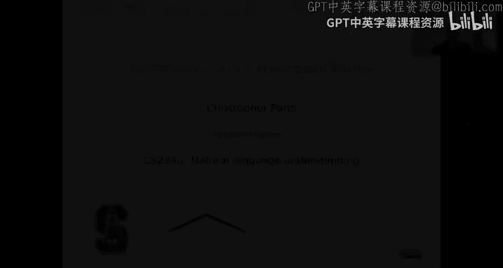
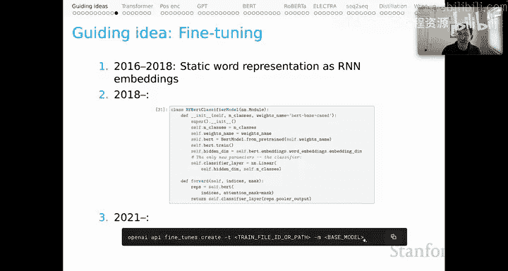
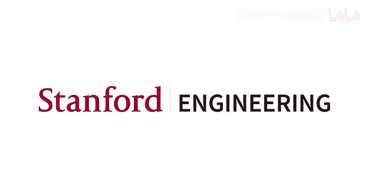

# 斯坦福大学《自然语言理解｜Stanford XCS224U Natural Language Understanding I Sp 2023》中英字幕（豆包翻译 - P4：-04-Contextual Word Representations, Part 1： Guiding Ideas .zh_en - GPT中英字幕课程资源 - BV1sx4y1s7oW

Hello， everyone。 I'm Chris Bots。 Welcome to our unit on Conual word representations。

 I thought I'd kick this off with some high level guiding ideas。

 The first thing I wanted to say is that in previous iterations of this course。

 we've spent about two weeks focused on static vector representations of words and in some cases。

 phrases and full sentences。 For this iteration of the course。

 we're going to go directly to contextual word representations。

 which have proven so powerful for today's NLP research and technologies。

 But I did want to offer a brief overview of the history that leads to contextual representations。

 So let's rewind the clock back to what I've called feature based classical lexical representations。

 and the hallmark of these representations is that they are sparse。 Typ。

 what we're thinking of is very long vectors where the column dimensions represent the output of usually hand built feature functions that we've written that might capture things like the binary sentiment classification of a word or which part of speech it tends to have most。

😊。

Or whether or not it ends in a suffix like ING for English and so forth and so on。

 So we write a lot of these future functions， and as a result， we have vectors。

 there are mostly zeros because most words don't have these properties。

 but the few ones carry important information。In the next phase， we have count based methods。

 This is the introduction of the distributional hypothesis。

 I'm thinking of methods like point wise mutual information and TF IF term frequency inverse document frequency。

 a classic from information retrieval that we'll visit a bit later in the course。For these methods。

 we begin from some kind of count matrix， So typically for PMI。

 it would be a word by word matrix where the cells in that matrix capture the number of times so that each word co-accurs with the other words in our corpus for TF IF it would probably be a word by document matrix。

 and now we're capturing which words appear and with what frequency in all the documents in our corpus。

 And the idea behind these methods is that we take PMI or TF IDF and we massage those counts in a way that leads to better representations。

And that's coming purely from distributional information。

 We typically don't write hand built feature functions in this mode。

 but these vectors tend to be pretty sparse。The next phase is what I've called classical dimensionality reduction。

 This is the introduction of dense representations。 I have in mind methods like PC。

 principal components analysis， SVD， that singular value decomposition。

 LD's late and Deishly allocation。 There's a whole family of these。

 And typically what we're doing at this phase is taking maybe the output of representations built in the mode of step 2 there。

 and compressing them。 And in compressing them， we typically get denser。

 more informative representations that can also capture higher order notions of distributional similarity and cooccurrence and so forth。

 And that proved incredibly powerful。And then the fourth phase。

 which might be the final phase for this static vector representation approach。

 We have what I've called learned dimensionality reduction approaches。 Here again。

 we have dense representations。 These could be the output of an autoencoder or a classical method like word to V or glove。

 And what we do at this phase is really essentially combine the count based methods from step 2 in this history with the dimensionality reduction that we see from methods like SVD and PCA。

 and that leads us to very powerful， typically learned representations that have a tremendous capacity to capture higher order notions of cooccurnce。

That's a very fast overview if you would like to get hands on with these methods and really deeply understand them。

 then check out this page that I've linked to here from the course website。

 it links to a lot of notebooks and some older videos that could help you with a refresher on all these methods or to just get up to speed where you're ready to think directly about contextual representations。

The representations that we get from these contextual models that will be the focus for this unit and really for the entire course really resonate with me as a linguist。

 And so I thought I would just pause here and run through some examples that I think lead from the linguistics angle to the conclusion that word representations are highly sensitive to the context in which they' are used Let's start with a simple case。

 like the vase broke。 and our focus will be on that English verb break Here。

 The sense of break is something like shatter。For dawnbro， though。

 we have a superficially similar looking sentence， subject verb。

 But now the sense of break is more like begin。And that's presumably conditioned by what we know about the subject and how that operates on the sense of the verb break for a stereotypical reading。

The news broke again， superficially similar sentence。 The news is the subject。

 but now it seems to be conditioning a reading that is more like was announced or appeared or was published。

 very different sense yet again for Sandy broke。 the record， we have our first transitive case。

 And now the sense of break is something like surpassed the previous world record。

But for Sandy broke the law， a different sense yet again， this is something like a transgression。

 again， conditioned in this case by the direct object。The burglar broke into the house。 Now。

 we have brake appearing with a particle into。 and in this case。

 it means like En forcibly without permission。 But the newscaster broke into the movie broadcast means something more like interrupt a related but interestingly distinct meaning that is coming from the same break plus particle construction。

And then in we broke even， just for another surprise。

 this is an entirely new sense break plus even means something like we lost the same amount as we gained。

And this is just a sample of the many， many senses that B can take on in English。

 and what we see in these patterns is that the sense it does have in context is driven by the surrounding words transparently。

 but maybe also by things that are happening in the context。

Similar things arise for adjectives like flat as in flat beer， flat note， flat tire， flat surface。

 That's the same adjective flat。 But depending on what no it modifies。

 you get very different senses can happen with a verb to throw a party， throw a fight， throw a ball。

 Thr a fit。 There might be some metaphorical sense in which these all these senses are related。

 But they are also clearly distinct， and they're being driven by something about how this direct object interacts with the verb。

And we should extend this beyond just the simple morphfoyntactic context。

 Let's think about ambiguity resolution coming from the things we say to each other for the sentence a crane caught a fish。

 you probably infer that there the sense of crane is for a bird。It's not determined by that。

 but that's the most likely inference。 Whereas a clay， a crane picked up the steel beam。

 you probably infer in that case that a crane is a machine。

 And then correspondingly for I saw a crane， you might not absent more context。

 know whether I mean a bird or a machine。 But if we do embed this sentence in larger context。

 you'll begin to make inferences about whether it was a bird or a machine。

 And so that shows you that even things that are happening ambiently in the context of utterance can impact what set。

 what sense crane has in these sentences。Are there any typos， I didn't see any。

 The second sentence is clearly elliptical。 And in this case。

 we probably infer that I didn't see any means I didn't see any typos。

 contrasttrast that with are there any bookstores downtown town。 I didn't see any。

 It's an identical second sentence。 But now the inference is that any means something like any bookstores。

And that is， again， showing that the senses that these words take on in context could be driven by everything that is happening in the surrounding sentence and also in the surrounding discourse on out。

 extending into things about world knowledge and so forth。

And so that for me really shows that the static word vector representation approach was never really going to work out because it insists that broke in all those examples in one correspond to a single vector flat into a has to be a single vector and so forth and so on。

 and what we actually see in how language works is much more malleability for individual word meanings。

 and that's precisely what contextual word representations allow us to capture。

I thought I would pause here just to offer a brief history of where these ideas come from。

 because it's a very recent history。 Things are moving fast， but it's also interesting to track。

 I think a classic paper may be the starting point for this is die and lay 2015。

 They really showed the value of language model style pre training for downstream tasks。

 And the paper is fascinating to look at。 It's a pre transformformer paper。

 A lot of the things that they do look complicated in retrospect。

 And some of the simpler ideas that they offer。 We can now see in retrospect are incredibly powerful。

We fast forward a little bit to August 2017， Mcanid， all this is the Cove paper。

 And what they showed is that pre trained by directional LSTMs for machine translation could offer us sequence representations that were a useful starting point for many other downstream tasks outside of M T。

And that kind of begins this move toward pre training for contextual representations。

 it really takes off with ElLmo in February 2018。 that team was really the first to show that very large scale pretrain of bidirectional LSTMs could lead to rich multipurpose representations that were easily adapted to lots of downstream tasks via fine tuning。

In June 2018， we get GPT。And then in October 2018， the Bt era truly begins Devent at all 2019 is when the paper was published。

 but the work appeared before that and had already had tremendous influence by the time it was actually officially published。

 That Bt model is really the corridor stone of so much that we'll discuss in this unit and beyond。

There's a parallel dimension to all this， a kind of parallel journey that I thought I would talk a little bit about as another guiding idea。

 I've put this under the heading of model structure and linguistic structure。

 And this is related also to this idea of what kinds of structural biases we build in our model architectures in the upper left。

 I have a simple model that's reviewed in those background materials。

 where you can imagine that each word in the sentence。

 the rock rules is looked up in like a glove space or a word word to vex space。

 And then what this model does is simply add those representations together to get a representation for the entire sentence。

This is a very high bias model in particular because we have to decide ahead of time that the way those representations will combine will be via addition。

 and you have to think even if that's approximately correct， it's only going to be approximate。

 it would be a kind of minor miracle， if addition turned out to be actually the optimal way to combine those word meanings。

And you could see that as giving rise to the models that are on the right here。

 this is a kind of recurrent neural network。 Again。

 you can imagine that we look up each one of those words in a static vector representation space like glove。

But now we feed them into this R N N process that actually them。

 processes them with a bunch of new neural network parameters。 And in that way， it could be trained。

 It could be taught to combine those word meanings in an optimal way。

It could be the case that the optimal way to combine word meanings is with addition。

 and the models that we have over here on the right are certainly powerful enough to learn addition of those vectors。

 If it's correct。 But that is very unlikely to happen。

 Probably the model will learn a much more complicated function that might be much more nuanced。

 And so in that way， we've released some of the biases that we introduced over here。

 And we're going to allow ourselves to learn in a more free form way from data about how to optimally combined words。

😊，There's another dimension to this if you go down on the left here。

 this is a tree structured neural network， in this case we decide ahead of time that we know the constituent structure。

And then we might have a bunch of neural network parameters that combine the child nodes to create representations for the parents in a recursive fashion as we move up the tree。

That is very powerful in the sense that we could have lots of different functions that get learned for how to combine child notess into their parents。

 but this model is kind of high bias because it decides ahead of time about how the constituent structure should look you have to。

Believe or know a priori that the rock forms a constituent in a way that rock rules simply does not。

Whereas the models up here take a more free form approach。Down in the right hand corner。

 I have the kind of models that we saw in the lead up to the transformer。

 This could be like a bidirectional R N。 where again。

 we could look up the words in a static vector representation space。

 But now we have information following left to right in these hidden representations。

 And we might have added a bunch of attention mechanisms on top that essentially connect every other hidden unit to every other hidden unit in this representation。

 So whereas this had a presumption that we would process left to right。

 and this one had an assumption that we would process by constituent structure。

 this model down here says essentially anything goes。

 And I think it's fair to say that a lesson of the transformer era is that anything goes given sufficient data is the most powerful mode to be in。

 And that really is a kind of insight behind the transformer architecture。

The attention mechanisms that I mentioned there are really important。

 And this is also part of the journey that leads us to the transformer and might harbor most of its power。

 Let me give you a simple example of how attention worked especially in the lead up to transformers。

 Here， I have a model that you might think of as an R N N。

 maybe we're processing left to right for really not so good。

 We look up those words in some kind of static vector representation space。

 And then we have our left to right process that leads to these hidden representations。

 Suppose now that I want to train a classifier on top of this final output state。 Well。

 I might worry in doing that that there'll be a lot of information about the words that are laid in the sequence。

 but not enough information in this representation here about the words that were earlier in the sequence。

 And so attention emerges as a kind of way to remind ourselves in late states。

 what was in earlier ones。We could do that with a scoring function and here what I've depicted is a simple dot product scoring function。

 exactly the sort that we get from the transformer in essence。

 and what it's doing is taking the dot product of our target representation with all of the previous hidden states。

We softm normalize those， and then we kind of bring those in to the representation that we are targeting to get a context vector here。

 We could take the average of all of them。Then finally， we get this attention combination H here。

 And that could be a kind of neural network parameterized function that takes in this representation。

 plus the attention representation that we created here and feeds that through some parameters and a nonlinearity。

 And that finally gives us the representation that we feed into the classifier that we wanted to fit originally。

 And the idea here is that now our classification decision is based indeed on this representation at the end。

 But now infused with a lot of information about how similar that representation is to the ones that preceded it。

 And that is the essential idea behind dot product attention， which will be the beating heart。

 so to speak of the transformer。😊，Another idea that has proved so powerful is a notion of sub word modelling。

 And I thought I would take you on a brief journey of how we arrived in the current phase for this kind of sub word modelling。

 beginning with Almo， because what Almo did is truly fascinating。

 The Elmo word representation space begins with character level representations。😊。

And then it has a bunch of filters on top of those。

 And then it has a bunch of different convolutional layers that we then do max pooling over to get a representation for the entire sequence。

 We do that at different layers here。 And so those get concatenated up into these max pooling representations at the top。

 And those form the basis for word representations。

 and the idea is that this gives us whole word vectors that none the less have lots of information about the subword parts all the way down to characters。

 But including all of these convolutions of different lengths that capture different notions of subword within that space。

 Incredibly visionary， I would say。😊，One thing I should note， though。

 is that the Elmo vocabulary has about 100000 words in it， which is an enormous vocabulary。

 And even still， if you deal with real text， you will find that you are mostly encountering words that are not in that vocabulary。

 And even if you double it to 200000 or 300000。 Now， you're getting a really large embedding space。

 you will still， mostly encounter words that are unked out that is unknown to your model。

 And that's an incredibly limiting factor for this kind of whole word approach。

 But we see in here the essence of the idea that we should model sub wordss。😊。

A big change happened for the transformer when we got in parallel。

 this notion of word peace tokenization here， I'm going to give you a feel for that by looking at the Bt tokenizer that gets loaded in and sent in cell to here。

 And then when we call the tokenizer on the sentence， this isn't too surprising。

 we get things that look mostly like whole words， especially if youre used to N LP。

 where the kind of suffix for isn't has been broken apart。 And so is the punctuation。

But when we call the tokenizer on the sequence encode me with an exclamation mark。

 notice that the word encode has been split apart into do two words。 N。

 and then code with those markers there， indicating that that is a word internal piece。

And if you tokenize a word like snuffphyepagus。You get a sequence of  one， two， three， four，5。

 six parts to that single word that came in。The effect here is that we can have a vanishingly small vocabulary there under 30000 words in thist tokenization space。

 so a very small embedding space。 But nonetheless， when we encounter words that are outside of that space。

 they don't get unked out， but rather， we analyze them into subword pieces that we do have embedding representations for。

Incredibly powerful， and in the context of a contextual model。

 we might have some hope that for cases like N code being split into two tokens。

 the model will learn internally that in some sense those form a coherent piece， a word。

 but we don't need that directly reflected in the tokenizer's vocabulary。Incredible idea。

A related idea for the transformer that is so foundational in that I think the field is still figuring out is positional encod。

 When we talk about the transformer， you will see that it has almost no way of keeping track of the order of words in a sequence。

 It's mostly a bunch of columns of different things that happen independently with some attention mechanisms bringing them together。

So to capture word order， we typically have something like a positional encoding。

The most heavy handed way to do that is to simply have， in addition to your word embedding space。

 a positional embedding space that simply records where individual words appear in the sequence。

 So here， thou is paired with one， because it's at the start of the sequence。

 But if thou was in position 4， it would be this fixed vector here。

 combined with the embedding for position 4。 And those get added together into what you might think of as the basis for contextual representation。

This has proved effective， but it has many limitations that we're going to talk about later in the unit。

 and we're going to explore ways to capture what's good about position encoding while also overcoming some of the problems that it introduces。

And then， of course， one of the major guiding ideas behind all of this is simply massive scale pre training。

 This is an idea that was unlocked by the distributional hypothesis。

 which had the insight that we don't need to write hand built feature functions， but rather。

 we can just rely on unlabeled corpora and keep track of which words are appearing with which other words。

It really comes into its own in the neural era with models like word Tvek and G， as I mentioned。

Following that， we get the Elmo paper， and I mentioned before that that was the eye opening moment when we saw that we could learn contextual representations at scale and have that transfer into tasks we wanted to fine tune for。

And of course， you get the GPT paper and then Bt launches the Bt era。

And then you get at the end of this little history here， the GPT3 paper。

 which applied this massive scale idea at a level that was previously unimagined and unimaginable。

 and that really did introduce a phase change in research as we started to deal with these truly massive models and ask them to learn in context that is just from prompts we offer them how to perform tasks and so forth。

And then related to this， of course， is the idea of fine tuning and its corresponding notion of pre training。

 here's a brief review of these ideas。In 2016 to 2018。

 the notion of pre training that we had was essentially that we would feed static word representations into variant of RNNs。

And then the model would be fine tuned and it would learn a bunch of stuff。

When we fast forward to the BRT era in 2018， we start to get fine tuning of contextual models and here is just a bit of code of a sort that you will write in this course where we read in BRT representations and fine tune them essentially to be a classifier。

That started in 2018， and I think it continues。 We might be headed into an era in which most of the fine tuning that happens is on these massive language models that we mostly don't have access to。

 So we can't write code as in the Bt code there。 but rather。

 we just call an API and some kind of partially understood and partially known to us fine tuning process fine tune some of the parameters for one of these large models to do what we want to do。

 I'm hoping that we still see a lot more of this custom code being written。

 It's very powerful analytically and technologically。

 but this is surely part of your future as an NLP as well。

