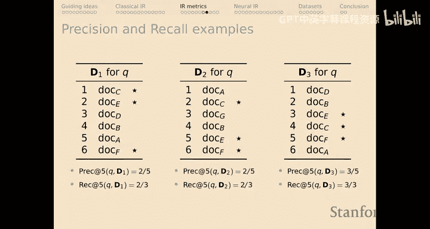
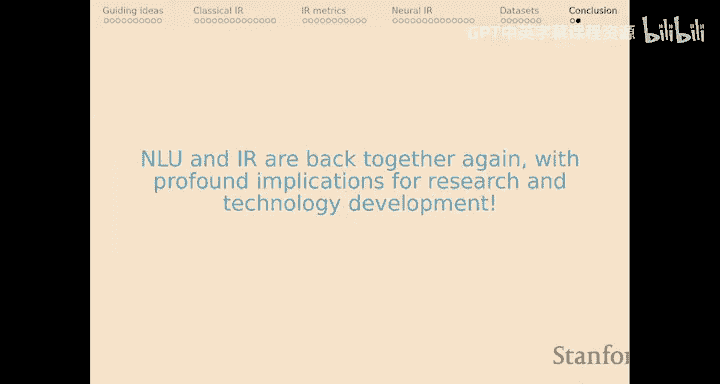

# 斯坦福大学《自然语言理解｜Stanford XCS224U Natural Language Understanding I Sp 2023》中英字幕（豆包翻译 - P50：-50-Fantastic Language Models and How to Build Them, Part 2 .zh_en - GPT中英字幕课程资源 - BV1sx4y1s7oW

Al right， welcome everyone。Again， we have a very full day。

 The plan is to finish up our review of core information retrieval stuff。

 The focus will be on neural information retrieval。

 where a lot of the action is these days have then a few data sets to show you。

 and then I'm going to turn it over to Siid and S is Siid is going to help us talk again about how to build fantastic language models。

So let's dive in， we'll start by using our big handout here， information retrieval。Right。

 and so here we are。 and we are going to skip。 That's right。

 I had a couple more metrics that I wanted to show you。 So let's start there。

 So last time we talked about how。Assessment in the space of IR should be multidimensional。

And we've been focused on accuracy， but I will make amends。

 we are going to circle back and talk about these other dimensions。

 which I regard as absolutely crucial in this space。But with that said。

 we did dive into different metrics。 We talked about success and reciprocal rank success you should think of as just saying。

 for my chosen K， is there a star above me， that is， is there a relevant document above K？

So it's a very coarse grain measure。 so this one here， if we set success at 2 D1 as success。

 because there is a star at two or above。D2， that ranking also has a success of one because there is a star at two or above and poor D3 gets a success of zero。

And you can see already that it's coarse grained because D1 and D2 are differentiated in some intuitive sense。

 but here they both got a success score of one。Reciprocal rank is a little bit better in the sense that it's more or less just registering whether there's a star at or above K。

 except now we are sensitive to the topmost ranked one， so for example。

 D1 here has an R at 2 of1 because there is a star in first place。

 whereas D2 has1 over 2 because the first star is in second place。And then D3 still gets its pore0。

So pretty coarsegraed， but very intuitive and sometimes success and R R are good metrics in the sense that you kind of just want to know for your chosen K。

 whether you hit the mark， whether you got a star， and especially if you only have one relevant document per query。

 you might as well use these metrics。And then R R will just be a little bit more nuanced。

We also talked about precision and recall the classic accuracy style metrics in this space。

 the differentiator here from the previous ones is that these are going to be sensitive to multiple stars so if you have more than one document that's relevant to your query。

 you will be able to detect that。So we have this notion of a return value that is just the set of documents k or above。

 and then the relevant documents， those are the ones with stars。

 and precision is saying for my chosen K， what percentage of the things that are above K are relevant？

And that's precision in the sense that if you picked K。

 you're looking at this set of documents and you want to know how many of them have stars relative to the total。

Or like the reverse of precision would be like， which ones are kind of imprecise as predictions。

 because there's no star there。And then recall is kind of the duel of that。

 and it says for my chosen K， how many of the stars made it up to K or above。

 and the opposite of that would be like how many stars are lingering down below。

So you can see here because of the numerator that we're going to differentiate systems now based on how many stars are at K or above。

 so it's sensitive to multiple stars。So just to walk through again。

 precision at 2 for D1 is2 out of 2。For D2， it's one out of2 because just half of them have a star and for poor D3。

0 out of 2。Recall is very similar， but now the denominator changes right。

 so the recall at two for this first one is two out of three。

 that is of the three star documents two or at K or above。

Here it's one out of three and here at's zero out of three。And just around this out。

 poor D3 has not fared well in our ranking so far。 But in a surprise twist。

 if I change the value of K to 5， all of the sudden， D3 looks pretty good。

Because now it's got all three of its stars at  five or above， whereas the other two。

Even though they've got some high stars up there， we're not sensitive to that precisely。

 and so now D3 has pulled ahead。And that is maybe something that you want to watch out for because people kind of innocently choose these K values when they're evaluating systems。

 and I just showed you that that could really impact the ranking of systems and in particular，Like。

You know it's hard to imagine since there are only six documents。

 but if it was a lot of work to travel down to our chosen K， if K was 100。

This would obscure the fact that we might pick as our winner a system that had all the stars more or less at 100 and the other systems which have their stars at the top of the ranking and therefore they're easy to find。

 those might be diminished with such a high K。And so that kind of gets you into the role of thinking。

 what are my users trying to do， What is the cost of them scanning down a list of ranked results and things like that。

 And that's where I want you to be when you think about these metrics。

 What are you trying to solve out there in the world， What are your users confronting。

 What is the cost of reviewing examples and so forth and so on。Yeah。

 will the neural IR models that we're going to kind of solve this problem of？

Because right now everything's based on the presence or not a word。

Rather than kind of maybe a either a longer meaning or like the quality of the relevance。

 however we define it， like maybe it only says the word once。

 but actually has the best information afterwards。Will that take care of that or is all of neuro also going be based on presence or not upward That's a great question。

 wait， we should be careful。 So yeah， I think for the first part of your question。

 I want to say the neural IR models are overall going to be better because of what you alluded to。

 they have a very rich semantic space。It won't directly impact this because these stars。

 after all aren't about terms。 This is about whether a whole document was relevant to a query。

 You should imagine that the background processes like some team of humans went through and said。

 okay， you searched for Bt， and now I'm going through documents and saying， yeah。

 this one is relevant。 This one isn't。 That's what produced these rankings。

But I think you're right in your core intuition。 term based models are going to be kind of brittle。

 And if we have hard query document pairs， they might miss them。 Actually， that reminds me like this。

 for some reason， it didn't display before。 Let's see if it displays。 Now。

 I had this nice example that Omar created。This is an example of why search is a hard NLU problem。

 because this is a query what compounds protect the digestive system against viruses。

 where the response is certainly relevant， but there is zero relevant term overlap between query and document。

 all of the connections that we want to make our deeply semantic connections。

And I do think that that is why neural IR models have pulled ahead four accuracy style assessments。

 trying to be careful， as you'll see。

I have one more metric。Which is average precision。 And this will be。

 because it' is fair to say our most nuanced metric。 Okay， so a little bit hard to think about。

 But I think it's intuitive。 Average precision。 Notice it has no K。

And the reason it has no K is that we're going to sum over all the precision values for different ks here。

 where there is a relevant document， think back to our rankings， wherever there was a star。

 we're going to choose that as a K。And we're going to sum up just those precision values and divide it by the number of relevant documents。

Here's an example， same three rankings that we had before。

 and what I'll show you are these precision calculations。 So for the first one。

 we have stars at position1，2 and6。And so we accumulate the precision values for one， two， and six。

And those are， I hope the ones I've given there that sums to 2。5。And then we divide that by three。

 which is the number of relevant documents。So we've abstracted away the K， which is reassuring。

 And we're also checking at every level。 So it's not going to have that sensitivity I showed you before where the choice of K dramatically impacts which rankings we favor because now we're kind of looking at all of the ones chosen by the ranking。

So that's D1， and then for D2， same thing， but now we're checking it2，5。

 and 6 because that's where the stars are， and that sums to 1。4。And then for D3。

 we do the same thing at positions 3，4， and 5， and notice interestingly that D3 has a pulled ahead of D2。

That's less surprising to me in the current context because。D2。Is kind of good and kind of not。

 right， It has that one star that's near the top， But the other two stars are way at the bottom of our ranking。

 whereas at least E 3 kinda put them all， at least not literally at the bottom。

Whereas D1 looks like just a slam dunk winner here。 I mean。

 it simply has most of the stars right at the top。 It has that one only one at the bottom。 But。

 you know， on balance， D1 looks good。 So if I just stepped back from this little example。

 I would say that average precision is kind of nice in terms of giving what looks to me like a pretty nuanced picture of these three rankings。

I think that's all of the accuracy style metrics。 Of course， there are others that you'll encounter。

 some are sensitive to the numerical like the float value because sometimes you have not just a one or a0。

 a star or not， but rather a float value for relevance。 There are lots of versions that， of course。

 average these over sets of queries。 that'll be very common to see， but underlyingly。

 that's just some kind of arithmetic average of these scores。 So I think this is a good sample。

 Are there questions I can answer about these metrics。

Really quick the flow value on that for relevance。How's that at a high level computing what' it's called like the discounted cumulative gain。

 and it is the sum of all of the scores。Divided by something or other。

 This must be in your history somewhere。You could also dis。系基你个。Precision or not precision。

 I think maybe the position weighted a combination of human labels and。

Oh so you found the discounted cumulative gain。 That's a metric I left out。

And then you're just observing that very often for these data sets。

 we'd have humans do a bunch of labeling。 And then average precision is one way of aggregating over the labels we might have collected。

I kind of alluded to this before， but like here's a partial list of things you could think about。

 which metric fundamentally there is no single answer。

Is the cost of scrolling through K passages low？Then maybe success at K is fine。

 because you don't care whether it was a position 9 or position 1。

 What you really care about is that the user is kind of confronted with the success that they can easily find。

 That's one scenario that you could be in。Are there multiple relevant documents per query。

 This is straightforward。 If so， you probably shouldn't use success at K or R R at K because they're only sensitive really to one star。

 And if you went to the trouble of getting multiple stars， you know。

 why have your metric be insensitive to that。So that seems clear。

Is it more important to find every relevant document， If so， you should favor recall。

 That would be a case where maybe human review is cheap or the cost of missing an example is hugely expensive。

 In that case， you want to favor recall， you can't miss anything。 Conversely。

 if you just need to find some relevant things。 Maybe in an ocean of examples。

 because you want to label them or because it's just good to know about them。

 then you could favor precision， because then all you really care about is that near the top are some relevant things。

F1 at K is the harmonic mean of precision and recall， same thing as we do in NLP。

 and that can be used where there are multiple relevant documents。

 but maybe the relative order above K doesn't matter。

 that's just one perspective on what I mean when I say we're combining precision and recall。

And then finally， average precision of the ones I've showed you will give you the most fine grain distinctions of the metrics。

 right， because it's sensitive to rank。And it's sensitive to precision and recall。

 precision because it aggregates over those values and recall because that's the denominator。

So that looks like an awfully good way to really get a fine grained ranking of systems。

And then finally， I'm going to talk about this a bit later。 We have to move on beyond accuracy。

 This is a paper that I did with a team recently of researchers here and at IBM。

 What we're seeing here is a kind of post ho leader board。

 not an actual leader board because part of our complaint is that there are no leader boards that really do anything beyond measuring accuracy style things。

 But if you did go through the literature， as we did here and find a lot of systems。

 you can see that they vary widely along other dimensions。 Here is the mean reciprocal rank。

 one of our rankings。 goes from 19 to 37 and 39 or something， you say， okay。

 but then look just to the right of that at the query latency。To get to 37。

 look how much time I have to spend versus down here where 36， I spend a fraction of the time。

That is absolutely something that will matter to the search experience of users。

 There is almost no way there waiting around for 691 milliseconds。For example。

 or what about the index size， right， if you care about space footprint and you will。

 if you are indexing the web。Some of these have tiny little indices。 and then u， oh。

 that's our model calledber V1，154 gigytes。Right， so now， if you need to hold it in memory。

 your world just got a lot more expensive。And you see over here Ram requirements， so BM25。

It has no hardware requirements at all， you can run that on anything。

Whereas these models down here that have these really high MR scores。

 hugely expensive in terms of compute， classicic story of the neural age， right。

 So you have to pay somewhere。And then， of course， I hope you're thinking about this。

 So then what is the best combination of all these things， Well。

 it depends on how much money you have and how much time you have and how much you care about accuracy。

And so the best pitch I can make to you is that as you evaluate systems。

 you think about what you care about what matters and conduct construct your evaluations on that basis that's going to be a big theme of the course later on and I'm hoping to time it so that you all for your papers or thinking about assessment and you think。

 you know I should have a whole section about my philosophy of assessment here and not just fall into F1 or fall into success at K or whatever is relevant。

This is kind of interesting too， this is from the same paper。Here's BM25。Costs essentially nothing。

 but it has very low performance。 If you travel straight up from there， Look at these bladeed models。

 also costing essentially nothing， but vastly better in terms of their performance。

 that looks like a real discovery to me。 You know， this is like the Pareto frontier as they call it these systems where you would just wouldn't choose any that are off the frontier。

 no matter what your values。 And obviously， you can see that to favor this model。

There are going to have to be other dimensions that we care about beyond cost and MRR。

 because otherwise， that's just not a choice you would make。But for all I know。

 there are hidden dimensions that need to be teased out that would show that that ants model is the best。

Relative to。Let's dive into some of those models， then neural IR。First。

 we'll start with cross encoders。This will be very intuitive。 Okay， here。

 just imagine I have a huge transformer。And for cross encoders。

 what I do is I just concatenate the query and the document together。

 process them with my transformer model， and then on the top here I put a little scoring function and the scoring function will just say for this query。

 how good is this document。Enormously powerful to this comment from before。

 we are making like maximal use of this， say Bt model here to get every possible interaction between query and document。

So this should' be good in terms of accuracy。But you might worry about some other things here。

 Let me walk through a bit more In the background here。

 I'm assuming that our data set looks like this。 We have a query。

One positive document and a set of one or more negative documents。

We could have multiple of the negatives。What I'm depicting on the left here is a model we could summarize like this。

 This is the encoder。We concatenate the query in the document and process them。

 and we retrieve this representation here， layer N， position zero。

We feed that through a dense layer that does our scoring。

 and that is the basis for essentially a classifier。

This is called the negative log likelihood of the positive passage。

 and if you squint or you don't squint， you just let it go blurry。

 you will see that it is a typical classifier loss。

The only possible twist is the denumminator is the positive passage score。

And then on the denominator， I have the positive passage summed together with all the negative passages that I have in my example set。

But fundamentally， it's a classifier。And so that's why this examples look like this because that's what's being used here to optimize all these parameters to score documents。

Final thing。I hope your thinking about this is going to be incredibly expressive and powerful。

 but it just won't scale。 The cost of having the query and document interact at query time is that I can't process any of these documents ahead of time。

 So just imagine this。 your query comes in on the web like your Google。

 and you're using a cross encoder。 the user queries。

 You need to process that query together with every single document on the web to score them。

 And then on that basis， you will get beautiful scores。😊，But obviously。

 each query could take years to serve。So from this perspective， it is just not a practical choice。

Maybe we could use it for reranking， you see this sometimes where a cheap retriever gets a lot of like1 thousand documents and then this is done to rerank the last thousand。

 but we can't do this at webscale。So a question in the back， yeah。

Do use this with multiple or positive documents as well。嗯。I let's see。 I don't see why not。

 The numerator could be the sum of the positive， and then the denominator could just include all of those。

 So that what you would be doing is。Well。I'm just trying to think through that that would be one approach。

 the other approach would be to just treat them as separate examples。I think under some conditions。

 those will be identical， but I'd have to think it through， but。I don't see a problem。

 I don't see a problem。But it's worth thinking about， I'll get back to you on that。

Let's improve on this。 D PRR dense passage retriever。 This will also be intuitive。 Here we go。

 query and document， except notice Now they are processed by separate models。

 The query encoder and the document encoder could be the same parameters， But the point is。

 we process them separately。 And I've made lighter every state， except the output tokens。

 but below the two class tokens。Because those are the only ones that we need。 Okay， E two。

And then we do some kind of scoring on that basis， like similarity。 right， So here。

 our examples are the same。Now the similarity function as I'm calling it for a query in a document is we process the query。

 we get this guy， process the document， and we get this the guy。

 and then we do scoring on that basis， there are no additional parameters we just score based on those representations。

 their dot product。So now we've got something that is highly scalable because we can process every document in our entire web collection into a single vector。

 this one， and it can just sit there on disk， and then at query time， process the query。

 get its vector and do this super fast dot product comparison for scoring。

So now we've got something that is probably even going to function as a full ranking model。

 not just a reraner， but the real gain is that we can process all our documents offline。

 The cost was that we now have almost no interactions between the query and the document。

 like if you think about token identities， If you think about the soft matching that happens with TF IF。

 none of that is going to be able to happen here。That was the cost。Yeah。So， I mean， essentially。

 what well be comparing would be two fixed length vector right， I mean。

 a letter representing the document and another difference。 So is there。I mean。

 a limit to the length of the document that could be represented is that I mean。

 like could it represent an arbitrary long document。The goodlos context。These are great questions。

 Let me repeat them For the first question。 Yes， you are right。

 The one constraint we need to impose on the query encoder and the document encoder is that they have the same dimensionality so that we can do the dot product。

 They can otherwise be separate models if we want。 And then length of query and length of document。

 that's just going to be imposed by whatever we choose for the query in the document themselves。

 So if you choose Bert， you're going to be stuck with 5。

12 is the longest document that you can process unless we do some further manipulation of these things。

Yeah。If these models are trained to project into kind of like a shared embedding space。

 like documents that are similar to a query you're going to。

Fall into a similar location and embeddedbe space。Could we have a system where we essentially take like we pre processs all the documents？

We take a query at in Prince time。Projected into a bedding space and then do like any your research or something。

Yes， well， yes， so some aspects of what you're describing， I think。

 are what DPR will be optimized for， the other parts of which you're saying are going to be optimization tricks that I show you in a second。

 I believe。Yes。😊，Do you elaborate on what you mean by limited query doc interactions？

Just that all we've got in the end is this vector for the whole query and this vector for the whole document。

 so token identities to the extent that they're preserved at all。

 they have to have been packed into those vectors。Whereas over here。

We had every token level interaction you can imagine as a result of us using like the transformer。

Yeah， is there any room for training some more clever synthesis of the two representations get at the end as opposed to just product。

 Oh， that's the end。 I think that's a natural follow on is that you might think I want to have in this layer here。

 some additional parameters。 And you can kind of see how that might work， right。

 So instead of just using this vector， I would put some parameters on top。

 And then the same optimization could be used，They're going to the same。basically。听住。Yeah， yeah。Yeah。

 and this could be good in the sense that we would pay a little bit of a cost by adding more parameters。

 but we might gain something in terms of expressivity。Thanks。Let me show you a happy compromise。

Oh yeah， I just wanted to point this out that I've just showed you two loss functions。

 I showed you the cross encoder and the DPR， and you can probably already see that they are identical except for this function that you might call comp here。

And that's kind of freeing。 and as you think about these different model architectures。

 probably what you're thinking about is simply changing this comp function and then using your available data to train the model against this negative log likelihood of the positive passage。

There are other losses out there in the literature， but this is the most widely used。

 and it seems to be very effective。Cobert。This stands for Conualized Late interaction with Bert。

It was invented by Omar and Mattay， who are here。 Omar is my student， I work closely with Mattte。

 and let's see， so Omar would want you to know that this stands for contextualized late Interction and he pronounces it Colbert because Stephen Colbert has a show full of contextualized late night interactions。

But you can also pronounce it colbert。It's your choice because the Bt there is the BRT model。

And we are， still hoping that Stephen Colbert will take notice of this。just start。

I haven't been so bold， but I welcome you all to do that。That's great。 add him on Twitter， yes。

Here's how this will work。 I've drawn the query encoder on the side for reasons that you'll see。

 but it's the same kind of thing。 so imagine Bert processes my query and I've grayed out everything but the final representations because crucially those are the only ones that we actually need。

Same thing with the document， and it could be the same encoder。

Now what I'm going to do with Colbert is form a grid of scores。

And this is going to essentially give the similarity value between every query token and every document token。

And then I will choose the values along the rows。 that is for each query。

 the document token that maximizes that similarity comparison。

 and the scoring function is essentially the sum of those three max values。

 That is why you see maxim all over the place for Colbert。Examples are as before。Losses as before。

 and I wrote down here what we would think of as the comp function and I wrote it as maxim for a query in a document you sum over the query tokens and you get the max matching document token。

So you can see why it's contextualized late direction because I'm using the output states。

But unlike DPR， I'm allowing them all to interact with each other via these very fast maxim calculations。

I have token level interactions。ItRight so highly scalable and highly expressive。

 The only cost is that the interactions happen only in this very thin final layer。

But this is really pleasing for IR。That Colbert， because of this。

 brings us back to common intuitions in I R。 We do genuinely achieve with these maxim scores。

 Intuitive， soft alignments。 Here I have the query。

 When did the Transformers cartoon series come out。And the response document。

 the animated Transers was released in August 1986。

 and these are proportional to actual maxim values query relative to document。

 the thickness of that line， And you can see that it is doing something very intuitive and also something very semantic。

 because unlike term based models， I don't have to do anything special to capture the fact that come in the context of come out is a lot like released。

And similarly with when and that date here， I'm showing the two topmost maxim values。

 and they're also very intuitive。 And this is wonderful because I R has been so successful for so long。

 doing term matching。 And it is nice to see that intuition carried forward into this more semantic space。

 in my view。😊，So I hadn go up here。第呢。Matrix of like query document。Is that why the in memory index？

Very critical there。Yes， so your question is why is the index for Colbert so big。

 it is because we have to store every token level representation， Yes。

 I'm going to show you that we can do better but naively storing these for our entire document store is going to be a lot of vectors。

One per token， not one per type。One per token。Yeah。I have to pay somewhere。

 I guess that's the insight。Yeah， question。Maybe there's some intuition that can make this a little clear if the document has multiple variants of transformers or the step theycon opt crime forever。

 they're all related to the original opinion transformers。

Would you be able to kind of draw that link to all those other tokens as well or would you。はて。

I guess。One relationship transformers is representing once。I think that's a great question。

 so transformers， that's why I picked it， it'smusly ambiguous between our model and the animated cartoon series。

Of my youth。So， but I think the point is that because it's burnt。

Transformers in this context will have a very different representation from the one if we were talking about NLP。

 And that's why it's so good that we are using Bt， because then we'll get maxims that are appropriately semantic。

 That is the hope。Yeah， whereas term based models really going to struggle。

 the best they're going to be able to do is have n gras that kind of capture the fact that this transformers is the cartoon series1。

So another， actually， that's another argument in favor of being in a more semantic space。

I want to just quickly talk with you about how we have worked to optimize Colber because I think that this suggests things that you would want to do if you developed your own neural retrieval models because the hard truth here is that BM25 is blazingly fast and scalable。

 and these neural models are not。 You have to work much harder to get them to that point of being as performant in terms of other dimensions beyond accuracy。

We could use Colbert as a reranker as I alluded to before。

 right so here I have all these token level representations， which I do have to store。

And they're each connected to a document。Now， if used naively， this will be not scalable。

 but I could do this given some query that's represented as a sequence of tokens。

I could get the top K documents for it using like BM25 and then rerank that top K。

And so if k is small， I pay the full price of the cobert model， but only for K documents。

And you're hoping that BM25 did a good job of getting you to that initial point。

It's a very common application， and it can be really meaningful to rerank that final set of K documents。

But we could do a little better if we wanted to use Colbert end to end。 Here's how we could work。

 We again， store all those token level vectors。 But now we're going to kind of turn things around。

 We just need to keep track of those vectors and their associated documents。

For a query that we have encoded as a set of vectors using Colbert。We take each query vector， W I。

 and we retrieve the P most token vectors from this huge list that are similar to our target。

 And that doesn't require the full cobert model。 That could just be a similarity calculation。

 And you can do those really fast。 People have really optimized that。

And then you get all the documents associated with this small set of vectors that you found。

 and you score them。So again， the name of the game is to use Colbert only very sparingly in a final stage because it is so expensive。

And then a third step here， just quickly， we can do even better。 And this is quite striking。

 What we can do is cluster our token level representations into their centroids using k means clustering。

 That's what I've got in red here。And then use them as the basis for search。 So again。

 we encode our query into a series of vectors， and then for this target vector W I。

 we first get the centroids that are closest to that。

 and this is important because in practice we can collect only like four centroids per token vector and do really well。

That's a tiny number。 Then we get the t most similar token vectors to that centroid。

And then we finally do scoring on the associated documents。And so by leaps and bounds here。

 we have reduced the amount of compute we need to do with this huge index by using the centroids and then using colbert again very sparingly。

Final thing， and then I'll take some questions， the team has worked very hard to reduce the latency of Colbert。

This is a latency analysis here and the thing I want to point out to you is that the Colbert model steps actually for this second version。

 the one I just described to you with the centroids。

 that was actually a relatively small part of the overall cost because it was being used so sparingly。

 the big costs were being in the dealing with the huge index。

And also doing work to quantize the vectors so that they were easier to store on disk by making them smaller。

And so after a bunch of work with this framework called Plaid。

 they were able to get rid of almost all of that index lookup and dequantitization or decompression steps for the vectors that were costing so much。

 and they brought the latency down to like 58 milliseconds。

so it went from something that is impossible to imagine deploying industrially to something that is close to what you might entertain as a possibility for deployment。

And I you know the details are in the plaid paper。 we can talk about them offline。

 I just wanted to call out that I think this is an incredible achievement。

 It is so clever the set of things that they did to achieve this enormous improvement so shout out to them and it does mean that if you had heard a rumor that Colbert was impractical to use because the index was too large and the latency was too long。

 I think it's not true anymore。 The indices are small because of quantization and this is that picture of latency。

 so give it a shot。I have one more model， but let me take questions。 Yeah， did you have a question。

 Oh sorry， I just had a question about the system。Okay， cool。 Yeah， I'm happy to talk more。

 The plaid papers full of tricks and things like that。I don't want to take up too much time。

 I definitely want to give Sid plenty of time to talk about models。 So let me just show you one more。

 This is played。 This is also ingenious。 It'll get you thinking in a new way。Okay， so first sed。

I wrote sequence at the bottom because we're going to do this for both queries and documents。

 this process。 And crucially， here I have the vocabulary。 I've only represented7 tokens。

 but if it was bird， it would be like 30000， okay。So we again process the text into the output states。

T1 through T3 there。And then we form all these scores。

And the scores are determined by this thing here， that's S sub J。

 so we're going to apply a linear layer to the encoding those output states。

And we're going to combine it with the embedding for these vocabulary items with a bias。

So if you strip away the details， you can see that this is like a dot product of these states with all of these values here in our vocabulary。

And then Spplayed is the sum of that， and so you can think of that as summing across all the document tokens。

 and so what we've got in that orange column there is a probably very sparse vector that represents this text down here with respect to our vocabulary。

So this is a lot like。Term based。Work of old， right， This is a lot like a TF IF representation。

 except it was done in the neural space。 so we should get the advantages of being with a semantic model。

And then the similarity value is just displayed representation that is this representation here for the query dot product with the document。

 and the loss is the one that we've been using all along。to speak there。

You do the display process both with the query and with the document and then。Yeah。

 that's a bunch of it looks similar in my document。 but this is great。

 Let me review what you just said。 There's a bunch of new things。 sequence。

 not query or document because we do this for both kinds。 And， of course。

 we can do all the documents ahead of time。😊，The big twist is that we're scoring these sequences with respect to the vocabulary。

 and we are essentially getting in semantic space because this is an embedding space here。

 and this is a contextual embedding space here， scores。

For each query term with respect to the whole vocabulary。That gives us this big。

 presumably pretty sparse vector， and their optimization further encourages sparsity。

And then the similarity value is the dot product of those for queries and for documents。

So it has some hallmarks of late interaction。Except it is interacting the text representations with the vocabulary。

 kind of like what you get with TF IDF。And this model is outstanding。

You saw it in some of my of my slides before。 Very impressive。And it's also a new way of thinking。

 which I really like。Here's a bunch of more recent developments。 and one theme of them。

 I won't go through them is just that people are working hard finally on making these models more efficient。

 So a big theme of this is not just obsession with accuracy。

 but also obsession with especially latency。And then finally， for that paper that I mentioned before。

 we did a bunch of systematic investigations of different approaches， you can see BM25， DPR。

 Colbert and some Spplayed models here， and these are all kind of variants of these models where people have worked hard to optimize them。

There's lots of tables like this in the paper。 Let me just draw out a few comparisons。

 B M 25 is the only solution that could run on this tiny hardware here。

 We couldn't even run the other systems。 That's why it's alone in its own little block there。

And it costs nothing。Right， but it's not that successful either。

 Success at 10 is low relative to the rest。 When we move here， this is sort of interesting。

 These two Colbert models achieve very similar performance。 If you look all the way to the right。

 except one of them is double the latency of the other one。For this hardware。

 And so you might wonder， do I really need this extra。Point of performance。

If I'm going to have to wait that long。And then if you look to Spde。

 so Spde is below Colbert V too small。But its latency is a quarter or something of the Colbert V2 small。

So maybe you care more about that and not so much about the success。

And then if you compare these two blades， right， they have the same performance。

 But if you just jack up the hardware a little bit。Then you get much lower latency。

But look how much the price went up。It went up for all of them with this heavy duty hardware。Yeah。

 so this is the space that you're actually operating in。

 we'll talk later about how we might more systematically integrate all these scores。

 I think this is enough now to get you thinking about all of these dimensions and。

They are the Plaid Colberus， yeah， pretty expensive there。Luckiily in the paper。

 we show that you never need a GPU for Colbert， I believe。

 just so you can always use cheaper hardware。啊。Yeah。But those costs do look scary。😀Yeah。😊。

The final section of this is just some data sets。 I think I don't need to go through it because you have it as a resource。

 If you want to get started in neural information retrieval。 you've got Trec M Marco。

 And then there are a bunch of new benchmarks that are designed to assess systems out of the box。

 That is zero shot。 Be is great。 Lotte is great for longtailed topic stratified evaluation。

 And then this X or tie I is cool because this is multilingual。

 And I know you have expressed interest in multilingual stuff。

 This could be a great playground for doing that with kind of Q A and retrieval。

 like open Q A as we've been doing it。😊，Bun of other topics。

 I think the bottom line here is just again， this is like a refrain in this class。

 NLU and IR are back together again after being apart for so long。

 and this is having profound implications for research and technology development。

 so this is absolutely a very exciting moment to participate in this research because there is so much innovation yet to happen。

 and it is having such an impact on research and also out in the wider world。

Excellent， all right， Si。 want to take over。So it's close that like retrieval isn't just hitting NOU。

 It's hitting everywhere， like vision and robotics as of like this week。

 we're starting to use retrieval methods to do。Like what's the best way to figure out how to do a new task。

 maybe retrieve some examples of a robot or a human doing the same task。

 and then generating your actions， so cool stuff。Cool， all right。Let's see if this works。Yeah。

 all right。So。I'm going to kind of pick up or try to pick up where I left off last week and kind of give you this evolution。

 this history lesson on how he got to the transformer。

And then go from there into tips and tricks for training big models generally。

 and then end with like a small little teaser on fine tuning and parameter efficient tuning。

So you can use that in your projects down the road。Cool， so just to kind of blaze past things。

 I kind of started by talking through you know where things were pre 2017 when the transformer paper came out on both the RNN and the CNNN side and kind of tied a lot of the innovation around the transformer to how modern convolutional neural net specifically residual nets were working and kind of the connections there were closer than the connections to RNNs。

kind of walk through how we got to the self attention block with this fancy code。

 which is basically just saying like you're splitting your heads and you can kind of think of your heads in a self attention block as the different kind of kernels or filters in a CNN layer。

And then kind of closing with like this full self attention block where we're actually doing the RNN style attention。

 and then this question of this nonlinearity that we're adding at the end because without this nonlinearity and this sort of MLP that we're adding to the end of each transformer block。

 we're really just doing weighted averages of linear transforms of values。Okay。

So if we kind of take this as ground truth， you know。

 starting point for what a transformer block looks like。

 very much inspired by the ideas of CNNs and RNs with attention at the time。

We have this residual connection here， which is kind of just adding x over and over again as we stack more and more layers together。

 there's a problem， can anyone spot the problem in this implementation by itself？

So the problem is that activations blow up， we keep adding the same input over and over again as we go deeper eventually specifically in the RNANN attention layer。

 when we take this dot product between the queries and the keys， we're going to get overflow。

And so we need to do something about that right， so while the first part of kind of building the transformulator is very。

 very much inspired by history， the second part is just trying to make sure it doesn't fail and doesn't blow up and doesn't crash when we try training it。

So what's one thing that we can do to kind of avoid the sort of。Blow up of our activations。

So layer normalization， so layer normalization， maybe batch norm and layer norm recovered earlier on。

 is a very， very simple idea along each feature dimension。

 where we're just going to normalize so that each feature has mean zero standard deviation1。

Which means that every time we add a residual connection。

 we're going normalize so that everything comes back to a decent space。

 We're still able to learn the kind of same level of exsivity we care about。

 We're just not necessarily going to you know， keep blowing up or growing the magnitude of our activations。

And what that looks like is you know， two calls to NN dot layer norm with a dimensionality of our transformer。

 and then adding that into as block where it's going to normalize each X before we pass it into the attention and the MLP layers respectively。

Now there's a problem with this that isn't obvious and actually wasn't obvious to the people building transformers at the time。

 it wasn't really explained kind of till three years later。

 which is that you have optimization issues when you do this specifically if you just try to optimize the naive transformer with this layer norm in place with kind of conventional ML wisdom which is like learning rate decay or a constant learning rate。

 bad things happen specifically I'm going to use the hugging face emoji my stand in for a transformer。

Stuff happens， the optimization crashes， it's either exploding gradients。

 it's either vanished ingredients if you yes someone in 2018 or 2019 or 2020。

 they would tell you one or the others happening， but there are definitely no gradients that are like stable throughout the training process。

So you introduce this kind of weird thing， it kind of comes out of almost nowhere。

 which is like this transform this like warm up schedule。

That you see a lot of the time in any code for training or even fine tuning transformers these days。

Now this is actually just like fun because I have the time I'm going to like go through it。

Who came up with this？Okay。I'm thinking I think I remember in the s Swwae Ad all paper they had like a weird learning rate。

 but I don't remember so it is in the original transformer paper is like the main thing that they get to get this staably。

 so it's one of the authors that came up with it。But if you actually run a git blame on the first ever transformer codeb from Google。

 the Tensor to Tensor codebase， like in the very first commit in like the arcpars like flags for the different optimizers to use。

 there's one option just called Noome after Nom Shasir and in the annotated transformer like the very first like block。

 that's what the optimizers called it's NoOpt in Sasha Ru's code。

 and it's called the NoM optimizer for a really long time until they just decide to call it just like linearar warmup cosine decay。

And so Noam Jaziier kind of came up with it and if you were to kind of go back and think about the sorts of problems and the papers he was working on at the time。

He was actually doing a lot of stuff with different types of。Like gradientding decent optimizes。

 like RMS Pro， add a factor came out like a year after the transformer paper came out。

And he was really interested in looking at this problem of like，huh okay。

 weights seem to be or like if you just really inspect the gradients early on with this lateror thing。

 variant seems to be high and you kind of want to burn that in and he's seeing this for LSTM so he's kind of doing this already for his LSTM work。

And then you just like let's try this， it worked and no one really questioned it it breaks conventional machine learning wisdom like why am I warming up my learning rate before I'm bringing it down right like if I'm optimizing some surface I kind of like want to start you know。

 kind of high move in and then like maybe ane it as I get closer to my minimum。

but no one is able to explain why till three years later。

 a paper comes out that kind of like steps through the specifics of training a transformer model on some data like synthetic data with the atom optimizer and actually tie it to the layer normalization layers that we just added。

 you know， we fixed one problem we added another。RightSo up top we have kind of know good gradients right so on the left here is the gradient magnitude and here's the update magnitude。

 So the gradients that are computed and the updates that are actually applied to the weights with warm up in blue in red we have the same thing but without warm up And what ends happening is that gradients go to zero somehow as you train it is actually a weird graph because like as you're coming forward in time is like as you're training more and more So this is kind of like starting out and then like this is kind of。

😊，Yeah， and this is kind of like towards the you know， wherever training becomes unstable。

And then your updates also become super high variances。 So they do some math。

 and they kind of bound the update as a kind of like。

Proportal to the dimensionality of the layer derivative of the dimensionality of your transformer。

Over the input norm that's coming in。 So if your input norm like if the size of your activation is like sufficiently large。

 your layer norm gradient is going to be completely， completely screwed。

So what they end up doing is like， okay， so warm up is necessary because it helps you get the atom optimizer to kind of like move slowly enough at the beginning。

So that we're kind of like saturating the gradients， we're like okay。

 and then when we kind of go full throttle like things are generally stable。

 the activations norms aren't changing all too much。

 they're changing in a predictable way and we can kind of start to handle that and then conventional ML kicks in。

But it's weird and it's also weird that it took three years later。

 and some people still don't buy this explanation， but it's the best explanation I've got to why we need that warmup。

So general wisdom， your fine tuning or pretraining a transformer。

 warm up for at least 5% of your full training and then start decay hang。It just helps。I ask him。

 I don't know this。So is there some。Data dependency or some assumption about what the data will be like because it seems like you said。

 hey look， after a while we can relax， these updates are small or reasonable。

 but the world could do a lot to you and if you shifted genre or data time。

They would go back into being very uns so I think in this paper。

 they're looking at like what I'll call nice data sets they're looking at like the Wikitext2s of the world that are like somewhat predictable。

 it's all Wikipedia homogenized language but even when you're training the modern like the really big transformer these days even after like all of these tricks you're still going to have like bad batches just like really。

 really unpredictable things that are low likelihood on your model that are going to cause big updates in the middle of training that are going to completely crash your run So this happened tons of times while we were training like the 355 million parameter models。

This happens every time you're training any big model in like the1 billion plus parameter range so the allluther AI folks like this happens all of the time。

 the T5 models have this thing in like one of the notes in like the Gitthub repository for like training a T5 which is like if training fails rewind to the latest checkpoint reranomize your data order and then try again and it won't crash and that's kind of how modern ML or most modern language models are trained right now we don't know how to avoid it yet we think it' side to the data we can't isolate it so why not just reroll and try again eventually you'll just keep making progress。

こ。So。Question fact the draft again。 I mean， what do the different colors they represent in Yeah。

 So the question was what the good different colors represent。

 So up top is blue with the kind of traditional transformer learning rate So warm up and then。

Go down， red is the no warm up， let's just start the learning rate high and then tapor。So red is bad。

 blue is good。like， so the way you can interpret this graph and the paper is linkednk in kind of at the bottom of the slide。

 but you can think of like the furthest back like magnitude is like this is like basically plotting like the mean inner deviation of the updates across layers。

The furthest back is like batch zero as you get further in。

You get to like batch 100 or batch 400 or whatever。Yeah。Question。

I wonder to what extent like the warm up and the rate。

They've gotten really to be your choice of optimizer like then。

Because I've run into some problems where。😔，喂。I found that using atom max of the infinity norm will work because I've got this level dropout or whatever。

 is there any guidance of like all these big hyperparmeters that go into like。

This to where if I pull one lever， I should be pushing one down or choose this optimize I to another because it feels like。

I mean。Taking three years， it feels a little bit like a wild West， which is what I've。Yeah。

 so so if I were to paraphrase your question， it's like。

 if you decide to change anything about the current recipe， like change your optimizer。

 change dropout， change your learning rate， are there rules of thumb for what else you need to change to get things to work？

No。Um， it is。So kind of part of like why I kind of led with like how we got to hear。

 kind of starting from like the historical context was kind of to unpack a lot of this folk knowledge because it's still at the point where optimizing these models especially as we go bigger is kind of still concentrated in the minds and like experience of like a very small number of people because like who's trained a  seven billion parameter language model or who's trained to 100 billion parameter language model。

 where does that skill set come from when you're talking about a training run that costs you millions of dollars to develop plus you know however much the compute costs。

How many things are you really going to be trying at the end。

 what things can you extrapolate from so folks at Open AI have definitely done like scaling laws research where they're trying these different things in some bounded search space。

But if you were to invent like a brand new optimizer。

 that kind of looks at like you know maybe second， third， fourth order moments of your gradients。

 maybe do something fancy relative to like you know how things are changing over time and you were to just try and apply it to you the biggest language model you could train。

 I have no idea what I would tell you in terms of like what things you should change beyond like some obvious things which like maybe don't set the learning rate to be ridiculously high。

I'm starting now。If you have a batch of data， that's。

Like let's just say during training you find you come across a bad batch of data that happens to cause like the destabilization with the ingredients。

And then you rewind back to your checkpoint and you take that same exact batch of data。

 but instead of。Like running it through training when ingredientss are enabled。

 if you just run it through inference， will that bad batch of data have caused like anomalous behavior？

From the model during inference or strictly just the back prop So when we debug or when we debug this。

 so we a couple years ago， trained like some by today's standards， really。

 really small language models， but like 124 million to 355 million scale。

We were noticing this problem。The way we debuggged it was like looking at the gradients。

 which didn't tell us much， but then we just looked at activation norms per layer。

And that's how we actually debug this right so looking at the forward past。

 looking at the magnitudes of each layer， like where we thought we could possibly be overflowing or underflowing。

 that's exactly kind of how we debugged it。But we need to debug it at the batch level。

 we debug it as a kind of function of time， because like a single batch isn't going to perturb everything。

A series of batches， like maybe two， three， who knows how many。

 eventually you're going to fall under some trajectory where things get bad。

 your activations blow up。So we would be able to deterministically be going to that checkpoint。

 then deterministically like step through training and like log every activation。Which is expensive。

 but like that's how we were able to get to the bottom of the problem。

But I don't think we have tools for actually figuring out which batch of data or which sequence of batches of data or the actual triggers for that behavior。

Yeah， I guess I was just curious specifically about like if the same data that causes destabilization and training。

Can cause like theomalous behavior the second normal form task It probably would。

 And you know there's some more recent work about like how to quantize these models。

 like how to get a transformer that's trained with like 16 bit precision to like train or to run with like 8 bit precision by like you know intelligently like bucketing floats from1 debtmers who's a PhD student up at UW is this theory on something called outlier features that show up in these really big models that kind of try and get at this。

 but。More of an art than a science right now。Okay， so are we done now that we fix this like layer norm stuff。

 the learning rate stuff， all of the stuff you get to transformer to work？Kind of right。

 so like over the last few years， like training has been stable。

 people want to like milk the most of the transformer， you know。

Especially as they scale up so they do a couple things。

 so one when you're training and attentionally and you're projecting to queries and keys at sufficient scale。

 the bias term in each like linear layers like Wx plus B。

 you can get rid of the bees because like it's not really doing anything and it saves a little bit of compute So let's get rid of them that's like the first thing to throw out there are different activations that have been invented and different types of like。

Cool ways to just better fit your data so there's this like swish glue so a gated linear unit actually defines like a separate weight matrix as part of the activation and then a swish is like is like a sigmoid activation that applies to one part of the weight and not the other Ive code for all of this it works better This is actually the activation of choice now in most transformer implementations。

Sollma was trained with this， Pa was trained with this， worked really well。

One thing that folks noticed is that moving the layer norm to happen， you know。

Before you actually feed it through the attention or the MLP layers instead of after is a more stabilizing force this is actually kind of important。

 also a layer norm has trainable weights so some papers decide to be like you don't actually need you know these trainable parameters for mean invari。

 you can actually just like divide by the mean square or the RMS of like your entire activation feature。

All things to just get rid of irrelevant flops because we're training massive models and we're trying to do the bigger the model on the compute that we have。

Oh yeah here's the code for like a Swiss glue activation and an RMS norm so Swisish glue is like so the C is like basically a sigmoid。

 a projection layer is basically saying like let's take this input feature project it into like two separate chunks。

 one chunk becomes like a gating value kind of like in a gated recurrent unit and like the RNN literature and one becomes the actual value you apply the sigmoid to the gate and then multiply it elementwise with a value and you get your new thing works really well。

And an Rs norm is like literally just dividing by the norm of the vector instead of like trying to learn anything fancy。

Cool， this is what the modern transform looks like。So that's it for the evolution of the transformer。

 as far as I know， nothing in the last two weeks have changed drastically from this。

And the last three， to what extent let's say we are doing a fine tune。

Instead of like the full train where we're doing like Laura and Bob that。

 how would would we still want to follow these kinds of guidelines or are these specific to just？

Doing all of the data， doing a full pre training Yeah， so question is， you know。

 what of this do we really need if we're fine tuning or if we're kind of doing like parameter revision fine tuning like this is only necessary for pre training。

So I've started using Swisish glue instead of like any other activation like everywhere even for like a two layer MLP tends to work better。

 so take that with a grain of salt， everything else you can probably not care about。The RMS norm。

 the pre normorm， is probably just like a general rule of thumb if you're adding any transformer layers just because it is like demonstrably more stable。

 but other than that no。Other questions here before we move to how to train on lots and lots of compute。

Cool， so let's talk about training at scale。So。I's start with a story。 My story。 Okay， so I am。

Not old， but I have you know seen a few things as far as you know language models have gone right so like 2018 is when I I think did my first deep learning tutorial I trained a MNIS like you know the typical like two layer four layer MLP for classification。

There's actually a line there， it's the 100，000 parameter line that's 2018。😊。

As I kind of start my PhD in 2019 I'm doing more NLP stuff， I'm looking at like word vectors， RNNs。

 some more sophisticated things， I'm getting up to a million parameters。

2020 I kind of branch out from like the small anal piece stuff I'm doing to more intensive enal piece so looking at tasks like summarization。

 training models with like 10 million parameters， and then by 2021。

 the biggest like the biggest models I was training was like when I switched into multimodality robotics。

 looking at visual question answering。18 million parameters。And at the time。

 the standard pipeline for me， and I think this was the standard pipeline for a lot of grad students that I talked to then is like I'd be able to train most of my things on one GPU or you know even my laptop CPU for like a maximum of a few hours that is what a training run would take at least for like most of the things I was doing on a day to day。

But you know in 2021 Percy's like， hey， this GPT3 thing seems cool。

 let's at least figure out if we can get an academic lab to like try and train a GPT2 like the earlier generation。

 so clocking in like 124 million parameters， which is notably an order of magnitude bigger than anything I trained at the time。

 so why I decided to do this is still beyond me， but I learned a lot of useless things。

One of the useful things that I learned is that。Training a 124 million parameter model on a decent GPU that we had access to at the time with a batch size greater than four would go out of memory。

 which is bad because a batch size of four is small and we wanted to ideally train with like a batch size of 512。

So there was a simple trick and it's called gradient accumulation。

 which is just like I'm going to run batch sizes of four。

 however many times it takes to get into 512 and then do an update after processing all of those batches sequentially。

 so I'm just going to keep accumulating the gradients and Pytorch makes it really easy。

 it's just a for loop and an if statement。😊，But if you do the math。

's like 100 days to train on that single GPU for 1000 steps。

 So how do we go from this clock of 100 days to something reasonable。

 that's what we're going to talk about。So。The scaling toolbox， at least as far as you know。

We were concerned， kind of ended up looking like you know， three。Different parts。

Across 16 GPUs because Percy and Chris Ray and I think Chris and Dan and Chris Manning and the NLP group decided to invest upfront in really powerful GPU machines so we could actually train on like 16 GPUs at once。

嗯。For reference， 16 GPUs on AWS to just rent on an hourly basis is 56 bucks an hour now。

56 bucks an hour， if you want to just like sit on them。

 but if you're willing to let anyone who has the money and wants to sit on them， like pre-empt you。

 you can get them for 16 bucks an hour。So across four days like that，s not the worst。

 it's like not great， but totally doable。So the scaling toolbox we ended up looking at was data parallelism。

You can think about this as literally just divide and conquer。

Paralyze work across all of these GPUs instead of one。Mixed precision training。

 and we're going to talk a little bit about what that means。

And then this interesting idea called zero redundancy。

 which is about minimizing the memory footprint of training。And then later on。

 as you want to scale up to you， hundreds of billions of parameters on know 256， 5， 12， 1，024。

 2048 GPUs。We'll talk like there are things like that come handy， like model parallelism。

 that are things to consider like hardware and software limitations。But。

Some of you might be here looking at me， which is like， okay。

 do I need any of this stuff if I'm not training really big models like I'm just fine tuning stuff。

A lot of these。Tips and tricks， like you may not have access to 100 GPUs or even eight。

 but you might have access to two or four comes in handy。

A lot of the ideas here are still ideas that I'm using when I'm training stuff on my laptop or when I'm trying to run inference with like the latest big model that is publicly released。

 so it's useful。But please ask questions if things become too hazy or too not useful。不是。

People relying on coab data parallel。Might actually not help。So CoabB， yeah， CoabB。

 you're still limited to a single GPU and I'm guessing redund so mixed precision would help kind of definitely for running inferenceprints。

And zero redundancy would also help running inference What's the zero red So zero redundancy has like add on that they wrote up in a paper later called zero Infinity。

 which is like what if I didn't put all my weights on the GP at once what if I put some of them on in like CPU Ram or even in like NVME SSD storage so actually turning your laptop into a more powerful workhorse than a coab GPU？

Cool， so this is a toy example kind of going through data parallelism。We're running low on time ish。

 so this is MNIS with an MLP， we're trying to do classification is kind of the typical Py Torque workflow I'm going to define an endOt module。

 I'm going to define a batch size， a data loader that's going to load from the torque vision data set。

 and then I'm just going to run you know lots and lots gradient steps。

The idea here is how do we paralyze this across multiple？Workers， multiple GPUs， Well。

 that batch size， you see there， is totally divisible。

 especially given that like what we're doing at the end when we kind of compute the loss is just take an average。

An average of averages is still the average， that's the idea we're going to work with。

 The mean of means is still the global mean。So just like in CPU land where you can kind of think about like SD instructions like single instruction multiple data right so this is like kind of how most graphics and media operations work on your laptops。

 we're going to now think about like the SPMD paradigm I'm going to write one program and it's just going to automatically scale to being split across how ruining machines because we're going to split the data across multiple machines。

It seems hard， but as of Pytorch 1。4， a lot of the hard parts are taken care of for you。

 these are the only lines you need to change in the implementation。

 two of them are import statements。😊，So the first thing we're going to do is we're going to just。

Create something called a distributed sampler， which is going to automatically partition our data across the number of workers we define up from。

 right， We're defining a world size of 8。 So that means we're training on H GPps。

 So it's going to partition our data into eight different subsets that each worker gets to go through。

We're going to wrap our NN dot module with like this nice little wrapper。

 this distributed data parallel wrapper， which is just going to sync the gradients for us behind the scenes。

And then we're going to run this with a special command called Cortron。

 which is just going to inject a bunch of environment variables so way that we can you know get some statistics about。

 you know our local rank， who's the guy who should be printing stuff through the screen。

 who's the guy who should be logging stuff where each worker lives。

And that's about it and you can do all of this and you're just paralyzing it naively across 16 GPUs。

 you get， you know， not quite a 16X speed up because there is some overhead from communication。

It's like seven days， that's like cool， it was not good enough。

Because we were trying to train lots of models， reproducibly five seeds for like 10 different types。

 so like 50 models， so we needed to go a little faster than this。

So let's talk about memory footprints。When I am training any model with an atom optimizer。

How much memory does just storing that model and the optimizer weights take up？Right。So。

In 32 bit precision， our model is going to have parameters where each parameter stored and with 32 bits。

 that's a float， gradients， 32 bits。AndNow you're optimize there's also going to do this weird a thing where's going to have a copy。

 its own separate copy of the parameters like kind of duplicating a little bit of work there。

 that's also 32 bits and then atom tracks momentum like in variances like the first and second order of the gradients so that's another 64 bytes or bits right there。

So the lower bound on static memory， just like storing this stuff on a GPU is 20 bytes times the number of parameters that you have。

That doesn't include activations at all for these larger transform models if I want to keep around every like buffer。

 like every you know， intermediate matrix as I pass it through the network that takes up way more space。

 but like this at least gives us something that we can read and about。

The training implications of this is that if I want to fit a model with a billion parameters。

 as's going take about 18 gigs resting， 31 gigs of GPU RA with a batch size of one。

Which is problematic because most GPs then capped out at 24 gigs。

 the really expensive ones now have like 40 or 80， but this is still bad。

175 billion parameters would take three terabytes of RA， not storage， just RAM。Without activations。

 with activation probably looking like 10 terabytes。Good luck。

The numbers in Boulder batch size of one， numbers non Boulder。

 just like just putting it on the thing。And things you should know about floats it was a standard defined in this IEE document。

 you have a one bit sign， 8 bit exponent， 23 bit like scientific notnotation like all this stuff happened that happens after the exponent wide range up to 1038 and the question is like do you need that range answer is like。

😊，Kind of， but not really。So the mixed precision memory footprint。

 if I'm training a model in mixed precision， what that means is that I'm just going to run everything in a forward pass。

And part of the backwards pass in 16 bit precision instead of 32 bit precision。

Notably what that means is like now I'm sort my parameters and 16 bits， my gradientds and 16 bits。

 all of that those intermediate activations that take up lots and lots and lots of memory。

 especially as you go bigger are halved， which is great。

But the weird part about mixed precision is not everything is mixed precision。

 So your optimizer to stably update your model still needs the 32 B parameters under copies。

 your 32 bit momentum，32 B variance。But and you've kind of like， oh， you've dropped four bytes。

 and those four bytes are kind of useful。Yet training with mixed precision at least a couple years ago。

 and it's still mostly true now， is still way faster than training with full precision。

And the reason for that is。Most Nvi GPUs， starting with the Volta cards。

startedted shipping with a thing called Tensor Cose。

Tensor cores are basically the individual logical units on a GPU that are responsible for matrix multiplies。

 Your GPU is really good at accelerating neural network training because it's really good at doing matrix multiplies These things are optimized for  four by four to you know 16 by 16 size shs。

If you're training in 16 bit precision， you can actually end up using way more tensor cores than if you were using 32 bit precision。

And so you're able to get a ton of speed ups just because you're able to tap into the hardware。

 the underlying hardware system， more frequently。As of the ampere style car。

 so like the A100s or you know the more recent like 3090s， 3090 TiIs 4090s。

Those start shipping with these cores that are able to do float 32 precision。

 but are still even faster for 16 bit precision， so when you can train with 16 bit precision。

All right， this shaves a day off of our small scale training， this shaves off way more。

 especially as you go bigger。And now the final bit is how do we eliminate the redundancies right so in standard data parallelism？

Yeah。So when you are estimating the gradients precision matters more， you want that full range。

 specifically you want that you know those like 23 bits that kind of correspond to like everything that has data to be meaningful because while the full range of like flow 32 is really really big。

 it actually can't be super precise，It'sLike kind of in like the 01 range， for example。

So you kind of want as much there as possible to kind of ensure precision。Okay， so zero redundancy。

 standard data parallelism， you're basically storing everything on each GPU。

 key idea is I don't need to store everything on every GPU。

 I just need to store some things on every GPU。So the model gets to say on H GP because the model has to do all of the work。

 but the gradients， I can just split across the number of devices that I have， so half my gradients。

 if I have two GPUs go on one device， half of them go on the other device。

Same with the optimizer states， half of them going on one device。

 half of them going on the other device with this model of zero redundancy。

 you're actually not adding any extra communication cost， you just get free memory。

Because you're just intelligently partitioning things across devices。Notice that this scales you。

Use less and less memory as you add more and more machines。

 So this is kind of like the biggest trick to start training like 1 billion to 10 billion parameter plus models。

And now when you add this， you're at three days。喂。So you have to tell it because this would require like things being slightly out of sync to optimize so this actually doesn't require anything out of sync because in a backwards pass with distributed data parallel。

 the individual updates already have to be synced across processes right if you take the loss across average across all processes that means that the gradient to apply have to be transferred as well。

So this just basically does that work for you。We gotta wrap up， you hit a communication wall。

 matrix multiplies stop fitting on a device， so you start charginging them and then you have to start scheding things wisely and yeah great fine tuning inference there is a great library that you should use called PEft from Hugingface it's great and that's it。

