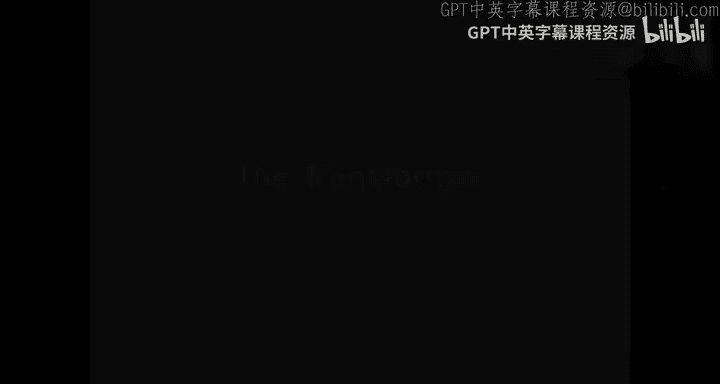
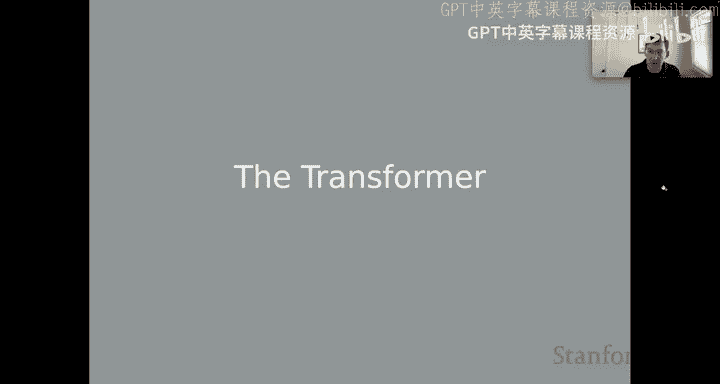
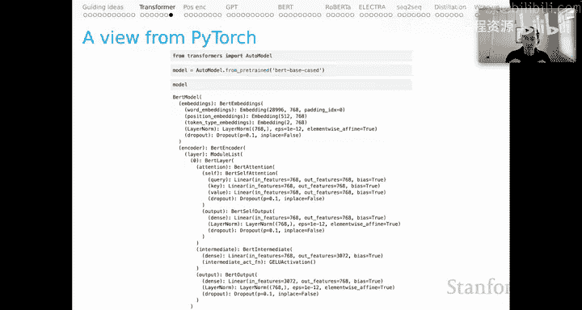
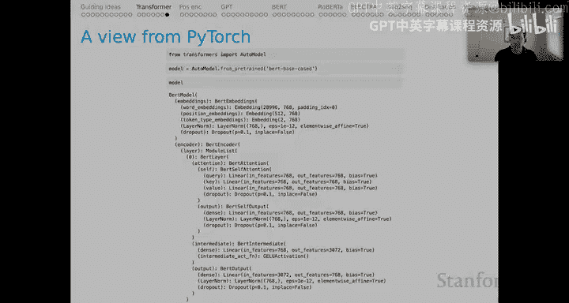
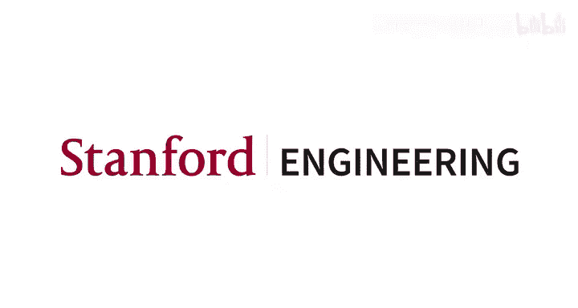

# 斯坦福大学《自然语言理解｜Stanford XCS224U Natural Language Understanding I Sp 2023》中英字幕（豆包翻译 - P5：-05-Contextual Word Representations, Part 2： Transformer .zh_en - GPT中英字幕课程资源 - BV1sx4y1s7oW

Welcome back， everyone。 This is part 2 in our series on contextual representations。

 We've come to the heart of it， the transformer architecture。 While we're still feeling fresh。

 I propose that we just dive into the core model structure。

 And I'm going to introduce that by way of a simple example。

 I've got that at the bottom of the slide here。 Our sentences。 the rock rules。

 And I've paired each one of those tokens with a token representing its position in the string。😊。

The first thing that we do in this model is look up each one of those tokens in its own embedding space。

 so for word embeddings we look those up and get things like x47。

 which is a vector corresponding to the word the， and that representation is a static word representation that's very similar conceptually to what we had in the previous era with models like word to Vec and G。

We do something similar for these positional tokens here and get their vector representations。

 and then to combine them we simply add them together dimension wise to get the representations that I have in green here。

 which you could think of as the first contextual representations that we have in this model。

On the right here， I've depicted that calculation for the C input part of the sequence。

 and that's a pattern that I'm going to continue all the way up as we build this transformer block。

 just showing the calculations for the C dimension because the calculations are entirely parallel for A and for B。

So to get C input， we simply add together x34 with P3 and that gives us C input。

The next layer is the attention layer。 This is the part of the model that gives rise to that famous paper title。

 attention is all you need。 And the reason the paper has the title attentionten is all you need is that the authors saw what was happening in the previous era with recurrent neural networks where people had recurrent mechanisms。

 And then they added a bunch of attention mechanisms on top of those recurrences to further connect everything to everything else。

 And what the paper title is saying is you can get rid of those recurrent connections and rely entirely on attention。

 Hence attention is all you need。 That's an important historical note because the transformer has many other pieces。

 as you'll see， but they were saying in particular， I believe。

 that you could drop the recurrent mechanisms。The attention mechanism that the transformer uses is essentially the same one that I introduced in the previous lecture coming from the pre transformformer era。

 it is a dot product based approach to attention。I've summarized that here。

 You can see in the numerator。 We have C input dot product with a input and C input dot product with B input。

 Let me show you what those look like。 So here I've got depicted each dot product is a dot and the arrows going into it correspond to the components that feed into that calculation。

 So that this dot here corresponds to A input combined with C input and this one A input with B input。

 We do that same thing for the B step。 and then we do the same thing for the C step。

 So the two dots that are depicted here correspond to the two dot products that are in this numerator。

One new thing that they did in the transformer paper is normalize those dot products by the square root of D。

 D is the dimensionality of the model。 It is the dimensionality of all the representations that we have talked about so far。

 That's a really important element of the transformer。

 We're going to do a lot of additive combinations in this model。

 and that means that essentially every representation has to have the same dimensionality and that is D。

 there is one exception to that which I will return to。

 but all the states that I depict on this slide need to have dimensionality D。

And what the transformer authors found is that they got better scaling for the dot products when they normalized by the square root of that model dimensionality as a kind of heuristic。

So those normalized dot products give us a new vector， Al with the tilde on top。

 we softmax normalize that， and that gives us alpha which you could think of as kind of attention scores。

To get the actual attention representation corresponding to this block here。

 we take each component of this vector alpha and multiply it by each one of the representations that we're attending to。

 so Al 1 by a input Al 2 by B input， and then we sum those values together to get C attention。

And as a reminder， we have all these dense connections for all of these different states。

 I'm just showing you the the calculations for C attention。

 and that's important because all those lines that are now on the slide are really the only place at which we knit together all of these columns which will otherwise be operating independently of each other。

 so this really gives us all the dense connections that we think are so powerful for the transformer learning。

 what sequences are like。Now I do think that the representations that I have in orange are attention representations。

 but they're kind of raw materials because they're really just recording the kind of similarity between our target representation and the representations around it to get an actual attention representation in the transformer what we do is add together these contextual representations down here with these attention values and that gives us the representations in yellow。

 CA layer。And those are kind of full fledged attention based representations。

I've depicted the calculation over here and that includes a nice reminder that we actually applied dropout to the sum of the orange and the green Dropout is a simple regularization technique that will help the model to learn diverse representations as part of its training。

The next step is layer normalization and this is simply going to help us with scaling the values we're going to adjust them so that we have zero mean and a nice normal distribution falling off of that zero mean。

 and that's just a happy place for machine learning models in general。

The next step is really crucially important。 These are the feed forward components in the transformer。

 I have depicted them as a single representation in blue。

 but it's really important to see that this is actually hiding2 feed forward layers。 We take C。

 A Nor and purple here as the input。 And we feed that through a dense layer with parameters W1 and B1。

 And we apply a re U activation to that。😊，That is fed into a second dense layer with parameters W2 and bias term B2。

 and that gives us CFF。And this is important because many of the parameters for the transformer are actually hidden away in these feed forward layers。

 And in fact， this is the one place where we could depart from this dimensionality decay。

 because A C A norm here has dimensionality decay by design。

 But since we have two feed forward layers， we have the opportunity to expand out to some larger dimensionality。

 if we want。 As long as the output of that goes back down to decay。

 And as we'll see for some of these very large deployed transformer architectures。

 people have seized this opportunity to have really wide internal layers in this feed forward step。

 And then， of course， you have to collapse back down。

 And that might be giving these models a lot of their representational power。

But we collapse back down to DK for CF here， then we have another addition of CA norm with CA CF to get CF layer here in yellow and we have dropout applied to CFF that's that regularization step and then finally we have a layer normalization step just as we had down here which will help us with rescaling the values that we've produced thus far and therefore help the model learn more effectively。

That is the essence of the transformer architecture。 There are few more details to add on。

 but I feel like this gives you a good conceptual understanding。

 We began with position sensitive versions of static word embeddings。

 We have these attention layers down here。 And then we have the feed forward layers up here。

 In between， we have some regularization and some normalization of the values。

 but the essence of it is position sensitivity， attention feed forward。

 and we are going to stack these blocks on top of each other。

 and that's going to lead to lots more representational power。

 but all the blocks will follow that same rhythm。Since attention is so important for these models。

 I thought I would linger a little bit over the attention calculation。

What I've shown you so far is the calculation that I've given at the top of the slide here。

 which shows piece wise how all of these dot products come together and get rescaled and added in to form C attention in this case。

And the attention is all you need paper and in a lot of the subsequent literature。

 that calculation is presented in this matrix format here。And if you're like me。

 you might not immediately see how these two calculations correspond to each other。

 And so what I've done is just offer you some simple code that you can get hands on with to convince yourself that those two calculations are the same。

 and that might help you bootstrap on understanding of what you typically see in the literature。

 and then you can go forth with that more efficient matrix version of the calculation secure in the knowledge that it corresponds to the more peacewise thing that I've been depicting thus far。

The other major piece that I have so far not introduced is multi headed attention。

 so far I have showed you effectively single headed attention。

So let's dive into what it means to be multi headeded。

 I'm going to show you a worked example with three heads。 The idea is actually very simple。

 but there are a lot of moving pieces。 So let's try to do this by way of a simple example。

 I've got our usual sequence at the bottom here， the rock rules。

 and I've got our usual three contextual representations given in green。

We are going to do three parallel calculations corresponding to our three heads。

 Here's the first head。 We do our same dot products as before。

 and it is effectively the same calculation that leads to them with the small twist that we have introduced a bunch of new parameters into the calculation。

 Those are。W Q1 for queries。 W K1 for keys and W V1 for values。

 Those are depicted in orange in this calculation， and I put them in orange to try to make it easy to see that if we simply remove all of those learn parameters。

 we get back to the dot product calculation that I was showing you before。

 We've introduced these new matrices to provide more representational power inside this attention block。

And the subscripts1 indicate that we are dealing with parameters for the first attention head。

We do the same thing for our second attention head， all of those dot products。

 but now augmented with those new learn parameters， same thing， queries， keys and values。

 but now two for the second attention head。And we repeat exactly the same thing for the third attention head again。

 with parameters corresponding to that third head。And then to actually get back to the attention representations that I was showing you before。

 we kind of reassemble the pieces， so here is the attention representation for a。Here it is for B。

 and here it is for C。 We've pieced together from all the things that we did down here。

 these three separate representations。 And those are what was depicted in orange on the previous slides。

 But now you can see that implicitly， that was probably a multi headed attention process。

So now I think we can summarize maybe the one big idea that's worth repeating is that we typically stack transformer blocks on top of each other。

 so this is the first block I've got C input coming in and C out here。

 but C out could be the basis for a second transformer block where those were the inputs and then of course we could repeat that process and that is very typical to have 12 of 24。

 maybe even hundreds of transformer blocks stacked on top of each other。

And the other thing that's worth reminding yourself of is that these representations in orange here are probably not single- headed attention representations。

 but rather mother multi-headed ones where we piece together a bunch of component pieces that themselves correspond to a lot of learned parameters。

And that is， again， why this attention layer is so much a part of the transformer architecture。

 In addition to the fact that that's the one place where all of these columns of representations interact with each other。

 So that probably further emphasizes why the attention layer is so important and why it's good to have lots of heads in there。

 offering lots of diversity for this crucial interactional layer across the different parts of the sequence。

So that is the essence of it， and I hope that you are now in a position to better understand the famous transformer diagram that appears in the attention is all you need paper。

 I will confess to you that I myself on first reading， did not understand this diagram。

 but now I feel that I do understand it。Reminder that in that paper。

 they are dealing mainly with sequence to sequence problems so that they have an encoder and a decoder。

 And so now we can see that on the encoder side here， what they've depicted is。

Repeated for every step in that encoder thing。 So every step in the sequence that we're processing。

 And once you see that， you can see， okay， they used the same， I used the same colors that they did。

 So red for the embeddings， We have multi headeded attention。Additive and layer norm steps。

 Then we have the feed forward part， more normalization and kind of adding together of different representations。

 That's that same rhythm that I pointed out before。 That's on the encoder side。 On the decoder side。

 things get a little more complicated。 we're going to return to some of these details。

 But the important thing is that now we need to do mask attention。

 because as we think about decoding。 we need to be sure that our attention layer doesn't look into the future。

 We need to mask out future states and look only into the past when we do those dot products。

 So that's the masking down here。 But otherwise， the decoder has the same exact structure as the encoder。

They do have additional parameters on top here corresponding to output probabilities。

 If we're doing something like machine translation or language modeling。

 we'll have those heads on every single state in the decoder。

 But if we're doing something like classification， we might have those task specific parameters only on one of the output states。

 maybe the final one。But other than that， you can see the same pieces that I've discussed before just presented in this encoder decoder phase。

 So I hope that helps a little bit with the famous diagram。

 The final thing I wanted to say under this heading is just that you can get an even deeper feel for how these models work by downloading them and using hugging face code to kind of inspect their structure。

 I've done that on this slide with Bt base。 And this is really illuminating。

 You see a lot of the pieces that we've already discussed。 This is the Bt model。

It's got an embedding layer which has word embeddings， and you can see that there are about 30。

000 items in the embedding space， each one dimensionality 768。 That's D that I emphasize so much。

 The positional embeddings we have 512 positional embedding。

 so that will be our maximum sequence length， and those by definition have to have dimensionality 768 as well。

 We'll return to these token type embeddings when we talk about Bert in particular。

 but that's kind of like a positional embedding。Then we have layer Norman dropout so that's kind of regularization of these values and then we have the layers and what you can see on this slide is just the first layer。

 it's the same structure repeated for all subsequent layers。Down here， we have the attention layer。

 You see 768 all over the place because that's D and the model pretty much defines for us that we need to have that same dimensionality everywhere。

 The one exception is that when we get down into the feed forward layers。 we go from 768 out to 3072。

 that's that intermediate part， but then we have to go from 3072 back to 768 for the output so that we can stack these components on top of each other。

 but you can see that opportunity there to add a lot more parameters and therefore a lot more representational power。

And as I said， this would continue for all the layers。

 and that's pretty much a summary of the architecture。

 And you can do this for lots of different models with Huging face。

 You can check out G and Bert and Roberta and all the other models we talk about。

 they'll differ subtly in their kind of graphs， but I expect that you'll see a lot of the core pieces repeated in various flavors。

 as you look at those models。

