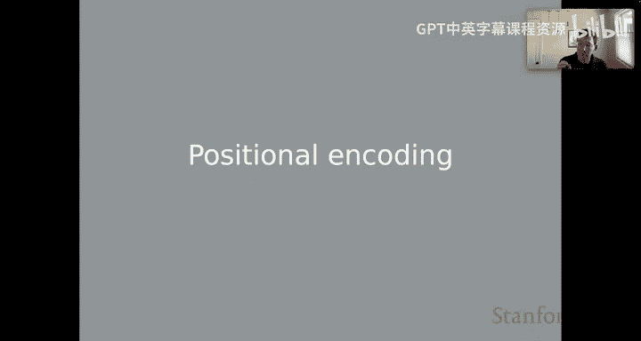
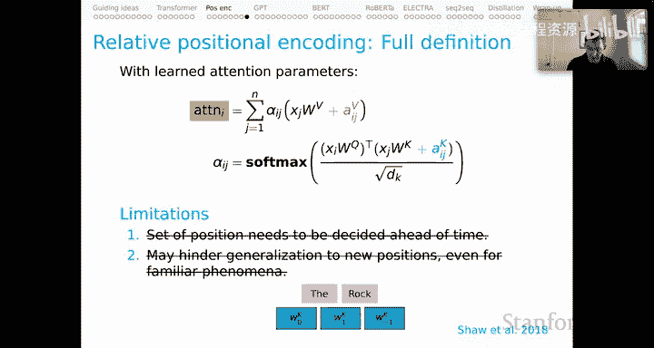

# 斯坦福大学《自然语言理解｜Stanford XCS224U Natural Language Understanding I Sp 2023》中英字幕（豆包翻译 - P6：-06-Contextual Word Representations, Part 3： Positional Encoding .zh_en - GPT中英字幕课程资源 - BV1sx4y1s7oW

Welcome back， everyone。 This is part 3 in our series on contextual representations。

 We have a bunch of famous transformer based architectures that we're going to talk about a bit later。

 But before doing that， I thought it would be good to pause and just reflect a little bit on this important notion of positional encoding。

 This is an idea that I feel the field took for granted for too long。

 I certainly took it for granted for too long。 And I think we now see that this is a crucial factor in shaping the performance of transformer based models。

😊。

Let's start by reflecting on the role of positional encoding in the context of the transformer。

 I think the central observation is that the transformer itself has only a very limited capacity to keep track of word order。

 The attention mechanisms are themselves not directional。 It's just a bunch of dot products。

 And there are no other interactions between the columns。

 And so we are in grave danger of losing track of the fact that the input sequence ABC is different from the input sequence CB B A。

Positional encodings will ensure that we retain the difference between those two sequences。

 no matter what we do with the representations that come from the model。

Kind of secondarily there's another purpose that positional encodings play which is kind of hierarchical。

 they've been used to keep track of things like premise hypothesis in natural language inference that was an important feature of the BEt model that we'll talk about a bit later in the series。

I think there are a lot of perspectives that you could take on positional encoding to keep things simple。

 I thought I would center our discussion around two crucial questions。

 The first is does the set of positions need to be decided ahead of time？And the second is。

 does the positional encoding scheme hinder generalization to new positions？

I think those are good questions to guide us one other rule that I wanted to introduce is the following。

Modern transformer architectures might impose a max length on sequences for many reasons related to how they were designed and optimized。

 I would like to kind of set all of that aside and just ask whether the positional encoding scheme itself is imposing anything about length generalization separately from all that other stuff that might be happening。

So let's start with absolute positional encoding， this is the kind of scheme that we have talked about so far on this scheme we have word representations and we also have positional representations that we have learned corresponding to some fixed number of dimensions and to get our position sensitive word representation we simply add together the word vector with the position vector。

How is this scheme doing for our two crucial questions， Well， not so well。 First， obviously。

 the set of positions needs to be decided ahead of time。 When we set up our model。

 we will have some embedding space， maybe up to 512。And if we picked 512， when we hit position 513。

 we will not have a positional representation for that position。

And I also think it's clear that this kind of scheme can hinder generalization to new positions even for familiar phenomena。

 just consider the fact that the rock as a phrase if it occurs early in the sequence。

 is simply a different representation than the rock if it appears later in the sequence。

There will be some shared features across these two as a result of the fact that we have two word vectors involved in both places。

 but we add in those positional representations as equal partners in this representation。

 And I think the result is very heavy handed when it comes to learning representations that are heavily position dependent。

 and that could make it hard for the model to see that in some sense。

 the rock is the same phrase whether it's at the start of the sequence or the middle or the end。

Another scheme we could consider actually goes all the way back to the Transer's paper I've called this frequency based positional encoding。

There are lots of ways we could set this up。 But the essential idea here is that we'll define a mathematical function that。

 given a position will give us back a vector that encodes information about that position kind of semantically in its structure in the transformer paper。

 They pick a scheme that's based in frequency oscillation。

 So essentially based in sine and cosine frequencies for these vectors。

 where higher position oscillate more frequently。 and that information is encoded in the position vector that we create。

 I think there are lots of other schemes that we could use the essential feature of this is this argument pause here。

 If you give this function position 1， it gives you a vector， if you give it 5，13。

 it gives you a vector。 If you give it a million， it gives you a vector。

 and all of those vectors manifestly do encode information about the relative position of that input。

😊，So we have definitely overcome the first limitation。

 the set of positions does not need to be decided ahead of time in this scheme because we can fire off a new vector for any position that you give us。

But I think our second question remains pressing， just as before this scheme can hinder generalization to new positions even for familiar phenomena。

 in virtue of the fact that we are taking those word representations and adding in these positional ones for different positions as equal partners as I said。

 and I think that makes it hard for models to see that the same phrase could appear in multiple places。

The third scheme is the most promising of the three that we're going to discuss。

 This is relative positional encoding。 We're going to take a few steps to build up an understanding of how this scheme works。

Let's start with a reminder， this is a picture of the attention layer of the transformer we have our three position sensitive inputs here。

 A input， B input and C input， and remember it's crucial that they be position sensitive because of how much symmetry there is in these dot product attention mechanisms。

Here's a reminder about how that calculation works with respect to position C over here。

For positional encoding， we really just add in some new parameters。

 So what I've depicted at the bottom of the slide here is the same calculation that's at the top。

 except now in two crucial places， I have added in some new vectors that we're going to learn representations for down in blue here。

 We have key representations， which get it added into this stop product。

 and we up here in the final step， we have value representations。

 which get added in to this multiplied attention mechanism， plus the thing we're attending to。😊。

So those are the new crucial parameters that we're adding in here。

 and the essential idea is that having done this with all the position sensitivity that's going to be encoded in these vectors。

 we don't need these green representations here anymore to have positional information in them because that positional information is now being introduced in the attention layer because we're going to have potentially new vectors for every combination of position as indicated by these subscripts。

But that's only part of the story。 I think the really powerful thing about this method is the notion of having a positional encoding window。

 So to illustrate that， I've repeated the core calculation at the top here as a reminder。 And now。

 for my illustration， I'm going to set the window size to2。

Here's the input sequence that we'll use as an example。

 and above that I'm going to show you just integers corresponding to the positions。

 Those aren't directly ingredients into the model， but they will help us keep track of where we are in the calculations。

To start the illustration， let's zoom in on position 4。

If we follow the letter of the definitions that I've offered so far for the key values here。

 we're going to have a vector A44 corresponding to us attending from position 4 to position 4。

As part of creating this more limited window based version of the model。

 we're actually going to map that into a single vector W0 for the keys。

Now we travel to the position one to the left， and in this case。

 we would have a vector a43 for the keys。But what we're going to do is map that into a single vector w minus1 corresponding to taking3 minus4。

When we travel one more to the left， we get a position 42。

 but now we're going to map that to vector w minus2 again for the keys。

And then because we set our window size to2， when we get all the way to that leftmost position。

 that's also just W-2 again，4-1， given the window size takes us just to the maximum of this window。

 in this case，-2。And then a parallel thing happens when we travel to the right。 So we go from 4 to 5。

 that gives us vector W1 for the keys。 Then 4，6 gives us W 2。

 And then when we get to the third position from our starting point that again。

 just flattens out to W2 because of our window size。So actually represented in blue here。

 we have just a few vectors， the 01， the minus1 and the minus21。And then the one，2 vectors。

 as opposed to all the distinctions that are made with those alpha sub 4，3 and 4，2 and so forth。

 So we're collapsing those down into a smaller number of vectors corresponding to the window size。

And then to continue the illustration， if we zoom in on position three。That would be vector A 3。

3 for the keys。 But now that gets mapped to W0 K， which is the same vector that we have up here in that 4。

4 position。 And a similar collapsing is going to happen down here。

 So when we move one to the left of that， we get -1。

 which is the same vector as we had up here just to the right。

And then we have the same thing over here， minus2 corresponding to the same vector that we had above。

And that would continue。 And we have a parallel calculation for the value parameters that you see in purple up here。

 the same notions of relative position and window size。

 So we actually learn a relatively small number of position vectors。

 And what we're doing is essentially giving a small window relative notion of position that's going to kind of slide around and give us a lot of ability to generalize to new positions based on combinations that we've seen before。

 possibly in other parts of these inputs。😊，A final thing I'll say is that this is actually embedded in that full theory of attention that might have a lot of learn parameters and might even be multiheaded。

 so what I've depicted here is just the full calculation just to really give you all the details。

 but again the cognitive shortcut is that it's the previous attention calculation with these new positional elements added in and again a reminder in this new mode we introduce position relativity in the attention layer。

 not in the embedding layer。So let's think about our two crucial questions first we don't need decide the set of positions ahead of time。

 we just need to decide on the window and then for a potentially extremely long string。

 we're just sliding it around in it using a relatively few number of positional vectors to keep track of relative position。

And I think we have also largely overcome the concern that positional embeddings might hinder generalization to new positions。

 After all， if you consider a phrase like the rock， the core position。

 vectors that are involved there are 0，1 and  -1， no matter where this appears in the string。 Now。

 depending on where it appears， there will be other positional things that are happening and other information will be brought in as part of the calculation。

 but we do have this sense of constancy that will allow the model to see that the rock is the same。

 essentially wherever it appears in the string。😊，So my hypothesis is that because we have overcome these two crucial limitations。

 relative positional encoding is a very good bet for how to do positional encoding in general in the transformer。

 and I believe that that that is now well supported by results across the field for the transformer。

