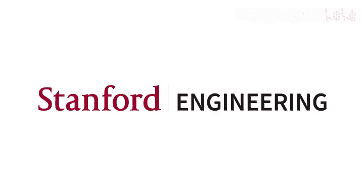
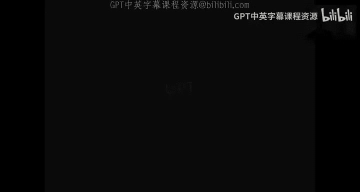
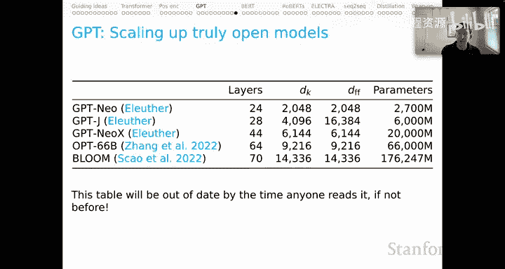

# 斯坦福大学《自然语言理解｜Stanford XCS224U Natural Language Understanding I Sp 2023》中英字幕（豆包翻译 - P7：-07-Contextual Word Representations, Part 4： GPT .zh_en - GPT中英字幕课程资源 - BV1sx4y1s7oW

Welcome back everyone， this is part four in our series oncontextual representationations。

 we have come to what might be the most famous transformer based architecture， and that is GPT。

I thought I would start this discussion in a kind of technical place。

 that is the auto regressive loss function that's usually used for neural language modeling。

 And then I'm going to try to support that technical piece with a bunch of illustrations。

 So here is the full loss function。 there are a lot of mathematical details here。

 I think the smart thing to do is zoom in on the numerator。

 What we're saying here is that at position T。 We're going to look up the token representation for T in our embedding layer。

And do a dot product of that vector representation with the hidden representation that we have built up in our model to the time step precing the one that is in focus here。

 time step T。The rest of this is kind of softm normalization。

 So we do that same calculation for every item in the vocabulary， and then we take the log of that。

 and we are looking for parameters that will maximize this log probability。 But again。

 the thing to keep an eye on is that the scoring is based in the dot product of the embedding representation for the token we want to predict and the hidden representation that we have built up until the time before that time step。

😊，So here's that same kind of thing by way of an illustration。 Our sequence is the rock rules。

 And for this kind of language modeling， I think it's good to keep track of start and end tokens here。

 So we begin modeling with that start token， which is kind of given that is at position T1。

 And we look up its embedding representation， And then we form some kind of hidden representation H1。

Then to predict the， which is now at time step2。We are going to use H1 here dot product with the embedding representation for the。

 remember that's the numerator in that scoring function。At time step 2。

 we now copy over the and we continue， we get its embedding representation and here I'm depicting like a recurrent neural network。

 so we're traveling left to right just to keep things simple。

 I'll talk about how GT handles this in a bit later。

 So we traveled left to right and we got a second hidden representation H2。 and again。

 the scoring is the same to predict the rock at position 3。 We use H2 and the embedding for rock。

And then the sequence modeling continues in exactly that same way until we predict our end token。

But for each one of these time steps， remember what we're doing is getting a score for the rock that is proportional to the dot product of the embedding for that token and the hidden representation just prior to that point that we're making the prediction at。

 and then we exponentiate that for the sake of doing that softmax scoring。When we move to GPT。

 we're essentially just doing this in the context of a transformer。

 so kind of to depict that I've got at the bottom here a traditional absolute encoding scheme for positions。

We look up all those static vector representations and we get our first contextual representations in green as usual。

 and then for GPT we might stack lots and lots of transformer blocks on top of each other。Eventually。

 though we will get some output representations， those are the ones that I've depicted in green here。

 and those will be the basis for language modeling。

 so we will add on top of those some language modeling specific parameters。

 which could just be the embedding layer that comes from the word embeddings down here。

And that will be the basis for predicting the actual sequence。

 and so we get an error signal to the extent that we're making predictions into the space that don't correspond to the actual one hot encoding vectors that correspond to the sequence itself。

In essence， though， this is just more of that conditional language modeling using the transformer architecture。

 Maybe the one thing to keep in mind here is that because of the nature of the attention mechanisms。

 we need to do some masking to make sure that we don't， in effect， look into the future。

So let's build that up a little bit。 We start with position A。And at that first position。

 the only attending we can do is to ourselves because we can't look into the future。

 I haven't depicted that， but we could do self attention。When we move to position B。

 we now have the opportunity to look back into position A and get that dot product。

 And we could self attend， as I said before， although I didn't depict that。 And then finally。

 when we get to position C， we can look back to the previous two positions。

So the attention mask is going to have this look where we go backwards。

 but not forwards so that we don't end up looking into the future into tokens that we have not yet generated。

So in a little more detail and I would kind of like to belabor these points because there are a lot of technical details hiding here。

 what I'm going to depict on this slide is very specifically training of a GPT style model with what's called teacher forcing and this is going to mean that no matter what token we predict at every time step。

 we will use the actual token at the next time step。So let's be really pedantic about this。

 At the bottom here， I have our input sequence as represented as a series of one hot vectors。

 These are kind of lookup devices that will give us back the embedding representations for words from our embedding space。

Here's our embedding space in gray。 And so we do those lookups。 and that gives us a bunch of vectors。

 And as a kind of shorthand， I have depicted the names of those vectors B for beginning of sequence the rock rules。

 That's the sequence there。Then we have a whole bunch of those transformer blocks。

 And what I've done is summarize them in green here。 And just reminder。

 I've got all those arrows showing you the attention patterns so that we always look into the past。

 but never into the future。Then on top of that， we're going to use our embedding parameters again。

 So these are the same parameters that I've got depicted down here。

And now we are going to compare essentially the scores that we predict in each one of those spaces with the one hot inves。

1 hot vectors that actually correspond to the sequence that we want to predict。

 So this was the start token。 And conditional on that， we want to predict the。

This is the down here and conditional on that we want to predict rock and so forth。

 you do get this offset where the input sequence and the output sequence are staggered by one so that we're always conditional on what we've seen predicting the next token。

Imagine that these are the scores that we get out of this final layer here。

 I've depicted them as integers， but they could be floats。

And the idea is that that is the comparison that we make to get our error signal。

 We can look at the difference between this vector here and this vector here and use that as a gradient signal to update the parameters of the model。

 And that's how this actually happens in practice。 We always think of language modeling as predicting tokens。

 But really， and truly， it predicts scores over the entire vocabulary。

 And then we make a choice about which token was actually predicted by， for example。

 picking the token that had the largest score。And this。

 I've mentioned teacher forcing in this context， this is really important here。

 I think we should imagine that at this time step here。

 what the model did is give the highest score to whatever word was in the final position here。

But the actual token was rules， so this will give us an error signal because we have in effect。

 made a mistake that we can learn from。The teacher forcing aspect of this is that I do not use the vector consisting of all zeros and a1 down here at this time step。

 but rather I use the actual token。If we back off from teacher forcing。

 we could go into a mode where at least some of the time we used the vector consisting of all zeros and a1 down here as the input at the next time step。

 and that would effectively be using the model's predictions rather than the gold sequence as part of training and that could introduce some useful kind of diversity into the learned representations。

 but usually we do something like teacher forcing where even though we got an error signal here。

 we use the actual thing that we wanted to have predicted down at the next time step。

That is part of training the model。 And then when we move to generation。

 we do something that's very similar， although with some twists。

 What I've depicted on the slide here is something like imagining that the user has prompted the model with the sequence start token and the。

And the model has predicted rock as the next sequence。 So we copy that over that representation。

 We process with the transformer as usual， and we get another prediction。 In this case。

 it was the sequence rolls。 So now we have generated the rock rolls as our sequence。

 We copy that over into the next time step。 And then we get along as the next token。

 Notice that you might have expected that this would be the rock rules。

 and the model ended up predicting something different。 That might be in its nature。

 Maybe that was a mistake， maybe it wasn't。 But the point is that in generation。

 we no longer have the possibility of doing teacher forcing because we are creating new tokens。

 And so we have to use the scores that we got up here to infer a next token。 Copy that over。

 condition the model on that and have the generation process repeat。

But throughout this entire process， again， a reminder， the model does not predict tokens。

 The model predicts scores over the vocabulary as depicted here。

 and we do some inferencing to figure out which token that ought to be。

 And as we'll discuss later in the course， there are lots of schemes for doing that kind of sampling。

 you could pick the max scoring one， but you could also roll out over a whole bunch of time steps。

 looking at all the different predictions and predict and generate the sequence that kind of maximizes that overall probability that would be more like beam search。

 and that's very different from the kind of maximum probability step that I'm depicting here。

And that's a nice reminder that in generation， what we're doing is applying a decision rule on top of the representations that these models have created。

 And it's kind of not so intrinsic to the models themselves that they follow that particular decision rule。

 That's a complexity of generation。Final step here when we think about fine tuning G。

 the standard mode is to process a sequence and then use the final output state as the basis for some task。

 specific parameters that you use to fine tune on whatever supervised learning task you're focused on。

 but of course， we're not limited to do that， we could also think about using all of the output states that the model has created maybe by doing some kind of max or mean pooling over them to gather more information from the sequence than is just contained in that final output state。

 But like， for example， in the first G paper。 their fine tuning is based entirely， I believe。

 on that final output state。To round this out， I thought I'd just show you some GTs that have been released。

 along with some information about how they're structured to the extent that we know how they're structured。

 so the first GP had 12 layers and a model dimensionality of 768 and a feed forward dimensionality of 3072。

 That's that one point in the model where you can expand out before collapsing back to decay inside the feed forward layers。

And that gave rise to a model that had 117 million parameters。

GP T 2 scaled that up considerably to 48 layers，1600 dimensionality for the model and 1600 for the feed forward layer for a total of about 1。

5 billion parameters。And then G 3 had 96 layers and a massive model dimensionality。

 almost over 12000 for its model dimensionality。 As far as I know。

 we don't know the dimensionality of that inside feed forward layer， but it might also be 12000。

 And that gave rise to a model that had 175 billion parameters。And by the way。

 the G3 paper reports on models that are kind of intermediate in those sizes。

 All of those models are from open AI。 If you want to think about truly open alternatives。

 here is a kind of fast summary of the models that I know about This table is probably already hopelessly out of date by the time you are viewing it。

 But it does give you a sense， for the kinds of things that have happened on the open source side。

 And I would say that the hopeful aspect of this is that there are a lot of these models now。

 and some of them are quite competitive in terms of their overall size。 For example。

 the bloom model there has a hundred and 76 billion parameters and is truly gargantuan in terms of its dimensionalities and so forth。

 And there are other some other smaller ones here that are obviously very performanceant。

 very powerful， very interesting artifacts in the G mode。

