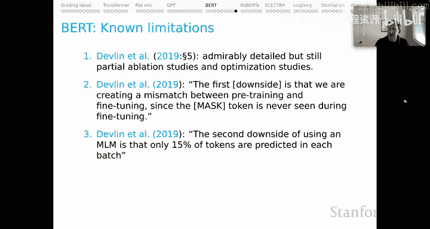

# 斯坦福大学《自然语言理解｜Stanford XCS224U Natural Language Understanding I Sp 2023》中英字幕（豆包翻译 - P8：-08-Contextual Word Representations, Part 5： BERT .zh_en - GPT中英字幕课程资源 - BV1sx4y1s7oW

Welcome back everyone， this is part five in our series on contextual representations。

 we're going to focus on Bert， Bert is the slightly older sibling to GPT but arguably just as important and famous。

Let's start with the core model structure for Bert。

 this is mostly going to be combinations of familiar elements at this point。

 given that we've already reviewed the transformer architecture in Bt as essentially just an interesting use of the transformer。

As usual to illustrate， I have our sequence the rock rules at the bottom here。

But that sequence is augmented in a bunch of Bt specific ways。 So all the way on the left here。

 we have a class token。 that's an important token for the Bt architecture。

 Every sequence begins with the class token。 That has a positional encoding。

 we also have a hierarchical positional encoding。 This is given by the token sent A。

 this won't be so interesting for our illustration， but as I mentioned before。

 for problems like natural language inference， we might have a separate token for the premise and a separate one for the hypothesis to help encode the fact that a word appearing in the premise is a slightly different occurrence of that word that when it appears in a hypothesis。

 and that generalizes to lots of different kinds of hierarchical position for different tasks that we might pose。

But we have this very position sensitive encoding of our input sequence。

We look up the embedding representations for all those pieces as usual。

 and then we do an additive combination of them to get our first context sensitive encoding of this input sequence in these vectors that are in green here。

And then just as with GPT， we have lots of transformer blocks。

 potentially dozens of them repeated until we finally get to some output states which I've given in dark green here and those are going to be kind of the basis for further things that we do with the model。

That's the structure。 Let's think about how we train this artifact。

 The core objective is masked language modeling or MLM。

 and the idea here is essentially that we're going to mask out or obscure the identities of some words in the sequence and then have the model try to reconstruct the missing piece。

So for our sequence， we could have a scenario where we have no masking on the word rules。

 but we nonetheless the train the model to predict rules at that time step。

 That might be relatively easy as a reconstruction task。 harder we'll be doing masking。

 So in this case， we have a special designated token that we insert in the place of the token rules。

 And then we try to get the model to a state where it can reconstruct that rules was the missing piece using the full bi directional context around that point。

And then relatedly， in addition to masking， we could do random word replacement。

 so in this case we simply take the actual word in this case。

 rules and replace it with a random one like every。

 and then try to have the model learned to predict what was the actual token at that position。

And all of these things are using the bidirectional context of the model in order to do this reconstruction task。

When we train this model， we mask out only a small percentage of all the tokens。

 mostly leaving the other ones in place， so that the model has lots of context to use to predict the masked or missing or corrupted tokens。

 That's actually a limitation of the model and if inefficiency and the MLM objective that E in particular。

 will seek to address。Here's the MLlM loss function in some detail。 again。

 as before with these loss functions， there are a lot of details here。

 but I think the crucial thing to zoom in on is first the numerator。 It's very familiar from before。

 we're going to use the embedding representation of the token that we want to predict and we're going to get a dot product of that with a model representation in this case。

 we can use the entire surrounding context leaving out only the representation at T。

 whereasas for the autoregressive objective that we reviewed before。

 we could only use the preceding context to make this prediction。

The other thing to notice here is that we have this indicator function M T here。

 which is going to be one if we're looking at a mass token and0 otherwise。

 And so what that's essentially doing is turning off this objective for tokens that we didn't mask out。

 So we get a learning signal only from the mass tokens or the ones that we have corrupted。

And that again feeds into a kind ofef inefficiency of this objective because we in effect。

 do the work of making predictions for all the time steps。

 but get an error signal for the loss function only for the ones that we have designated as masked in some sense。

For the Bert paper， they supplemented the MLM objective with a binary neck sentence prediction task。

 So in this case， we use our corpus resources to create actual sentence sequences with all of their special tokens in them。

 And for sequences that actually occurred in the corpus， we label them is next。

 And then for negative instances， we have randomly chosen sentences that we pair up and label them as not next。

 The motivation for this part of the objective is to help the model learn some discourse level information as part of learning how to reconstruct sequences。

 And I think that's a really interesting intuition about how we might bring an even richer notions of context into the transformer representations。

😊，When we think about transfer learning or fine tuning。

 there are a few different approaches that we can take。

 here's a depiction of the transformer architecture and the standard lightweight thing to do is to build out task parameters on top of the final output representation above the class token。

 I think that works really well because the class token is used as the first token in every single sequence that Bt processes and it's always in that fixed position so it becomes a kind of constant element that contains a lot of information about the corresponding sequence。

 So the standard thing is to build like a few dense layers on top of that and then maybe do some classification learning there。

But of course， as with GPT we shouldn't feel limited by that and a standard alternative to this would be to pool together all of the output states and then build the task parameters on top of that kind of mean pooling or max pooling or whatever decision you use to bring together all of the output states to make predictions for your task and that can be very powerful as well because you bring in much more information about the entire sequence。

I thought I would remind you a little bit about how tokenization works。

 Remember that Bert has this tiny vocabulary and therefore a tiny static embedding space。

 and the reason it gets away with that is because it does wordpiece tokenization。

 which means that we have lots of these word pieces indicated by these double hash marks here。

 and that means that the model essentially never unts out any of its input tokens。

 but rather breaks them down into familiar pieces， and then the intuition is that the power of mass language modeling in particular will allow us to learn internal representations of things that correspond even to words like end code which got spread out over multiple tokens。

Let's talk a little bit about core model releases for the original Bt paper。

 I believe they just did Bt base and Bert large incased and uncased variant。

 I would recommend always using the cased ones at this point。 Very happily， lots of teams。

 including the Google team have worked to develop even smaller ones。 So we have tiny。

 many small and medium as well。 And this is really welcome because it means you can do a lot of development on these tiny models and then possibly scale up to larger ones。

 So， for example， Bert tiny has just two layers that is two transformer blocks。

 relatively small model dimensionality and relatively small expansion inside its feed forward layer for a total number of parameters of only 4 million。

 I will say that that is tiny， but it's surprising how much juice you can get out of it when you fine tune it for tasks。

😊，But then you can move on up to many small medium and then large is the largest from the original release at 24 layers。

 relatively large model dimensionality， relatively large feed forward layer for a total number of parameters of around 340 million。

All of these models， because all of them， as far as I know， use absolute positional embeddings。

 have a maximum sequence length of 512， and that's an important limitation that increasingly we're feeling is constraining the kinds of work we can do with models like BRT。

There are many new releases and I would say to stay up to date you could check out Huging faceace which has variants of these models for different languages and maybe some different sizes and other kinds of things。

 maybe for example， there are by now versions that use relative positional encoding。

 which would be quite welcome I would say。For Bert， some known limitations。

 And this will kind of feed into subsequent things that we want to talk about with Roberta and Era。

 especially。 First， the original Bt paper is admirably detailed。

 but it's still very partial in terms of ablation studies and studies of how to effectively optimize the model。

 And so that means that we might not at the be looking at the very best Bt that we could possibly have if we explored more widely。

Devvelin et al also observe a downside。 They say the first downside is that we're creating a mismatch between pretraining and fine tuning since the mask token is never seen during fine tuning that is indeed unusual。

 remember the mask token is a crucial element in training the model against the MLM objective。

 you introduce this foreign element into that phase that presumably you never see when you do fine tuning and that could be dragging down model performance。

And the second downside that they mentioned is one that I mentioned as well。

 We're using only around 15 per of the tokens to make predictions。

 We do all this work of processing these sequences。

 but then we turn off the modeling objective for the tokens that we didn't mask and we can mask only a tiny number of them。

 because we need the bidirectal context to do the reconstruction。

 That's kind of the essence of the intuition there。 So that's obviously in the inefficient。

 And the final one is kind of intriguing。 I'll mention this only at the end of this series。

 This comes from the Excelelnet paper。 And they just observe that Bt assumes the predicted tokens are independent of each other。

 Given the unmask tokens， which is oversimplified as high order。

 longrad dependency is prevalent in natural language。

 And this is just the observation that if you do happen to mask out two tokens like new and York from the place name New York。

 the model will try to reconstruct those two tokens independently of each other。

 even though we can see that they have a very clear。

Statistic dependency the Bt objective simply misses that。

 and I'll mention later on about how ExcelNe brings that dependency back in。

 possibly to very powerful effect。

