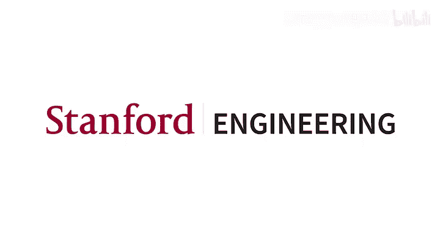
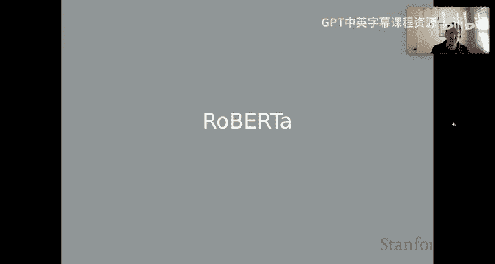
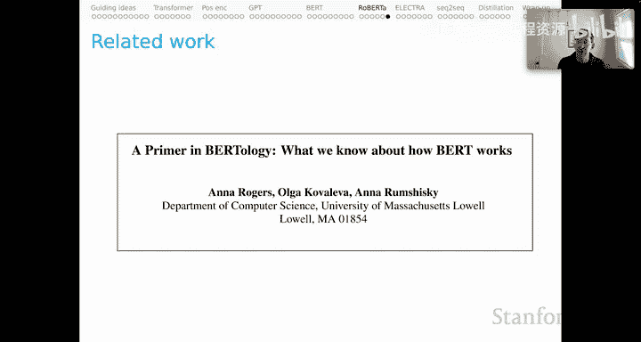

# 斯坦福大学《自然语言理解｜Stanford XCS224U Natural Language Understanding I Sp 2023》中英字幕（豆包翻译 - P9：-09-Contextual Word Representations, Part 6： RoBERTa .zh_en - GPT中英字幕课程资源 - BV1sx4y1s7oW

Welcome back， everyone。 This is part 6。 In our series on contextual representation。

 We're going to focus on Roberta。 Roberta stands for robustly optimized Bt approach。

 You might recall that I finished the Bt Sccast by listing out some key known limitations of the Bt model。

 And the top item on that list was just an observation that the Bt team originally did an admirably detailed。

 but still very partial set of ablation studies and optimization studies。

 So that gave us gave us some glimpses of how to best optimize Bt models。

 but it was hardly a thorough exploration， and that's where the Roberta team is going to take over and try to do a more thorough exploration of this design space。

 I think this is a really interesting development， because at a kind of meta level。

 it points to a shift in methodologies。 The Roberta team does do a much fuller exploration of the design space。

 But it's nowhere near the kind of exhaustive exploration of hyperparm。😊。

That we used to see， especially in the prede learning era。

 And I think what we're seeing with Roberta is that it is simply too expensive in terms of money or compute or time to be completely thorough。

 And so even Roberta is a kind of very heuristic and partial exploration of the design space。

 But nonetheless， I think it was extremely instructive。

For this slide I'm going to list out kind of key differences between Bert and Roberta。

 and then we'll explore some of the evidence in favor of these decisions just after that。

First item on the list， Bert used a static masking approach and what that means is that they copied their training data some number of times and applied different masks to each copy。

 but then that set of copies of the dataset with its masking was used repeatedly during Epochs of training and what that means is that the same masking was seen repeatedly by the model。

You might have an intuition that will get more and better diversity into this training regime if we dynamically mask examples。

 which would just mean that as we load individual batches。

 we apply some random dynamic masking to those so that subsequent batches containing the same examples have different masking applied to them。

Clearly， that's going to introduce some diversity into the training regime and that could be useful。

For Bert， the inputs to the model were two concatenated document segments and that's actually crucial to their next sentence prediction task。

 whereas for Roberta inputs are sentence sequences that may even span document boundaries Obviously that's going to be disruptive to the next sentence prediction objective but correspondingly。

 whereas Bt had that NSP objective， Roberta simply dropped it on the grounds that it was not earning its keep。

For Bert， the training batches contained 256 examples。 Roberta up that to 2000 examples per batch。

 a substantial increase。Burt used a wordpiece tokenizer。

 whereas Roberta used a character level byte pair encoding algorithm。

Bert was trained on a lot of data。 Book Corpus and English Wikipedia。

 Roberta leveled up on the amount of data by training on books Corpus， Wikipedia， C News。

 open web text and stories。 And the result of that is a substantial increase in the amount of data that the model saw。

Bert was trained for 1 million steps， whereas Roberta was trained for 500000 steps。Pause there。

 you might think that means Roberta was trained for less time。

 but remember the batch sizes are substantially larger。

 and so the net effect of these two choices is that Roberta was trained for a lot more。Instances。

And then finally， for the Bt team， there was an intuition that it would be useful for optimization to train on short sequences first。

 the Roberta team simply dropped that and trained on full length sequences throughout the training regime。

I think those are the high level changes between Bert and Roberta。

 there are some additional differences and I refer to Section 3。

1 of the paper for the details on those。Let's dive into some of the evidence that they used for these choices。

 beginning with that first shift from static masking to dynamic masking。

 This table summarizes their evidence for this choice。 they're using squad。

 multinli and binary Stanford sentimentment tree Bank as their kind of benchmarks to make this decision。

 And you can see that for Squa and SST， there's a pretty clear win， dynamic masking is better。

 for multinli， it looks like there was a small regression， but on average。

 the results look better for dynamic masking。 And I will say that to kind of augment these results。

 there is a clear intuition that dynamic masking is going to be useful。

 And so even if it's not reflected in these benchmarks。

 we might still think that it's a wise choice if we can afford to train in that way。

We talked briefly about how examples are presented to these models。

 I would say the two competitors that Roberta thoroughly evaluated were full sentences and doc sentences。

 so doc sentences will be where we limit training instances to pairs of sentences that come from the same document。

 which you would think would give us a clear intuition about kind of something like discourse coherence for those instances。

We can also compare that against full sentences in which we present examples。

 even though they might span document boundaries， and so we have less of a guarantee of discourse coherence。

Although doc sentences comes out a little bit ahead in this benchmark that they have set up across squad。

 multianai， SS S T2 and race， they chose full sentences on the grounds that there is more at play here than just accuracy。

 We should also think about the efficiency of the training regime。

 And since full sentences makes it much easier to create efficient batches of examples。

 They opted for that Instead。 And so that's also very welcome to my mind because it's showing， again。

 that there's more at stake in this new era than just accuracy。

 We should also consider our resources。This table summarizes their evidence for the larger batch sizes。

 they're using various metrics here， perplexity， which is a kind of pseudo perplexity given that Bert uses bidirectional context and they're also benchmarking against multinLI and SST2。

 and what they find is that clearly there's a win for having this very large batch size at 2000 examples。

And then finally， just the raw amount of data that these models are trained on is interesting。

 And also the amount of training time that they get。

 And so what they found is that they got the best results for Roberta by training for as long as they could possibly afford to on as much data as as they could include。

 So you can see the amount of data going up to 160 gig here versus the largest Bt model at 13。

 a substantial increase。 The step size going all the way up to 500000， Where for Bt。

 it was a million， But remember， overall， there are many more examples being presented as a result of the batch size being so much larger。

 larger for the Roberta models。And so again， kind of another familiar lesson from the Deep learning era。

 more is better in terms of data and training time。

 especially when our goal is to create these pretrained artifacts that are useful for fine tuning。

To round this out， I thought I'd mention that the Roberta team released two models base and large。

 which are kind of directly comparable to the corresponding Bt artifacts。

 The base model has 12 layers， dimensionality of 7。

68 and a feed forward layer of 3072 for a total of 125 million parameters。

 which is more or less the same as Bt base， and then correspondingly。

 Bt large has all the same basic settings as Bt base， and correspondingly。

 essentially the same number of parameters at 355 million。As I said at the start of this screencast。

 Roberta was thorough， but even that is only a very partial exploration of the full design space suggested by the Burt model。

 For many more results。 I highly recommend this paper， a primer in Btology from Rogers at all。

 It's a little bit of an old paper at this point。 So lots has happened since it was released。

 but none the， it's very thorough and contains lots of insights about how best to set up these Bt style models for doing various things in NLP。

 So highly recommended as a companion to this little screencast。😊。

