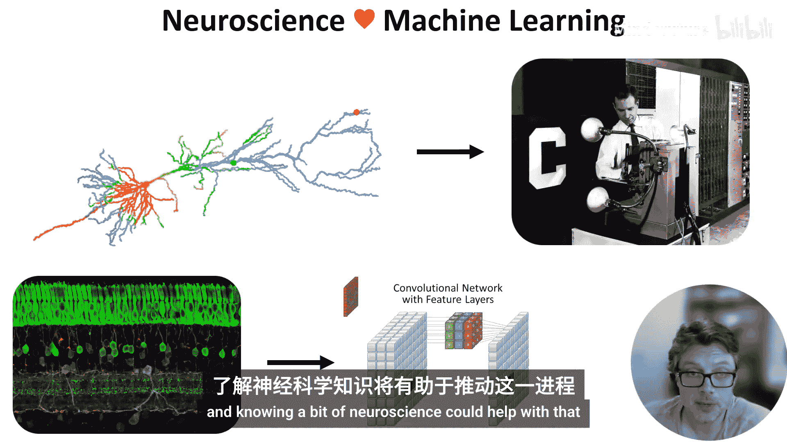
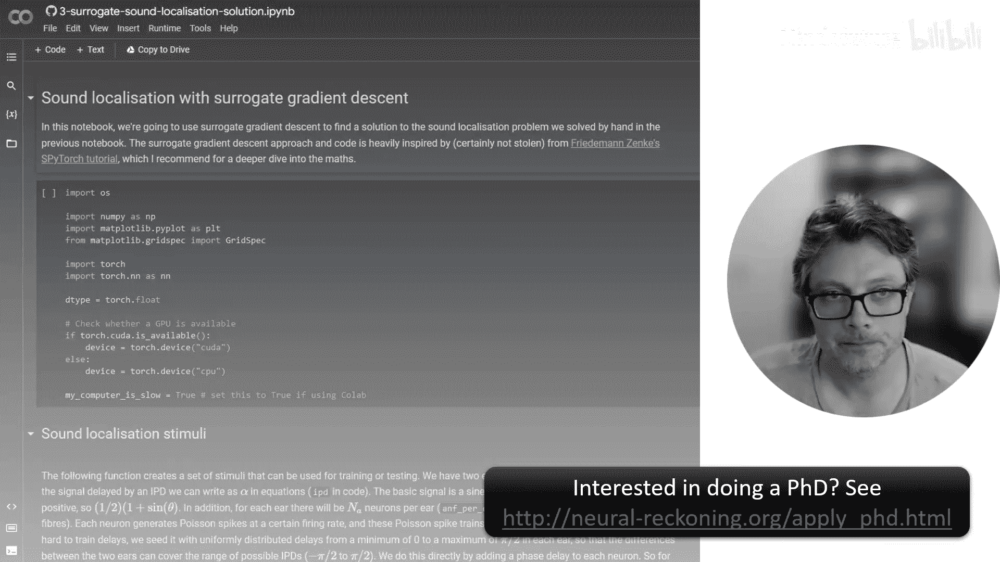

# 机器学习人员的神经科学 ｜ Neuroscience For Machine Learners p01 P01_W0_V0-Why_neuroscience -BV1MiawzJExR_p1-

Welcome to Neuroscience for Mach learners。 As the name suggests。

 this course is intended for people with a background in machine learning who want to learn a bit about neuroscience。

 It runs in person at Imperial College， London， as well as being freely available online。

So let's start this first video by talking about why you should be interested in neuroscience。Well。

 one reason is that machine learning and neuroscience had a really rich history of influencing each other from the neuron to the perceptron or from the retina to the convolutional neuron network。

In recent years， they have started to drift apart， but that could change。

 and knowing a bit of neuroscience could help with that。

After all， the human brain can still easily solve some tasks that we can't yet easily solve with machine learning。

 so how does it do that？Well， honestly， we don't know yet。

 but we do know some pretty crazy and fascinating stuff about the mechanisms the brain uses。

Like the incredibly energy efficient way that brain cells signal to each other that is neither fully digital nor fully analog。

Now， some of the brain things the brain does are probably not relevant to machine learning。

 but some of them probably are since they're solving many of the same problems。

And knowing about different approaches to intelligence taken by natural and artificial systems。

And their different constraints can help enrich our thinking about both。😊。

So that's the approach we'll be taking in this course。

 we'll mostly avoid talking about neuroscientists current theories about how the brain puts everything together since like in all of science。

 those ideas are probably going to turn out to be wrong and mine included。😊，Instead。

 we'll focus on what we do know about the brain and use those ideas playfully and creatively。

And if along the way， you discover you actually do want to understand how the brain works。

 then this course can be a first step in that journey too。

