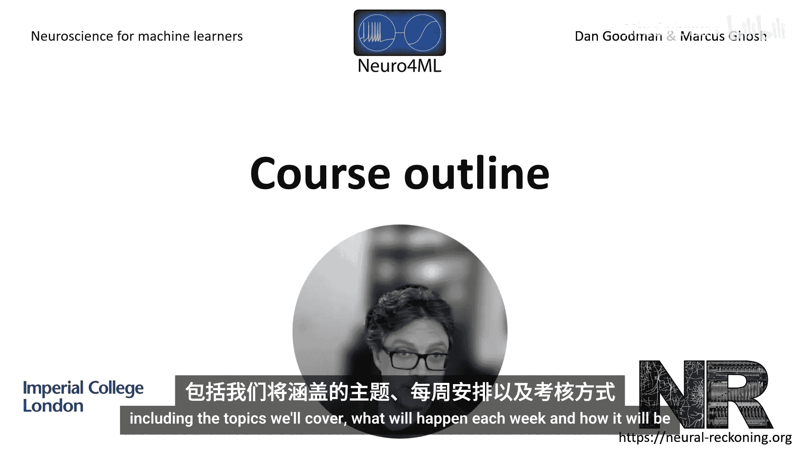
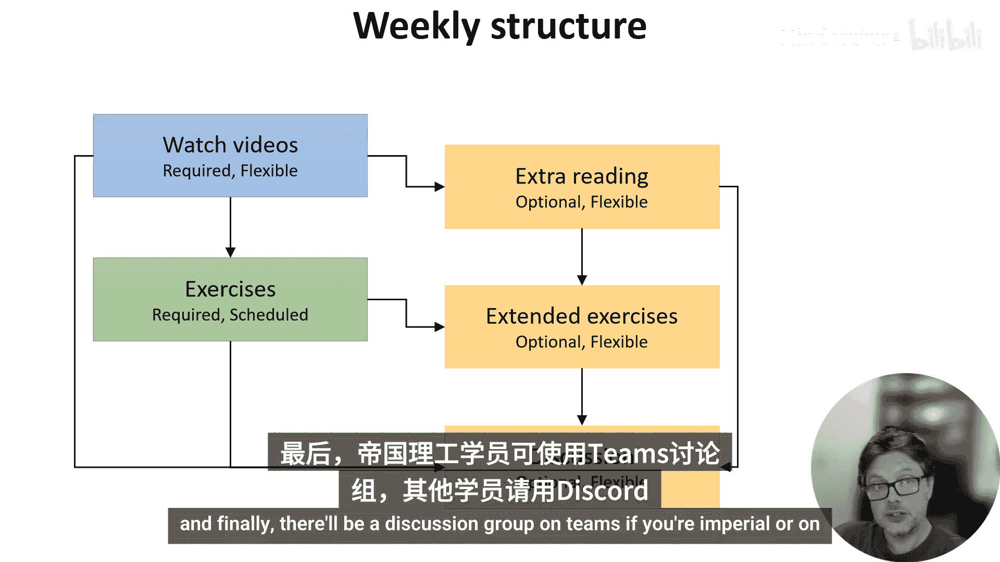
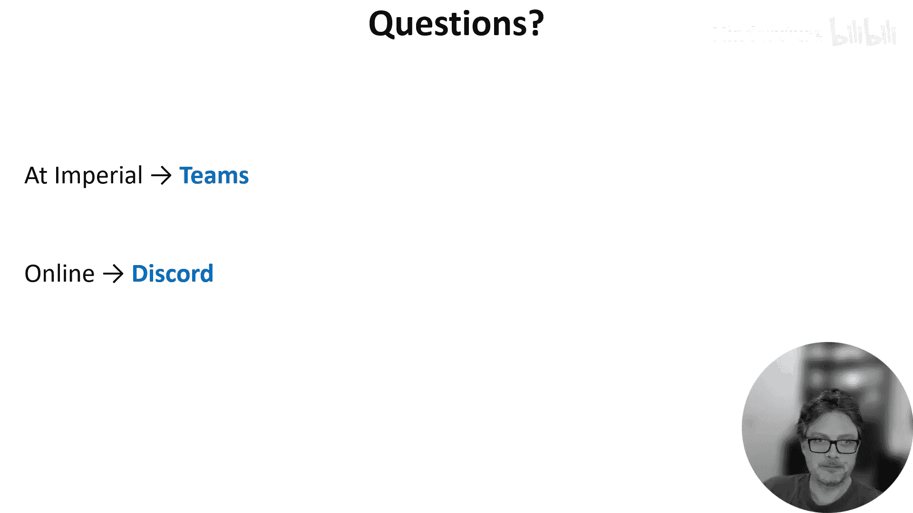

# 机器学习人员的神经科学 ｜ Neuroscience For Machine Learners p02 P02_W0_V1-Course_outline -BV1MiawzJExR_p2-

In this video， I'm going to give an outline of the general structure of this course。

 including the topics we'll cover what will happen each week and how it will be assessed。

So let's start with the topics。 broadlyadly speaking， it comes down to four parts。

 Part1 is about the structure of the brain， how it's composed of brain cells。

 called neurons connected via synapsis and divided into different regions。

We'll also talk about how these cells communicate and compute with these signals and the models we use to try and understand this。

In part two， we'll focus specifically on learning， what we know about how learning happens in the brain。

 some models of this and how those models might relate to learning and machines。

The third part of the course is about some of the theories that have been proposed about how the brain puts all these mechanisms together。

We'll start from some methodological approaches to how you might go about understanding a brain。

 and these also apply to understanding an artificial neural network and then we'll look at some theories of how the brain might be solving some particular sorts of tasks。

In the final part we'll discuss prospects for the future。

 we'll talk about neuromorphic computing that is a specialized hardware designed to mimic some aspects of how the brain functions。

 and we'll also talk about some more recent developments in neuroscience that we still don't quite know what to make of。

The course uses a flipped classroom approach。 That means that rather than sit down and listen to me talk for a couple of hours each week and then go off and try to understand the material on your own。

 we flip that。Each week you watch a series of short videos like this one that cover the essential material。

 and you might also want to do some extra reading around these topics。

Then in our scheduled class time， you'll work in small groups doing coding based exercises and we will be around to support you more interactively in that。

You can also continue after the scheduled time if you don't finish or if you want to take it further。

Unfortunately， we weren't about to do interactive sessions online。

 but you will have access to all of those exercises。And finally。

 there will be a discussion group on teams if you're imperial or on discord otherwise。

Finally， for those studying at Imperial， this course will be assessed。

 and there are three assessment points。First， there are two pieces of coursework。

 each worth 40% of the final grade。These will be done in groupss of two and will be coding based。

We'd encourage you to use Python notebooks， and the easiest way to do so is to use Google Coab。

 which we will set up for you with zero installation required。

And you can even claim back the cost of a Google or Co Lab Pro account for the term。

Assessment will be partly done by your peers that is everyone will read and assess each other's notebooks the reasoning behind doing this is to encourage you to present your work clearly and to let you learn from the different approaches and strategies taken by different groups。

We'll make a detailed guide available when you're given the first quarter work assignment。

And the third and final assessment point is an online multiple choice quis at the end of the term worth 20% of the total mark。

If you've got any further questions， please ask on Team if you're impmerial or on Discord if you're following online。

 and I hope you'll enjoy the course。

