# 机器学习人员的神经科学 ｜ Neuroscience For Machine Learners p03 P03_W0_V2-History_of_neuroscience_and_machine_learning -BV1MiawzJExR_p3-

Neuroscience， machine learning and computing more generally have had a long and rich history of influencing each other。

 and there's no way I can cover everything that could be said about that。

 So in this video I just want to pick out just a few threads in that history and show how the influence goes both ways。

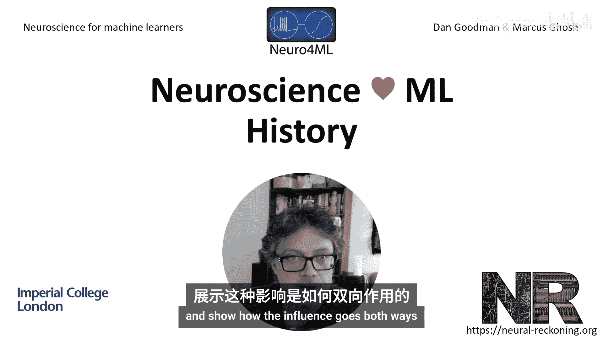

Let's start by talking about the idea of the neural network。

One of the first papers to mathematically model this was from McCican Piitz in 1943。

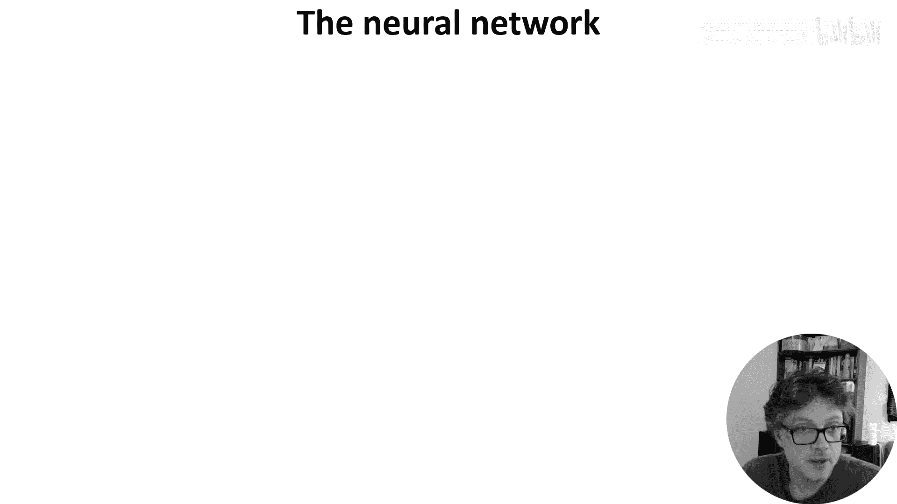

And this ultimately led to the modern study of neural networks in both biology and machine learning。

Their approach was to take what was known at that time about the biological neurons。

 explicitly acknowledge what they still didn't know and create an abstract model that would work even with future findings。

And this model is essentially equivalent to the modern artificial neuro。

 except that input and output activations of binary and weights are plus or minus1。😊。

This matched what was known at the time that biological neurons communicate via discrete all or nothing bursts of activity called action potentials or spikes that we'll come back to next week。

Even today， this is not a terrible model of networks of neurons。

 although it does miss out on a lot of the interesting temporal dynamics that we'll talk about throughout this course。

The main result they showed was that the class of functions conutable by these networks was equivalent to propositional logic。

 In other words， you could implement any logical function with neural networks and vice versa。

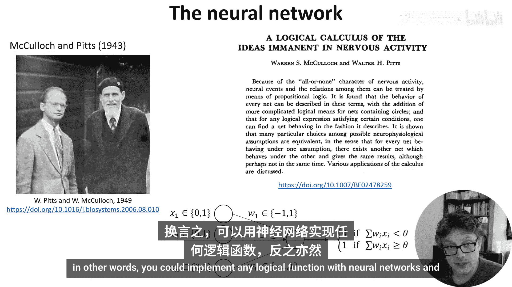

As a brief inlude， I just wanted to mention that McCella and Piitz's work and the biology of the brain was a direct inspiration to John Von Lehman。

 who created the architecture of the modern digital computer。

You can see here， he states that the CPU and the RA correspond to the associative neurons in the human nervous system。

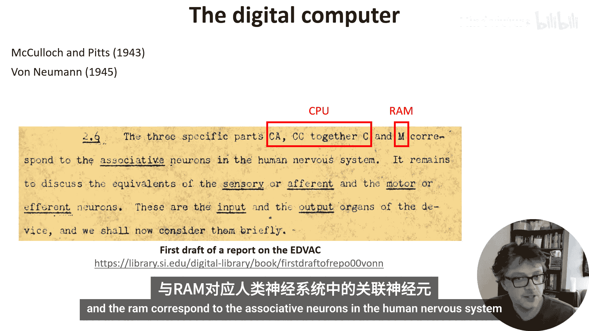

The next major development in the neural network concept was from Frank Rosenblatt。

 who invented the Perceptron model that is still used in a modified form today。

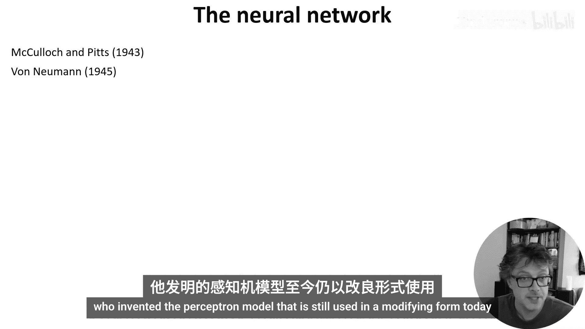

And yes， he did actually build it with wires because they didn't have computers that could simulate them at that time。

It had 512 modifiable connections and filled an entire room using motors to modify the weights。

Roosenbat's insight was that the Macallican Ps model and its close links with proposition logic was too rigid to handle the statistical problems the brain has to contend with。

😊，Namely， that biological networks seem to be wider， at least partly randomly。They're very noisy。

 and so is the input data from the world they're handling。

So the model he came up with is actually fairly complicated， and I won't go into it in detail。

 like McCella can Pi it uses binary activations and had a recurrent structure and temporal dynamics inspired by what was known from biology at the time。

😊，Later work simplified it to the form you've probably seen before here in this equation。

The key result of this work was to show that given enough training data from a distribution。

 the test accuracy on different samples from the same distribution approaches the training accuracy。

 And that was something that wasn't true of the earlier approaches and definitely something that would be an important property for understanding the brain。

And just to show that it is still relevant， one of my papers in 2013 was actually to show that the perceptrum was statistically a better model of mammalian sound localization than either of the two dominant models current at that time in the field。

😊。

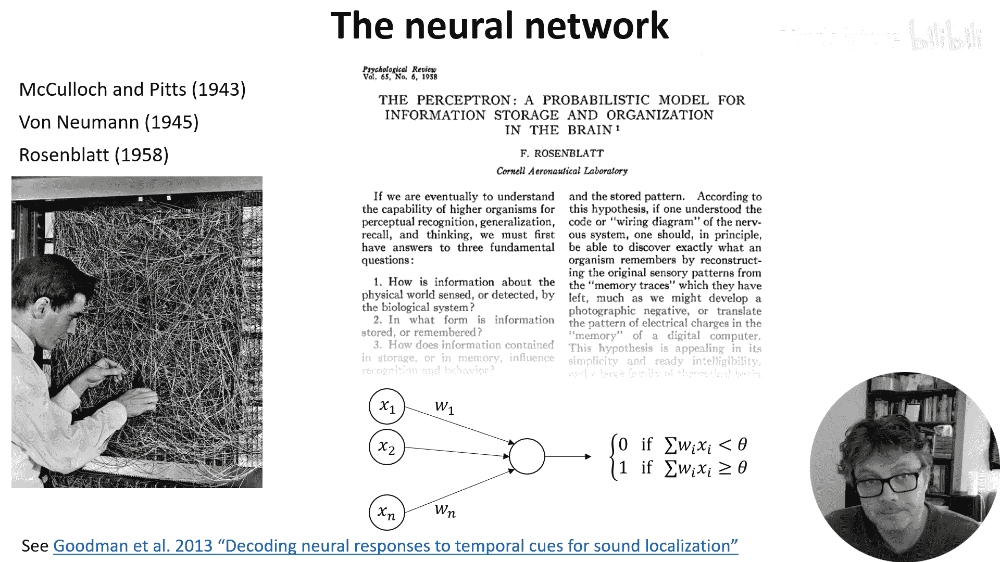

The next development I have to talk about is Minsky's criticisms of the perceptionceptron。 Now。

 I won't say much about this since it doesn't bear directly on neuroscience。

 but it feels wrong not to mention it at all。During the 1960s。

 Marvin Minsky started criticizing the perceptron， ultimately leading to a book in 1969 that's credited with ending funding for neural network research and setting the field back for decades。

😊，Now I'm not going to take a position on that， but there are a couple of interesting things to say about his criticisms in terms of the history I'm talking about。

His argument was that a single E S could only implement a linearly separable function and therefore couldn't compute functions like exclusive ore。

Or evenness。Or connectedness。However， he did recognise that multilayer perceptrons were able to do so。

 and indeed it was well known that the Mcellalican pit neuron could do exclusive or， for example。

 because it could do any logical function。😊，His criticism of modular perceptrons was not that they couldn't implement these functions。

 but that they were too hard to trim。Now obviously that turned out to be largely wrong。

 which I'll come back to in a moment， but it is interesting to note that it wasn't entirely wrong。😊。

Although it's possible to solve the connectedness problem with a deep or recurrent neural network。

 it's still very hard to find this or any other solution via training without essentially feeding in the answer in terms of a very specific and highly constrained architecture。

In fact， it's still an open research question， and then to justify talking about this in the history of neuroscience and ML。

 the latest paper I could find on the topic was actually from a neuroscience research group。😊。

Minsky thought that the multilayer neural networks could be hard to train， but Romahart。

 Hinton and Williams found a solution in backproag。

Now I'm going to assume you either already know what back propation is or be learning about it in another course very soon。

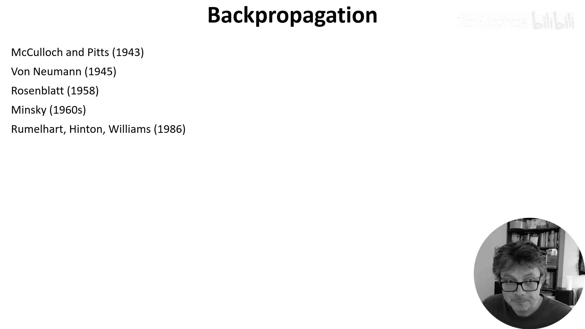

This box has a very brief summary if you want to pause and have a read。In brief。

 they found an efficient algorithm to compute the gradient of the loss function with respect to the parameters of the network and therefore an efficient way to do gradient descent on multi layer neural networks。

And this is proven to mostly， mostly solve Minsky's problem with trainability， including。

 for example， finding a solution to the XO problem。

Although it's still not theoretically proven when it should work。

 and we saw a moment echo ago an example of where it fails。

Indentally gradient based methods were known in the 60s when Minskky was developing his arguments。

 but they were considered to be too inefficient and slowly convergent for high dimensional problems。

😊，Returning to neuroscience， Rimahart and colleagues explicitly recognized that although their method was effective。

 it wasn't biologically plausible， but there are some interesting twists to this。

 The first is that some biologically plausible learning rules can be seen as mathematical approximations of back。

 which we'll talk about later in the course。And the second is that the reason that backdrop isn't biologically pla may turn out to be irrelevant。

😊，The argument goes that Backp requires passing an error signal backwards through the network。

 and there's no biological mechanism that can do that。

You could do it with a secondary feedback network that carries the error signal backwards through the network。

😊，But it would have to be exactly symmetrical with a feed forward network。

 and nothing like that has been observed in the brain。

But in a fascinating development from 2016 onwards。

 Timothy Lily crapapp and colleagues found that if you just use a random feed network that isn't symmetrical。

 it still works。It turns out that the feed For network learns to align itself with the feed Back network。

 so that in the end， the feedback network is carrying the correct error signals for the learnt or aligned feed forward network。

😊，This feedback alignment turns out not to scale to very deep networks， but the story isn't over yet。

 and there's still a lot of interesting research going on in this space。

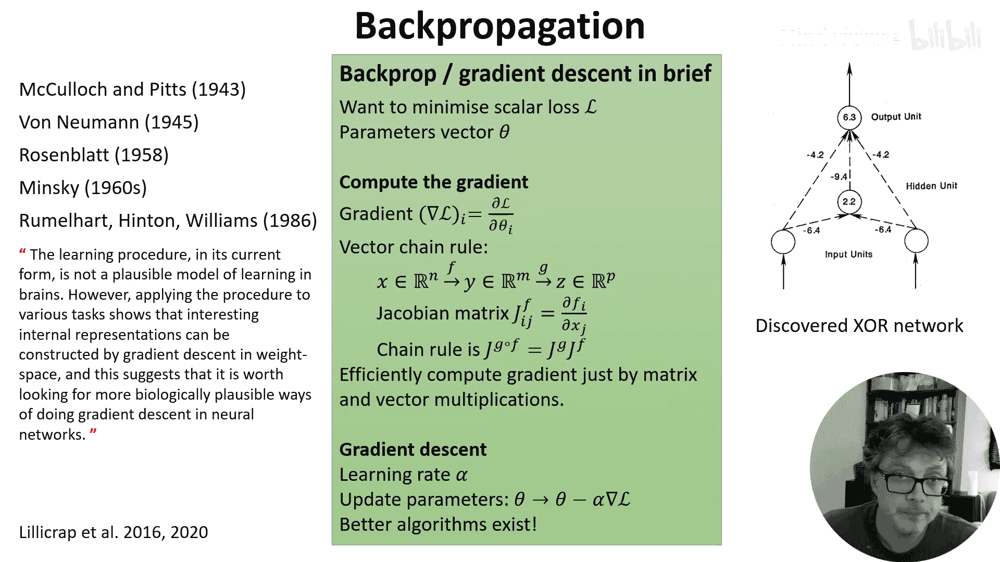

Okay， so I'm done talking about neural networks in general and want to cover just a couple more topics before finishing this video。

The first is the interplay between neuroscientific studies of the visual system and the development of the convolutional neural network。

In the late 50s and early 60s， neuroscientists Hubel and Visel discovered two types of cells dominated in the early part of the visual system。

Most of the cells they analyzed had a receptive field。That is a small local area of the visual field。

 where shining light could cause the neuron to fire。 And in the rest of the field， it has no effect。

Some of the cells were simple， meaning effectively that you could predict their response to any signal by knowing their response to shining a light at different spots。

😊，And this is roughly equivalent to saying that they act as linear filters。

Here you can see one example from their recordings。

So shining a light here where the X's are causes the cell to be more active and shining it here where the little diamonds are causes it to be less active。

They also found complex cells。 These were defined to be any cell that wasn't simple。

 but in many cases， they found that they had the property of responding to， for example。

 a bar of light with a preferred orientation， but they didn't mind where in their receptive field。

 the bar was shown。If you know about how convolutional neural networks work。

 this probably doesn't really surprise you。 you can think of simple and complex cells as being roughly like convolutional layers and pooling layers。

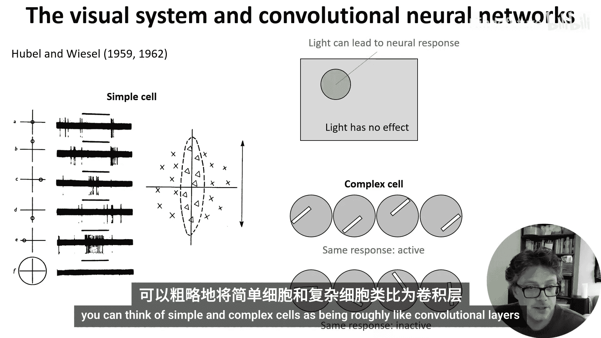

The simple and complex cell structure was the direct inspiration for Fukushima's 1980 neocogniural。

This was an explicit computational model inspired by Huble and Visel and featured alternating S and C layers corresponding to simple and complex cells。

😊，A network was trained by a bespoke unsupervised learning rule that I won't go into here。In 1989。

 Janan Leun and others took essentially the same architecture。

 but trained it using back propagation and later refining this model and calling it a convolutional neural network。

 And this LED to a flurry of work in machine learning over the next decades and played a big part in the current explosion of success in machine learning。

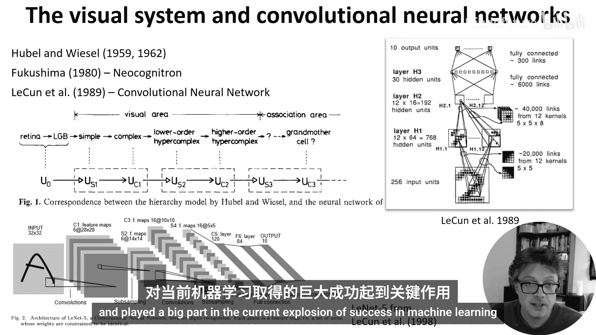

Before closing out this discussion of the visual system。

 I want to briefly take it back to neuroscience and show that the influence isn' in just one way。😊。

In 2014， Dan Yemenenss and colleagues found that training O CNN to perform well at the task actually gave internal representations that were a close match to neural data recorded in the visual system。

And Alex K' colleagues found the same thing in the auditory cortex。

This LED Martin triumph for others to propose a brain score and a leader board to track which models were giving the closest match to neural data。

But the story isn't over， and there are lots of people out there who are not convinced by this。

 For example， Jacob Bill found that these networks don't predict the patterns of success and failure made by humans on out of distribution stimuli。

And my group found the same problem in auditory stimuli， at the same time。

 another group found the same thing independently around the same time。😊。

So the jury is still out on how good deep neural networks are as models of the brain。

 but one thing is for sure is that machine learning is having an outsized influence on neuroscience at the moment。

😊，The last thing I'm going to talk about in this video is reinforcement learning。😊。

The phrase actually dates back to Pavlov in 1927。 Y， the dog guy。

And the study of this sort of learning， though actually goes back to Thornddykin 1898。At this point。

 it wasn't neuroscience so much as animal psychology and instantly the Thorundke paper is pretty funny because it seems his main name was to prove that animals are actually quite stupid。

 which maybe I guess was an active debate in that day。😊。

So he built cages with opening mechanisms of varying complexity that the animals had to escape from and tracked how long it took for them to escape over repeated trials。

 and I don't know about you， but I find these look remarkably like modern day training curves。😊。

In the conclusion， you can even see some hints of what in modern reinforcement learning terms we'd call optimizing for value instead of optimizing for reward。

😊。

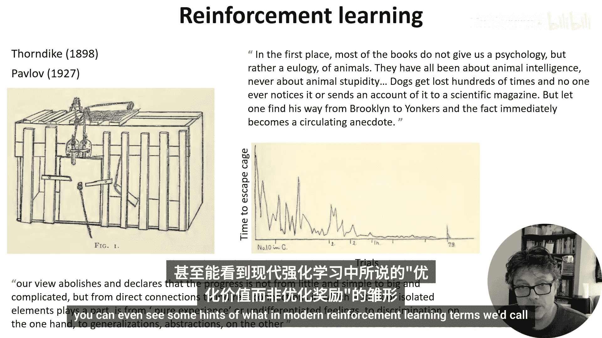

There's a lot of developments in this space from researchers in psychology and neuroscience。

 and I don't want to go into the whole history of this topic。If you're interested in it。

 there's a great book from Suturn andbarto that is freely available online and goes deep into the history。

😊，Here are' just to mention a few interesting moments from that history。Like Alan Ting's 1948 paper。

 where he describes a computational learner that is explicitly described as a model of cortex。

There's a long spell where the mathematical modelling of reinforcement learning is primarily carried out by computer scientists and people working in optimal control。

😊，And it came back to neuroscience in a big way in the 80s and 90s。

 with experiments on dopamine neurons and models that showed that their activity corresponded to what you'd expect from temporal difference learning。

And this sparked a huge wave of work in neuroscience。

 a lot of which was going on at the Gatsby Computal neurourscience Uni at UCL。

 led by Peter Diane and colleagues。And just to show that there's a tight relationship to this day。

 Des Saba's last academic post before founding Deep Mind was actually at UL with Peter Diane。

 and he's still advocating for AI to be influenced by neuroscience today。😊。

This has been a very brief and very incomplete history of some of the ways that neuroscience and machine learning have interacted over years。

 There's a lot more。So here are some good papers to read and if you're interested in learning a bit more about that history and what's going on at the moment in this space。

😊，There's also a great newsletter that's worth signing up to from Patrick Minow with all of the latest developments in what's sometimes called neuroaiI。

😊，And perhaps the next big development I'll be reading about will be from you。

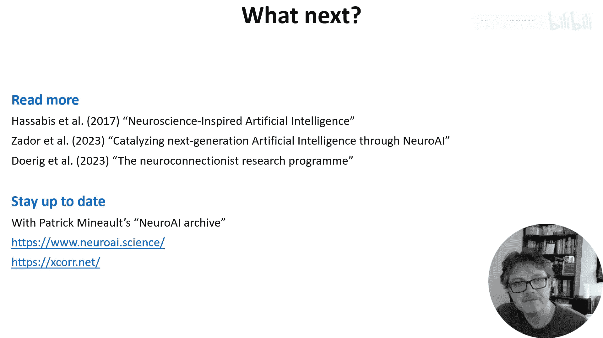