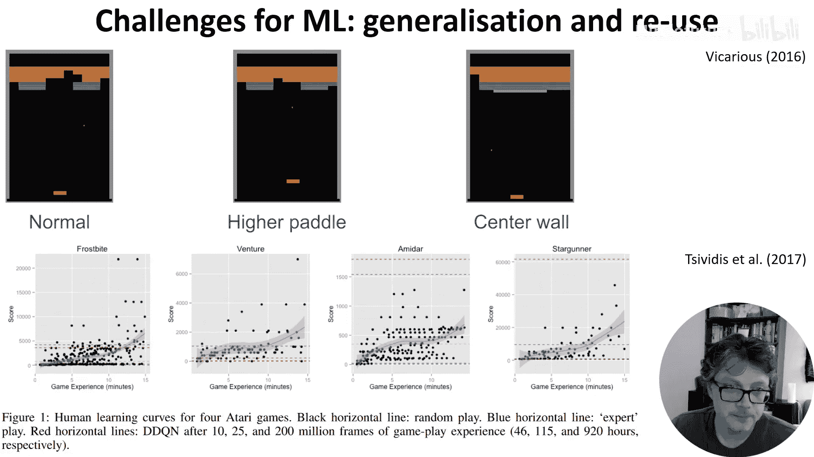
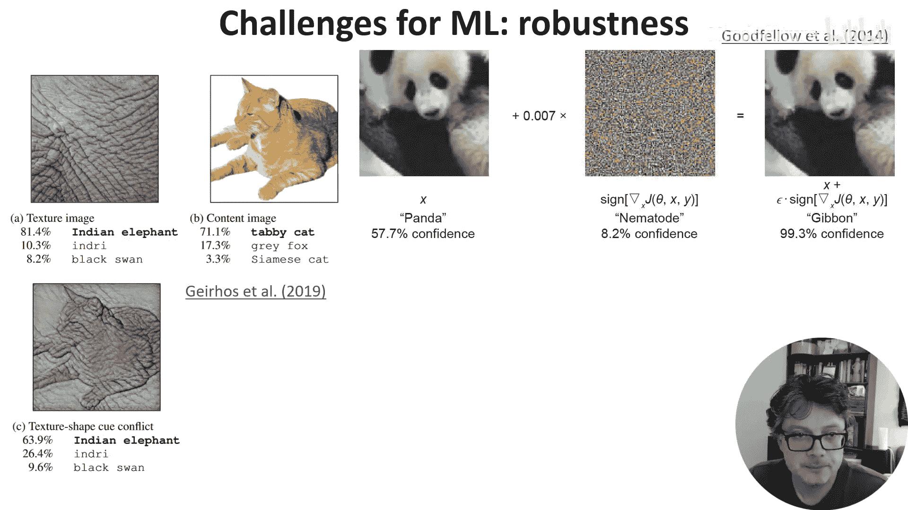
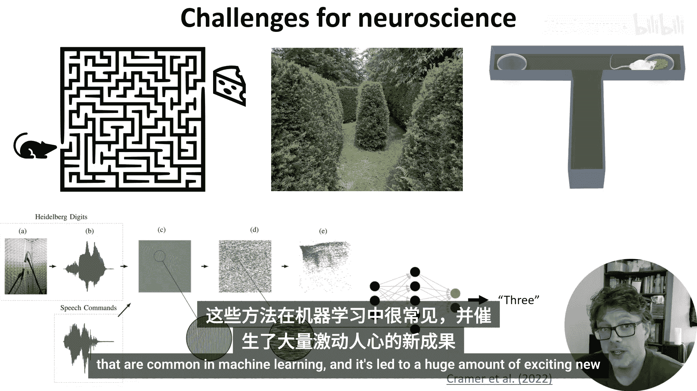
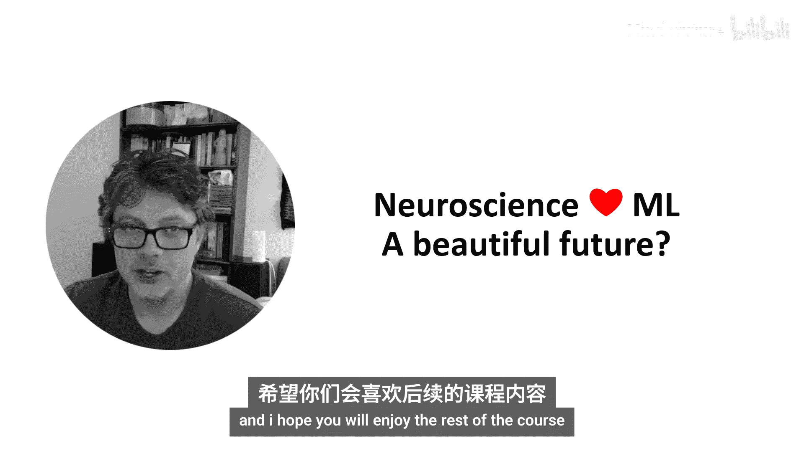

# 机器学习人员的神经科学 ｜ Neuroscience For Machine Learners p04 P04_W0_V3-Challenges_for_machine_learning_and_neuroscience -BV1MiawzJExR_p4-

In the last video this week， I want to talk about some of the challenges for machine learning and for neuroscience and how I think these two fields can help each other to make progress。

Let's start by talking about power efficiency。 I'm going to illustrate this by talking about the famous go match between Alphago and Liidong。

😊，To set the scene， computers overtook humans at chess in 1997， but in go。

 again with a much larger search space， humans remained superior。Until 2016。

 when Deep Minds Alphago beat top human player Lisa Siel。In that match。

 it's been estimated that Algo was drawing somewhere around 100 to 1000 kilowaWts of power compared to presumably around 20 watts for Sal's poor little human brain。

That means AlGo was around 5000 to 50000 times less efficient than a human brain。

 and it's worth saying that that human brain was also doing a bunch of other stuff at the same time。

Now obviously that's a huge difference， but this might be overstating the case a bit by the next year。

 Deep mindd had implemented Alphago0， which played better than the previous version and they claim was only drawing around one to 2 kilowatts of power。

 so only about 50 to 100 human brains。Now， obviously， that's still very inefficient。

 but it only took a year to improve by a factor of 50 or more。

 so I wouldn't bet against the machines on this。There is another challenge for machine learning though。

 which is how much training it needs to reach high levels of performance。

Alphago0 was trained on over 5 million games。 Now， we don't know how many games Li Saal played。

 but at the time of that match， he was 33 and assuming he started playing age 5。

 played around five matches every day from then on。 He would only have played around 50000 games。Now。

 that's not entirely fair， of course， because he was making use of the collective knowledge of all humans who have ever played this game。

But then Alphago was also able to use this， and then she tested it。

 It turned out that it didn't help very much。 The training was a little faster。

 but it actually kept out a much lower level performance at the end of training。😊。

One of the reasons for this is that humans have a lot of knowledge that they can call on ause in new scenarios。

 and machine learning methods still lag behind in this， although progress is fast。

To illustrate this in 2016， the company Vicarius， later brought by Google。

 had an interesting analysis of the game breakout。You know。

 this game where the ball bounces around and you control the paddle that moves left and right。

 and you have to destroy all the colored bricks at the top by hitting them with a ball。Well。

 it turned out that the state of the A DRL methods of the time were easily able to master the scheme。

 but then they started introducing variations。So if you just move the paddle a bit higher。

 a human player has no problem at all。But the DRL agent needed to be retained almost from scratch。

 or similarly， adding an unbreakable wall in gray。Another example is an analysis of human learning of Atari games that were famously mastered by DRL。

 This study found that for some of the games in under 15 minutes of training。

 humans could learn to play at a similar or better level than the DRL agents after tens or even hundreds of hours of play。

The last challenge I want to talk about for machine learning in this video is robustness。

Although the situation has improved recently， machine learning solutions tend to be brittle and prone to break。

There are lots of different aspects to this， and the previous slide on generalization and reuse is one example。

But another way of seeing it is that they're prone to manipulation。

 what is sometimes called an adversarial attack。The classic example of this is where you add a humanly imperceptible amount of what looks like random noise to an image。

 and you can get an image recogniser to output any label you like with high confidence。Already。

 this tells us that whatever this network is doing。

 it's quite different to the way that humans recognize images。😊，Now。

 part of the answer is Mo that these networks treat texture as more important than shape compared to humans。

Here， you can see that if you take a picture of a cat and give it the texture of an elephant。

 it's recognized as an elephant， although most people would have still said cat。

But you don't even have to be as sophisticated as that。

 You can just slap on a bit of text and get it to change its mind。 In this case。

 by putting on the text iPod onto a picture of an apple。 It says iPod rather than Apple。

But now I want to turn away from machine learning and talk about some of the challenges for neuroscience。

For the first one， you might know that scientists like to study mice running around mazes。

You might imagine something like this， or if you've been visiting the of English countryside a lot。

 maybe something like this。But the reality is very much more often like this。😊，In neuroscience。

 our experiments are usually incredibly simple， often coming down to a binary choice。

 Now there's a good reason for that。 it's hard to train animals to do these experiments and you want an easy way to interpret the results。

😊，But it does mean that we're studying animals to try to understand intelligent behavior。

 but we're doing it with tasks that don't actually really require any intelligence。

 And it's not clear if that's good enough if we really want to understand intelligence。

And the same is true of our models。 One of the most challenging dataset sets for biologically realistic Spikking neural networks is the Spikking Heidelberg dataset set。

And this is a database with just 20 spoken words to classify。Despite that， in recent years。

 we've seen a new focus in neuroscience on challenging tasks of the sort that are common in machine learning。

 and it's led to a huge amount of exciting new work。😊。

And I think that's a good note to finish this week on His。

 neuroscience and machine learning were tightly linked， and that led to some fantastic。

 fantastic and groundbreaking work in both fields。😊。

My bet is that we will make more progress in both fields if people know what's going on in the other one。

And I hope you will enjoy the rest of the course。

