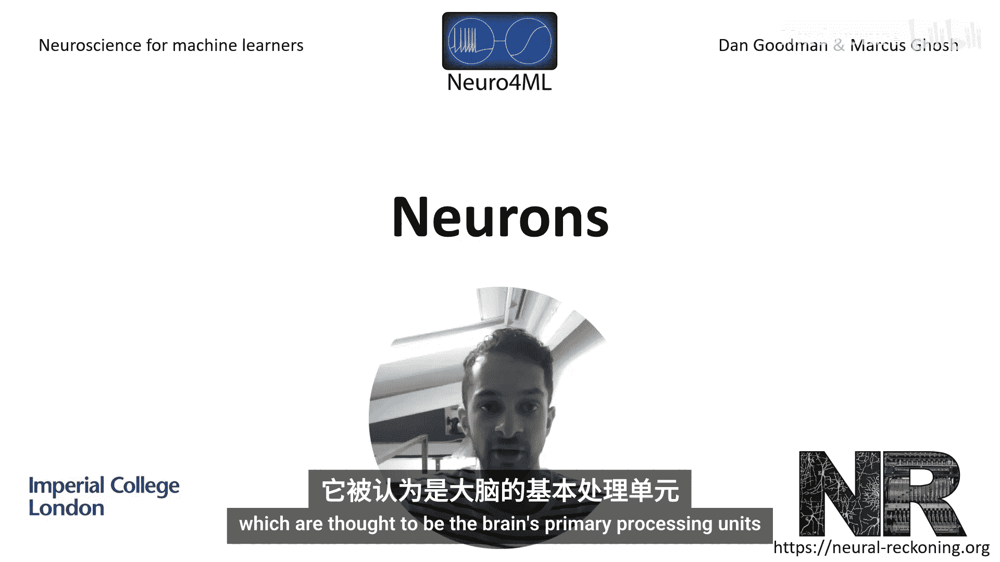
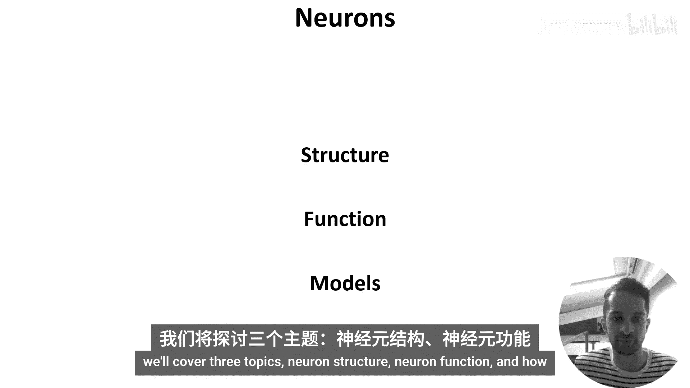
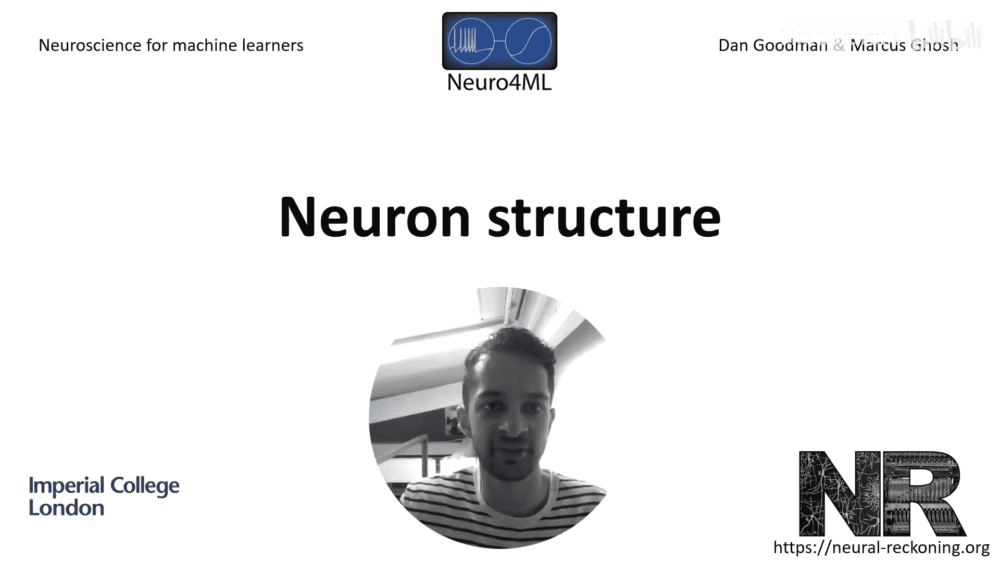
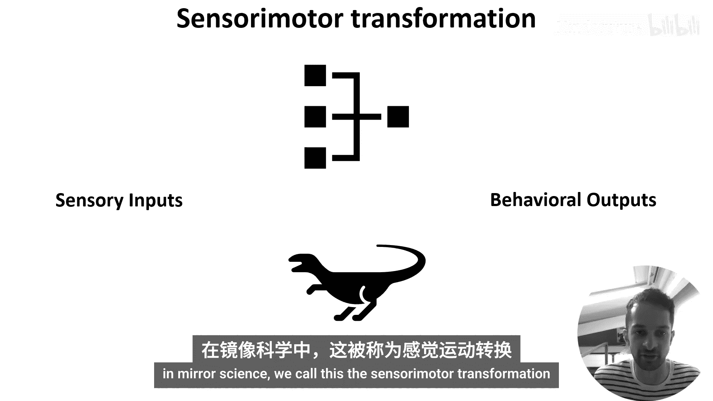
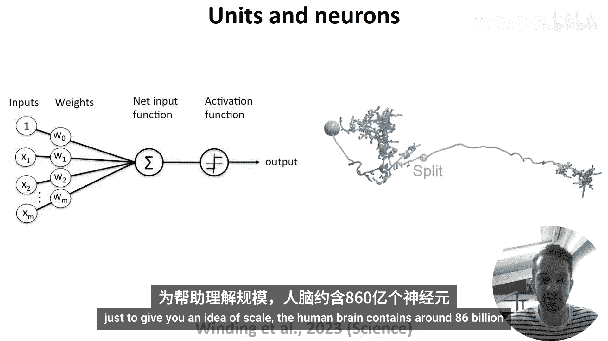
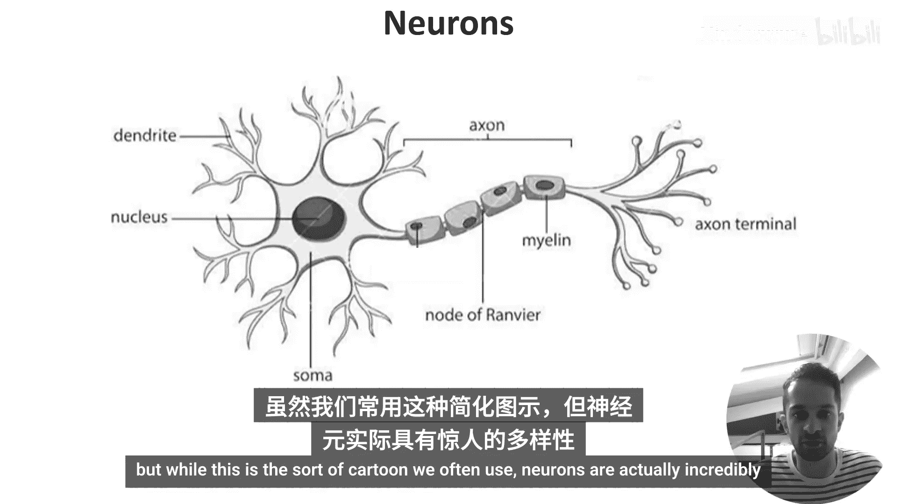
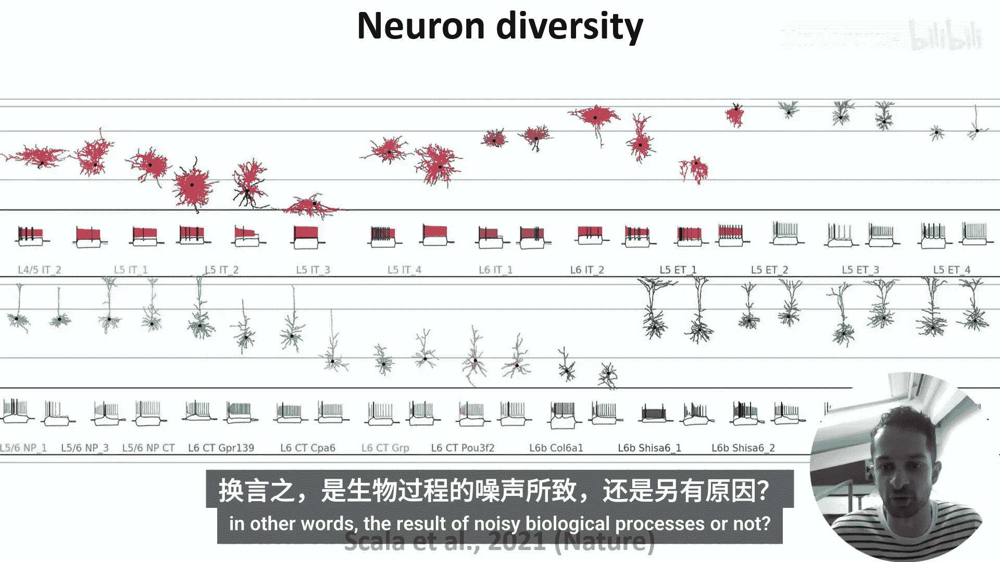
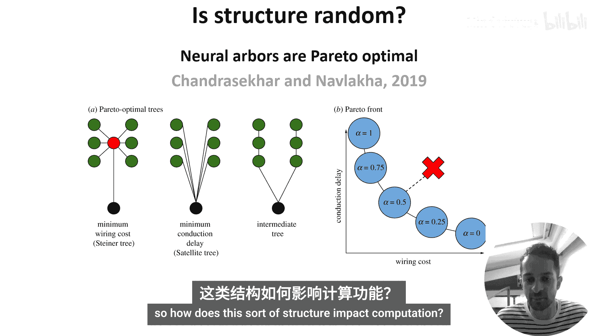
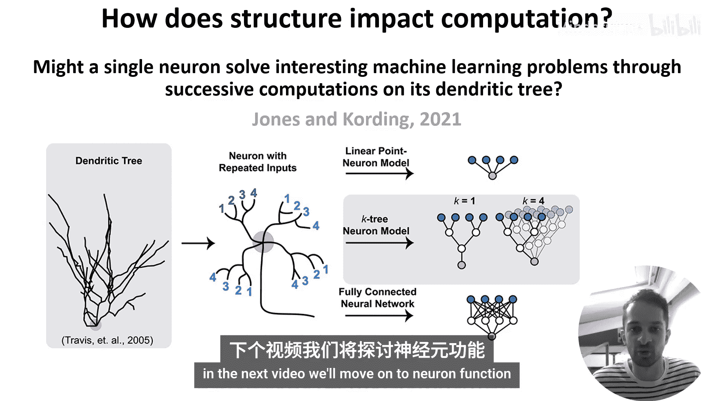

# 机器学习人员的神经科学 ｜ Neuroscience For Machine Learners p05 P05_W1_V0-Neuron_structure -BV1MiawzJExR_p5-

Hi， my name is Marcus Gosh， I'm a postdoc working with Dan and I'll be giving some of the lectures throughout this course In this first week we're going to focus on neurons which are thought to be the brain's primary processing units。

We'll cover three topics， neuron structure， neuron function。

 and how we can model neurons mathematically and simulate them in code。

In this first video， we'll focus on structure。We can think of both artificial neural networks and brains as computing input output transformations that is they take input data and output decisions for example。

 a trained ANN may take in images and output classes and similarly a predatoror may use its senses like vision and hearing to distinguish prey from other animals。

Murcience， we call this the sensory motor transformation。

 but how do these systems compute these transformations？

In ANNs， these transformations are realized by units。

 which sum their weighted inputs and pass them through an activation function like RE。In brains。

 the equivalent and neurons， which are not just simple points。

 but complex 3D structures like the neuronsn shown here， just to give you an idea of scale。

 the human brain contains around 86 billion neurons。

So what makes up a neuron？Like other cells， neurons have a fatty membrane which separates their inner contents from their surroundings。

 then inside they're filled with the fluid known as cytoplasm。

In their cytoplasm you'll find things which are found in other cells like a nucleus containing genetic material and usually the sits in the neurons's main cell body or soma。

 but unlike many other cells， neurons act as information processing units。

 they receive inputs from other neurons via the dendritic tree， which is shown on the left。

 and then they signal to other neurons， muscles or glands via the axon， which is shown on the right。

But while this is the sort of cartoon we often use， neurons are actually incredibly diverse。

For example， this paper made detailed measurements from over 1 thousand neurons and concluded that they're around 70 types。

 which differ in several features including their morphology， which you can see here。

Some of the neurons in blue looked like the diagram we saw on the previous slide。

 but others like those in pink， look quite different。

And while you might assume that this complexity was reserved for or even unique to the human brain。

All of these 70 neuron types， and actually this whole study is focused on just one part of the mouse brain。

So is this structural diversity just random， in other words。

 the result of noisy biological processes or not？

Well， in this paper the authors analyzed a morphology of over 10。

000 real neurons from an open source dataset and showed that they balance wiring costs。

 that is the amount of material needed to construct a branches and conduction delays。

 the distance between their cell body and their points of contact with other neurons。

In figure A on the left， the black circles represent the soma or cell body of the neuron。

Green circles show the inputs， and the red circle shows a branch point。

 And what this figure shows is how it's possible to wire the connections from green to black in different ways。

On the left is the tree with the minimum wiring cost in the middle of the tree with the minimum conduction delay。

 and on the right is an intermediate tree。Now last these two objectives。

 minimizing wiring costs and conduction delay， compete with each other。

 they form a Pto front where improving one leads to loss in the other。

 this is shown in panel B where the X axis is the wiring cost and the Y axis is the conduction delay and the front shows how improving one impairs the other。

For example， decreasing the construction delay leads to an increase in wiring cost。

Once this front is defined， you can then measure how far any given tree falls from it。

 as shown by the red Cross。What the authors conclude from their work is that neural arbors are much closer to being perito optimal than you would expect by chance。

 which suggests that the neuron structure is not random but strikes a balance between optimizing wiring costs and conduct delays。

So how does this sort of structure impact computation？

Frankly that's an open question， so rather than giving you an answer。

 Im just going to give you one example of the type of work which people are pursuing in this direction。

Here the authors model a single neuron and study how changing the properties of its dendritic tree。

 which again process its input， alters its ability to solve classic machining learning benchmarks like MIS。

Sn on the left here is an outline of a real neuron， itss cell body is marked in pink。

 and the black lines show its dendritic。From examining these trees。

 researchers have found two interesting features， their branched morphology and repeated inputs。

These features are shown schematically in the middle here we have a single neuron with its soma in pink。

 an output axon and four numbered inputs in dark blue with stdritic tree。

As you can see these inputs are divided into two branches and this structure is repeated across subtrees which are shown in light blue。

 so in this paper the authors study how altering the structure of this tree。

 which they call a K trin model in next task performance。It a lower bound。

 they use a linear point neuraln model and as an upper bound。

 they use a fully connected neural network with the same number of trainable parameters。

What they conclude is that the performance of their tree model improves usU in3k number of repeated subtries。

 but starts to degrade when you make the trees more realistic by making them asymmetrical。

What that suggests is that there's still lots to explore in this space of exactly how structure impacts computation。

Okay， so that's all neuron structure in the next video we'll move on to neuron function。

