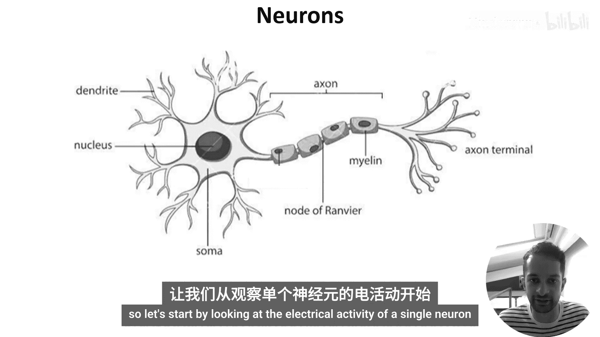
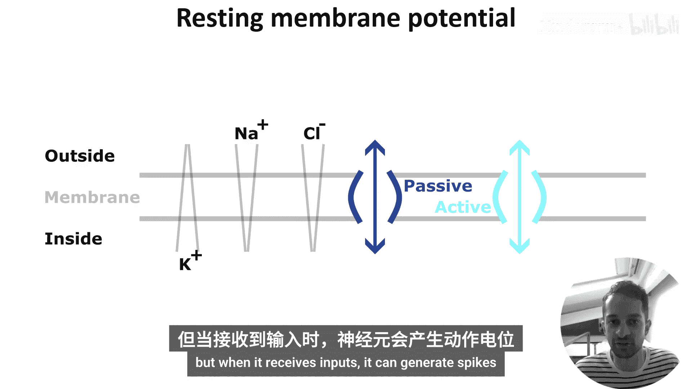
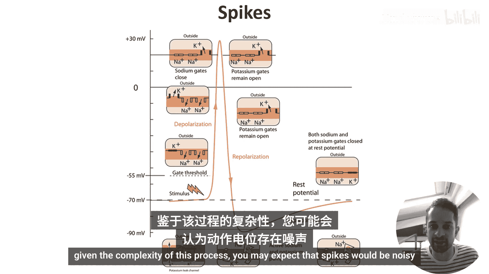
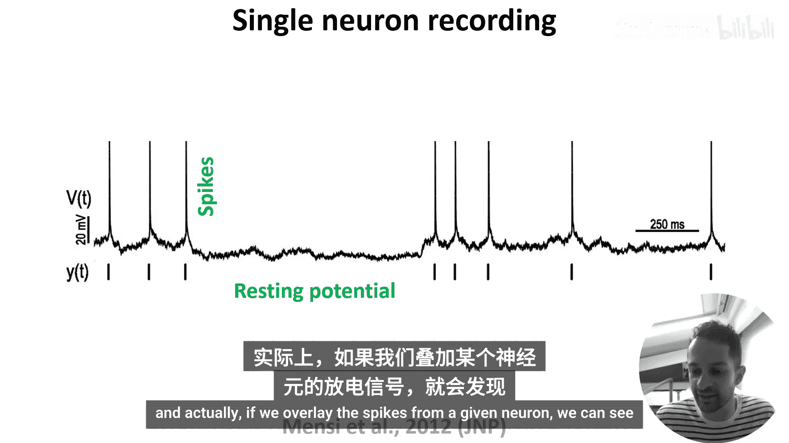
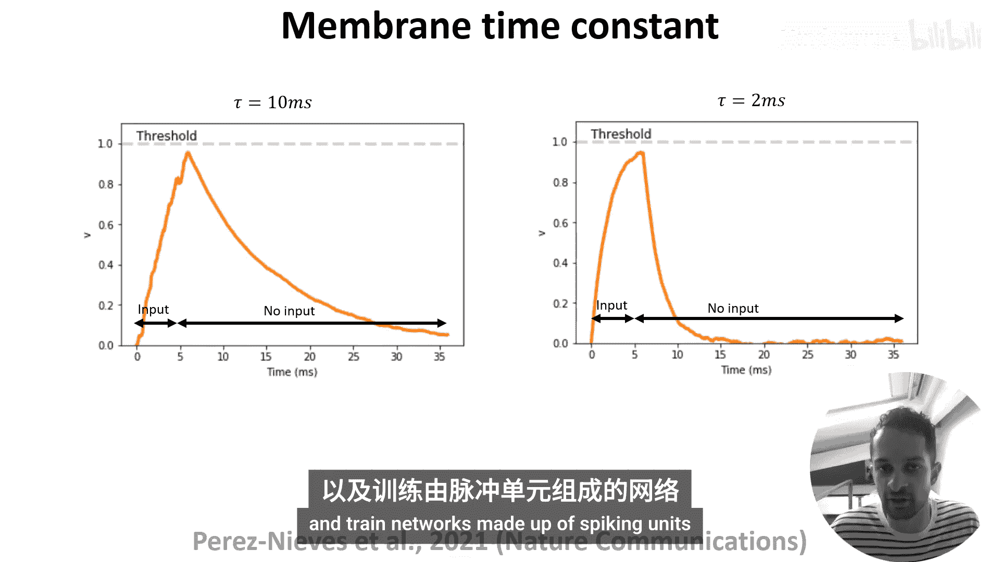

# 机器学习人员的神经科学 ｜ Neuroscience For Machine Learners p06 P06_W1_V1-Neuron_function -BV1MiawzJExR_p6-

Hi again， in the last video， we covered neuron structure。

And I mentioned that neurons act as information processing units。Do so。

 they use both chemical and electrical signals neurons receive chemical input signals known as neurotransmitters at their dendrites。

 transform this into an electrical signal， and then output their own neurotransmitters to other neurons via their axon terminals。

😊，We'll cover chemical signaling next week and focus on the electrical part today。

 So let's start by looking at the electrical activity of a single neuron。

Here we have time in milliseconds on the x axis and voltage in millivvolts on the Y axis。

Exactly how researchers has acquired this sort of data depends on several factors。

 but in general you need an electro amplifier and a specimen to record from。

 like an isolated neuron in a dish or even a human brain during surgery。

Back to the figure from this sort of plot we can observe two features first there is these high amplitude one to two millisecond long events。

 which we call action potentials or spikes。Second， between the spikes。

 the neurons voltage fluctuates around a baseline value， which we call resting membrane potential。

So how do neurons generate their resting potential and spikes Well。

 the cell membrane plays a key role。Remember that the cell membrane separates the inside of the cell from the outside。

Importantly， ions， charged particles like sodium and potassium are unevenly distributed across the membrane。

 for example， potassium is at a higher concentration inside while sodium and chloride are at higher concentrations outside。

This means that there are both chemical and electrical gradients across the membrane。However。

 these charged ions can't cross the membrane directly and instead must use specializedised channels which have proteins embedded in the membrane。

Some of these channels are passive， so simply allow ions to diffuse across。

 but others are active and use energy to transport ions against their gradients。

The overall result of these ionic movements is that each ion balances at an equilibrium where its concentration gradient equals its electrostatic gradient。

 and this is known as the iron's equilibrium or potential。

Then the resting potential of the membrane put some of all as the iron's equilibrium potentials。

 which is usually somewhere around 70 millivvolts。Okay。

 so the resting potential is the neuron state when it has little or no input。

 but when it receives inputs， it can generate spikes。

This chromchematic shows time on the X axis， on the order of a few milliseconds and the neurons's membrane potential on the Y axis in mivat。

Inputs cause sodium channels in the membrane to open and sodium to flow into the cell down its concentration gradient。

 This raises the membrane potential， and if it rises high enough。

 Ask what is termed the gate threshold， voltage gated sodium channels open。

 More sodium flows in and the membrane potential rises to its peak。

 This process is termed deep polarlarization。At high voltages， sodium channels close。

 but potassium channels open and potassium flows out of the neuron， reducing the membrane potential。

 This is called repolarization。Interestingly， repolarization typically goes below the resting membrane potential。

 clear it going as low as minus 90 millivolts。This is called hyperpolarization and its effect is to effectively raise the threshold for a new stimuli to trigger a spike for a period of time。

 which we term the refractory period。After hyperpolarization。

 a combination of active and passive ionic movements eventually bring the membrane back to its resting state of minus 70 millivolts。

Given the complexity of this process， you may expect that spikes would be noisy。

 but if we return to our single neuron recording for a second。

You can see that they seem to be remarkably stereotypical in their shape。And actually。

 if we overlay the spikes from a given neuron， we can see that they really all look alike For example。

 this figure on the left shows more than 100 spikes recorded from a real neuron in response to different inputs。

And you can see that the variability is really low What this means is that each neuron spikes are essentially binary all or nothing responses and if neurons need to encode more complex information。

 they must do so by varying the number or timing of their spikes。

 but will return to how neurons encode information later in the course。Next for the slide。

 as each neuron spikes are so similar， sequences of spikes or spike trains are often plotted as binary events。

 for example， this plot on the right is what we call a raster plot and each row shows the spiking activity of a different neuron over time。

But while each neuron's own spikes share the same shape， not all neurons arelike in their dynamics。

For example， let's think about injecting input current into a neuron to inject enough current will raise its membrane potential past its gait threshold and cause it to sp。

But if we inject just a small amount of current transiently。

 then its membrane potential will increase and then decay back to rest。😊。

We term how long this decay takes the membrane time constant。

 and it has been observed experimentally that different neurons differ in this value。

 so decay at different rate。And that is what is plotted here for two example neurons with different membrane time constants。

 though these are simulations。Okay so while this and other details in this video may seem far from machine learning。

 using neural network models to explore what role these features play in computation or using biological features to boost performance。

 both really exciting prospects。Just to give you one example along these lines。

 in the paper which is referenced here， B and colleagues built neural networks with agenous membrane time constants and showed that this led to improvements in task performance。

But how do you make artificial units with different membrane time for instance well in the next video we'll show you how to model single neurons mathematically and that will provide a foundation for later in the course when we'll cover how to build and train networks made up of spiking units。

