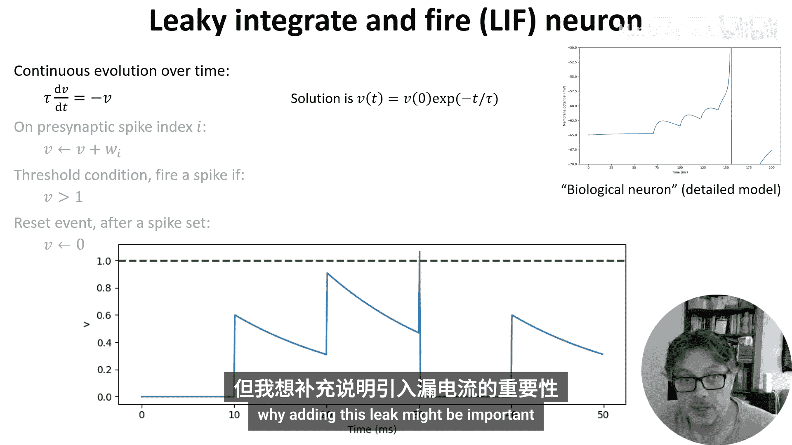
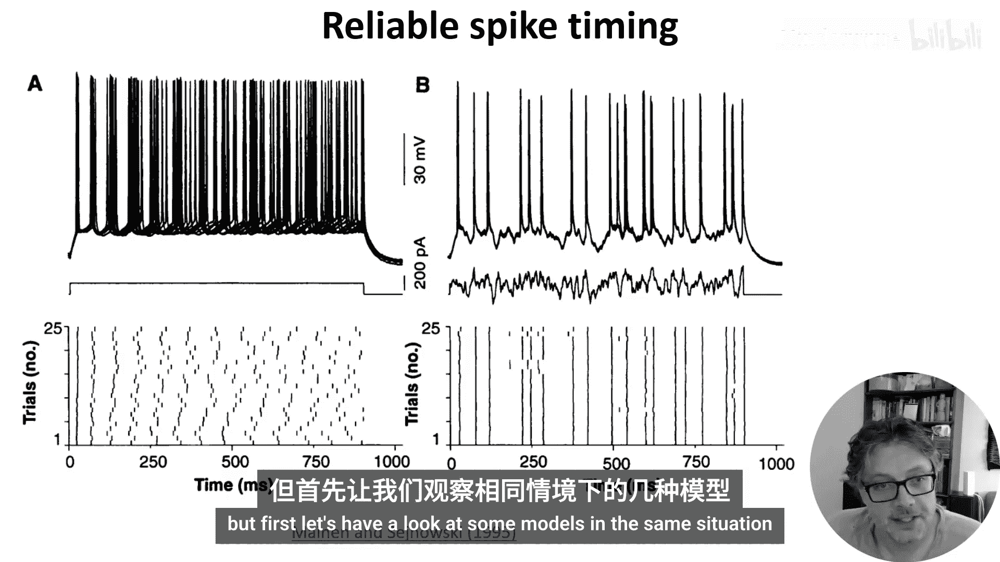
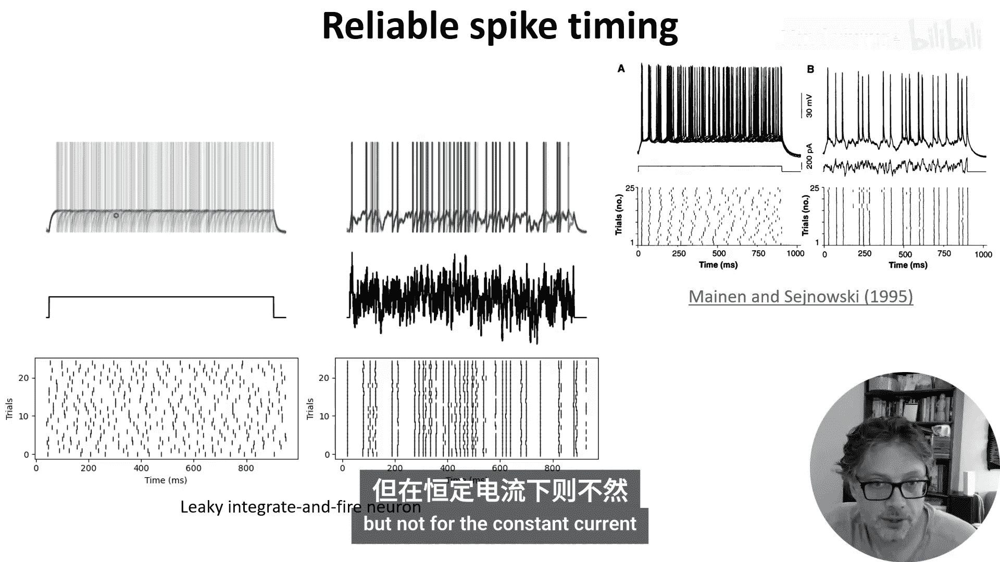
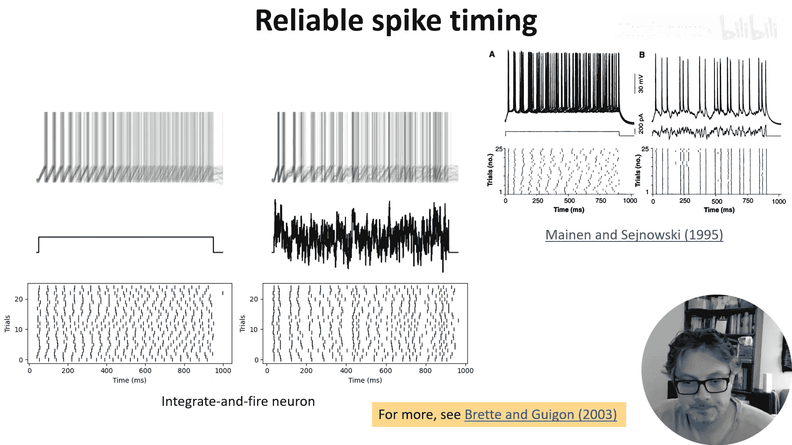
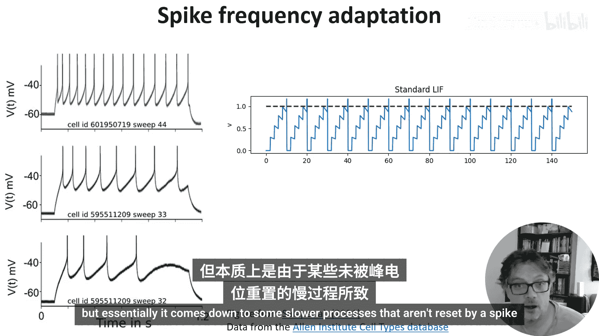
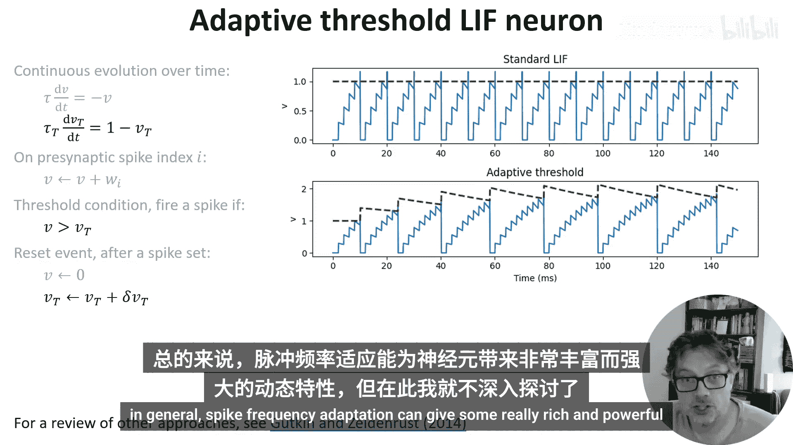
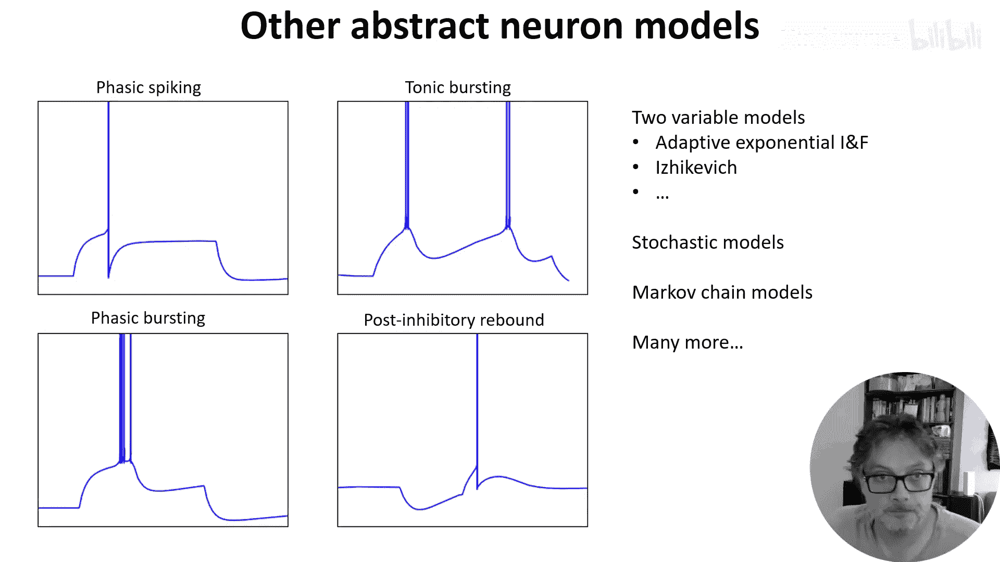

# 机器学习人员的神经科学 ｜ Neuroscience For Machine Learners p07 P07_W1_V2-Abstract_models -BV1MiawzJExR_p7-

So far this week， we've seen a lot of biological detail about neurons and the topic of this video is how we abstract and simplify this into very simple models。

In this video， we're going to focus on models without a lot of biological detail。

 like the spatial structure of the neuron。 And we'll come back to that in the next video。

We'll start with the artificial neuron that you're probably familiar with from machine learning。

This neuron has N inputs with activations x1 to x1， and weights W1 to WN。

Each of these activations and weights is a real number。

It performs a weighted sum of its inputs and then passes that through some nonlinear function F。

And you can use various functions here。 In older work， you'll often see their sigmoid function。

 And that's partly because it was considered a good model of real neurons。Nowadays。

 you'll often see the rectified linear unit or Relu。

 and that turns out to be much easier to work with and gift results that are often better。

Interestingly， there's still papers being published about what's the best model of real neurons activation functions like this one from 2023。

 which looks a bit intermediate between Sigmoid and Re。

The relationship between the model and the biological data is established by computing an input output function。

Typically， by counting the number of spikes coming into the neuron versus the number of spikes going out。

 averaged over multiple runs and sometime period。What this model misses out is the temporal dynamics of biological neurons。

So let's talk about temporal dynamics。😊，We saw in previous videos that when a neuron receives enough input current。

 it pushes it above a threshold that leads to an action potential also called a spike。

The source of the input current is incoming spikes from other neurons and we'll talk more about that in next week's videos on synapses。

For this week， here's a simple， idealized picture of what this looks like。

 It's from a model rather than real data to more clearly illustrate the process。

The curve shows the membrane potential of a neuron receiving input spikes at the times indicated by these red cis。

Each incoming spike causes a transient rush of incoming current。 for the first one。

 it's not enough to cause the neuro to spike。 And after a while。

 the membrane and potential start to decay back to its resting value。And then more come in。

 and eventually， the cumulative effect is enough to push the neuron above this threshold。

 and it fires a spike and resets。The simplest possible model you could have of that is called the In F N neuro。

And here's a b of how it bads。Each time an incoming spike arrives every 10 milliseconds here。

 the membrane potential instantaneously jumps by some fixed weight until it hits the threshold at which pointifies spike and resets。

😊，And we can write this down in a standard form as a series of event based equations。Firstly。

 when you receive an incoming spike， set the variable V to be V+ WI。

If the threshold condition V greater than one is true， fire a spike。And after a spike set v to 0。

And you can see that already this captures part of what's going on in the real neuron。

 But thises the fact that in the absence of new inputs， the membrane potential decays back to rest。

 So let's add that。We can model this decay by treating the membrane as a capacitor in an electrical circuit。

Turning this into a differential equation， V evolves over time。

 According to the differential equation， tau D V by D T is minus v。

 where tau is the membrane time constant we discussed in the last video。

You can solve this differential equation to see that in the absence of any input V decreases exponentially over time with a timescale of tau。

😊，And here's how that looks。 You can see that after the instantaneous increase in membrane potential。

 it starts to decay back to the resting value。Now， although this doesn't look like a great model。

 it turns out that very often this captures enough of what is going on in real neurons。

You'll see that in this week's exercises， but I want to give one other reason why adding this leak might be important。

In experiments， if you inject a constant input current， that's this current here。

Into a neuron and record what happens over a few repeated trials。

 You'll see that the membrane potentials。 that's these here and the spike times that's here。

A fairly different between trials。 and that's because there's a lot of noise in the brain which adds up over time。

On the other hand， if you inject a fluctuating input current， that's this current here。

You'll see that both the membrane potentials and the spikes tend to occur at the same times。

So the vertical lines on this plot are basically showing you that on every repeat。

 the spike is happening at more or less the same time。😊。

Now I'll come back to why this happens in a moment。

 but first let's have a look at some models in the same situation。

You see the same thing happens with a leaky integrated fire neuron。Here。

 I've plotted the membrane potentials as semi transparent。 That's here。

 so that you can clearly see that both the spike times and membrane potentials tend to overlap for the fluctuating current。

 but not for the constant current。

But now if we repeat that with a simple integrated fine neuron without a leak。

 you can see that you get unreliable spike times for both the constant and fluctuating currents。

In other words， adding the leak made the neuron more robust to noise。

 and that's an important property for the brain and perhaps also for low power neuromorphic hardware that we'll talk about later in the course。

😊，So why does the leak make it more noise robust？ Well。

 that was answered by Romanmanmb Brett in a paper in 2003。 The mathematical analysis is complicated。

 but it boils down to the fact that if you either have a leak or a non linearity in the differential equations。

 The fluctuations due to the internal noise don't accumulate over time。

Whereas with a linear and non leaking neuro。

Okay， so just to remind you where we were， we had got to the leaky integrate F neuron。

 which we've just seen has some nice properties that you'd want biological and neuron model to have。

But still， when you look at the picture here in the top right。

 you can see that these instantaneous jumps in the model are not very realistic。

 So how can we improve that。A simple answer is to change the model so that instead of having an instantaneous effect on the membrane potential。

 instead it has an instantaneous effect on an input current。

 which is then provided as an input to the leaky integratedifier neuron。

So you can see on the bottom plot here that the input current。

Is now behaving like the membrane potential before with this exponential shape。

And you can think of that as a model of the internal processes of the synapses。

 and we'll talk more about that next week。For the moment。

 we're going to model that by adding a differential equation。 tau I D I by D T equals minus I。

 So as similar to what we had before for the membrane potential with its own time constant tau I。

We also add that current eye to the differential equation。For V here， multiplied by a constant R。

And the rest of the model is as it was before。😊，And you can see that this gives a better approximation of the shape。

 here You can see that this is looking quite， quite similar to that。

Now there's a lot more that you can do here if you want， for example。

 you can model changes in conductance rather than current and we'll get back to that more next week。

Now， if you feed a regular series of spikes into a leaky int fire neuron without any noise。

 That's what's going on here。 You'll see that the time between spikes is always the same。

And it has to be because the differential equation is memoryless and resets after each spike。However。

 real neurons have a memory of their recent activity。

 and here are some recordings from the Allen Institutes Cll types database that we'll be coming back to later in the course。

In these recordings， they've injected a constant current into these three different neurons and recorded their activity。

And you can see rather than outputting a regularly spaced sequence of spikes。

 there's an increasing gap between the spikes。 You can see it particularly clearly here。

 This gap here is much longer than this gap here。Now， there's various mechanisms underlying this。

 but essentially it comes down to some slower processes that aren't reset by a spike。

 So let's see how we can how we can model that。

Actually， there are many， many different models for spike frequency adaptation。

 and I'm just going to show you one very simple approach。

 but you can take a look at this review here if you want some more ideas。😊，In the simple model here。

 we just introduce a variable threshold represented by the variable VT。

Each time that's the green line here。 each time the neuron spikes， the threshold increases。

 making it more difficult to fire the next spike， and then slowly。

 but then the threshold slowly decays back to its starting value。In the equations。

 we represent that by having a new exponentially decaying differential equation for the threshold。

 by modifying the threshold condition so that it's V greater than VT rather than greater than one and specifying that after a spike。

 the threshold increases by some small amount。😊，Now you can see that it does the job。

 there's a smaller gap between the earlier spikes than the latest spikes。In general。

 spike frequency adaptation can give some really rich and powerful dynamics to neurons。

 but I'm not going to go into any more detail about that right now。

Alright， so this has been a really quick tour of some features of abstract neuro models。

 There's a lot more to know about if you want to dive deeper。😊。

Some of the behaviours of real neurons that we haven't seen in our models so far include phic spiking。

 That's just spiking at the start of an input。 bursting。 that's multiple spikes。

 and that can be either phsic just at the beginning of the input or tonic ongoing。

And there's also post inhibitory rebound， where a neuron fires a spike once an inhibitory or negative current is turned off。

You can capture a lot of these effects with two variable models。

 such as the adaptive exponential Int fire， or the Ia cave H neuron models。

There's also stochastic neuron models based either on having a Gaussian noise current or a probabilistic spiking process and taking that further there are Markov chain models of neurons where you can model the probability of neurons switching between discrete states。

And there's many， many more。 I'll put some links in the reading materials for this week if you want to take this further。

You'll also find a Jupyter network with all the code to generate all of the figures in this video。

Alright， so that's all for abstract neuron models in the next video we will talk about more biophysically detailed models of neurons。

😊。

