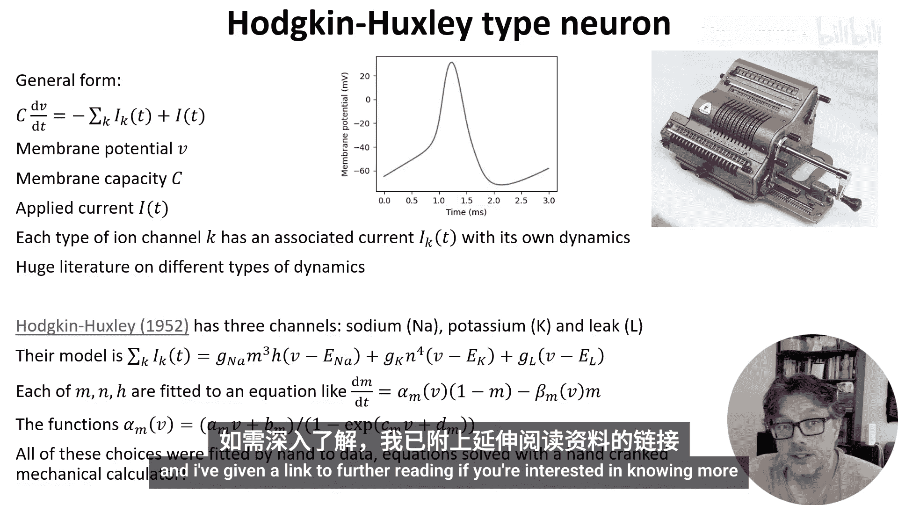
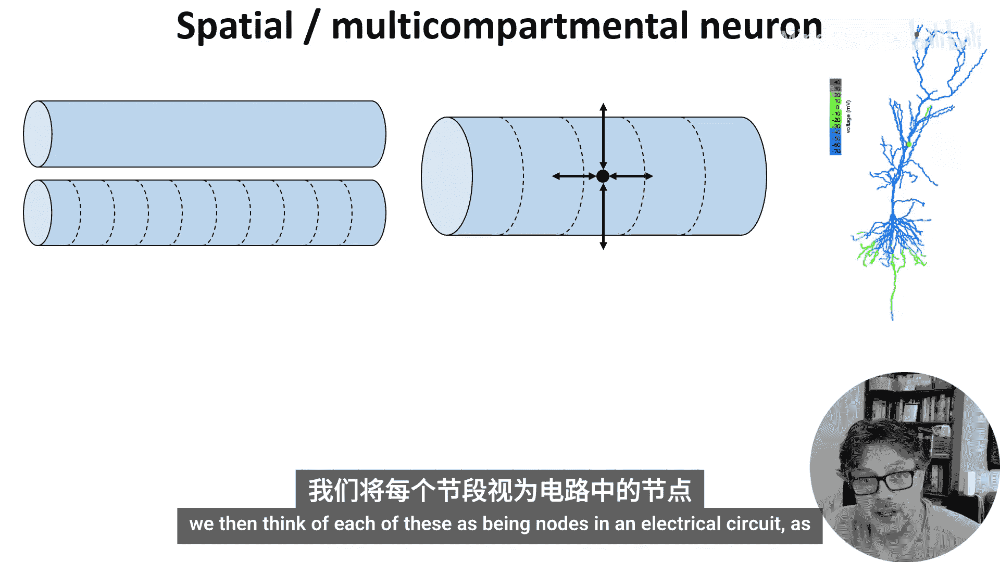
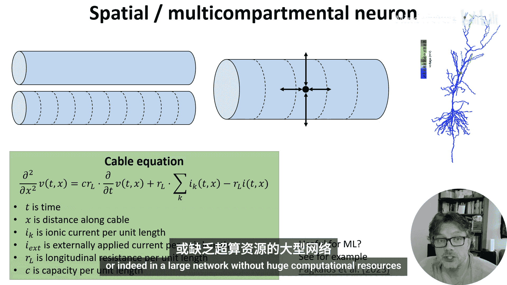
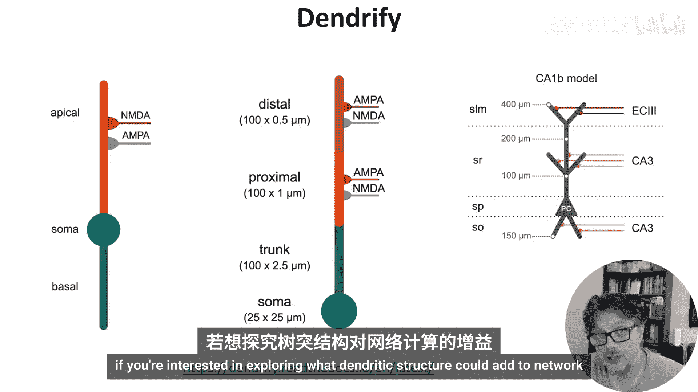

# 机器学习人员的神经科学 ｜ Neuroscience For Machine Learners p08 P08_W1_V3-Biophysical_models -BV1MiawzJExR_p8-

This video is going to be much shorter than the last one。

 I don't want to go deep into models that are more biophysically realistic。

 but I did want to mention。

We'll start with the famous Hodgkin hackxley neuron。

 You can see an action potential plotted with this model here。

The way these models are derived is by treating the cell membrane as an electrical circuit consisting of a capacitor and a number of voltage dependent resistors corresponding to the different ion channels。

Each ion channel has its own dynamics， and there are many， many different types。 Actually。

 there are thousands of papers on different types of ion channels and their are associated dynamics。

In the original paper by Hugkin and Huxley， they considered just three channels corresponding to sodium。

 potassium， and a leak。By hand， quite literally as they used a hand craned mechanical calculator to solve the equations over a period of several weeks。

They found a series of functions that approximated these dynamics quite well。 And ultimately。

 this comes down to a nonlinear differential equation with four dynamic variables and a lot of choices of functions and constants to fit to data。

It's also a bit of a nasty one to simulate， either requiring very small time steps or a specific numerical integration method。

Okay， this has just been a very quick glimpse at this type of model。

 You can see an example of the code to simulate these in the notebook accompanying this video。

 And I've given a link to further reading if you're interested in knowing more。

One thing we've totally ignored so far in all of the models we've talked about is that neurons have a very complicated spatial structure with dendrites and axons。

 And as you can see in the picture， activity that travels around the cell。😊。

We can capture this by thinking of the dendrites and axons as cylinders。

 and we can then break those cylinders into a number of short cylindrical segments that are relatively uniform。

We then think of each of these as being nodes in an electrical circuit。

 as we did with the Hogkin Huxline neuro。

And if we take this approach and follow the mathematical analysis through， we get the cable equation。

 which is a second order， partial differential equation。

This can be simulated by by breaking the cable into compartments as above。 But as you can imagine。

 it gets quite quite heavy quite quickly， as real neurons can have thousands of these compartments that need to be simulated。

The question is does any of this matter in terms of how the network as a whole functions or is this just implementation details？

Well， we don't know， but it has been argued that it may be important and it's an active area of research。

 for example， you can see this recent paper。The problem is that it's too computationally demanding to be used in a machine learning setup or indeed in a large network without huge computational resources。

And that's where Ddrified comes in。 It's a relatively new software package to automatically simplify these very complex models into something that can be easily simulated while still capturing a lot of the relevant dynamics。

 like you can see in these examples here。😊，If you're interested in exploring what dendritic structure could add to network level computations。

 this package is probably worth a look。

Alright， that's the end of the video on modeling neurons。

 The next video is going to be a quick introduction to this week's coding exercise。

 And then next week， we're going to move on to synapses and networks。😊。

