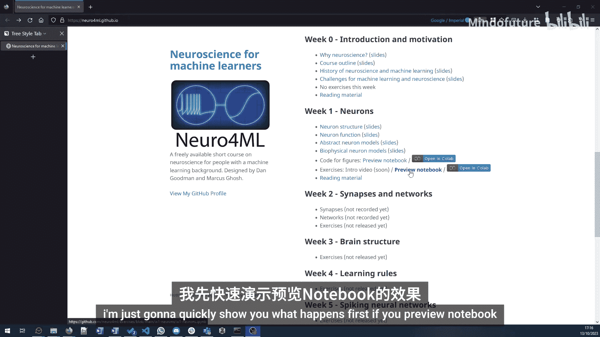
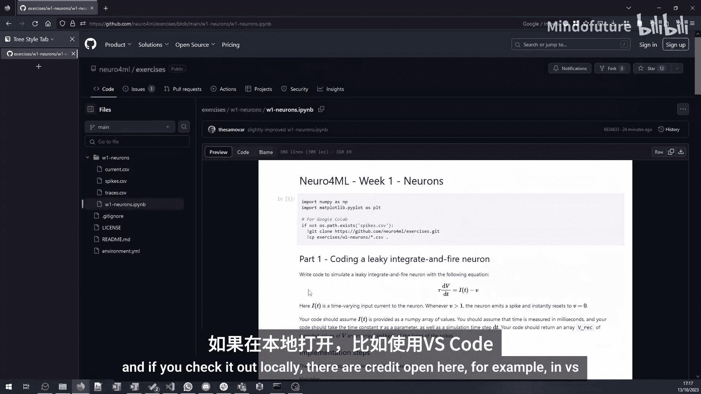
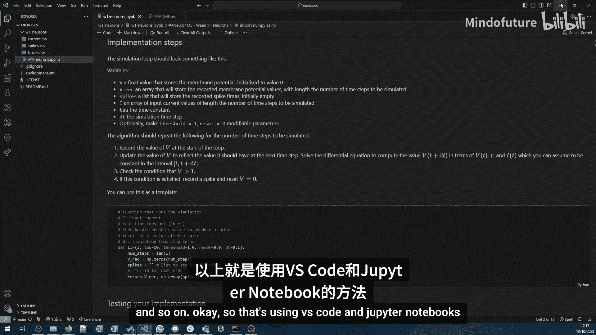
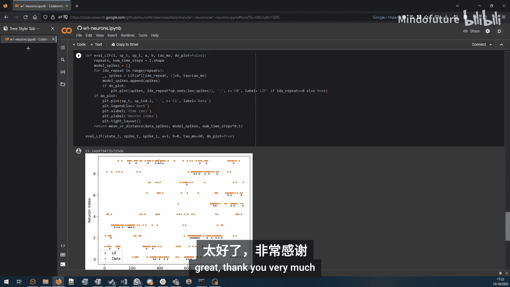

# 机器学习人员的神经科学 ｜ Neuroscience For Machine Learners p09 P09_W1_V4-Exercises -BV1MiawzJExR_p9-

Hi everyone， I just wanted to do a quick video just to introduce this week's exercises and to show you a couple of different ways that you can go up doing this。

😊，So this is the neurourscience for machinechine Learners's website and if you scroll down to week one。

 you can see here we've got exercises and there's a couple of options here you can preview the notebook or you can open it in curlab I'm just going to quick to show you what happens first if you hit preview notebook。

It opens up the Exs repository on GitHub， which you can check out and use locally。UmAnd here's the。

 here's that you can take a look at that。And if you check it out locally。

 there are I've got it open here， for example， in VS code you'll get a copy of the repository that looks like this and there's some instructions for how to do a local install of Python here。

😊。

So you can just follow that。And then you can it's a Jupyter notebook。

 so you can you click cells here and sort of press play to run them， edit them， see the output。

 and so on。Okay， so that's using VS code and Jupyter Notes。

The other option that you have is to open it in Google CoLab。

 which will handle basically all of the install and everything for you。

 So let's just take a quick look at what happens。 So if you do that so I open this in Google Coabab and here you can see immediately I have a copy of of the notebook open and I can just start editing and running these cells straight away and everything is just going to just work because I've tested it already。

Okay， so with that said and that will be the same for future weeks， with that said。

 now let's have a quick look at this particular week's exercises。😊，So there's two parts in part one。

 the idea is basically to just take the theory that you've learned about leaky integrate and fine neuron and to code your own simulation of it。

And to do that， you do it in Python and there's some implementation steps here。

 so basically what you want to do is you want to write some code that looks like this algorithm here。

And here I've written a sort of function template that you basically just have to fill in the gap here。

 right， everything else is written for you。Once you've written the code that does that simulation。

 you can run this cell and that results should look like this if you've got it right。Okay。

 so that's part one， and I think that should probably take something like 30 to 40 minutes to complete that。

All right， in part two， we've got a much more open ended exercise。

 which is kind of more like a real world sort of research situation。

 which is I'm giving you some data and I've also given you the code to load all of that data so you just need to run this cell and here's a plot of what this data looks like。

Now in this data， you have a series of input currents represented in orange。

 so there's 10 repeats with different currents， and you've got recorded traces and spike times of a neuron responding to those currents。

 And you can think of this as if it were real data。

 it's actually generated by a more complicated model， but you can think of it as real data。

And your aim is to come up with a simple abstract model that can approximate or fit this data。

This is a real contest that was run by the INCF， the International Neurinformatics。

 coordinating facility， I think in 2009， I entered that and I think I came second。

 which is obviously very annoying。Yeah， because otherwise。

 I would have got the prize if it come first and there was a money prize attached to it。😊，All right。

 so that's the game here is you want to try and fit this as well as you can。😊。

What I've done is to implement a distance metric between the spike times。

 So basically your model should produce a set of spike times。

 you've got the spike times from the data and in this case。

 I'm using what's called the Van Russom Sp train metric distance between between the spike trains。

So this will compute that given your code and here we go here here's a plot in this case I've just taken a leaky integrate file with just some sort of default parameters and you can see it's sort of fitting some of the spikes the blue one is produced by the model and the orange is is produced by the more complicated model that you're trying to fit to it's not doing a terribly totally bad job you can see some of the spikes are happening at the same time but it's also not doing a very good job。

So this is the distance and it's the value returned by this eval LIF function， and if this is0。

 you've got a perfect fit and basically the smaller this number is the better。

And the second part of the exercise is basically just just do whatever you can to get the lowest possible number here。

 the best possible fit to this data。And there's all sorts of ways you can do that。

 you can just find it by hand there's not so many parameters you might be to get lucky with that or you can try a global optimization package。

 for example， there's the CMA yes。Package， which is quite easy to install in Python like this or whatever you want。

 whatever you think is an appropriate way to try to do this fitting。

And for those who are attending in person， when we finished this at the end of the class。

 everyone's going to sort of call out their best number that they got to and the one with the best can show their solution to the rest。

All right， great， well， I hope you enjoy the exercise and for those who are online。

 please feel free to chat about it and discuss it， but please don't give too many solutions to everyone else because it ruin the fun for everyone。

😊，Great， great， thank you very much。😊。

