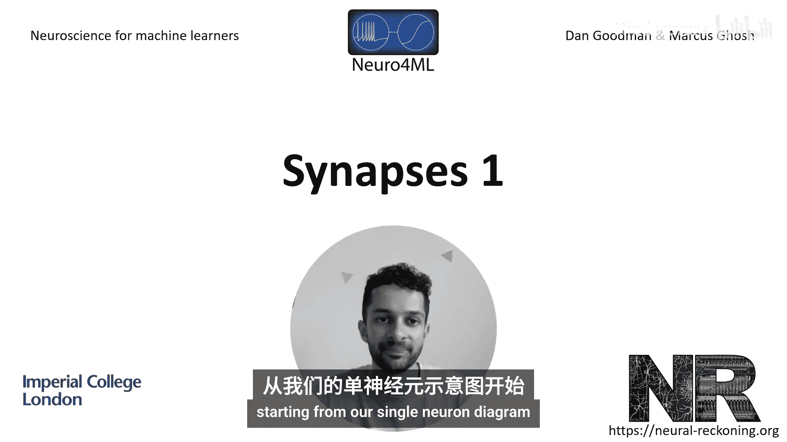
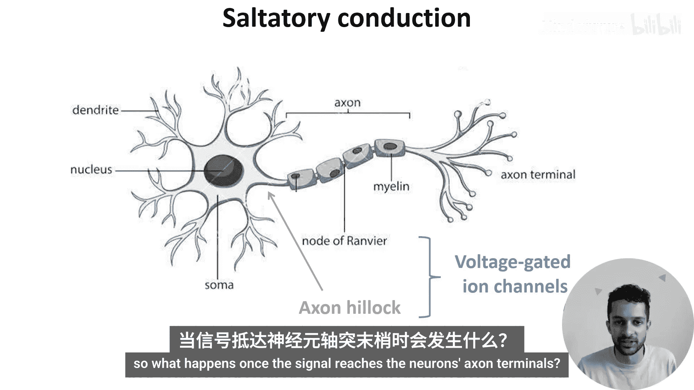
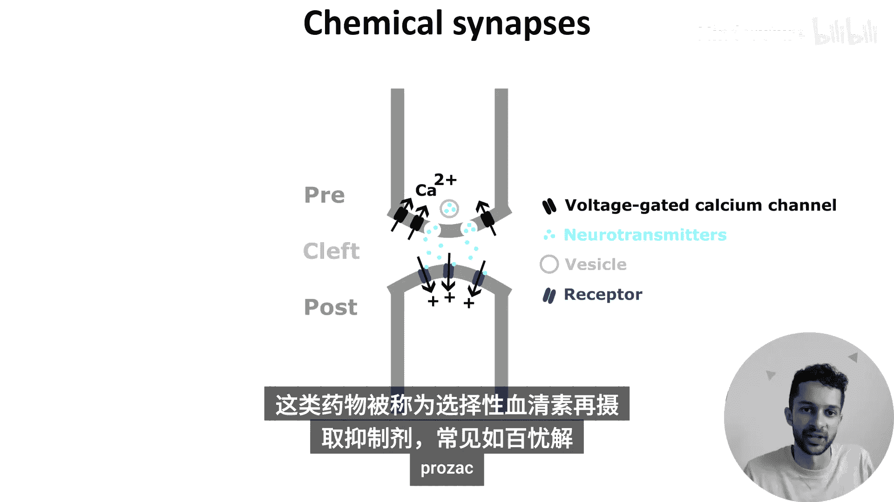
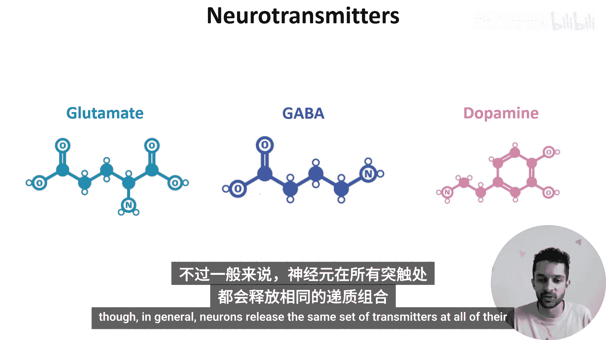
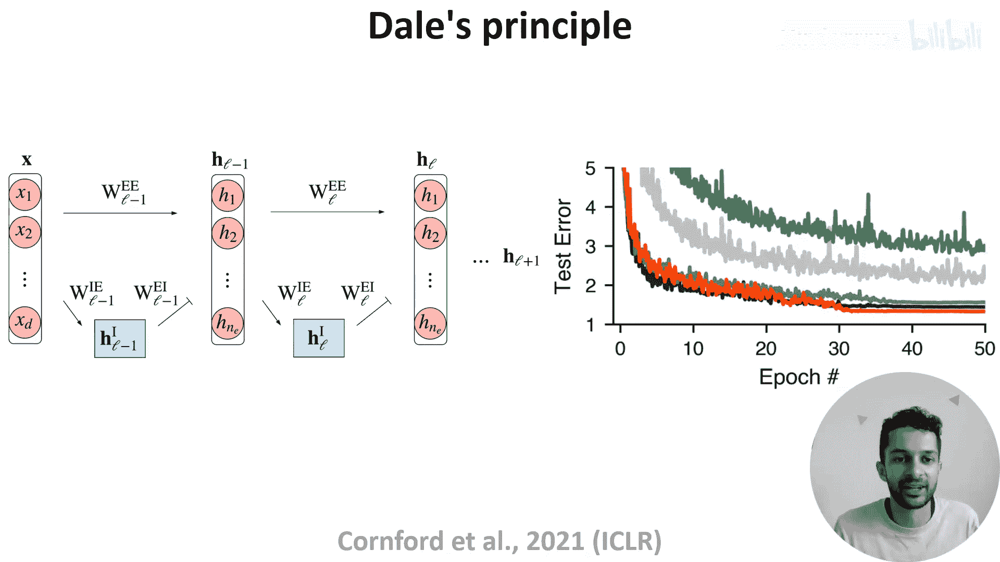
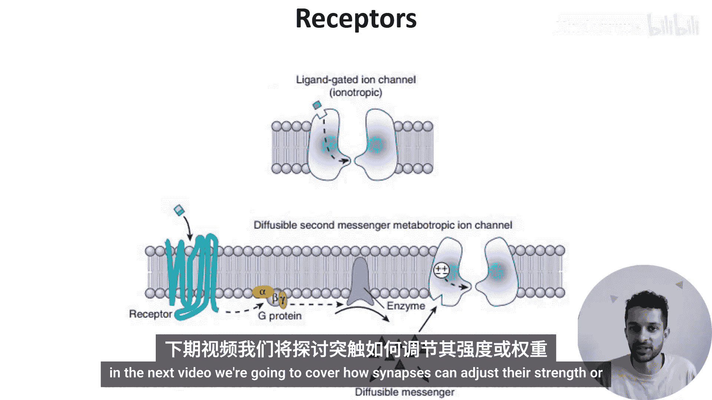

# 机器学习人员的神经科学 ｜ Neuroscience For Machine Learners p10 P10_W2_V0-Synapses_1 -BV1MiawzJExR_p10-

Hi， last week we covered how ionic movements enable neurons to generate their resting membrane potential and spikes。

In this video， we're going to talk about how neurons signal to each other。

 starting from our single neuron diagram。

Inputs of the neurons dendrites cause sodium channels to open and following their concentration gradient。

 these ions diffuse into the cell and spread along the dendrites the soma and the axon hillock Na rich with voltage gated channels。

Low amounts of input won't raise the membrane potential enough to trigger the opening of these channels；

 remember the gate threshold from last time， but large amounts of input may。

 in which case more sodium will flow into the neuron then begin to diffuse down the axon。However。

 without any help， this signal would just dis as it traveled the length of the axon。

So how do neurons prevent this？The solution is to insulate the axon using a fatty substance called myelin。

However， even insulating the whole length may not be enough。

 so instead there are insulated blocks separated by gaps known as nodes of wrong V。

 which are rich in voltage gated channels。These effectively boost a signal as it travels along the axon and generate what we callsatory or jumping conduction。

So what happens once the signal reaches the neurons axon terminals？

Well， if we zoom in on one of these terminals， we can see that this is where on neuron connects to another。

We called this connection a synapse and turned the neurons either side the free and post synaptic neurons。

These connections can be either electrical known as gap junctions or chemical like this one。

So what makes up a chemical synapse？The precyynaptic neuron has vesicles。

 3D spheres filled with chemical messengers known as neurotransmitters。

The post synaptic neuron has proteins embedded in its membrane， known as receptors。

 which the neurotransmitters combine to。Then the gap between the two is known as the synapic cleft。

 and while it's often drawn like a gap， there are actually proteins which reach across it and hold the entire junction together。

When an action potential reaches the Axon terminal。

The influx of ions depolarizes the membrane and causes voltage gated calcium channels to open and calcium to flow into the cell。

This causes the synaptic vesicles to fuse with the cell membrane and release their neurotransmitters into the cleft。

The neurotransmitters then perfuse across the cleft and bind the postynaptic receptors triggering different effects。

In the diagram here， binding causes an ion channel to open and positive ions to flow into most synaptic neuron。

 raising its membrane potential。So we would describe this as an excitatory signapse as a pre synaptic action potential will make the post synaptic neuron more likely to fire a spike。

Conversely， inhibitatory synapses reduce the postynaptic neurons membrane potential and make spikking less likely。

So how does this signal terminate Well， some neurotransmitter molecules simply diffuse away from the clef。

Some are broken down by enzymes and some are actually taken back up into the precyynaptic neuron。

An interesting side note here is that there's a whole class of drugs for treating depression which work by inhibiting this sort of reuptake channel。

 These are known as selective serotonin reuptake inhibitors and a common example is prozac。

Now let's discuss neurotransmitters in more detail。

Neurontransmitters are molecules synthesized by neurons， which are used to signal two other neurons。

There are hundreds of known neurotransmitters which are thought to have different functions。

 So I'm just going to give you three common examples。

Bluutate is the main excitedory neurotransmitter in vertebrate nervous systems。

TheAba is the main inhibitory neurotransmitter， and dopamine is often thought of as a pleasure signal。

 but is probably best described as signaling valence。Interestingly。

 individual neurons tend to contain and release multiple transmits， for example。

 single neuron may use both GaBba and dopamine。Though in general。

 neurons release the same set of transmitters at all of their synapses。

This is known as Dale's principle and sets up an interesting contrast between biological and artificial neural networks again biological neurons will release the same set of neurotransmitters for all of their partners。

But in artificial neural networks， single units have both positive and negative output weights。

 so their activation sends different signals to different units。

So is this a limitation of biology or an advantage？To exploreplore this question。

 Jonathan Cornford and colleagues built ANNs in which each unit was either excatory or inhibitory。

This is shown on the diagram on the left in pink and blue。

It turns out that these networks are difficult to train with standard gradient descent and end up performing worse than standard ANNs。

You can see this on the right graph where the black curve shows the performance of a standard A&N。

 and the green curve shows a simple implementation of networks with respect Dale's principle。

So the authors introduced some corrections and were able to get networks with respect Dale's principle and match the performance of standard ANNs。

This improved implementation of Dale's principle is shown on the graph as the red curve。

But as the authors are only able to match standard A&Ns。

 and as far as we know no one has shown better results by following Dale's principle。

 why neurons tend to follow this principle remains an open question。

Okay， back to neurotransmission。Once released， neurotransmitters diffuse across the synaptic cl。

 find receptors embedded in the cell membrane， and trigger different effects。

There are hundreds of receptors which are all specific to different neurotransmitters。

 but they fall into just two major classes。Iron atrophic receptors shown on the top are receptors where neurotransmitter binding trigger a change in structure which opens an iron channel。

Meabbotrophic receptors are receptors were binding trigger signaling cascades within the postcyynaptic neuron。

 which may eventually open iron channels or cause other effects。

Hopefully this has given you a better idea about how synapses work in the next video we're going to cover how synapses can adjust their strength or weight。

😊。

