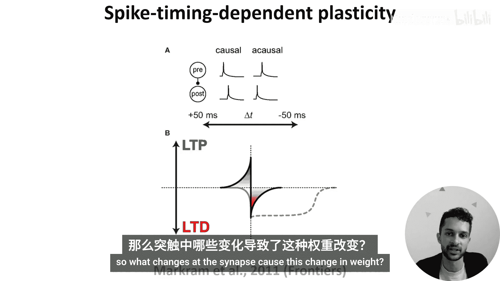
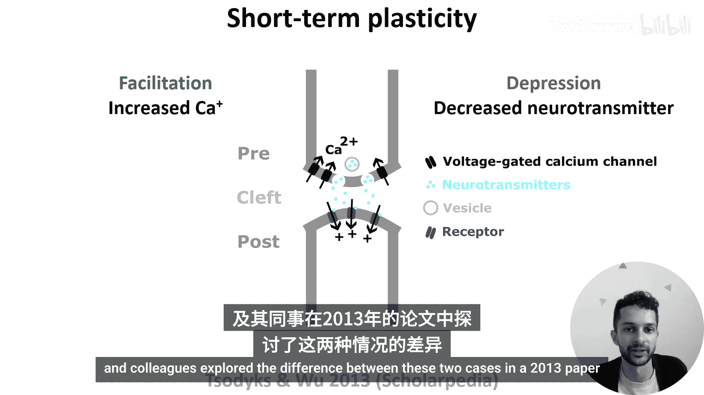
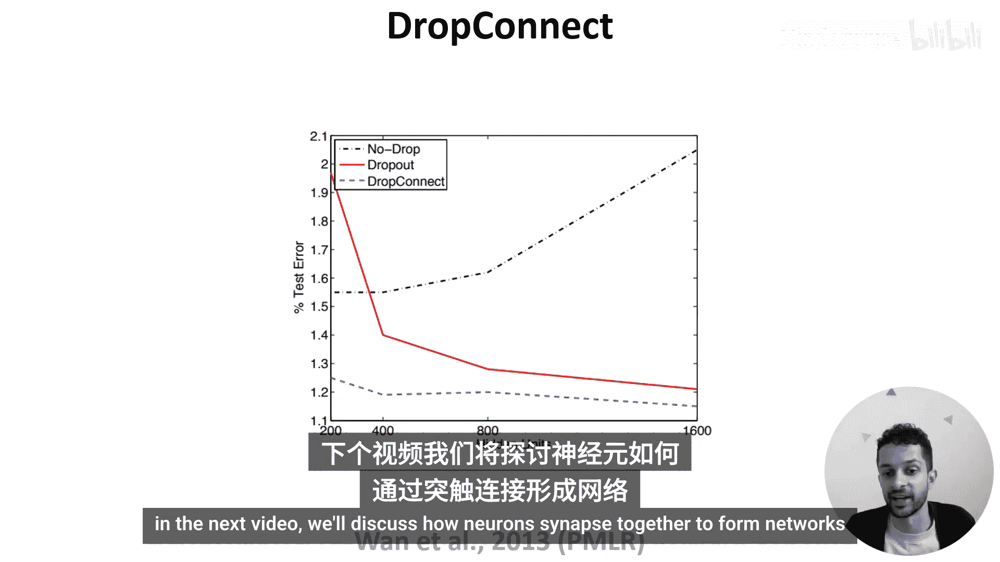

# 机器学习人员的神经科学 ｜ Neuroscience For Machine Learners p11 P11_W2_V1-Synapses_2 -BV1MiawzJExR_p11-

H in the last video we covered synapses， neurotransmitters and receptors in this video we're going to cover how synapses can adjust their strength or weight。

So in general， we train artificial neural networks by adjusting their connection weights according to a learning rule。

But what is the equivalent in biology。

Well， as early as 1949， Ron Heb closed a relatively simple learning rule。

When an axon of a cell A is near enough to excite a cell B and repeatedly or consistently takes part in firing it。

 some growth process or metabolic change takes place in one or both cells such that A's efficiency as one of the cells firing B is increased risk。

At the time this was just a theory， but experimental evidence confirmed it around 20 years later。

This learning rule is often summarized as cells that fire together， wire together。

 and conversely cells that fire out of sync lose their link。

Though this misses the fact that cell A must spike first and contribute to B's firing。

 and so the relative timing matters。

Just to expand on that a bit。Let's consider a pair of neurons。

Annnel A shows if the three synaptic neuron spikes tend to occur before or after the post synaptic neuron。

 And so if their relationship is causal or a causal。

Hunnel B shows how this synapses strength on the Y axis will be adjusted depending on the difference in spike timing between the two neurons。

If the relationship is causal， so pre proceeds postd， the strength will be increased or potentd。

 shown in green。While if it's a causal， in other words， prets to follow post。

 where the strength will be decreased， shown in red。

This is known as spike timing dependent plasticity and it tends to induce long term changes in synaptic strength via processes known as long term potentiation。

 LTP and long term depression LTD。So what changes at the synapse caused this change in weight？

Well， if we think about the structure of the synapse。

 then we can see that there are many possibilities for changing the connection strength。

 like increasing the number of synaptic vicles or the density of neurotransmitters within。

Increasing the number of postsynaptic receptors。Increasing the surface area of the synapse or even adding an additional synapse between the two neurons。

But these are all long term changes and synaptic weights can also change on much quicker timescales on the order of hundreds to thousands of milliseconds。

This is known as short term plasticity， and it describes how synaptic strength hs dynamically with the level of presynaptic activity。

Broadly， short term facilitation is caused by the shy levels of calcium at the axon terminal after biking。

 which increase the probability of neurotransmitter release。

Short term depression is caused by the lower levels of neurotransmitters available at the synapse。

 and in extreme cases it's possible that the synapse will fail to send signals at all。

So short term plasticity shows our neuronsn recent activity。

 and so the state of its synapses influence its weight dynamically。Going back a step。

 ref synapses will sometimes fail as vendor signal may remind some of you of dropout in machine learning。

So here it's individual connections which are failing， not the entire unit。

 and actually Yan Laun and colleagues explored the difference between these two cases in a 2013。

Just to be explicit， with dropout， you randomly silence units during training。

 which reduces overfitting with D connect， you randomly silence weights。

Just to give you a quick comparison between the two。

 the graph shows the test error on MN as a function of the network size。With no drop in black。

 the error increases with size as the networks increasingly overfi the data。With dropout in red。

 the error decreases with size。With Drop connect in blue， the error is lower and more stable。

If you're interested， the paper provides more empirical and theoretical results。

 which suggest that Drop Connect may be advantageous compared to drop out。Okay。

 that's all for this video in the next video we'll discuss how neuronsn synapse together perform networks。

