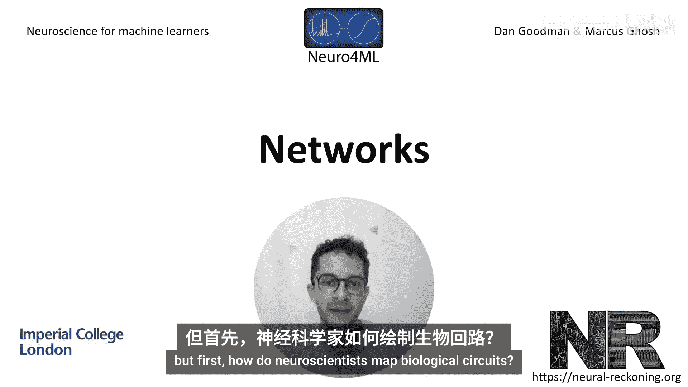
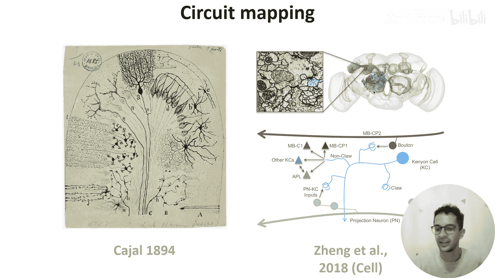
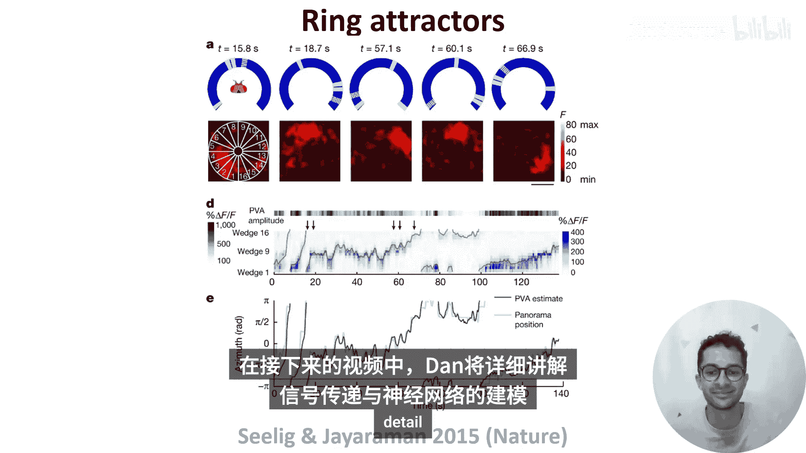

# 机器学习人员的神经科学 ｜ Neuroscience For Machine Learners p12 P12_W2_V2-Networks -BV1MiawzJExR_p12-

Hi again， in the last two videos， we learn about how neurons signapse with and signal to each other。

In this video， we're going to learn a bit about how neurons connect together to form networks or circuits。

To do that， I'm going to give you two examples of networks found in biology。But first。

 how do neuroscientists map biological circuits？

Well， broadly you need to dissect out an animal's brain， plic it very thinly， stain it。

 we knew it under a microscope， and then analyze the images。Historically， this was all done by hand。

 like this drawing from Kahaal in 1894。But everything from the data acquisition to the analysis is being automated and it's an exciting space to watch。

😊。

Okay， let's look at our first circuit。The cerebellum is an area of the brain involved in coordinating movement。

 and it's composed of circuits which look something like this diagram。

There are three things to note here。The cells are found in three layers which are labeled on the left。

The major cell types are labeled like the granule and hikininji cells and the connections between the different cell types are marked to either exc or true or inhibitory。

 depending on what neurotransmitters they use。So how does information flow through this network？

In the mossy fiber pathway on the right， input synapse with granule cells。

 which then send their outputs up into the layer above where they branch out and spread through the kji cell dendritic arbors。

 forming thousands of excitatory synapses。Because of their structure。

 these granuular cell outputs are known as parallel fibers。

The pekinji cells then sent inhibitory connections for the circuits outputs。

 and deep cerebelella nuclei。In a second pathway on the left， a timing fiber pathway。

 other inputs skip straight to the pekinji cells。Hopefully you can also see that there are other interesting connections in the circuit too。

 like the direct connections from both of these pathways straight to the outputs。

 so from the mosy and climbing fibres straight to the deep cerebelella nuclei。

So how can we think about or model this network's function？Well。

 models have been proposed for over 50 years， but one simplified way to think about it is that the three layer network with the two pathways we just discussed。

Inputs arrive by the mossy Fipers which connect to both the first and third layers with grannuular and nucleus cells。

Then there are feed forward connections through the network and the third layer generates output predictions。

These outputs are then compared to input observations and the difference between the two is fed back to the network as an error signal via the climbing fiber pathway。

 which on this diagram is shown in red。If you're interested to learn more about this model。

 this paper focuses on a really interesting question。

 which is how the network can learn when the connections conveying the error signal to the third layer are relatively weak。

 which is shown in panel B by the thin red arrow。Okay， on our second Circuit。

Around 30 years ago researchers were recording the activity of individual neurons in the rap brain when they discovered cells which seemed to encode the heading direction of the animal。

 and so they named these head direction cells。Here， for example。

 are three neurons firing rates and spikes per second as a function of the animal's heading direction。

 and you can see that each neuron is very specific。

This and later work would show that as a population。

 neurons evenly tiled the space of heading directions。

And that the activity of these cells depends on both visual and vestibular or balance inputs。

The better understand these results。Team proposed an attractor model in 1995。

 which they drew as a series of rings with the head direction cells in the aler ring and visual and vestibular inputs in the inner rings。

There are lots of details， but the most salient one is that there are strong excitatory connections between neighbouring head direction cells and strong inhibitory connections between distant cells。

This means that there'll be just one cluster of active cells at any time。

And either visual of vestibular inputs to the head direction cells will force this peak shift around the ring。

Interestingly， the authors thought of this as a somewhat abstract model and in their paper wrote。

 It is helpful to think of the network as a set of circular layers。

 this does not reflect the anatomical organization of the corresponding cells in the brain。

So recently， experiments in fruit flies。Revealed the group of neurons arranged in a ring with a single bump of activity which tracks the fruit flies heading direction In this experiment。

 the authors essentially have a fruit fly walk on a rotating treadmill while the fly watches a screen with some landmarks on in Pan A。

 This screen is shown as the blue ring。😊，Simultaneously， they're recording the fly's brain activity。

 which is shown in the black and red boxes below。We'll explain the recording technique they're using later in the course。

 but for now it's enough to know that red indicates more neural activity。

What you can hopefully see is that there is a single bump of activity which rotates around the ring as the fly navigates around and the panels below in DE show that this bump of activity actually tracks the flys heading direction So in sum ring attractors are a nice example of where experiments and theory in source circle Okay that's all about networks from me in the next videos Dan will talk about modeling synapses and networks in more detail。

