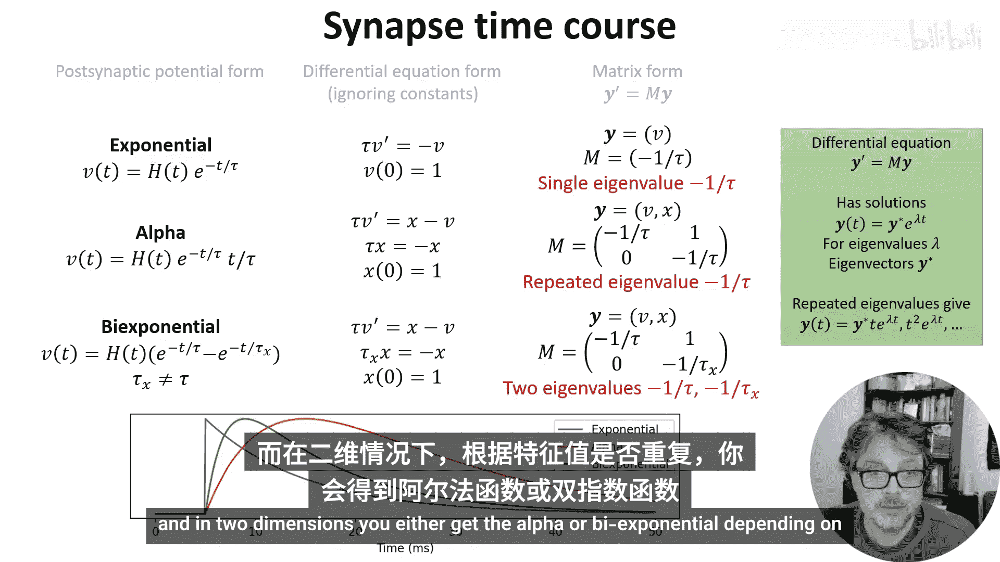
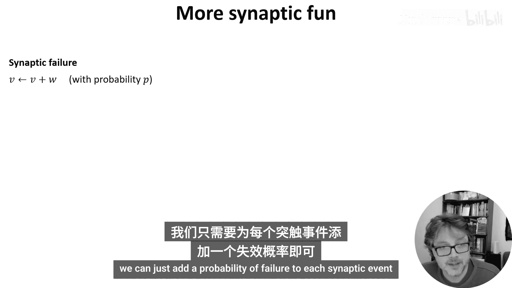
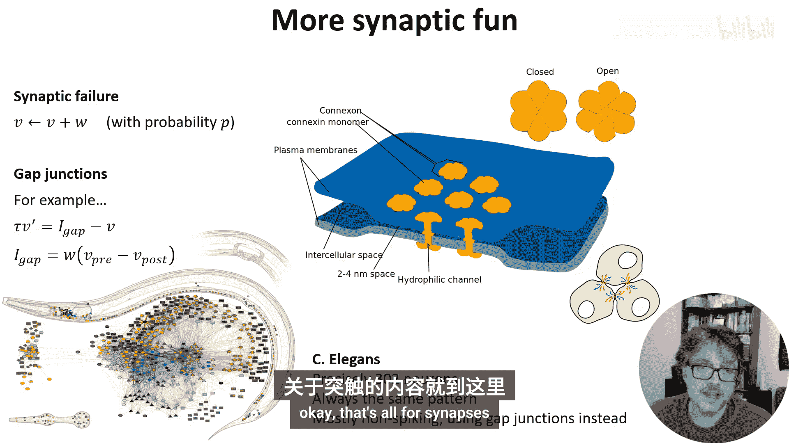

# 机器学习人员的神经科学 ｜ Neuroscience For Machine Learners p13 P13_W2_V3-Synapse_models -BV1MiawzJExR_p13-

Like last week， we just hit with you with a lot of detailed biology。

 and now we're going to see how to turn that into relatively simple equations。

Marcus explained how when a spike arrives at a transmitting synapse， neurotransmitter is released。

This neurotransmitter was a change in the conductance of the receiving cell because of the opening of an associated ion channel。

In turn， this leads to an input current following the same sort of equations we saw for the Hoddgekin Huxley formalism last week。

Which， in turn， leads to a change in membrane potential for either the Hodgegkin Huxley or leaky integrate fire type neurons。

Now， just as we did for neurons， we need to decide what level of detail we want to include in our synapse model。

 And one reason we might want to leave out some of this detail is that some of these changes will happen fast enough that modelling their temporal dynamics won't change much at the scale we are looking at。

Now， a helpful picture to draw to get a feeling for this is the post synaptic potential。

 sometimes simply referred to as a PSP。This shows the increase in the membrane potential of the receiving cell as a result of a spike arriving at that cell。

In this figure， you can see a model synapse at three levels of detail。

 The blue curve shows what happens when we model the synapse as an instantaneous increase in the membrane potential。

In orange， we model it as an instantaneous increase in a current。

 which then decays exponentially back to rest and in green， the same。

 but the instantaneous increase to the conductance。

Now let's start by talking about how we can directly model the dynamics in terms of conductance。

 current or membrane potential， and we'll come back to talking more about neurotransmitter release dynamics in a moment。

A common approach is to decide the key synaptic variable and model it with one of three classes of functions。

 Now， there's an explanation as to why these three classes come up that I'll return to in a moment。

For the sake of simplicity， I'll describe each of these as postynaptic membrane potentials。

 although they can also be used to model currents or conductances。

The first class is the exponential function。 We can write this as the product of an exponential decay with some time constant and a heavy side function H of T that returns 0 of T is less than 0 or 1 otherwise。

A step up in complexity is the alpha function， which we haven't seen before。 In this equation。

 we multiply the exponential decay by T so that it rises continuously before decay。

And a further step up is the by exponential function。

 which lets us separately control the rise and full time with two different time constants。

Each of these can also be expressed as a linear time invariant differential equation with constant coefficients。

Now this makes a certain sort of sense because we'd expect time invariance in a model of a physical system and having linearity and constant coefficient is just the simplest thing you can do。

We can take that argument a bit further by putting these equations into matrix form and calculating their eigenvalues。

These three forms are essentially the only possibilities for a one or two dimensional system that is both linear time invariant and has constant coefficients。

The exponential is the only possibility for one dimension， and in two dimensions。

 you either get the alpha or by exponential depending on whether or not the eigenvalue is repeated。

So far， we've looked at memoryless models of synapses。

 where previous activity doesn't affect what they do。But this isn't quite right。

Neurotransmitter is released in vesicles， and after being released。

 some fraction of them will be unavailable if another spike comes along。

This means that latest spikes will likely have a smaller effect than earlier spikes。

 and we call this short term synaptic depression。We can model it by adding an extra variable X that tracks what fraction of vesicles are available。

😊，However， it also turns out that you see cases where each subsequent spike has a bigger effect than previous spikes。

 which we call facilitation。A simple model that encapsulate both effects is to add an extra variable U that represents the probability that an available vesicle will be released and allow this to increase after each spike。

Combining these two ideas in the simplest way possible。

 we get this model in the absence of any spikes， the pool of available vesicles will increase exponentially until all vesicles are available。

At the same time， the probability of spiking will decay to zero。😊。

We can control the rate of these processes with facilitation and depression time constants Tau F and tau D。

When a spike arrives， we first increase you the probability of a ves release。

Note that we do this first， because otherwise the first bike would release zero vesicles。Next。

 we release an amount of v scores is proportional to U times x because there are x available。

 and we release with probabilityla to U。In this model。

 I've had this directly modify the membrane potential V， but as in previous slides。

 it could modify other variables。And then finally， since we've released U times Xveesicles。

 we now have to remove those from the available pool by subtracting that from X。😊。

And here's what those variables look like in these two cases。

So what does this do in terms of function。 Well， as usual， we don't have a complete answer to that。

 One thing for sure is that it gives synapses a longer memory than they would otherwise have。

 which is likely to be useful in many cases。 It can also allow the neuro to have richer spike frequency dynamics。

 allowing them to act as low， high or band pass filters and do gain control。

And there's a bunch of other ideas people have suggested。

 and I've put some links in the reading list for where you can read more about this and other models of short term plasticity。

As Marcus mentioned， synapses can be either excitatory or inhibitory。😊。

There are a range of different ion channels and dynamics giving rise to different sorts of excitatory or inhibitory synapses。

The simplest model is just that excitatory synapses lead to an increase in some variable。

 while inhibitory synapses lead to a decrease。However。

 when synapses are modeled with detailed ion channel dynamics and spatial structure。

 things can get more interesting。And chanting inhibition is a good example。In chunting inhibition。

 a spike causes a local increase in conductance， but with a reversal potential near to the resting potential。

This means that on its own， in the absence of any other input。

 you wouldn't observe any effect on the membrane potential。However。

 it will reduce the effect of an excitatory synapse on the dendrite while having no effect on an excitatory synapse on the soma or on a different dendrtic branch。

This means that it can have a selective， divisive effect on excitatory inputs。

 something you wouldn't easily be able to achieve otherwise。Another interesting channel type is NNDA。

 which can't be modeled linearly。 The effective NNDA requires the receiving neuronss membrane potential to have recently been high。

 and this may be important in learning。Talking of learning。

 I should mention long term plasticity here， but only briefly。

 because that's the main topic of week4。Marcus mentioned heavy rules。

 and you can generally model them by adding some differential equation for the synaptic weight W as a function of the activity of the precyaptic and postcyaptic neurons。

 and we'll talk about some of the particular models later。

There's also spike timing dependent plasticity or SDDP。

It's been observed experimentally that particular pairings of pre and post synaptic spikeite times can lead synapses to get stronger or weaker。

We can model this by increasing the weight by some Delta W that depends on the timing difference。

 and that can be made a reasonable profit to experimental data。This particular curve。

 where the synapse get stronger。 if presaptic spikes tend to come before post synaptic spikes could be thought of as encouraging networks to care about temporal causality。

Okay， that's all I'm going to say for now about that。

 but we'll be seeing much more about this later in the course。😊，As always。

 there's a lot more that could be said about modeling synapses。

 I'll just briefly mention two before closing this video out。The first is synaptic failure。

 and it's an easy one to model because we can just add a probability of failure to each synaptic event。

The second is gap junctions， and this is where two neurons for my direct electrical connection rather than via chemical synapse。

These， again， can be straightforwardly modelled as just another current proportion in this case to the difference in membrane potentials。

 There are， of course， more complicated models， too。Gapjunctions occur in many species。

 but a particularly interesting example is the tiny worm sea elegance。

 Neuroscientists love it because it always has precisely 300 and2 neurons with the same pattern of connections。

 It's unusual， though， because they are mostly non spiking。

 using gap junctions to communicate instead。😊，Okay。

 that's all for synapses in the next video we're going to look at modeling networks。😊。

