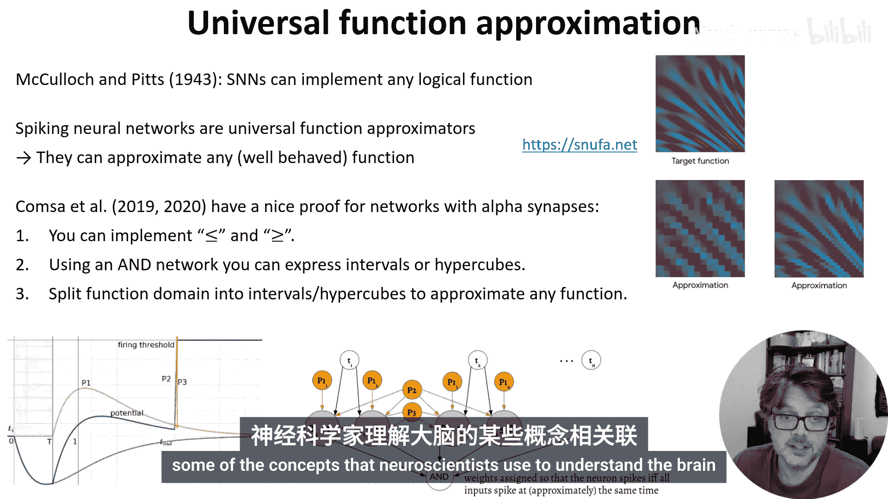
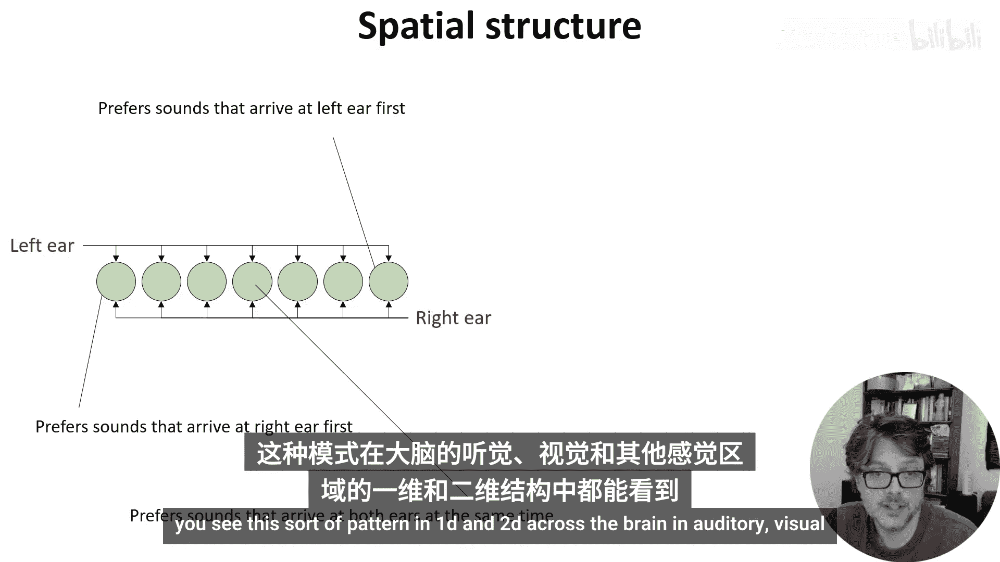
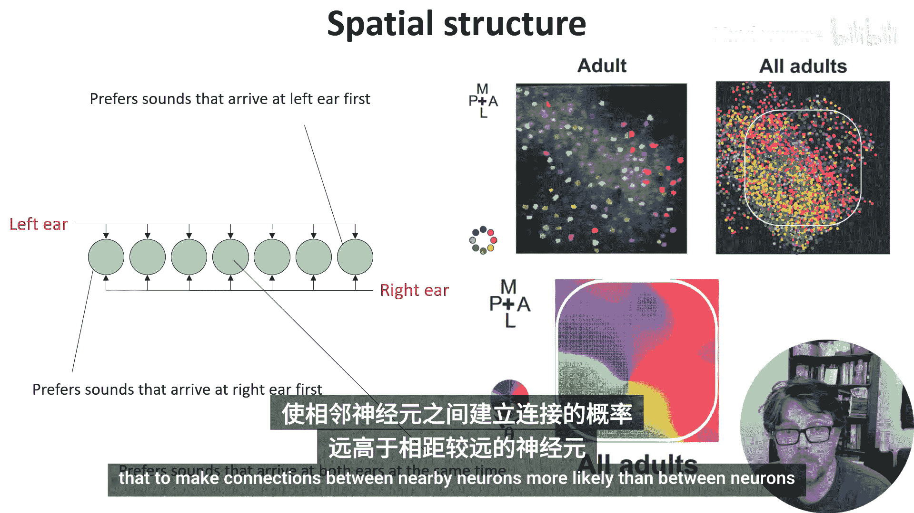
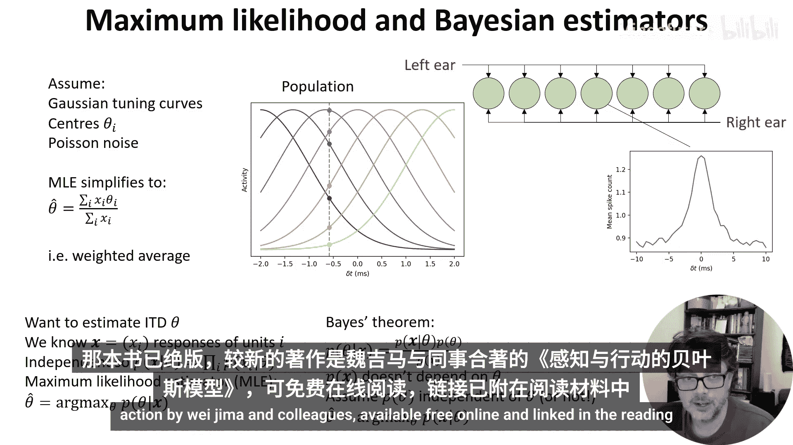
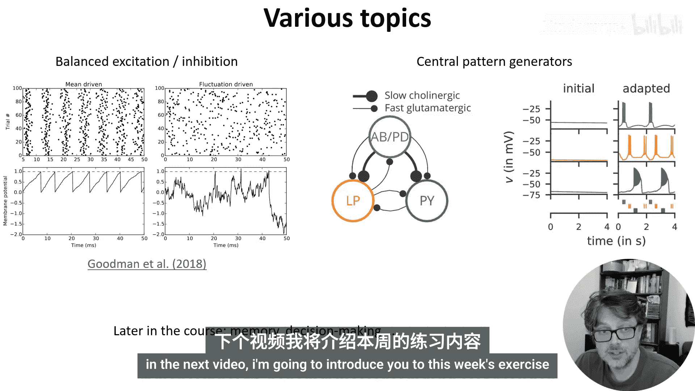

# 机器学习人员的神经科学 ｜ Neuroscience For Machine Learners p14 P14_W2_V4-Network_models -BV1MiawzJExR_p14-

In this video， we're going to start to look at modeling networks。

 which in some sense is the topic of the rest of the course。

A key question we might want to answer is， what can networks do that single neurons can't。Now。

 the simple answer is that they can do anything， which makes it sort of tricky to decide what to include in a short video like。

So let's start by unpacking what I mean by that。If you watch the history of neuroscience video。

 you'll know that as early as 1943， McCella and Pits showed that spikeiking neural networks could implement any logical function。

And we don't need to limit ourselves to logical functions。Just as for artificial neural networks。

 spiking neural networks are a universal function appators。

That is that they can approximate any reasonable function。

Now this has been proven in various ways by different people over the years。

 but I'm going to highlight a particularly nice and simple proof by Yuo Comsha at Google Research。

She gave a great talk about this at a conference Iorganised called Snoer。

 which stands for Spikking neural networks as universal function appmators。

And if you like this course， you might find some of the research presented there interesting too。

 and it's all available to watch on YouTube。😊，I included a link in the reading material to Ser and to Julius's talking paper。

Her paper starts by showing that you can implement the less than and greater than operators using spiking neurons。

 and we're going to do a similar thing in this week's exercise。Next。

 by adding in a network that implements logical and。

 you can express intervals or in higher dimensions， hypercuubs。Finally， by combining these。

 you can approximate any function to as much accuracy as you want by just dividing into smaller and smaller hypercubees。

😊，Okay， so that's great and perhaps not unexpected。

 given our brains are just spik in neural networks and we like to think we're fairly capable。😊。

But it does mean， as I said， that there's no way we can cover all the things we can do with networks。

So instead， what I'm going to do is talk through in detail one particular type of network that I've been interested in during my research career and show how it ties into some of the concepts that neuroscientists use to understand the brain。

The circuit we'll look at is the sound localization circuit。

 One of the key ways that we can tell which direction the sound is coming from is because there's an arrival time difference of the sound between the two ears。

Depending on head size and the angle the sound is arriving from for humans。

 this is a maximum of around 650 microseconds。But we're able to discriminate sounds arriving with a time difference as small as 20 microseconds。

 and some animals like owls can discriminate differences as small as just a few microseconds。😊。

So how can we detect this？One model is due to Lloyd Jeffs in 1948 and still found in textbooks。

 although the reality is a bit more complicated， as we'll see。In his model。

 you have an array of what is sometimes called coincidence detector neurons。

These and neurons still only fire a bike if they receive a simultaneous input from both their capses。

The signal arrives from the left ear and travels at a constant speed along this pathway。

 arriving at each neuron。With a slightly different delay。At the same time。

 the signal arrives from the right there and does the same thing but in the reverse direction。

When the acoustic delays exactly cancel with the neural delays。

 the signal will arrive at the coincidence detector at the same time and cause it to spike。😊。

And we could use the identity of which neuron fired a spike to tell us where the sound came from。

Let's see that in action for this example sound。 You can see that it arrives first at the left ear。嗯。

In the third window。 and then in the right ear， in the fifth window。

 So there' a two window time difference。Now， let's see what happens in that circuit。

When the sound happens， the signal appears at the left and starts moving right。And then at the right。

 moving left and they arrive at the cell at the same time， and it lights up。

So that's how Jeffss's model of sound localization works。

 and it has a few interesting and more general features that we can dig into。

The first is coincidence detection。It's actually quite a general property of leaking your arms precisely because of the leak。

 as you can see in this picture。😊，When two spikes arrive at similar times。

 they're enough to drive the neuro over threshold and cause a spike。

Whereas when they arrive with a larger time difference。

 the leak between the spikes means the peak is lower and not enough to drive over threshold。

We can plot the effect of this on a neuron that receives two spikes and to make it a bit more realistic。

 a fluctuating Gaussian background noise。😊，And here's what we get。😊。

You can see that the neuron fire more spikes when the time difference between the input spikes is smaller。

 and that's precisely what we want。This is one example of what's called a tuning curve in neuroscience。

 It shows the response of a neuron averaged over several repetitions to a stimulus defined by one or more variables。

In this case， the variable is the arrival time difference between the two spikes。

 but it could be anything like the contrast of a visual image。

 the amplitude or pitch of a sound and so on。And it can also be 2D。

 in which case you'd plot it as an image。We'll come back to tuning curves a bit later。

Another aspect of this network that you see many times in neuroscience is the spatial structure。

The cells here are in a one dimensional array in order of their preferred difference in arrival time。

You see this sort of pattern in 1 D and 2D across the brain in auditory visual and other modalities。

Here's an example from the barrel cortex of the rat。

 that's the part of the brain that processes inputs from the rat's whiskers。

The colored blobs show the preferred stimulation direction of the cell recorded at that position。

The special structure isn't terribly obvious here because there are so few cells recorded。

But you start to see it if you combine across multiple animals。And with a bit of smoothing。

 it becomes even clearer。One interesting feature of this is that it's learned。

 you don't see that in young rats or in the adults， and in terms of modelling。

 it's fairly easy to just add some metadata to each neuron specifying its position and use that in your models。

 For example， you can use that to make connections between nearby neurons more likely than between neurons that are far away。

With the idea of tuning curves and spatial structure in mind。

 we can talk about how information is encoded and decod in this network。Essentially。

 the model Jeffs proposed is what we would now call a one hot encoding。

Knowing the identity or index of the most active neuron tells you the category of the data。

 In this case， a value put into one of several discrete intervals。More recently。

 it was noted that in the presence of neural noise。

 this isn't a very robust way of decoding that information。

David McAlpine and colleagues proposed an alternative view of what the brain might be doing to decode information from this network。

Their idea was to take the difference of the sum activities of the cells that prefer right leading cells to those that prefer left leading cells。

😊，And to use this1 D variable to regress the location。

And it turns out this is much more robust to noise。 conceptualually。

 this is because by summing or equivalently averaging all the activity of the cells to reduce the effect of the noise。

In 2013， I wrote a paper that I can summarize here by saying that you can do better than either of these approaches by using a standard multi class perceptrum。

This makes use of all of the information in a way that neither of the other two models does。

 including averaging out the noise。And in one of those strange twists of fate。

 the same year our paper came out。 Another came out from the same lab that I had just moved to。

Basically doing the same thing。 Only， they used a Bayesian decoding framework rather than percepts。

 And so I'll use their paper to talk about that framework。

We've seen how we can have an array of coincidence detectors whose response is larger or smaller。

 depending on the arrival time difference of the sound。

Now I imagine we plot all of the tuning curves on top of each other for this population of neurons。

If the ITd were here where this gray vertical line is， then we'd see the responses at these circles。

And the idea is to use that pattern of responses to work out the ITD。If there were no noise。

 you could just read it out easily from this figure。 But these responses are very noisy。

 So we just have to use a probabilistic method。 And there's a very common way to do that。

This is going to get a bit maty。We want to estimate the ITD。

We know the neural responses as a vector x。We assume that they're independent。

 so we can easily compute the probability of a given vector of responses。

 given a particular value of theta。Then our maximum likelihood estimator is the value of theta that makes the observed response the most likely。

But we don't know this probability of Theta given X， only the reverse。

And that's where basissa's theorem comes in， because it lets us calculate one in terms of the other。

In particular， since we're computing an AGmax over Theta。

 we can ignore any term that doesn't depend on Theta and so we can ignore this P of X。

If we assume that all of the values of theatre are equally likely。

 we can also ignore the PR The term。On the other hand。

 if we have a prior of which ITDs are more likely than others， we can also incorporate this here。

 and then the method is known as maximum a posteriori or map estimation。😊。

Now we can express the estimate we want in terms of things that we can calculate。Al right。

 that all seems quite abstract， probably。 But in this case， we can make some additional assumptions。

 and it simplifies very nicely。So what we're going to assume is that the shape of all of these tuning curves is approximately Gaussian centered on some preferred ITD Theta eye for neuron eye。

We'll also assume that the noise is Poisson distributed。

 which is a fairly reasonable model of neurons。With these assumptions。

 the maximum likelihood estimate is simplifies down just to an average of the preferred ITDs weighted by the responses。

Alright， now that was a very quick run through probabilistic population coding。

 And if you're interested in more on that， I'd recommend the theoretical neuroscience textbook by Diane and Abbott。

 or since that one's out of print， a more recent book。

 Bayesian Models of Perception and Action by Weiji Ma and colleagues available free onlineline and Li in the reading materials。

😊。

Okay， that's pretty much it for the sound localization example。

 I just wanted to finish by highlighting what we've gained from the network here。😊。

A single neuron has a time sensitivity controlled by its time constant at the smallest around 1 millisecond。

 and it has a lot of noise。😊，We've seen this curve。

 but that's an average over 10000 repetitions on a single toilet looks like this。

 It's unlikely we could make a very accurate estimate from that。

By switching to a population and using a population level decoder。

 we get a system that is sensitive to time differences of a few microseconds。

 orders of magnitude more time sensitive than the speed of the fastest units in the network。

As I said， we can't cover everything about networks here。 So to finish off。

 I just want to highlight two more interesting things you might want to read up on further。

Gutticical neurons receive thousands of tiny inputs per second。

 so why don't they all fire very regularly， like on the left of this figure。

One possible answer is that there is a balance of excitation and inhibition。

 and if excitatory and inhibitory inputs are balanced and randomly inter disspersed。

 a neuron can fire very irregularly。😊，You can see the effect of that on the right。Now。

 you actually see both types of behaviour in the brain and having a range of such behaviours might be important。

In this paper， I look at different mechanisms that could contribute to that in the early auditory system。

More generally， some of the possible roles that have been suggested for balanced excitation and inhibition include improving the sensitivity。

 noise robustness and response speed of a network。 There's a big literature on this。😊。

Another thing I personally find fascinating is central pattern generators。

 These are small networks that seem to just emit the same pattern of spikes on repeat forever。

They're thought to be involved in coordinating movements。

 basically providing a regular signal that can be transformed into stereotypical sequences that we need to move our muscles in standard patterns。

Some of the circuits for this can be very simple， like this one shown schematically here in the lobster Smatic astric ganglion。

😊，This one is particularly interesting because it was found in modelling studies that there were many different parameters for this circuit that give the same output。

And then later， it was found experimentally that this is also the case in real lobsters。

 Different individuals can have widely different neural properties in this circuit。

 and still it functions in exactly the same way。I put more reading on this topic and the others in this video in the reading list。

😊，Also， we will be coming back to some other network topics like memory and decision making later in the course。

Okay， that's all for now in networks in the next video I'm going to introduce you to this week's exercise。

😊。

