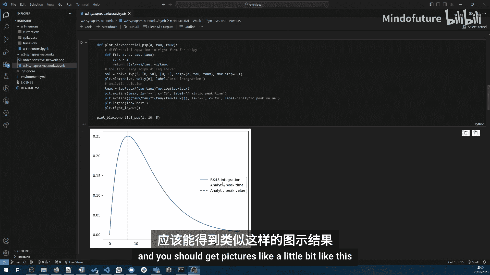
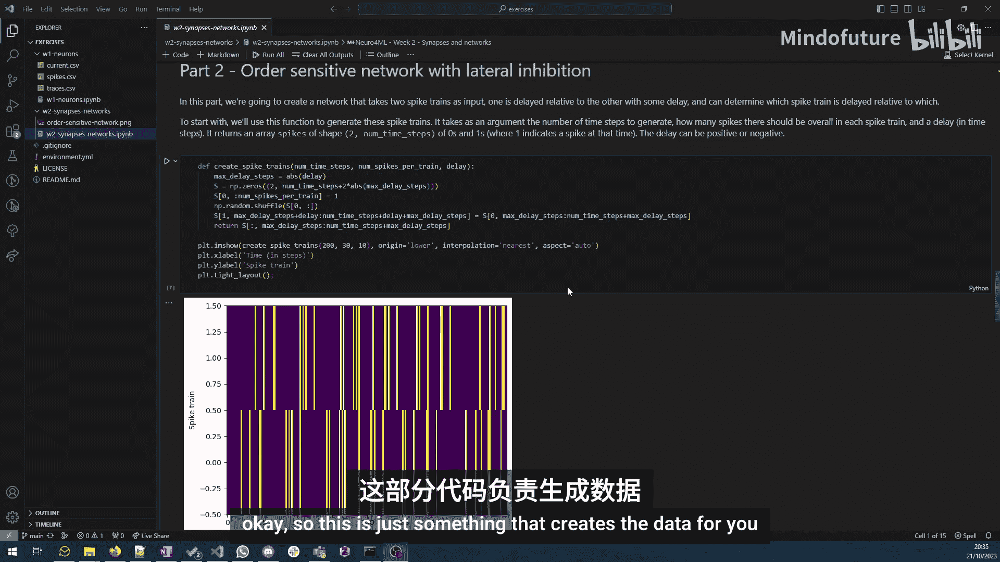
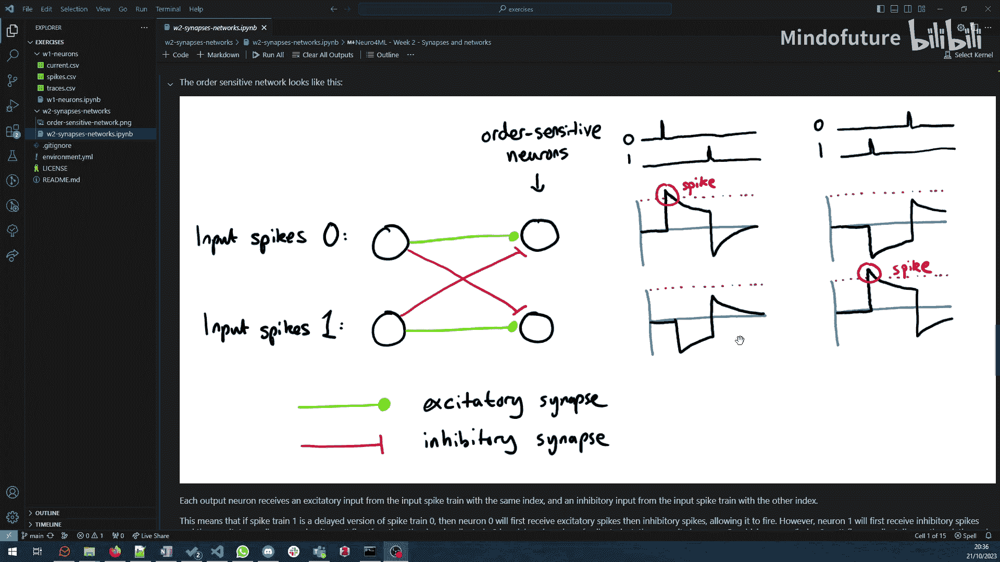
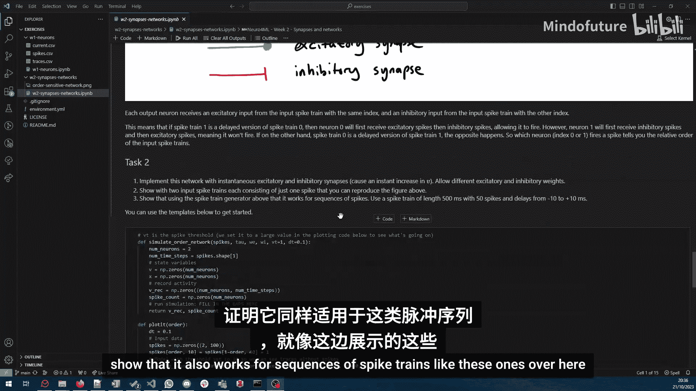
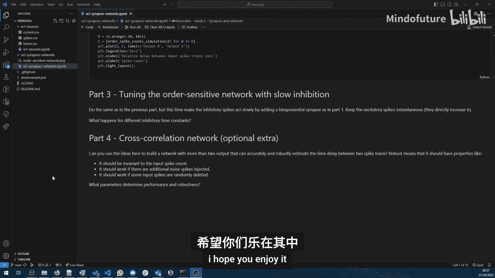

# 机器学习人员的神经科学 ｜ Neuroscience For Machine Learners p15 P15_W2_V5-Exercises -BV1MiawzJExR_p15-

Okay， in this video， I'm just going to briefly outline this week's synapses and Network exercise。

I think it should be that the notebook is mostly self contained and self explanatory。

 but I'll just go through very quickly just to give a rough overview。

So the first part is about using a more complicated synapse model than we before using bi exponential synapses。

I've written out a lot of the maths here， you don't have to go through it all in detail。

 but they probably should have a quick skim through that。

Your first task is basically to use numerical integration and compare it to a built in numerical and analytical solution。

And you should get pictures look a little bit like this。

The next part is to see how you can use that simulation that you've just written。

To and the the synapse to get different delays on the output or of of a neuro， in other words。

When this peak happens in this paratic potential。Once you've got that。

 you need to then implement a neural network simulator， a very simplified one with n neurons。

 each of which only receives a single input spike。At time，0。

And then test that。Okay， so that's kind of just a warm map to to the more interesting part。

 which has。To take what you've done so far and use it to build a network that is I've written it as an order sensitive network if you watch the previous videos。

 you see that the in the network by Yuo Comcha she has the less than equals to operation or greater than equalative operation and essentially what we're doing here is a different implementation of that same operation than the one that she used。

Using these sorts of synapses and delays。Okay， so this is just something that creates the data for you。

 this is the structure of the network， so basically the setup of the network is that this neuron this this there two inputs spike trains。

This one connects directly to this one， and this one connects directly excitatory to this one。

 and they each inhibit the other。And basically， what happens is if this one fires a spike first。

 then it the output neuron fires a spike， and then the delay comes after it's fire a spike。

 whereasas if this one fires first。The inhibition comes first。

 and then it can't then the then the excitation that comes later isn't enough to make it fire a spike。

Okay， so that's the structure of the network and your task is essentially to implement this and have a play around with it。

 basically show that you can reproduce this figure。

 show that it also works for sequences of spike trains like these ones over here。

Al right， with that done， you can take it a little bit further and you can start tuning this network using the slow inhibition of synapses that you've developed in the first part。

Okay so I think that that's realistically if you manage to get all of that done in two hours that would be pretty good。

 I've put in a part4 it's very much an optional extra in case you're interested in taking it a bit further。

 which is basically to take what you've developed here and try to build a more interesting cross correlation network that can estimate which outputs are correlated and what the time delay of that correlation is something that's invariant to。

How many input spikes there are robust to noise， robust to randomly deleting some spikes and try and understand what controls the performance and robustness of that。

 But like I said， I don't think anyone will get to that in the class。Okay， that's it。

 Hope you enjoy it。😊。

