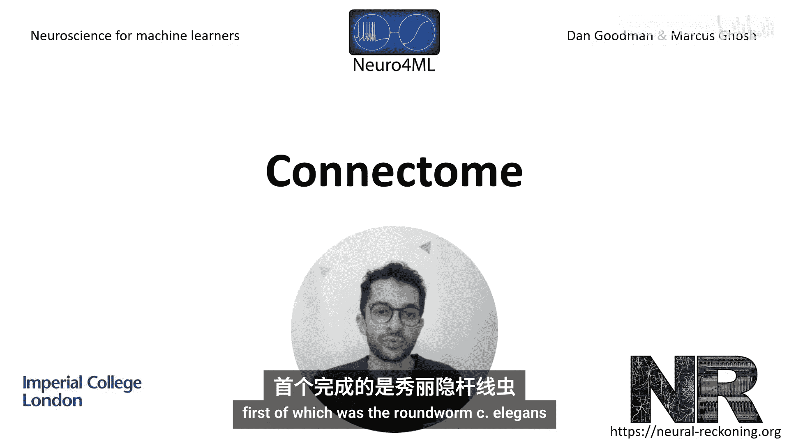
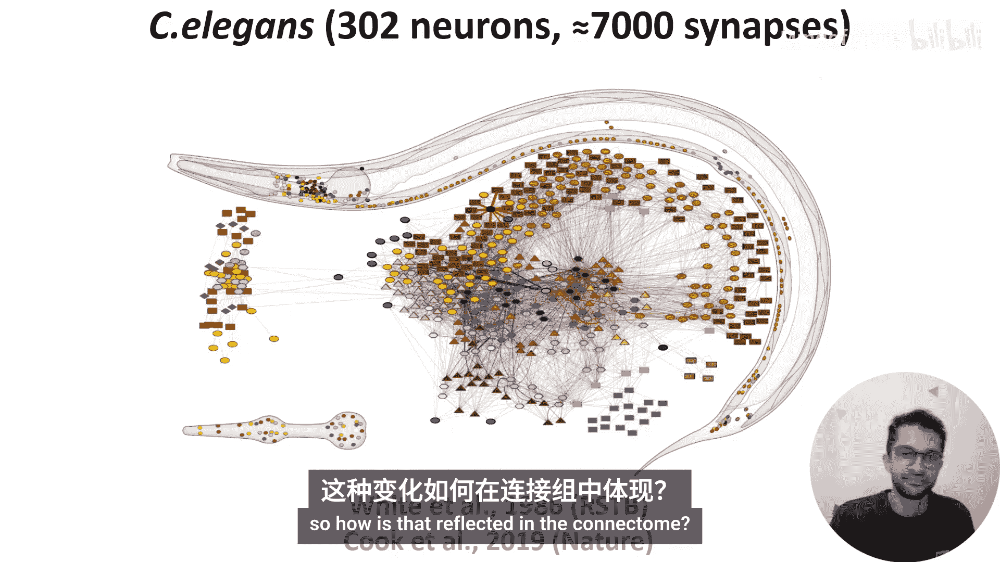
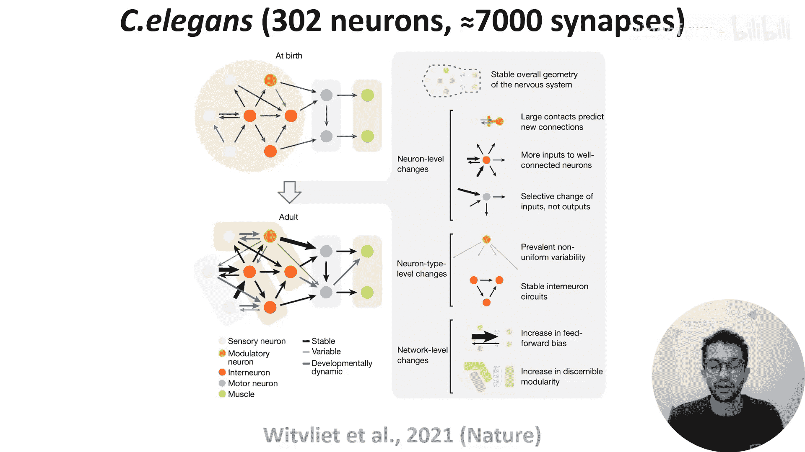
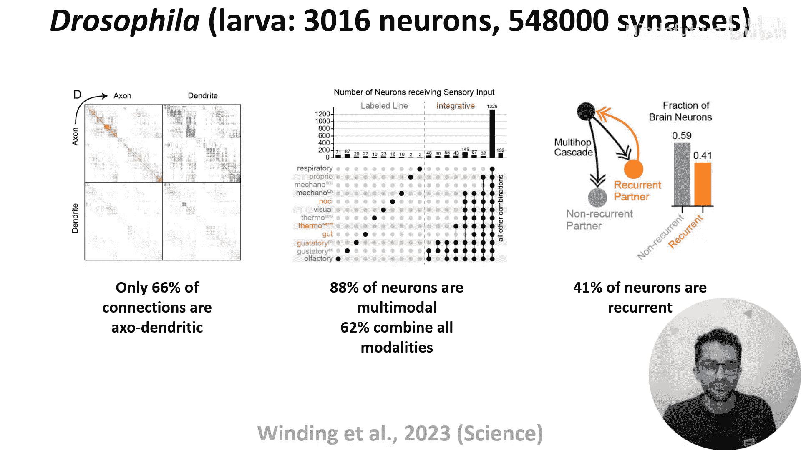
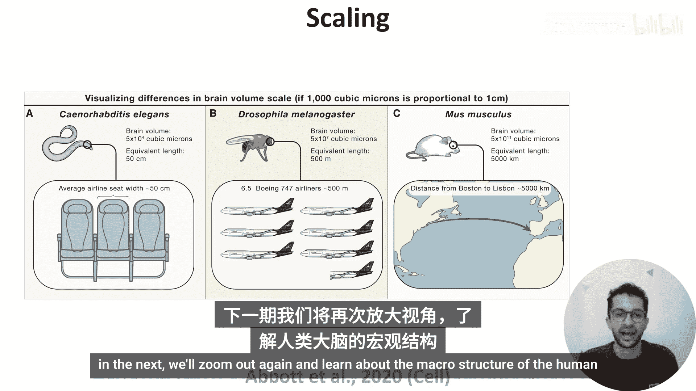

# 机器学习人员的神经科学 ｜ Neuroscience For Machine Learners p16 P16_W3_V0-Connectome -BV1MiawzJExR_p16-

Hy again， last week we covered how neurons sign up together to form networks。

 and we looked at some example networks like a ring attractor in the fruit flyly brain。

This week we're going to zoom out and consider what whole brains look like。

 which brings us to the connectome。Concept of having a full diagram。

 describing how every neuron next to every other neuron in an animal。To date。

 only four organisms have a full connectome， the first of which was the roundworm sea elegance。

The Clegs Connectome was first completed in 1986 and then updated in 2019。

The elegs are only around one millm long， but still to obtain the connectome researchers had to slice the samples into very thin sections around 50 nanoms thick。

W knew each under a microscope and then trace each neuron's connections through the slices by hand。

Once complete， they found the connectivity patterns shown here。

 which has just 302 neurons and around 7，000 synapses。

So what can we learn from this architecture well， firstly。

 about 80% of synapses are chemical and the rest are gap junctions。Second。

 the connectivity is sparse with only around 3% of all possible connections present。Third。

 neurons generally have dense local connections， but sparse long range connections。

 meaning the network has a modular structure。Fourth， from sensory inputs to motor outputs。

 the network is at most around four layers deep， so it's relatively shallow。

Though something to keep in mind is that while this network may seem simple。

 especially compared to a machine learning model。This network allows the worm to do everything from responding to sensory inputs foraging for food in its environment and mating to produce offspring。

 so I wouldn't underestimate the complexity you can get from even a relatively simple biological network so this connectome was generated by combining data from multiple animals of around the same age so it gives us a representative static view of brain structure。

 but brain is continuously changing as we learn an age， so how is that reflected in the connectome。

To address that question， this paper reconstructed the connectome of eight worms。

 each of which was a different age， and then compared these。They found that from birth to adulthood。

 there is a fivefold increase in the number of synapses。

 so these changes are not uniform and instead follow several patterns which are summarized in this figure。

Just to highlight three。First， new synapses tend to be added in the feed forward direction。

 from sensory inputs to motor outputs， so the network becomes increasingly feed forward over time。

Second， if you group neurons with similar connectivity patterns into modules or subnets。

 then you observe that a network becomes increasingly modular with age。Third。

 even though these worms were genetically identical。

 each worm had connections that were not found in other worms。

 which shows that experience also shapes the structure of neural circuits。Okay。

 moving beyond sea elegance， other models are beginning to have their connectomes mapped out too。

 like the fruit fly Drophiller。😊。

For example， this paper reconstructed the fruit fly lava or maggot connectome and at the top of the slide you can see that even going from a small worm or maggot there are already 10 times as many neurons and almost 80 times as many synapses。

 so what can we learn from this connectome？Well， one interesting feature is that if you define the direction of each synapse。

 so which neuron is pre and which is postcyynaptic。

 then contrary to what we usually assume in the field and have taught you so far。

 only 66% of connections are the axon of one neuron and the dendrite of another。

The rest are non canonical and you observe all possible connection types， exxon to axon。

 Exxon to dendrite， dendite to axon， and then right to dendrite。

Which means that the overall connectome is the result of four distinct neuron to neuron connection matrices。

 which are shown in the leftmost figure。Another interesting feature is that almost all neurons are multimodal。

 so if you start from the larva' sensory neurons which detect inputs like taste。

 temperature and touch and then use a signal cascade algorithm。

 propaggate signals through a model of the network。

You find that only 12% of neurons receive input from a single modality。

And this is shown on the left of the middle figure。

The other 88% of neurons receive inputs from different combinations of modalities which are shown on the right of the middle figure。

 and somewhat surprisingly 62% of neurons receive inputs from all 12 modalities。😊，Finally。

 the authors estimate that 41% of neurons are referring polysynaptically， in other words。

 if neuron A connects to B， B to C， etc， then eventually there is a connection back to A。

The rightmost figure illustrates this with a simple ABA connection in orange。

 but the bar chart considers loops with up to five synapses。Okay，St back a bit。

 we may expect that animals with more complex behaviours like us may have very similar connectomes to the fly and the worm。

 but simply scaled up。😊，Or we could expect additional features。Either way。

 it would great if we could obtain larger connectomes to compare these two。

Problem is that brain volume scales very rapidly。For example。

 going from a worm to a mouse is a 10 million sold increase in brain volume to visualize that if  a0 cubic microns of brain volume is proportional to a1 centimet linear distance。

 then the worm brain which we discussed is equivalent to the width of a seat on an aeroplane。

The adult fruitfed brain is equivalent to length of six and a half aes。

The mouse brain is equivalent to the distance between Boston and Lisbon。

So clearly obtaining larger connectomes present huge challenges in terms of data acquisition。

 data storage， analysis。😊，Okay， that's all for this video and the next we'll zoom out again and learn about the macro structure of the human brain。

