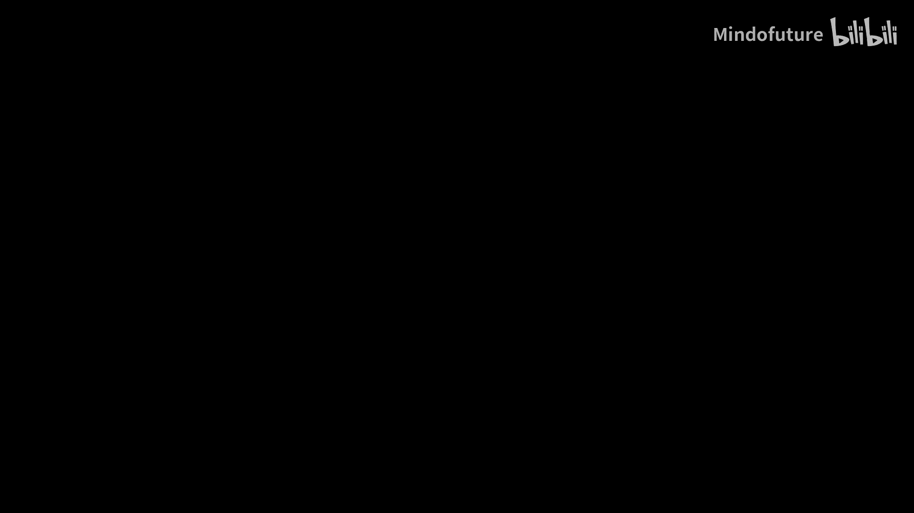
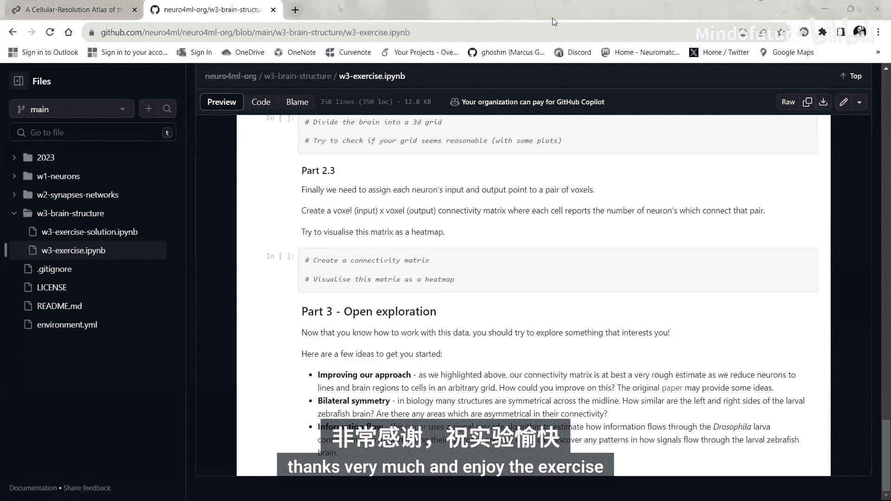

# 机器学习人员的神经科学 ｜ Neuroscience For Machine Learners p18 P18_W3_V2-Exercise -BV1MiawzJExR_p18-

Hi， everyone。This week's exercise is a little bit different because we're going to be working with some real data。

 which mostly come from this paper， cellular resolution outlas of the laval zebrafish brain。

Before getting into the exercise， I just wanted to take a minute or two to explain where the data come from and what they look like。

😊，So the data in this paper come from laval zebrafish。

 which are a commonly used animal model in neuroscience。

If we were to look at a fish from the top down， it would look something like this figure in a。

 the fish have n on either side of the head， two fins。

 and then if she followed the body down they gets there too。

What the authors did in the study was to use some genetic tricks。

 label one to two neurons in a fish brain fluorescently， and those are marked in green。

They then imaged each fish under a microscope and traced all of the neuronss morphologies to get 3D morphologies。

So what that left them with was a collection of one to two neurons。A fish。

To then be able to compare these a across fish， they used what are known as registration algorithms to align all of the data in a common reference frame。

What that left them with is an atlas consisting of thousands of neurons and their 3D morphologies through the fish brain。

 and that's what's shown in figure E， though again we're looking at the fish from a top down view。

 the eyes are these hemispheres here。And the brain structure is shown in gray and then all of these different lines showed the 3D morphologies of different neurons and there's thousands of neurons in this database。

So what are we going to do with this data， well， the exercise consists of four main parts。

In part zero， you just need to load the data。How you do that depends on how you're working。

 there's different methods for if you're working locally or on Cabab and there's instructions for both of those。

Once you've downloaded the data， we're then going to look at the data in terms of both single neurons and plotting all of the neurons in the data set like we just saw and we'll do that in two and three dimensions。

Once we've done that， we're then going to estimate a very rough netivity matrix between different areas of the fish brain。

I've broken this part into three subparts， there's instructions for each part and you'll need to fill in code to be able to do that。

对。Once you've obtained that connectivity matrix， we then thought it'd be really nice if you explored something which interested you in this data and we provided three different ideas to get you started。

The first idea is to just improve on our approach。I go into this in more detail in a notebook。

 but the connectivity matrix， which we estimate is at best a very rough estimate。

So you could try to improve on that and the original paper could provide you with lots of ideas on how to do that。

The second idea would be to explore how symmetrical the brain is down the midline， in other words。

 how similar are the left and right hand sides in terms of the distribution of cells。

 their connectivity patterns， etc， and you could also try to see if you can find areas of the brain which are asymmetrical。

The final idea which we had was that you could use a signal cascade algorithm youd try to estimate how information flows through the fish brain。

And I've provided a link to a paper which does that intraophiler and explains their approach really nicely。

If you're in the class of Imperial at the end of the class。

 we'll talk a little bit about the approaches we pride in this part and what we found。

If you're joining remotely， then feel free to share what you found or any of your ideas on the Discord。

Thanks so much and enjoy the exercise。😊。

