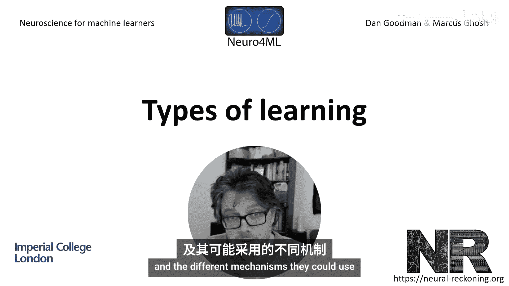
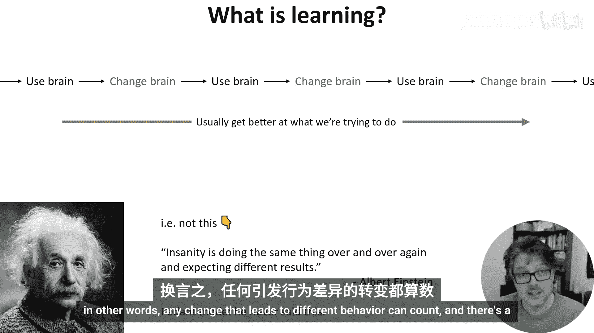
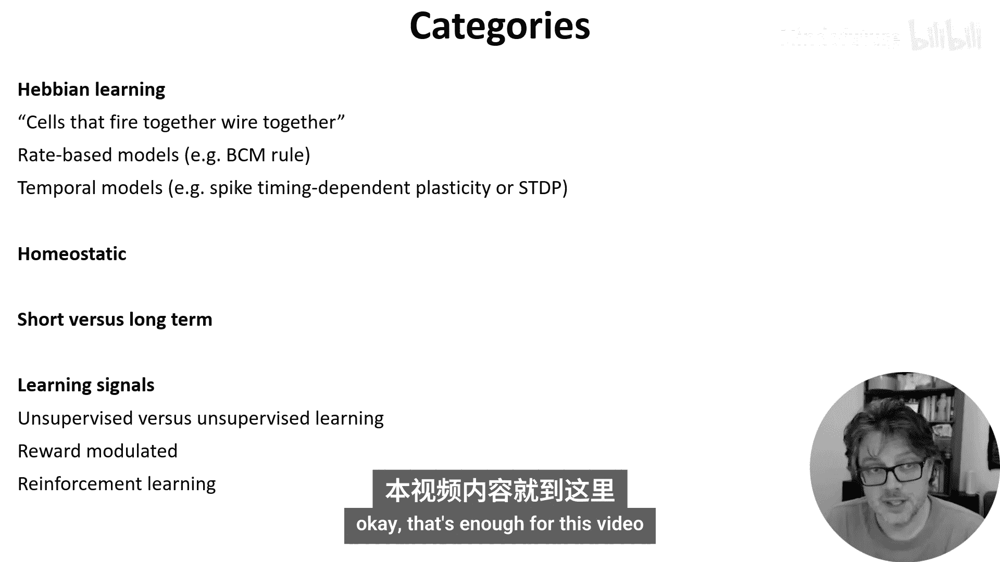

# 机器学习人员的神经科学 ｜ Neuroscience For Machine Learners p19 P19_W4_V0-Types_of_learning -BV1MiawzJExR_p19-

This week's videos are about learning。How it happens in the brain。

 what models we have of that and how those models relate to algorithms from machine learning。

Before we get into the details， let's start with an overview of what types of learning there are and the different mechanisms they could use。

Atractly， what do we mean by learning something like any change to behaviour in the face of experience。

 in other words。Any change that leads to different behavior can count。

 And there's a lot of things we can change in our brains。

In principle， anything that modifies our behavior could be a component of learning。😊。

We're all familiar with the idea of modifying synaptic weights to change the function of a neural network。

 That's usually what's meant by learning in a machine learning context。😊。

Although there are some other things we can do with synapses too， we can add or remove synapses。

 which is sometimes referred to as structural plasticity or wiring plasticity。

Close to what you might call architecture search in ML。And in principle。

 we might learn by changing any other aspect of a synapse， for example， it time constants。

We could also learn by changing other properties of a neuron。

 and we could modify its input gain its threshold or resting potential。

 and these could be considered similar to changing weights and biases in Ml。

We can change the dynamics of the neuron and the way it integrates information by altering the distribution of ion channels across the cell membrane or even its shape。

Another key thing that changes the behaviour of a neuron is the nature of its inputs。

 including the background activity of the network。Learning or memory doesn't have to be stored in permanent changes to the structure of the neuro or synapses。

Zero shot learning in language models using the context of the query could be thought of as fitting this button。

In neuroscience， working memory the things you hold temporarily in your brain in order to solve a task。

A commonly held theory is that this is implemented by persistent patterns of activity in the brain and not by any permanent change。

Taking that further， the exact chemical composition of the extracellular regions of the brain changes the way neurons behave。

😊，Neuromodulators are diffuse chemicals that change the function of ion channels and can be used by the brain to change the behaviour of a large group of neurons。

You've probably heard of dopamine， for example。😊，The brain could also choose to make more or less energy available。

 And by our behaviour， we can directly change this chemical composition。 For example。

 by drinking coffee when we're tired。Let's quickly look at some of the categories we need to keep in mind when discussing learning in the next few videos。

😊，One of the most important ideas is heavy and learning。 that's what we've seen before。

This is often summarized as cells that fire together， wire together。

 and this can be seen as encouraging associative or causal connections in the brain。😊。

One way to model this is with a family of rate based models that use correlations in the firing rates of pre and post synapptic neurons。

Alternatively， we can take timing of individual spikes into account， as in spike timing。

 dependent plasticity or SDDP。If we're thinking about ways the brain changes。

 then thinking about homeostasis is important。 This is the process by which our body or brain keeps itself in a sort of balance。

If some neurons are firing too much， then synapses might get weaker or thresholds might go up to reduce activity。

It's also important to distinguish between short and long term changes like the difference between changes in activity and permanent changes to the structure of synapses and neurons。

Finally， we should think about the signals available for learning as in machine learning we can distinguish between unsupervised and supervised forms of learning。

😊，Supervised learning in the way meant machine learning might be sort of rare in the brain in that there's no magic。

 You've got a right signal coming externally。 Instead。

 we might think about various forms of self supervised learning where one part of the brain gives feedback to another part。

😊，One example would be rewards。 if you do an action and get a nice sugar treat to do reward。

 that's a signal the brain can make use of。And of course。

 this addition into ideas around reinforcement learning。Okay， that's enough for this video。

 let's get some stuck into some equations in the next videos。😊。

