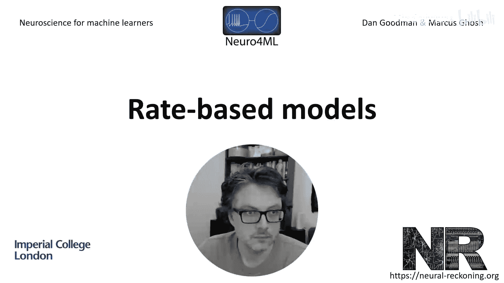
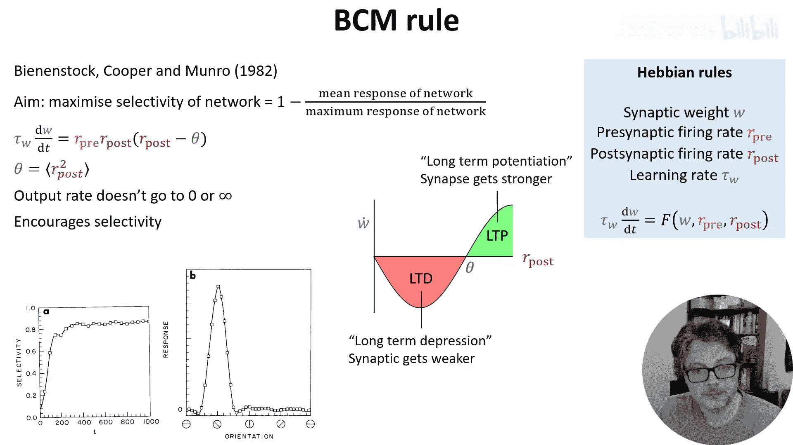
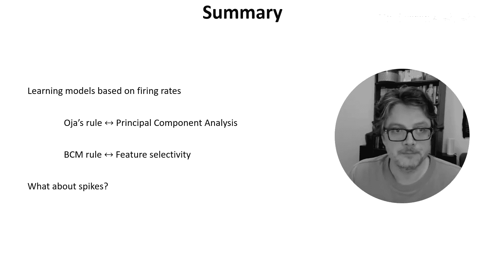

# 机器学习人员的神经科学 ｜ Neuroscience For Machine Learners p20 P20_W4_V1-Rate_based_models -BV1MiawzJExR_p20-

In this video， we'll talk about rate based heavyian models of learning。

We're only going to discuss learning of a synaptic weight W in response to a preynaptic neuron firing spikes at a rate RP and a postscyynaptic neuron firing at a rate R post。

We're going to model this with a differential equation saying that the weight changes at a rate tau W proportion it to some function F of the weight and the pre and postcyaptic firing rates。

So different functions F are going to give you different models。But that's all quite abstract。

 So let's take a look at a concrete example。 We're going to choose the function F to be the product of the pre and the post synaptic firing rates。

 so that W just grows in proportion to the correlation between the firing rates。

This clearly satisfies the idea of cells that fire together， wire together。

 The weight grows at the fastest rate when both pre and post synaptic firing rates are high simultaneously。

But we can already see a problem with this。 There's no reason for the weight to stop growing。

 It will just keep getting bigger and bigger。 And this actually turns out to be an issue with a lot of learning rules。

 And we'll keep coming back to it。One solution is to have a hard bound。

 just clip W at some maximum value。Another solution is a soft bound。

 which just reduces the rate of change of the weight as you get close to the maximum value。

 And there's various ways you can do that。 And this is this equation here is just one example。

Another problem is that in this simple formulation， the weight will only grow。

 never get smaller because the。Pre and the post synaptic firing rates are always positive numbers。

And it is possible to fix this by adding another term。

 but let's move on to another model and see how that deals with this issue。

So Oya's learning role was designed to solve the problem of the rates growing withoutbound。

You take the standard heian rule， and you subtract off a term proportionate to the product of the weight and the square of the post synmantic firing rate。

In other words， after growing for a while， the weights will stop changing。

And this has two nice properties。The first is that， as we hope for， the weights don't keep growing。

The second is more surprising。This learning rule extracts the first principal component of its inputs。

A link between a biological learning role and a statistical or machine learning algorithm。

 principal component analysis。In the next slide I'm going to show you how to prove this and it gets a bit hairy。

 so to keep things a bit simpler， we'll make a couple of not quite right assumptions。😊。

We're going to look at the case of a vector of inputs X and a linear output in your own Y。

So we can write Y as the dot product of the weight and the inputs。

We'll assume that vector x represents the pre synaptic firing rates。

 but we're also going to assume it has mean value 0。This won't change the result。

 but it makes the analysis simpler。With these assumptions。

 we can rewrite the learning rules like this， using a dot above the W to indicate a derivative and replacing one over the time constant with gamma。

Okay， now let's get into the Harry mathematical analysis。

 you might want to pause and work through this on a piece of paper as we go。

We're going to start with the same setup before with a vector of inputs and a single output。

The rate of change of the weight follows this equation。And the output， this equation。

Note that since Y is a scalar， the dot product of the weight W and the input X。

 we can write W transpose x， or we can write x transpose W。

We're interested in the fixed point after a long period of time when no more learning is happening。

 In other words， when， on average， the rate of change of W is 0。

And I'm going to use these angle brackets to mean that average。Expanding out W dot。

 we get this equation。Replacing Y with either X transpose or W transpose X。

 and you get this and you'll see why I did this in a minute。

So the first thing to note is that the mean of xx transpose is C， the covariance matrix of x。

Using this， we can rewrite the equation above like this。Now。Since W Transpo C，W。

Is a scalar that's this part here。Which we'll call Lambda。 This equation becomes Cw equals lambda W。

But this means that lambda is an eigenvalue of C， and W is an eigenvector。

And this is exactly the definition of W being a principal component。In fact。

 you can show that O rule will always converge the first principle component。

 but that analysis is more complicated。Because we get this fixed point of W。

 we know that W doesn't grow without bounds， and we can actually show a bit more than that by computing the fixed point of the norm of W。

Weet its derivative to 0。 And by expanding the out in components。

 we can see that this is W transpose times the derivative O W。

Expanding the result using the formula we calculated above， we get a second Lada term appearing。

 and this simplifies to lambda times 1 minus the norm of W。Now， for this to be 0。

 the norm of the weights must equal 1。In other words。O as rule gives us weight normalization。

 It always can purchase to some fixed value of the norm of W。

So we've seen the Os rule keeps weights bounded and leads to a neuron learning principal components。

Another approach is the BM rule named after B instock Cooper and Muroe。

Their aim was a model of the development of selectivity in the visual cortex。

 and so they set out to find a learning rule that maximizes selectivity。😊。

They define this as1 minus the mean response of the network divided by the maximum。In other words。

 for high selectivity， overall， the network should respond very little， but for certain inputs。

 it should have a very strong response。Their rule multiplies the simple Heian rule from before with a term that can be positive or negative。

It's positive if the postynaptic firing rate is high and negative， if it's low。

High and low are controlled by a threshold，This means that synapses can get stronger or weaker。

The intuition here is that it promotes selectivity because those inputs that cause a high firing rate will be driven even higher。

 and those with a low firing rate， even lower。However。

 you can already see that if theatre is just a constant。

 there's nothing to stop this from blowing up。 Once the synaptic firing rate goes above the。

 it'll just keep growing without bounds。So they made theta into a dynamic variable that averages the square of the postsynaptic firing rate。

If you imagine a learning environment where different inputs are constantly being presented。

 you can imagine this either as a running average over time or as a running average over the whole dataset。

Now， if our post gets too large， the threshold will increase。

This threshold will increase and the sign of the weight change will switch to negative and the synapse will start to weaken。

Similarly， if our post gets too small， it will strengthen it。

 So the output rate shouldn't go to 0 or to infinity。

It also encourages selectivity because if our post is equal to theater。😊，In other words。

 if you're here。Which is what would happen if all the different inputs LED to the same output。

 I if the selectivity T was 0。So you'd be at this fixed point。

And it would be unstable because of slight perturbation， for example。

 increasing it would increase the weights。 A slight pertuation that would decrease。

 It would start decreasing the weights。So in other words。

 any perturbation would push you away from that fixed point。

So what this rule is doing is making sure that you don't settle in a fixed point where the selectivity is low。

You can think about what's going on here by imagining that at the start of the learning。

 the output firing rate is low for all inputs。😊，But it's going to be higher for some than for others。

Now， the threshold will lower until one of the inputs gives a rate。Above the threshold。At that point。

 the weights that respond to this input will get stronger and stronger。And this ink will increase。

 This increase in the firing rate will cause the threshold to start increasing， as well。

And so the weights corresponding to all of the other inputs will start to decrease。

And the network will end up selecting selective to just that one preferred input。And sure enough。

 you can see that this is happening in their model of orientation， selectivity in the visual cortex。

Over time， the selectivity of the networks increases and the end result is a network with a strong preference for just one particular orientation。

And this qualitatively matches what happens in development。Incidentally。

 you might wonder why do we take the square of the firing rate。

 while the exact choice of taking the square isn't essential。

 It's only important that it be in London and we're not going to go into the reasons why thats important。

Alright， so we've seen how HeB's principle can be translated into learning models based on firing rates and that this can generate quite interesting computational properties。

 like doing principal component analysis or developing feature selectivity。However。

 it misses an important feature， which is the timing of spikes。

 and we're going to turn to that in the next video。😊。

